# Parcours A-Z : une année de l'institut, du paramétrage à la clôture

Ce guide sert à **vérifier à la main, d'un seul fil, que l'application tient une année complète** : on prépare l'année, on inscrit quatre étudiants, on encaisse, on contrôle, on enregistre un abandon, on passe à l'année suivante, on encaisse sans Internet, puis on clôture. Peu de données (5 étudiants), chaque étape s'appuie sur la précédente, et on peut le refaire autant de fois qu'on veut.

- **Durée** : 45 minutes à 1 heure (une cinquantaine d'étapes, la plupart de quelques secondes).
- **Ce que ce guide ne fait pas** : la connexion et la création de comptes (les deux comptes du seed suffisent), et les refus détaillés, déjà couverts par les scénarios UC01 à UC15. Seuls deux refus sont gardés : le trop-perçu (3.6) et le secrétariat qui ne peut pas annuler (4.1).
- **Rejoué par l'agent de recette** sur le build, de bout en bout, le 25/10/2026 : les 9 actes passent (voir [le rapport](rapports/RAPPORT_2026-10-25_PARCOURS-AZ.md)). Les matricules, numéros de reçu et montants ci-dessous sont ceux qu'il a obtenus.

## Repartir de zéro

1. Arrêter `pnpm dev` s'il tourne, puis dans le dossier du projet : `pnpm parcours:vider --confirmer`. Cela vide la base de dev (années, tarifs, étudiants, paiements, compteurs à zéro) et garde les comptes, les filières IF et SF et l'établissement. Une sauvegarde est faite dans `data/sauvegardes/`.
2. `pnpm dev`, puis ouvrir <http://localhost:3100>.
3. **Vider les données du site dans le navigateur**, sinon l'ancien poste d'encaissement (copie hors ligne, numéros de reçu réservés) reste en mémoire : dans Chrome, cliquer le cadenas à gauche de l'adresse, **Paramètres du site**, **Effacer les données**. À faire avant chaque nouvelle tentative.
4. **Deux navigateurs, pour ne pas se reconnecter sans cesse** : une fenêtre normale pour le **secrétariat**, une fenêtre de **navigation privée** pour l'**administrateur**. Le poste d'encaissement (acte 3 et acte 8) doit rester dans la fenêtre normale.
5. Les deux comptes, créés par le seed (identifiants dans `.env`) :
   - **Administrateur** : `SEED_ADMIN_*`, affiché « Administrateur IFSPA » en bas de la barre latérale.
   - **Secrétariat** : `SEED_USER_*`, affiché « Hanitra RAKOTO ».
6. **Acte 8 seulement** : l'encaissement sans Internet ne marche pas avec `pnpm dev` (le service worker n'existe qu'en version construite). À ce moment : arrêter `pnpm dev`, lancer `pnpm build` puis `pnpm start` (même adresse, même base), faire l'acte 8, puis continuer l'acte 9 sur ce même serveur.

> **Si vous rejouez à partir du 1er novembre 2026.** L'application calcule les retards avec la vraie date du jour : une échéance du mois M est « en retard » à partir du 1er du mois M+1. Ce guide a été écrit le 25/10/2026 ; l'année **2025-2026** est entièrement échue, donc rien ne change pour les actes 1 à 5. Pour **2026-2027**, **octobre 2026 devient « En retard »** : la tranche de droits d'octobre et la mensualité d'octobre 2026 comptent alors dans les retards. Concrètement :
> - Aux étapes 6.6, 6.7, 7.1 : « Aucun retard » devient un montant en retard (par exemple 195 000 Ar pour A, 180 000 Ar pour E) ; le « Reste à payer » total ne change pas.
> - À l'étape 7.2, le « dont … en retard » de B passe de 600 000 Ar à 723 000 Ar ; le paiement de 100 000 Ar tapé à la main donne le même résultat (décembre 2025 d'abord).
> - À l'étape 9.3, le tableau de bord de 2026-2027 n'affiche plus « Rien n'est encore échu » : il compte les 4 étudiants en retard.
> - La liste des Impayés (si on la rouvre après l'acte 6) contient alors aussi A, B, D et E.
>
> Les dates affichées (« Aujourd'hui, 25/10/2026 », heures des reçus) sont celles du jour où vous rejouez.

## Les cinq étudiants

| | Nom | Filière | Droits | Ce qui lui arrive |
|---|---|---|---|---|
| A | RAKOTOMALALA Voahirana | Infirmier(e)s (IF) | en 1 fois | paie tout en espèces, passe en 2e année |
| B | RASOANAIVO Fanja | Infirmier(e)s (IF) | en 3 fois | paie en partie en Mobile Money, passe en 2e année |
| C | RAZAFINDRAKOTO Mialy | Sage-femmes (SF) | en 1 fois | ne paie rien, abandonne |
| D | ANDRIANARISOA Tiana | Infirmier(e)s (IF) | en 1 fois | paie un peu, redouble |
| E | RAKOTOARISOA Nirina | Infirmier(e)s (IF) | en 1 fois | nouvel étudiant de 2026-2027 |

Tarifs 2025-2026 : IF 100 000 Ar de droits + 10 x 80 000 Ar (900 000 Ar) ; SF 120 000 Ar + 10 x 90 000 Ar (1 020 000 Ar).

---

## Acte 1. Préparer l'année 2025-2026

**Objectif :** vérifier qu'à partir d'une base vide, l'administrateur peut créer une année, saisir ses tarifs et la rendre courante.

Compte : **administrateur** (fenêtre privée).

| # | Qui | Action | Résultat attendu | Capture | ✓ |
|---|---|---|---|---|---|
| 1.1 | Administrateur | Menu **Paramètres**, onglet **Années scolaires**. | « Aucune année scolaire. Créez la première pour pouvoir saisir les tarifs et inscrire des étudiants. » Bouton **Nouvelle année**. « Administrateur IFSPA » en bas de la barre latérale. | 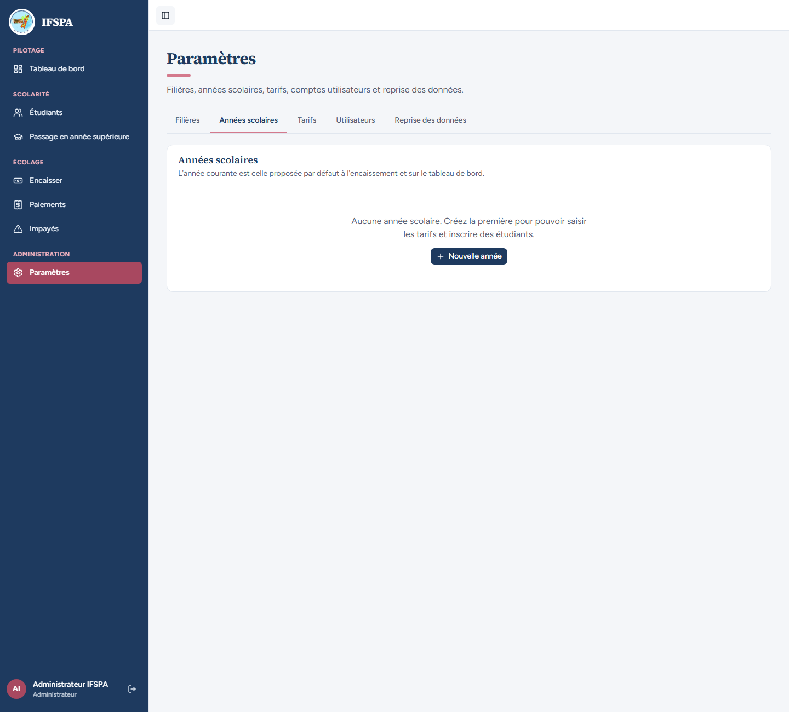 | |
| 1.2 | Administrateur | Cliquer **Nouvelle année**. Saisir `2025` dans « Année de début » (laisser octobre). | Aperçu : « Année 2025-2026 : mensualités de octobre 2025 → juillet 2026. » | 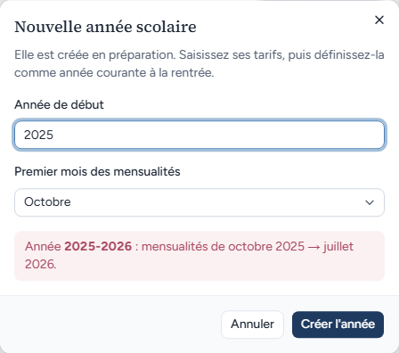 | |
| 1.3 | Administrateur | Cliquer **Créer l'année**. | « Année 2025-2026 créée, en préparation. Saisissez maintenant ses tarifs. » La ligne 2025-2026 apparaît avec **Tarifs**. | 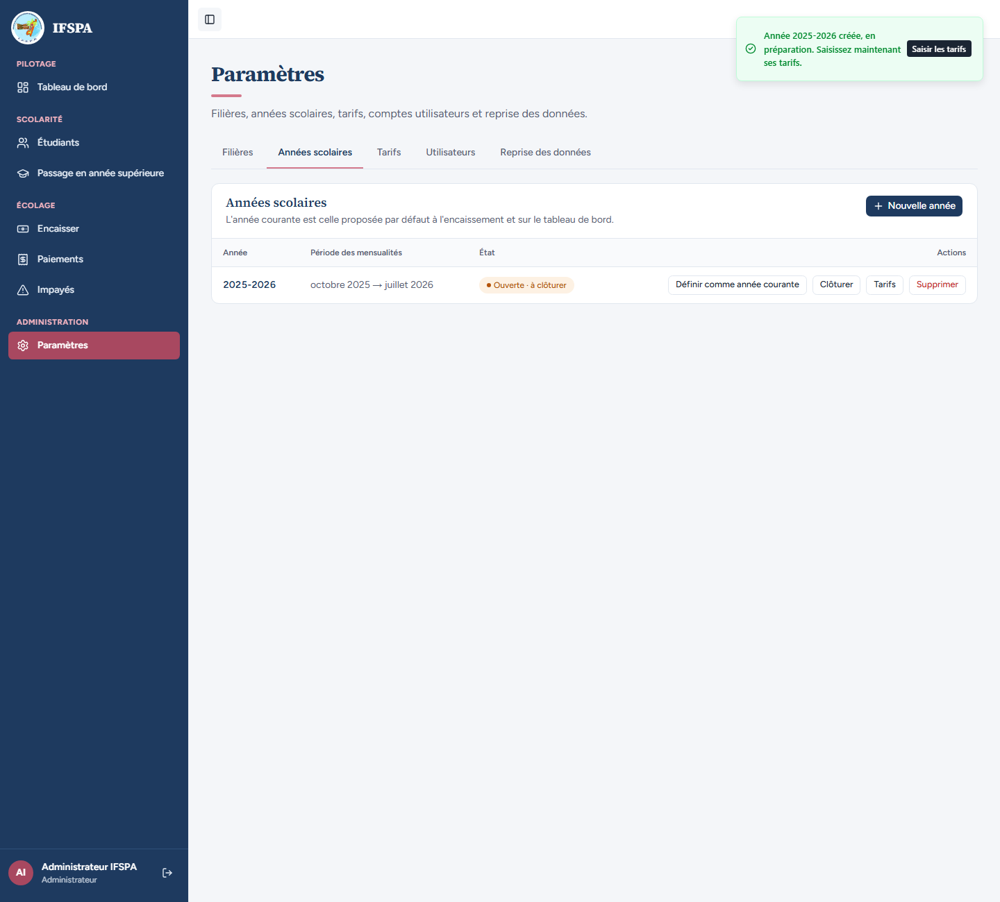 | |
| 1.4 | Administrateur | Cliquer **Tarifs** sur la ligne 2025-2026. Pour **IF 1re année** : droits `100 000`, mensualité `80 000`. Pour **SF 1re année** : droits `120 000`, mensualité `90 000`. Laisser « Nombre de mois » à 10. | « 2 classes modifiées, pas encore enregistrées. » Total annuel **900 000 Ar** (IF) et **1 020 000 Ar** (SF). | 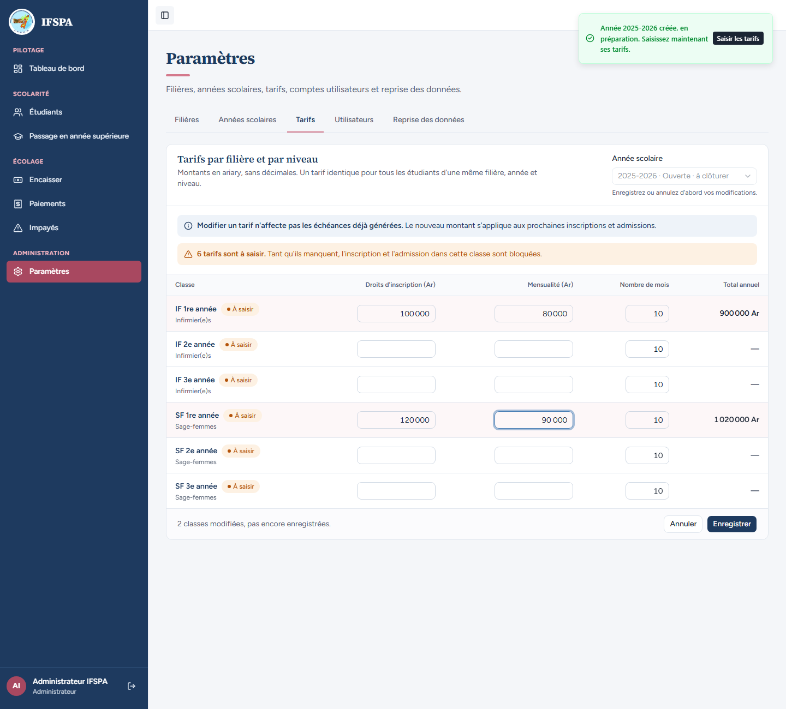 | |
| 1.5 | Administrateur | Cliquer **Enregistrer**, puis recharger la page. | Les montants sont conservés ; « 4 tarifs sont à saisir » (les autres classes, sans importance ici). | 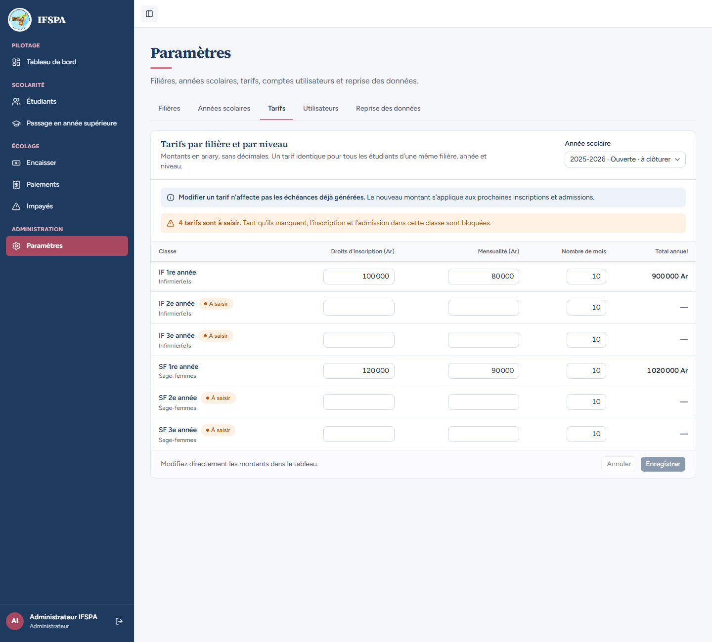 | |
| 1.6 | Administrateur | Revenir à **Années scolaires**, cliquer **Définir comme année courante** sur 2025-2026, confirmer avec **Définir comme année courante**. | Fenêtre « Définir 2025-2026 comme année courante ? », puis « 2025-2026 est désormais l'année courante. » La ligne porte « Année courante », état « En cours ». | 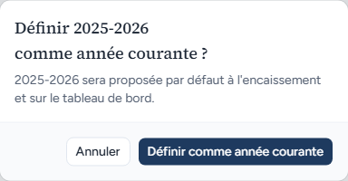 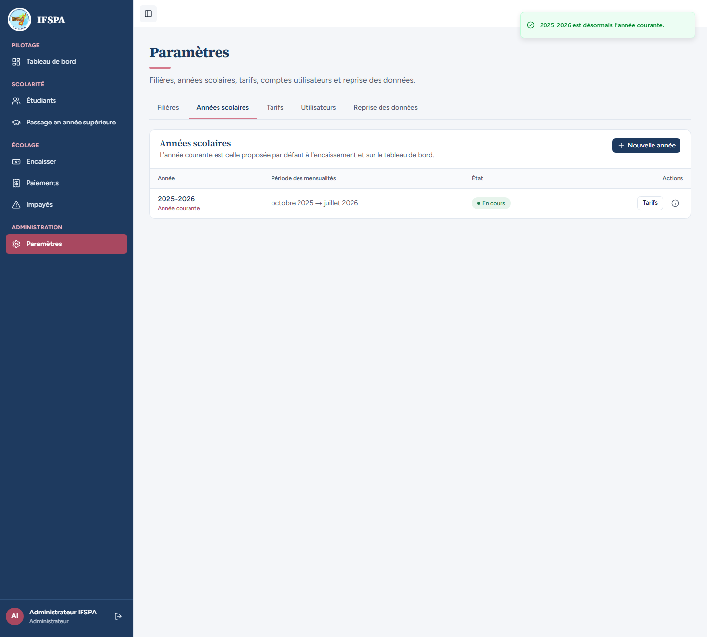 | |

---

## Acte 2. Inscrire quatre étudiants

**Objectif :** vérifier que l'inscription génère le matricule et l'échéancier de l'année, avec les droits en 1 ou en 3 fois, et que tout est en retard puisque 2025-2026 est échue.

Compte : **secrétariat** (fenêtre normale). Inscrire **dans cet ordre** : les matricules en dépendent. Pour chacun : menu **Étudiants**, bouton **Nouvel étudiant**, remplir, **Inscrire l'étudiant**. Laisser « 1re année ».

| # | Qui | Action | Résultat attendu | Capture | ✓ |
|---|---|---|---|---|---|
| 2.1 | Secrétariat | Inscrire **A** : nom `RAKOTOMALALA`, prénoms `Voahirana`, Féminin, né(e) le `14/03/2005` à `Toamasina`, tél. `034 00 000 01`, adresse `Lot II B 12, Tanambao V, Toamasina`, filière **Infirmier(e)s**, droits **En 1 fois**. | Récapitulatif : matricule indicatif **IF-2025-0001**, total **900 000 Ar**. Après envoi : « Étudiant inscrit sous le matricule IF-2025-0001 ». Reste à payer **900 000 Ar**, dont en retard **900 000 Ar**. « Hanitra RAKOTO » en bas de la barre latérale. | 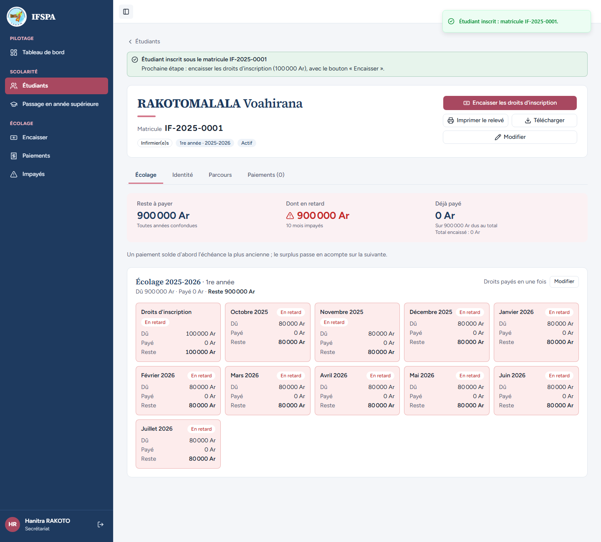 | |
| 2.2 | Secrétariat | Remplir **B** : `RASOANAIVO`, `Fanja`, Féminin, `02/11/2004`, `Brickaville`, `034 00 000 02`, `Lot 45, Ampasimazava, Toamasina`, **Infirmier(e)s**, droits **En 3 fois**. Ne pas encore envoyer. | Matricule indicatif **IF-2025-0002**. Récapitulatif : droits 1/3 octobre **34 000 Ar**, 2/3 novembre **33 000 Ar**, 3/3 décembre **33 000 Ar**, puis 10 mensualités de 80 000 Ar : total **900 000 Ar**. | 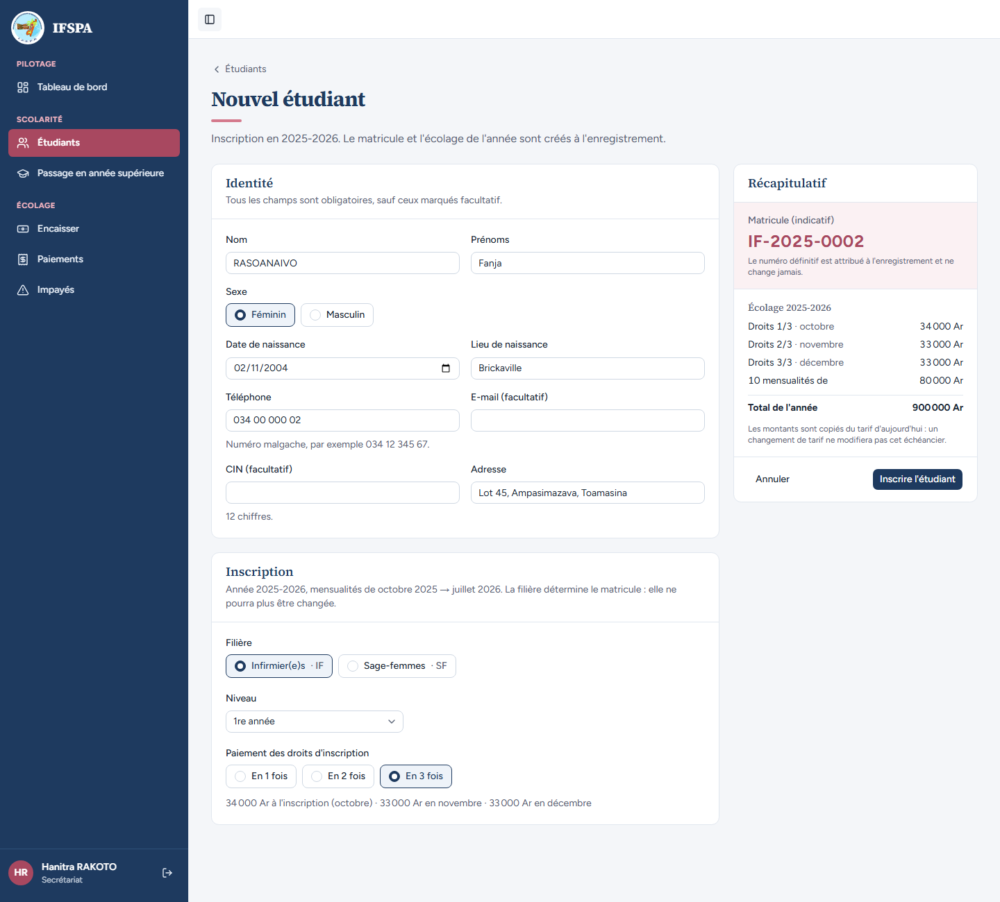 | |
| 2.3 | Secrétariat | Cliquer **Inscrire l'étudiant**. | « Étudiant inscrit sous le matricule IF-2025-0002 ». La grille montre « Droits — tranche 1/3 », « 2/3 », « 3/3 » entre les mensualités ; « Droits payés en 3 fois ». Reste à payer **900 000 Ar**. | 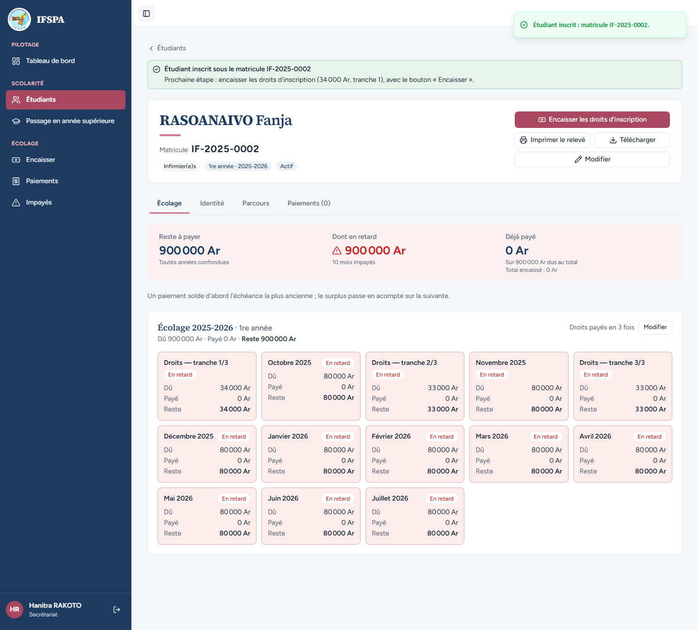 | |
| 2.4 | Secrétariat | Inscrire **C** : `RAZAFINDRAKOTO`, `Mialy`, Féminin, `30/01/2005`, `Toamasina`, `034 00 000 03`, `Lot 102, Ankirihiry, Toamasina`, **Sage-femmes**, droits En 1 fois. | Matricule **SF-2025-0001**. Reste à payer **1 020 000 Ar** (120 000 + 10 x 90 000). |  | |
| 2.5 | Secrétariat | Inscrire **D** : `ANDRIANARISOA`, `Tiana`, Masculin, `21/07/2005`, `Fenerive-Est`, `034 00 000 04`, `Lot 8, Morarano, Toamasina`, **Infirmier(e)s**, droits En 1 fois. | Matricule **IF-2025-0003** (la séquence IF continue, SF a la sienne). Reste à payer **900 000 Ar**. |  | |
| 2.6 | Secrétariat | Menu **Étudiants**. | « 4 étudiants inscrits » : IF-2025-0001, IF-2025-0002, SF-2025-0001, IF-2025-0003, chacun « En retard » avec « 10 mois impayés » (900 000 Ar, 1 020 000 Ar pour C). | 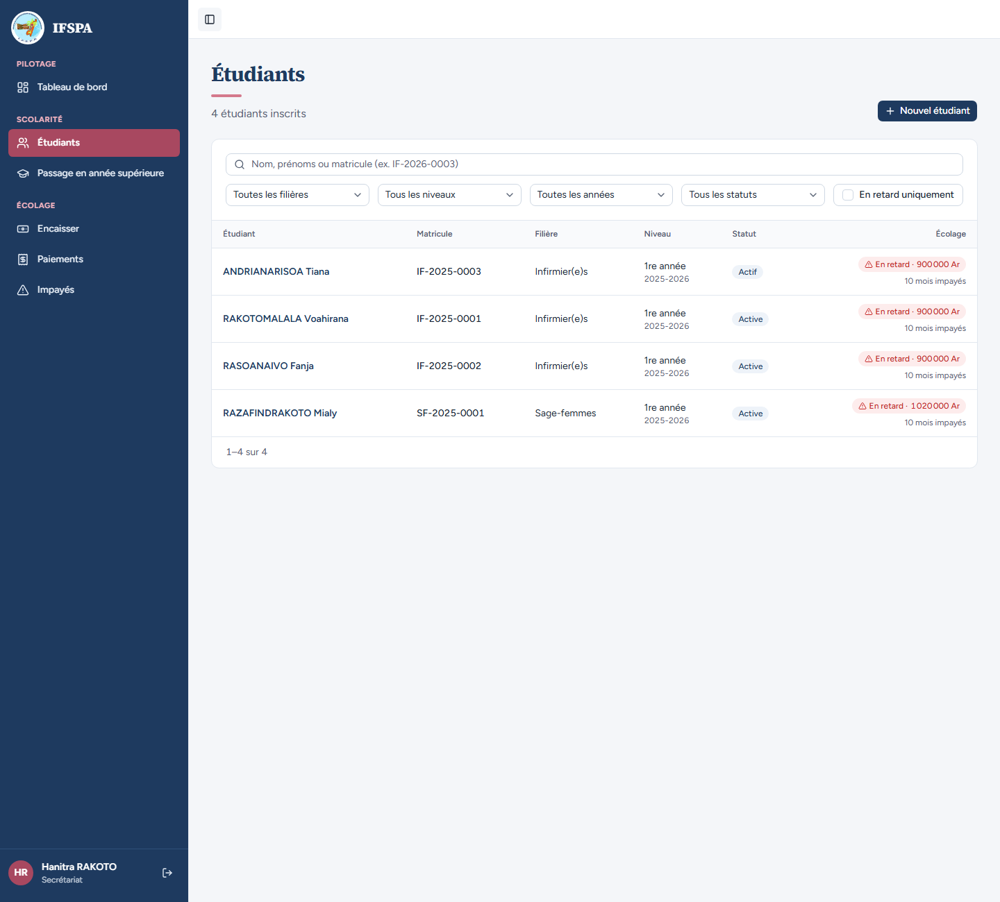 | |

---

## Acte 3. Le guichet

**Objectif :** vérifier qu'un paiement solde les échéances de la plus ancienne à la plus récente, qu'un paiement partiel laisse un acompte sur l'échéance suivante, qu'un trop-perçu est refusé et que le ticket est correct.

Compte : **secrétariat**, menu **Encaisser**. Les numéros de reçu commencent à **R-2026-00021** et non 00001 : l'écran Encaisser réserve 20 numéros (1 à 20) pour le poste dès qu'il s'ouvre, pour l'encaissement sans Internet (acte 8).

| # | Qui | Action | Résultat attendu | Capture | ✓ |
|---|---|---|---|---|---|
| 3.1 | Secrétariat | **Encaisser** : taper `RAKOTOMALALA` dans « Nom, prénoms ou matricule », Entrée. Puis cliquer la dernière carte, **Juillet 2026**. | À l'ouverture : « Reste à payer : 900 000 Ar, dont 900 000 Ar en retard », **aucune case cochée**, « Montant reçu » vide. Après le clic sur Juillet 2026, les 11 échéances se cochent (le cochage suit l'ordre de solde), « Montant reçu » **900 000**, « Ce paiement solde tout ce que l'étudiant doit. » Mode **Espèces** déjà choisi. *(Capture prise avant le 26/10, quand tout était coché d'office : elle montre l'état après le clic.)* | 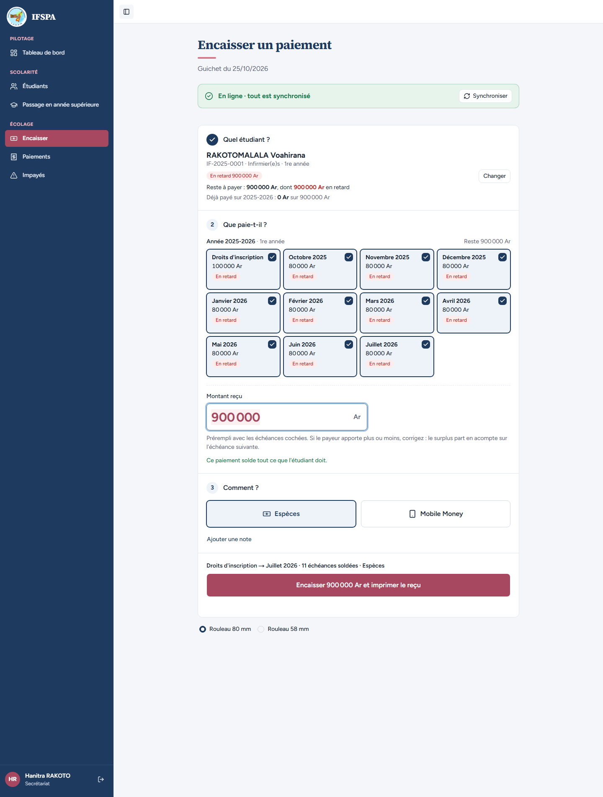 | |
| 3.2 | Secrétariat | Cliquer **Encaisser 900 000 Ar et imprimer le reçu**. | « Paiement enregistré : reçu **R-2026-00021**. » « 900 000 Ar · Espèces · RAKOTOMALALA Voahirana. Reste à payer : 0 Ar. » | 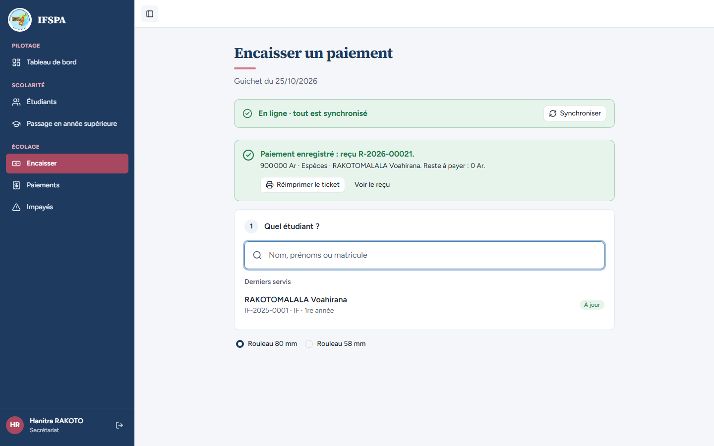 | |
| 3.3 | Secrétariat | Regarder l'aperçu d'impression (puis le fermer, ou cliquer **Réimprimer le ticket**). | **Deux tickets 80 mm** à la suite : le reçu, puis le même avec la mention encadrée « **DOUBLE** » en tête (le double pour l'institut sort toujours). Noir et blanc, sans QR code : N° R-2026-00021, Droits d'inscription 100 000 Ar, Octobre 2025 à Juillet 2026 à 80 000 Ar, **TOTAL 900 000 Ar**, « Arrêté à : neuf cent mille ariary », Mode Espèces, Reste à payer **0 Ar**. | 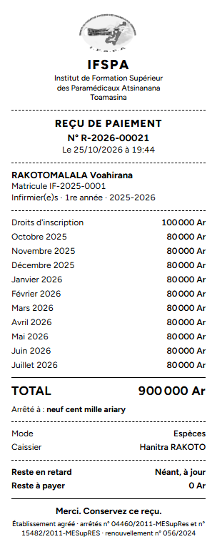 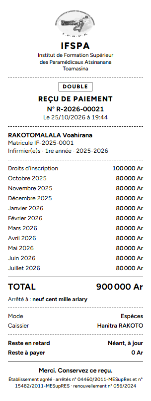 | |
| 3.4 | Secrétariat | **Encaisser**, chercher `RASOANAIVO`, Entrée. Taper `300000` dans « Montant reçu ». Choisir **Mobile Money**, puis **MVola**, saisir la référence `MV261025.0912.B02`. | Sans opérateur ou sans référence le bouton reste grisé. Une fois remplis : « 40 000 Ar d'acompte sur décembre, il restera 40 000 Ar. » ; « Droits — tranche 1/3 → Décembre 2025 · 5 échéances soldées · 1 acompte · Mobile Money MVola » ; « Après ce paiement, il restera 600 000 Ar à payer. » | 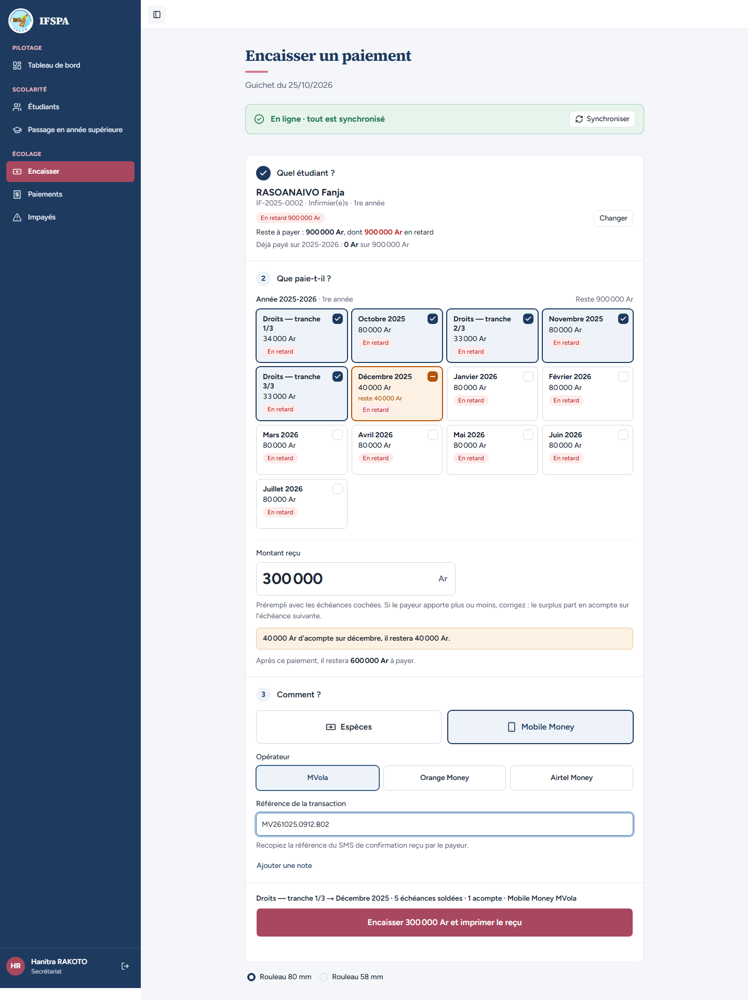 | |
| 3.5 | Secrétariat | Cliquer **Encaisser 300 000 Ar et imprimer le reçu**. | « Paiement enregistré : reçu **R-2026-00022**. » « 300 000 Ar · Mobile Money · RASOANAIVO Fanja. Reste à payer : 600 000 Ar. » (les trois tranches de droits, octobre et novembre sont payés, décembre est à moitié payé). | 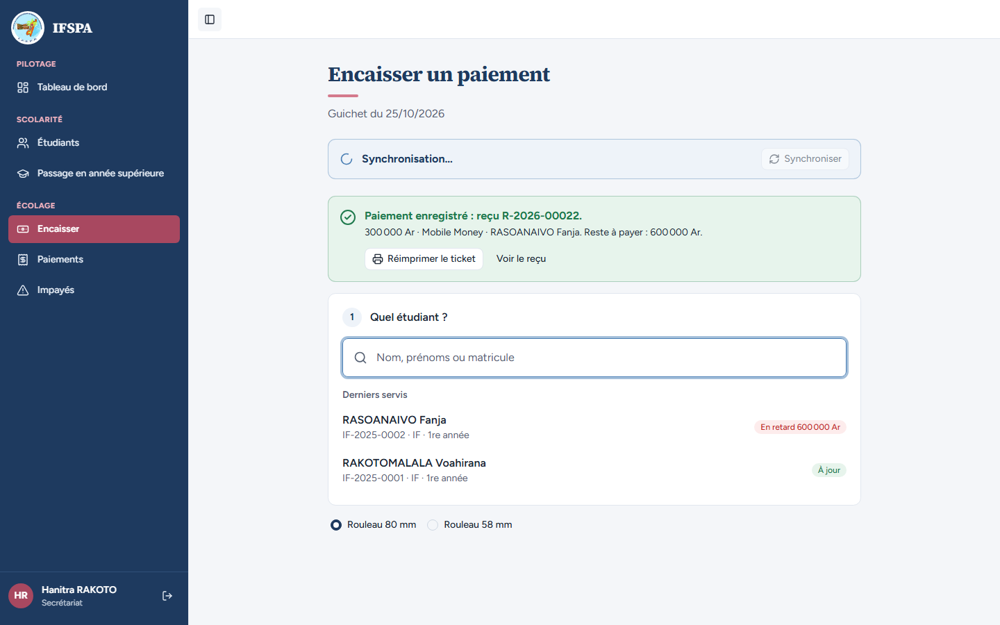 | |
| 3.6 | Secrétariat | **Refus.** **Encaisser**, chercher `RASOANAIVO`, Entrée, taper `1000000` dans « Montant reçu ». | Message rouge : « Le montant dépasse ce que l'étudiant doit encore : 600 000 Ar au plus, toutes années comprises. » Le bouton « Encaisser et imprimer le reçu » est grisé : « Corrigez le montant reçu pour encaisser. » Rien n'est enregistré (le prochain reçu sera le 00023). Ne pas encaisser. | 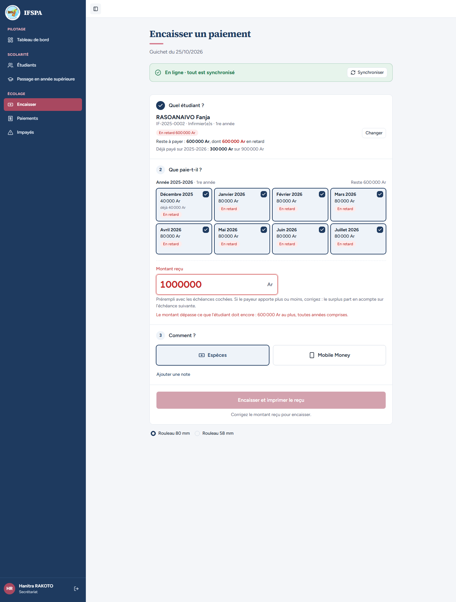 | |
| 3.7 | Secrétariat | **Encaisser**, chercher `ANDRIANARISOA`, Entrée, taper `100000` dans « Montant reçu », **Espèces**, **Encaisser 100 000 Ar et imprimer le reçu**. | « Paiement enregistré : reçu **R-2026-00023**. » « 100 000 Ar · Espèces · ANDRIANARISOA Tiana. Reste à payer : 800 000 Ar. » | 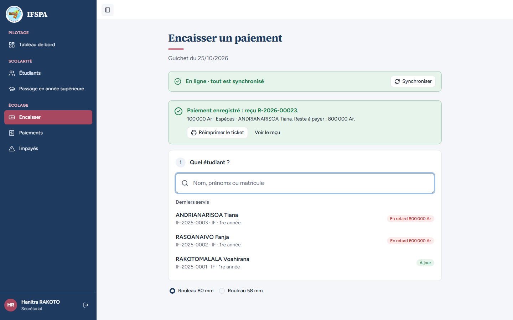 | |
| 3.8 | Secrétariat | **Erreur de saisie volontaire.** **Encaisser**, chercher `ANDRIANARISOA`, Entrée, montant `60000`, **Encaisser 60 000 Ar et imprimer le reçu** (la secrétaire a encaissé sur Tiana l'argent d'un autre parent). | « Paiement enregistré : reçu **R-2026-00024**. » « 60 000 Ar · Espèces · ANDRIANARISOA Tiana. Reste à payer : 740 000 Ar. » Ce reçu sera annulé à l'acte 4. | 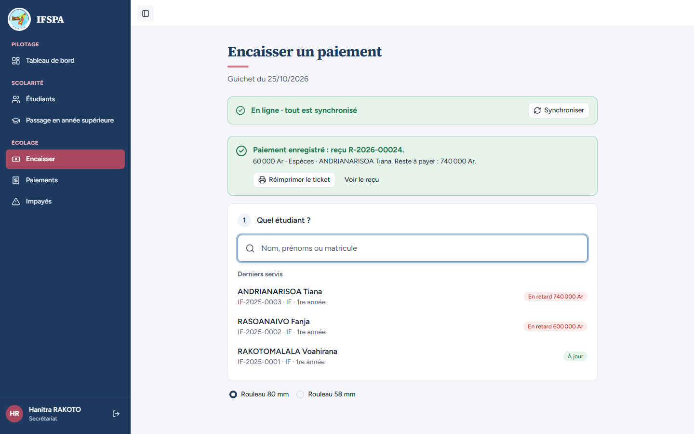 | |

---

## Acte 4. Contrôle par l'administrateur

**Objectif :** vérifier que le secrétariat ne peut pas annuler, que l'administrateur annule avec un motif sans rien supprimer, et que Paiements, Impayés, l'export Excel, le relevé et le tableau de bord disent la même chose.

| # | Qui | Action | Résultat attendu | Capture | ✓ |
|---|---|---|---|---|---|
| 4.1 | Secrétariat | Menu **Paiements**. | « Aujourd'hui » : **4 reçus**, Total encaissé **1 360 000 Ar**, dont espèces **1 060 000 Ar**, dont Mobile Money **300 000 Ar**. Chaque ligne a seulement **Réimprimer** : **aucun bouton « Annuler »** pour le secrétariat. | 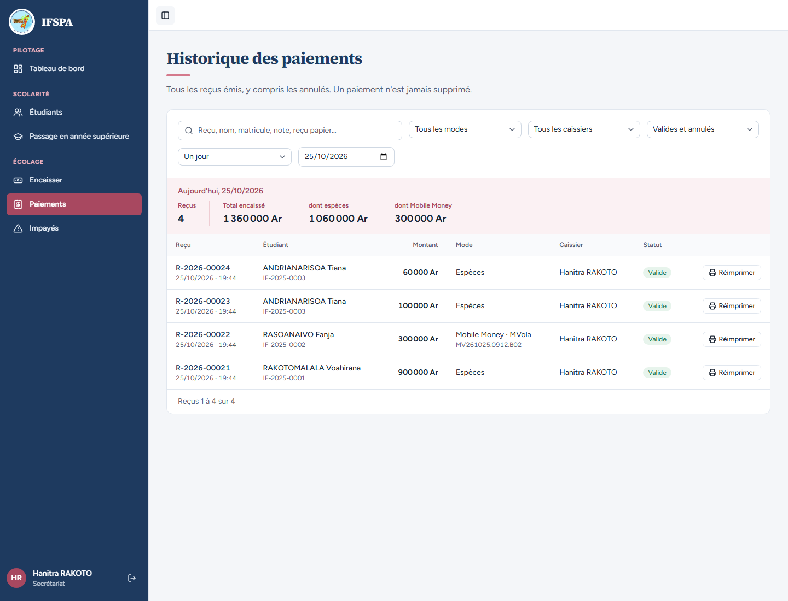 | |
| 4.2 | Administrateur | Se connecter en administrateur (fenêtre privée), menu **Paiements**. Sur la ligne **R-2026-00024**, cliquer **Annuler**. Motif : `Reçu établi au mauvais nom : l'argent n'était pas pour cet étudiant`. | Boutons **Annuler** visibles sur chaque reçu. Fenêtre « Annuler le reçu R-2026-00024 » : ANDRIANARISOA Tiana, « 60 000 Ar · Espèces », « Le reçu reste dans l'historique, marqué ANNULÉ. Les échéances qu'il payait redeviennent dues. » | 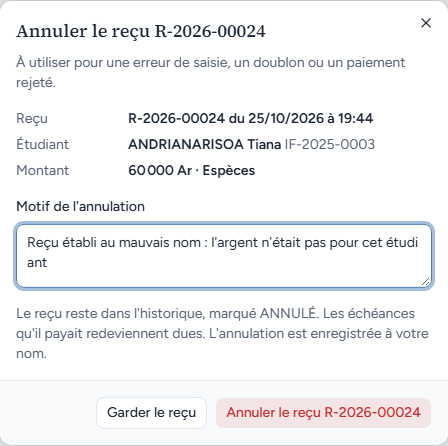 | |
| 4.3 | Administrateur | Cliquer **Annuler le reçu R-2026-00024** dans la fenêtre. | « Reçu R-2026-00024 annulé : les échéances qu'il payait sont de nouveau dues. » La ligne reste, **barrée et marquée « Annulé »**, avec le motif « … — par Administrateur IFSPA le … ». Totaux : **3 reçus + 1 annulé**, Total encaissé **1 300 000 Ar**, dont espèces **1 000 000 Ar**, Mobile Money 300 000 Ar. | 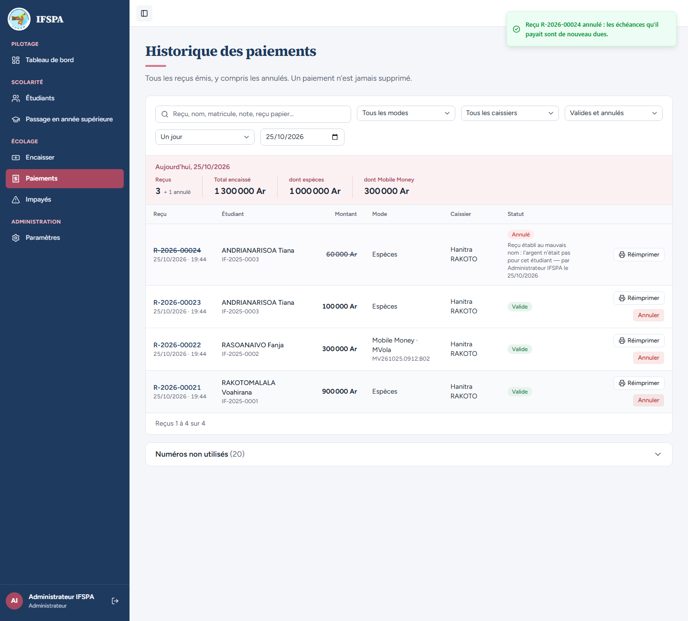 | |
| 4.4 | Administrateur | Menu **Impayés**. | « **3 étudiants en retard** · **2 420 000 Ar** à recouvrer » : RAZAFINDRAKOTO Mialy (10 mois, **1 020 000 Ar**, dernier paiement « Aucun »), ANDRIANARISOA Tiana (10 mois, **800 000 Ar**, dernier paiement 100 000 Ar), RASOANAIVO Fanja (**8 mois**, **600 000 Ar**, dernier paiement 300 000 Ar). **RAKOTOMALALA Voahirana n'y est pas** : elle a tout payé. Tiana est à 800 000 Ar (et non 740 000) parce que le reçu erroné est annulé. | 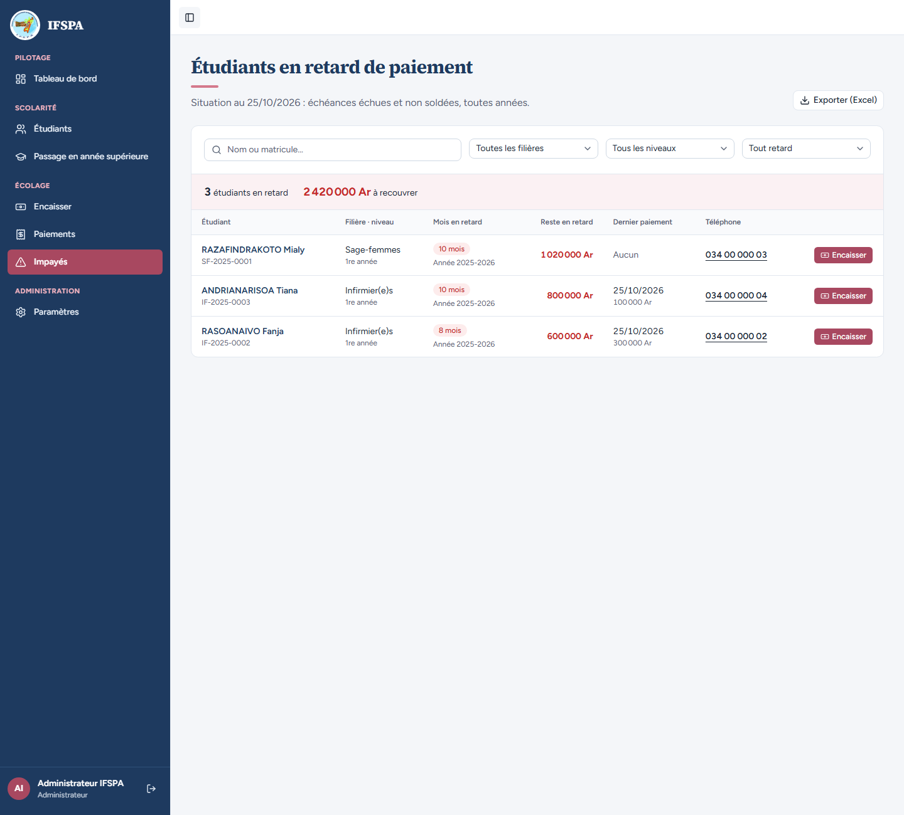 | |
| 4.5 | Administrateur | Cliquer **Exporter (Excel)**, ouvrir le fichier. | Fichier `impayes-AAAA-MM-JJ.xlsx` (date du jour), feuille « Impayés », 3 lignes : SF-2025-0001 (10 mois, 1020000), IF-2025-0003 (10 mois, 800000), IF-2025-0002 (8 mois, 600000), avec téléphone et dernier paiement. | 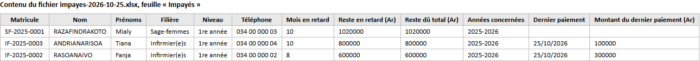 | |
| 4.6 | Administrateur | Menu **Étudiants**, ouvrir **RASOANAIVO Fanja**, cliquer **Télécharger** (relevé). | Fichier `releve-IF-2025-0002.pdf`, **une page A4** « RELEVÉ D'ÉCOLAGE » : droits tranches 1/3, 2/3, 3/3, octobre et novembre « Payé » ; décembre 40 000 Ar payés, 40 000 Ar restants ; janvier à juillet « En retard ». Sous-total 900 000 / 300 000 / 600 000 Ar ; « EN RETARD … 600 000 Ar, 8 mois de retard » ; reçu R-2026-00022, MVola, MV261025.0912.B02, 300 000 Ar. | 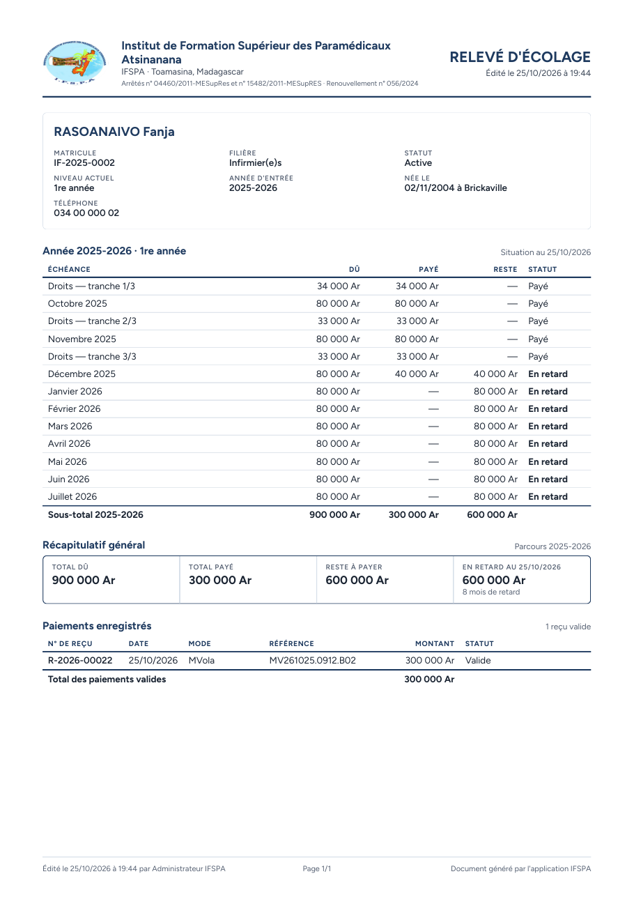 | |
| 4.7 | Administrateur | Menu **Tableau de bord**. | **Effectif actif 4** (3 Infirmier(e)s · 1 Sage-femmes) ; **Taux de recouvrement 34,9 %** « 1 300 000 Ar encaissés sur 3 720 000 Ar attendus à date », « Sous 85 % » ; **Étudiants en retard 3 sur 4**. Tableau filière x niveau : IF 1re année 48,1 %, SF 1re année 0 %, total 34,9 %. Derniers paiements : R-2026-00024 « Annulé » (barré) puis 23, 22, 21 « Valide ». | 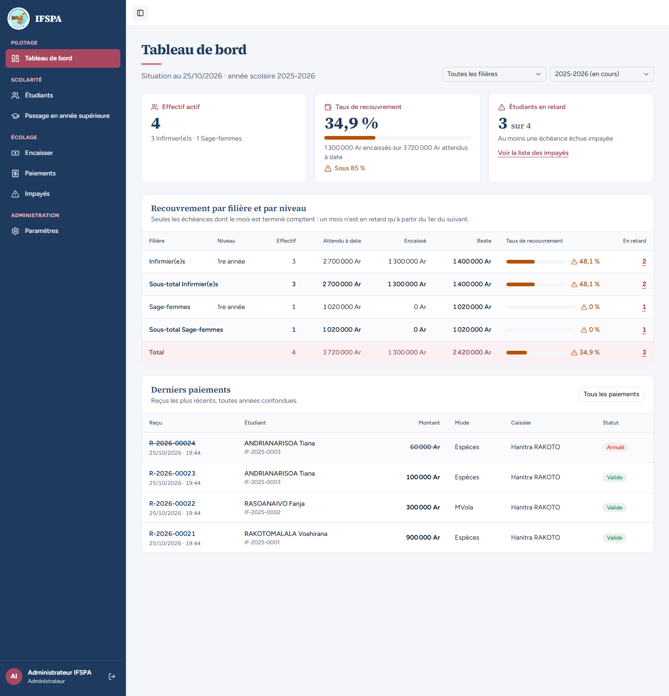 | |

---

## Acte 5. Un abandon

**Objectif :** vérifier qu'un abandon (réservé à l'administrateur) retire les mois suivants du dû, sort l'étudiant des impayés, et reste visible au guichet.

On enregistre l'abandon de C avec la date du **15/12/2025** (une sortie antidatée est permise) : janvier à juillet 2026 ne sont plus dus.

| # | Qui | Action | Résultat attendu | Capture | ✓ |
|---|---|---|---|---|---|
| 5.1 | Administrateur | Menu **Étudiants**, ouvrir **RAZAFINDRAKOTO Mialy**. | Fiche SF-2025-0001, « Actif », reste à payer 1 020 000 Ar. Le bouton **Enregistrer une sortie** est proposé (il n'existe pas pour le secrétariat). | 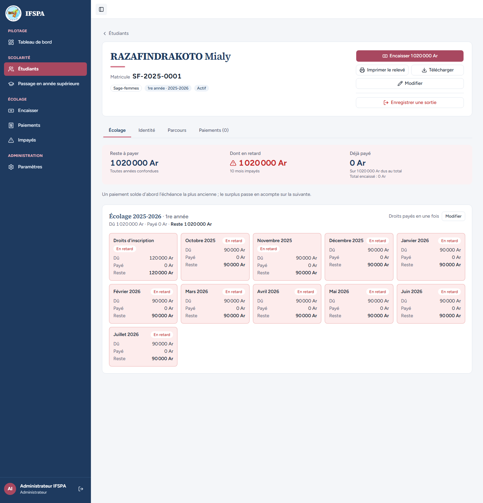 | |
| 5.2 | Administrateur | Cliquer **Enregistrer une sortie**. « Abandon » est coché. Date de sortie `15/12/2025`. Motif : `A quitté l'institut pour raison familiale`. | Avertissement : « Cette sortie est définitive. Les mois après la sortie sans aucun paiement ne seront plus dus. 7 échéances ne seront plus dues (630 000 Ar) ; il restera 390 000 Ar à payer. » | 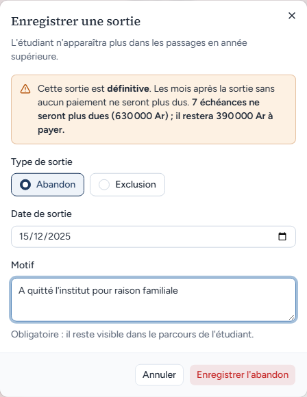 | |
| 5.3 | Administrateur | Cliquer **Enregistrer l'abandon**. | « Abandon enregistré : 7 échéances des mois suivants ne sont plus dues. » Fiche : « Sorti · Abandon le 15/12/2025 », reste à payer **390 000 Ar** (droits + octobre, novembre, décembre), janvier à juillet 2026 « **Non due (sortie)** ». | 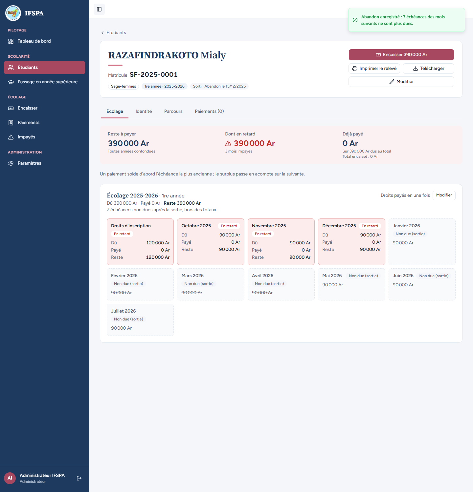 | |
| 5.4 | Administrateur | Menu **Impayés**. | **2 étudiants en retard**, **1 400 000 Ar** à recouvrer : RAZAFINDRAKOTO Mialy n'y figure plus (la liste ne garde que les étudiants actifs). | 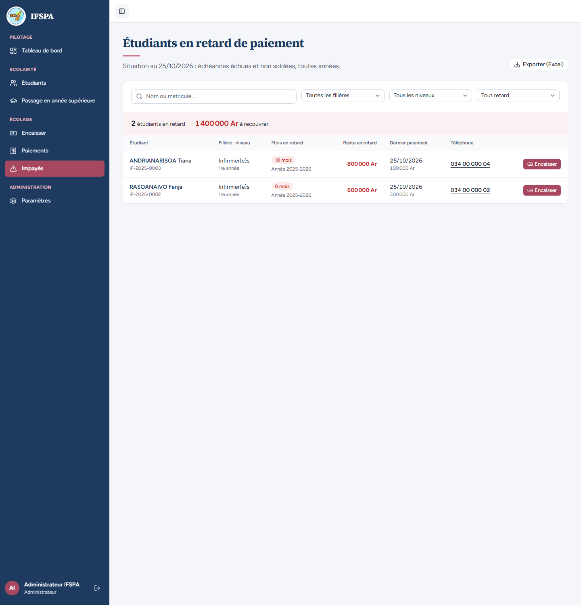 | |
| 5.5 | Secrétariat | **Encaisser**, chercher `RAZAFINDRAKOTO`, Entrée (ne rien encaisser). | Badge « **Sorti · Abandon** », « Reste à payer : 390 000 Ar, dont 390 000 Ar en retard » : un étudiant sorti reste encaissable tant qu'il doit (décision provisoire n° 20). Seuls droits, octobre, novembre et décembre sont proposés. | 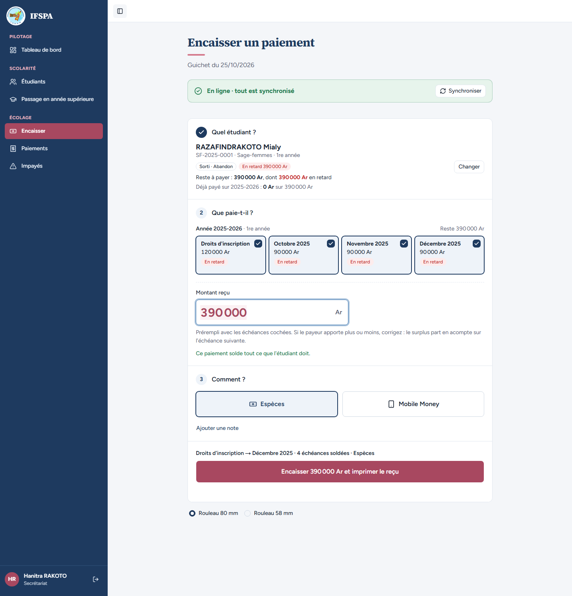 | |

---

## Acte 6. La nouvelle année et le passage

**Objectif :** vérifier que l'administrateur prépare 2026-2027, que le secrétariat fait passer la classe en décidant qui redouble, et que les impayés de 2025-2026 restent dus sur leur année.

| # | Qui | Action | Résultat attendu | Capture | ✓ |
|---|---|---|---|---|---|
| 6.1 | Administrateur | **Paramètres** › **Années scolaires** › **Nouvelle année**, saisir `2026`, **Créer l'année**. | « Année 2026-2027 créée, en préparation. Saisissez maintenant ses tarifs. » (2025-2026 reste l'année courante.) | 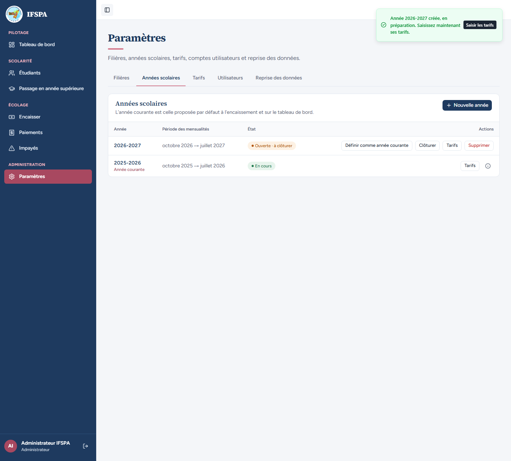 | |
| 6.2 | Administrateur | Cliquer **Tarifs** sur 2026-2027. **IF 1re année** : droits `100 000`, mensualité `80 000`. **IF 2e année** : droits `110 000`, mensualité `85 000`. **Enregistrer**, recharger. | IF 1re année **900 000 Ar**, IF 2e année **960 000 Ar** (le tarif 2e année est requis pour A et B, celui de la 1re pour D qui redouble). | 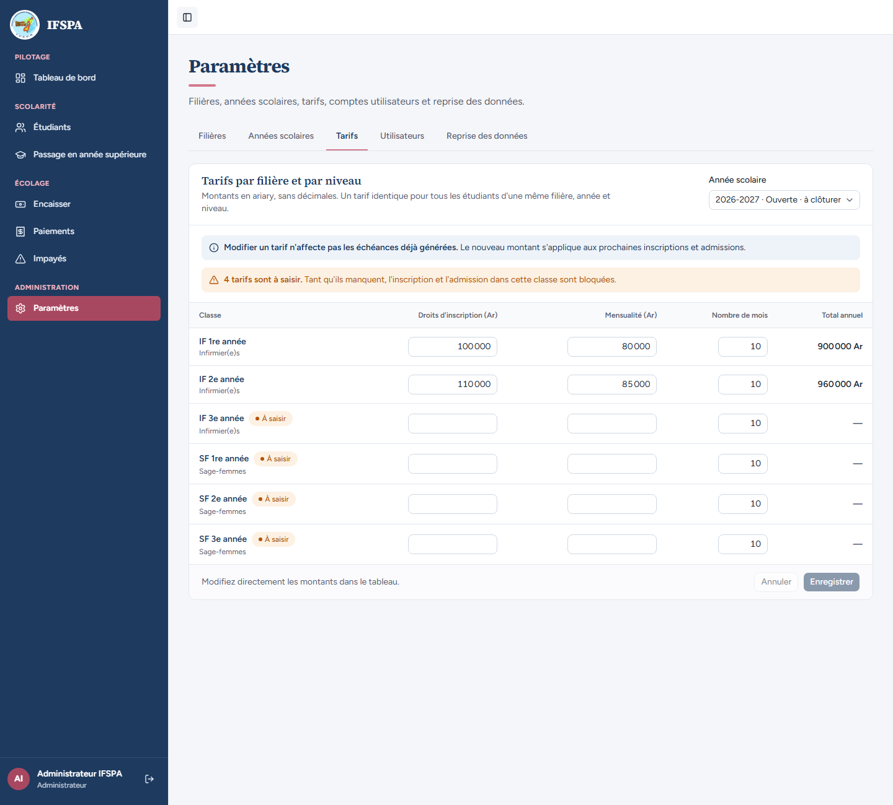 | |
| 6.3 | Secrétariat | Menu **Passage en année supérieure**, classe **Infirmier(e)s 1re année**. | « Fin de l'année 2025-2026 : décidez, classe par classe, qui passe en 2026-2027. » Classe « À faire », **3 étudiants**, tous cochés : ANDRIANARISOA Tiana (800 000 Ar en retard), RAKOTOMALALA Voahirana, RASOANAIVO Fanja (600 000 Ar en retard). Sage-femmes 1re année : « Aucun étudiant » (C est sortie). | 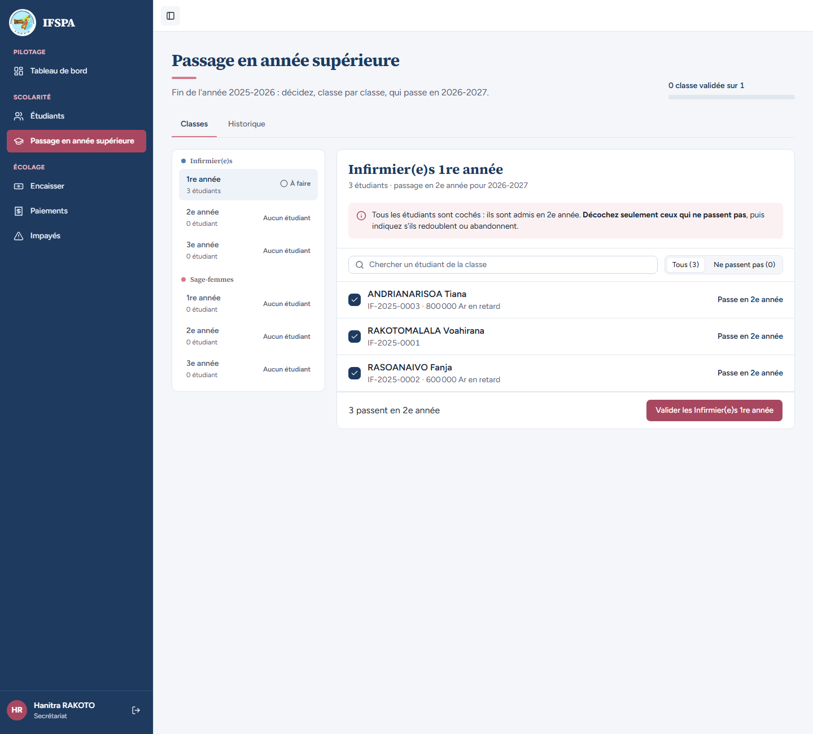 | |
| 6.4 | Secrétariat | Décocher **ANDRIANARISOA Tiana**. | Elle passe en « **Redouble** » (choix « Abandon » possible). En bas : « 2 passent en 2e année · 1 redouble ». | 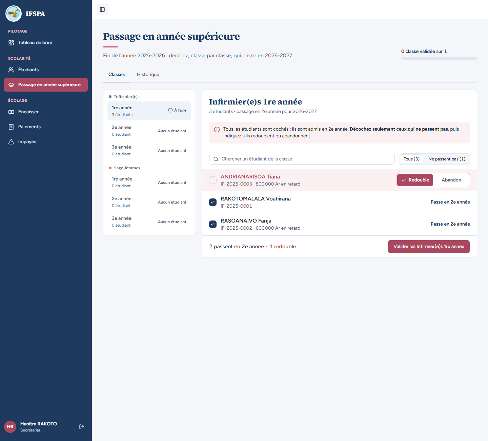 | |
| 6.5 | Secrétariat | Cliquer **Valider les Infirmier(e)s 1re année**, lire la fenêtre, cliquer **Valider le passage de 3 étudiants**. | Fenêtre : « 3 étudiants · de 2025-2026 vers 2026-2027 », « Ne passent pas (1) : ANDRIANARISOA Tiana · IF-2025-0003, Redouble », « 3 inscriptions 2026-2027 seront créées, avec leurs mensualités. », « 2 étudiants ont des impayés 2025-2026 : ils restent dus sur cette année. » Puis « Infirmier(e)s 1re année validée : 2 passent en 2e année · 1 redouble. », classe « **Validée** », liste figée. | 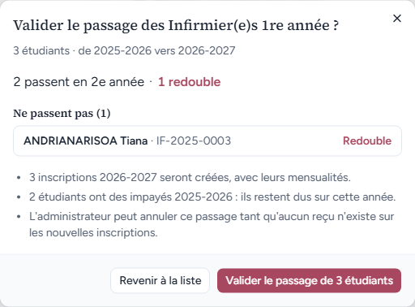 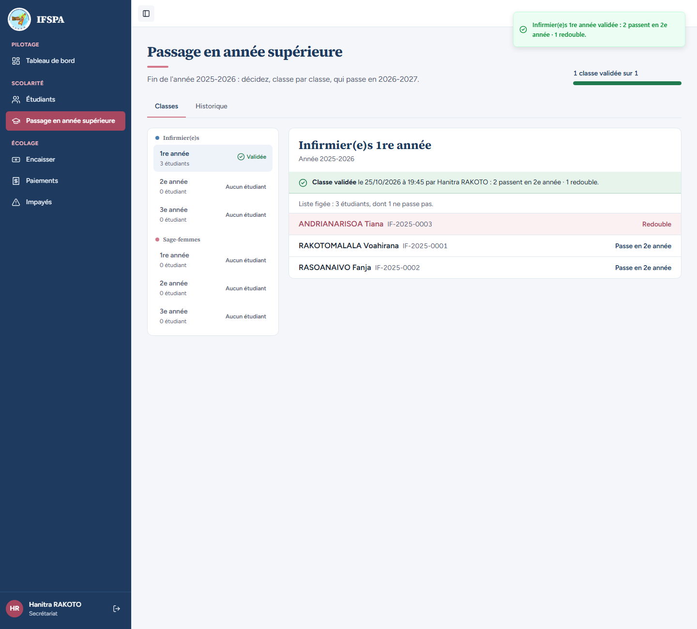 | |
| 6.6 | Secrétariat | Menu **Étudiants**, ouvrir **RAKOTOMALALA Voahirana**. | « 2e année · 2026-2027 ». Deux grilles : « Écolage 2026-2027 · 2e année » (droits 110 000 Ar + 10 x 85 000 Ar, reste **960 000 Ar**, « Aucun retard ») et « Écolage 2025-2026 · 1re année » **Soldée** (900 000 Ar payés). Même matricule IF-2025-0001. | 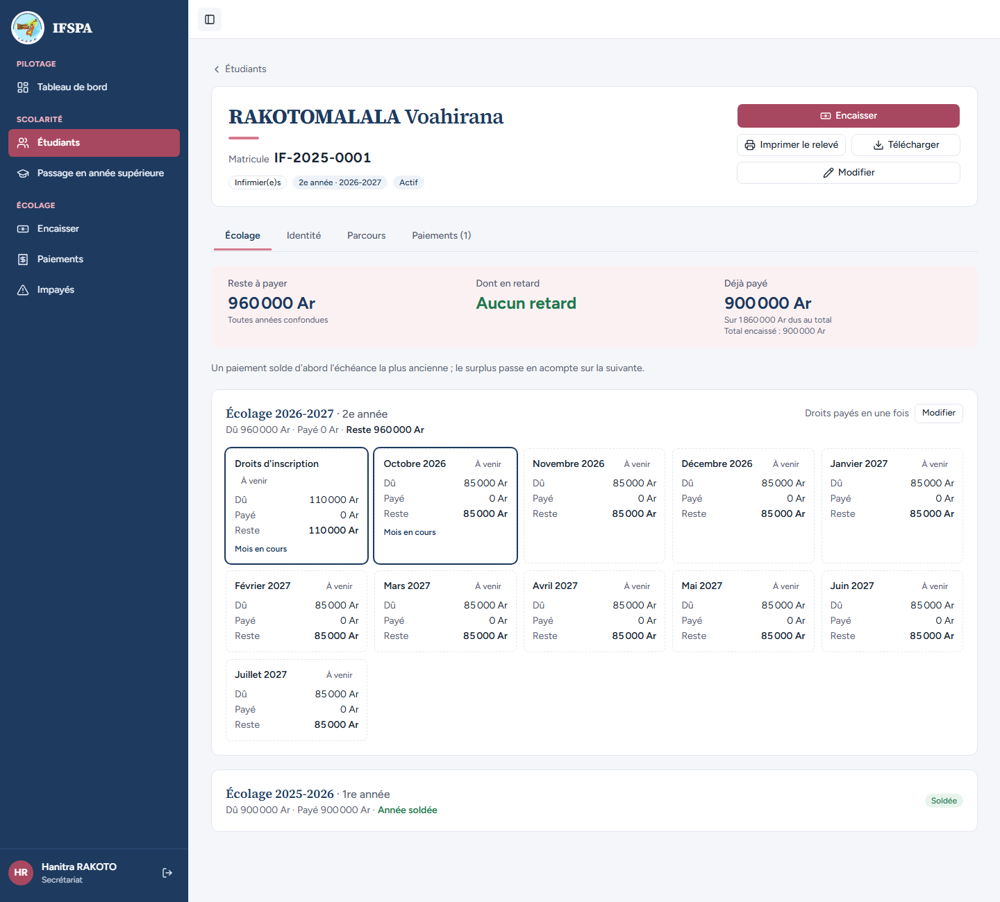 | |
| 6.7 | Secrétariat | Ouvrir **ANDRIANARISOA Tiana**. | Elle garde son matricule IF-2025-0003 et refait la 1re année : « Écolage 2026-2027 · 1re année » (900 000 Ar) en plus de ses 800 000 Ar de 2025-2026 : reste à payer **1 700 000 Ar**. | 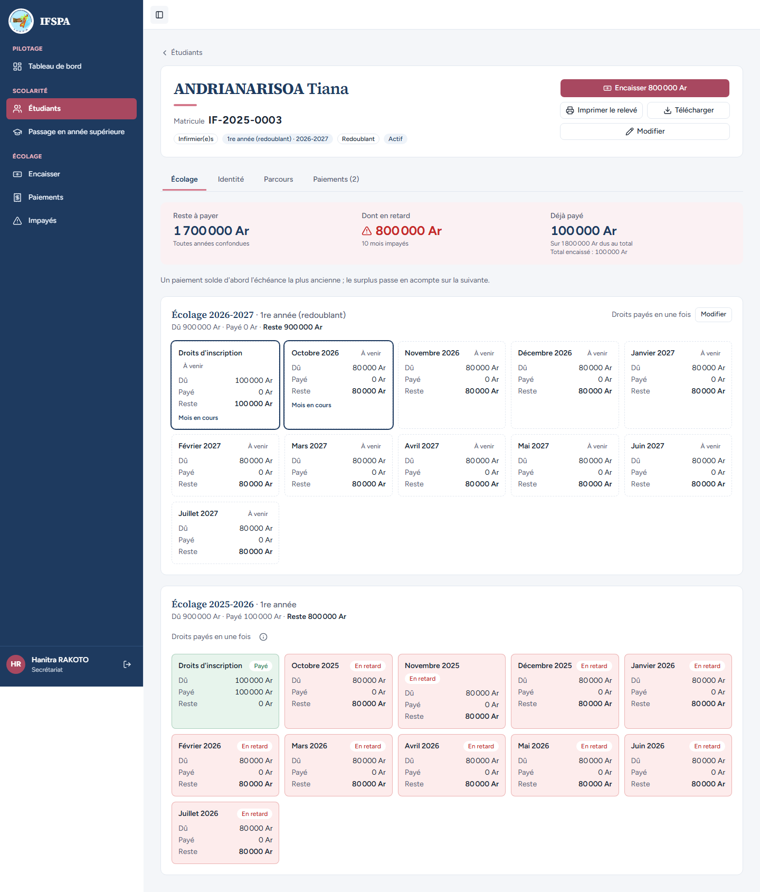 | |
| 6.8 | Administrateur | **Paramètres** › **Années scolaires** : **Définir 2026-2027 comme année courante**, confirmer. | 2026-2027 devient l'année courante ; 2025-2026 propose à son tour « Définir comme année courante ». | 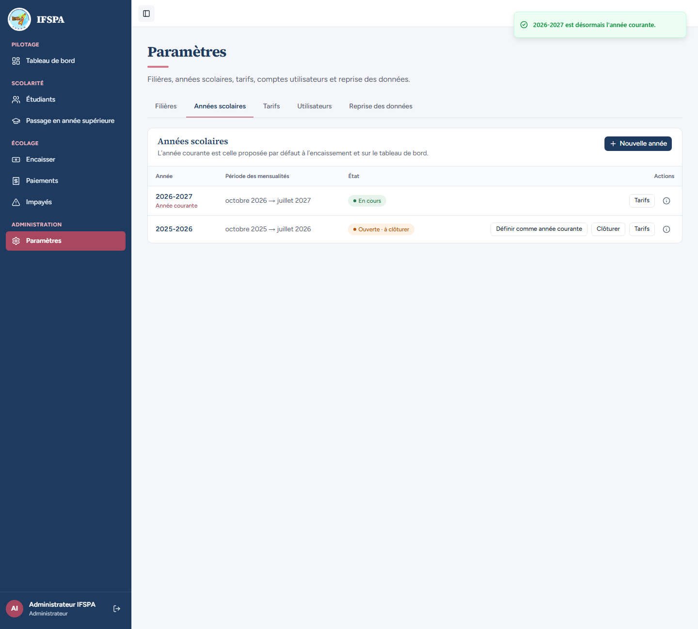 | |

---

## Acte 7. La rentrée 2026-2027

**Objectif :** vérifier qu'on inscrit un nouvel étudiant sur l'année courante et qu'au guichet un paiement solde d'abord l'impayé le plus ancien, même d'une année précédente.

Compte : **secrétariat** (même fenêtre que l'acte 3, pour garder le poste d'encaissement).

| # | Qui | Action | Résultat attendu | Capture | ✓ |
|---|---|---|---|---|---|
| 7.1 | Secrétariat | Inscrire **E** : `RAKOTOARISOA`, `Nirina`, Masculin, `11/02/2006`, `Toamasina`, `034 00 000 05`, `Lot 19, Ampasimazava, Toamasina`, **Infirmier(e)s**, droits En 1 fois. | « Inscription en 2026-2027 », matricule **IF-2026-0001** (séquence repartie à 0001 pour l'année d'entrée 2026). Fiche « Écolage 2026-2027 · 1re année », reste à payer **900 000 Ar**, « Aucun retard ». | 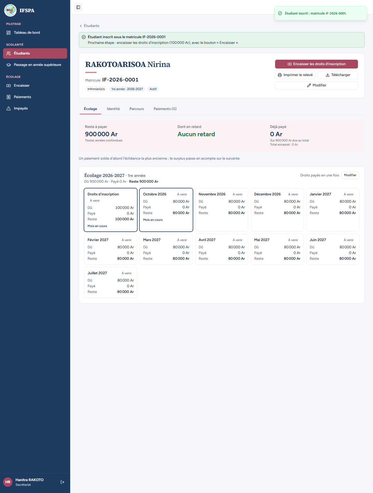 | |
| 7.2 | Secrétariat | **Encaisser**, chercher `RASOANAIVO`, Entrée. | « Reste à payer : **1 560 000 Ar**, dont 600 000 Ar en retard » (600 000 Ar de 2025-2026 + 960 000 Ar de 2026-2027). Deux blocs : « Année 2025-2026 · 1re année » (décembre « déjà 40 000 Ar » à juillet, « En retard ») et « Année 2026-2027 · 2e année » (« À venir »). **Aucune case cochée**, « Montant reçu » vide. *(Capture prise avant le 26/10 : les cases de 2025-2026 y sont encore cochées d'office.)* « Déjà payé sur 2026-2027 : 0 Ar sur 960 000 Ar ». | 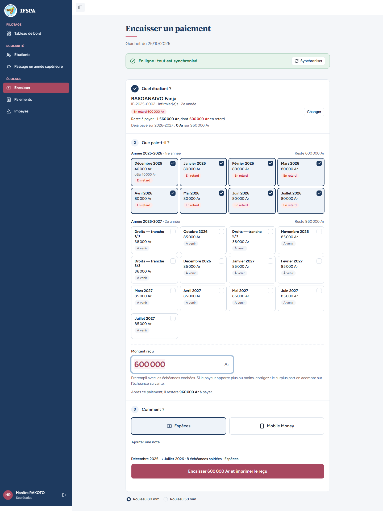 | |
| 7.3 | Secrétariat | Taper `100000` dans « Montant reçu », **Espèces**, **Encaisser 100 000 Ar et imprimer le reçu**. | Résumé avant envoi : « Décembre 2025 → Janvier 2026 · 1 échéance soldée · 1 acompte · Espèces » : le paiement solde d'abord le plus ancien (décembre 2025, 40 000 Ar), le surplus de 60 000 Ar est un acompte sur janvier 2026. Puis « Paiement enregistré : reçu **R-2026-00025**. … Reste à payer : 1 460 000 Ar. » | 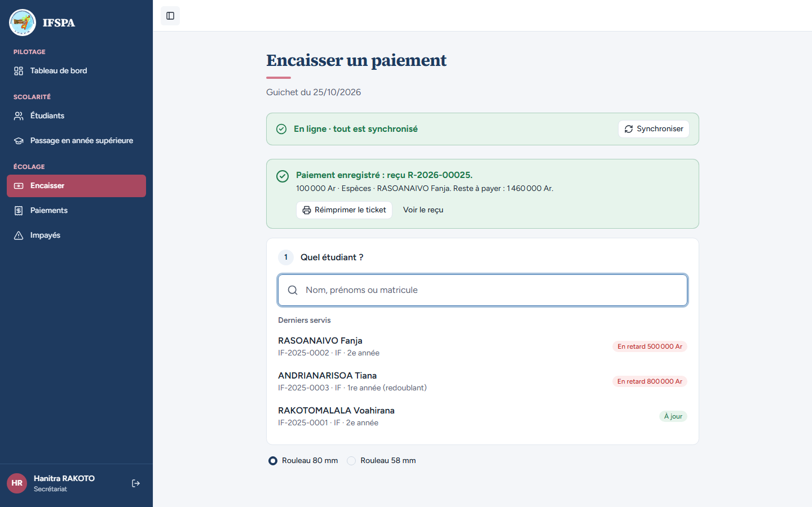 | |
| 7.4 | Secrétariat | Ouvrir la fiche de **RASOANAIVO Fanja**. | « 2e année · 2026-2027 ». Reste à payer **1 460 000 Ar**, dont en retard **500 000 Ar** (7 mois impayés), déjà payé **400 000 Ar** sur 1 860 000 Ar. Grille 2025-2026 : décembre « Payé », janvier 60 000 Ar payés et 20 000 Ar restants, février à juillet « En retard ». Grille 2026-2027 : rien de payé, 960 000 Ar, droits en 3 fois (38 000 / 36 000 / 36 000 Ar). | 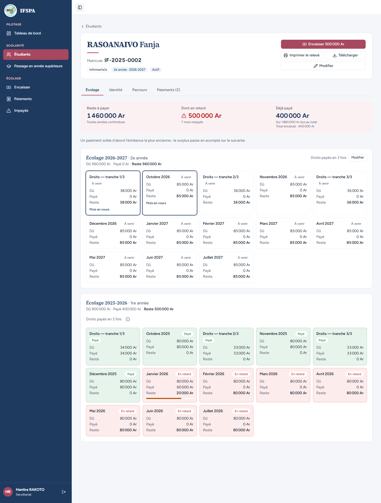 | |

---

## Acte 8. Encaisser sans Internet

**Objectif :** vérifier qu'au guichet on continue d'encaisser et d'imprimer un ticket sans Internet, et que le paiement part tout seul au serveur au retour du réseau.

**Préalable (voir « Repartir de zéro », point 6)** : arrêter `pnpm dev`, lancer `pnpm build` puis `pnpm start`, rouvrir <http://localhost:3100> dans la **même fenêtre normale** que le secrétariat. Couper Internet = mode avion, Wi-Fi coupé, ou dans Chrome **F12 › Réseau › Hors connexion**.

| # | Qui | Action | Résultat attendu | Capture | ✓ |
|---|---|---|---|---|---|
| 8.1 | Secrétariat | **Encaisser** avec Internet. Attendre quelques secondes (la page se met en mémoire). | Bandeau vert « **En ligne · tout est synchronisé** ». | 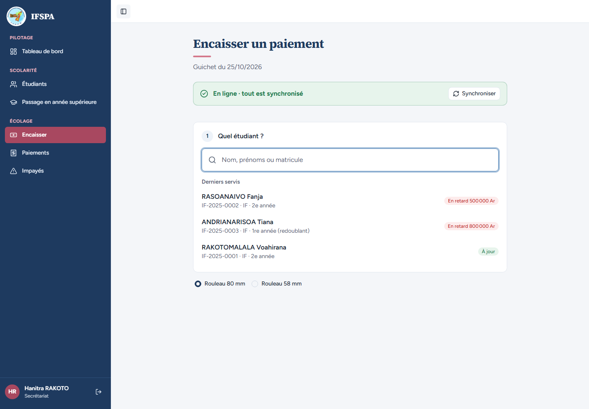 | |
| 8.2 | Secrétariat | **Couper Internet**, puis recharger la page (F5). | La page s'affiche quand même. Bandeau orange « **Hors ligne · vous pouvez continuer à encaisser** ». Les autres menus sont grisés « Connexion nécessaire » ; « Déconnexion impossible hors ligne ». | 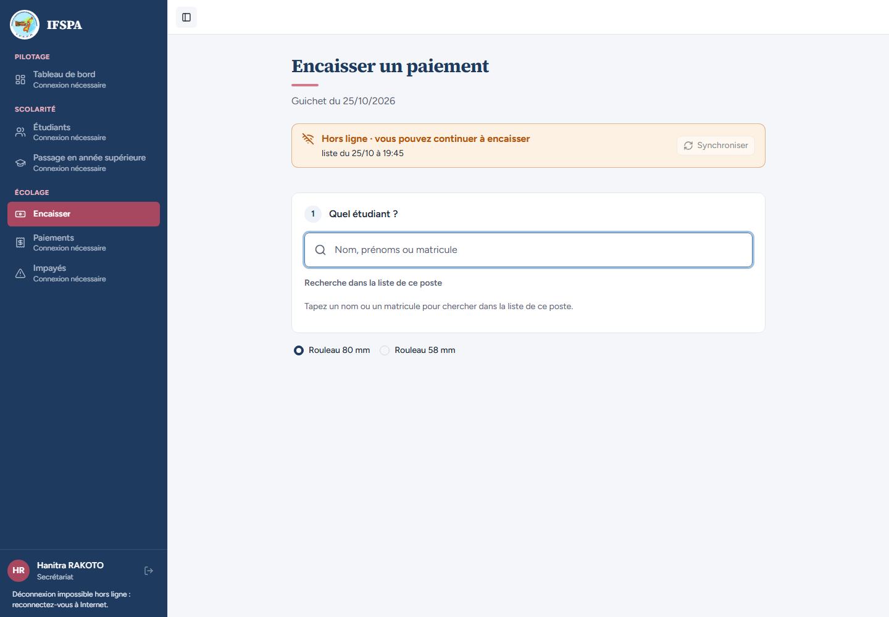 | |
| 8.3 | Secrétariat | Chercher `RAKOTOARISOA` (recherche « dans la liste de ce poste »), Entrée, cliquer la carte **Droits d'inscription** (elle se coche : « Montant reçu » **100 000**), **Encaisser 100 000 Ar et imprimer le reçu**. | « **Ticket R-2026-00001 remis.** Paiement gardé sur ce poste, il sera envoyé à la prochaine synchronisation. » « 100 000 Ar · Espèces · RAKOTOARISOA Nirina. Reste à payer : 800 000 Ar. » Bandeau « **1 paiement en attente** ». Le numéro vient des 20 numéros réservés au poste (acte 3). Le navigateur lance l'impression du ticket et de son double. | 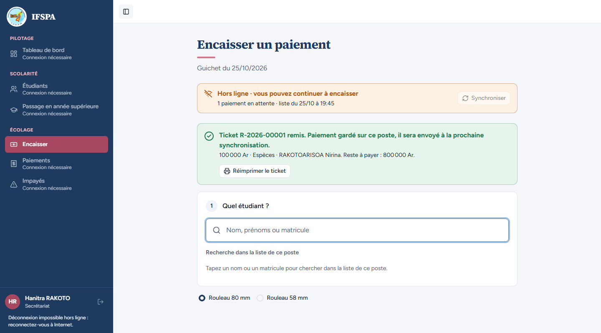 | |
| 8.4 | Secrétariat | **Rétablir Internet.** | Au bout de quelques secondes : « **En ligne · tout est synchronisé** » et « **1 paiement envoyé au serveur** ». (Le message vert du ticket garde son texte « sera envoyé à la prochaine synchronisation » : voir le rapport.) | 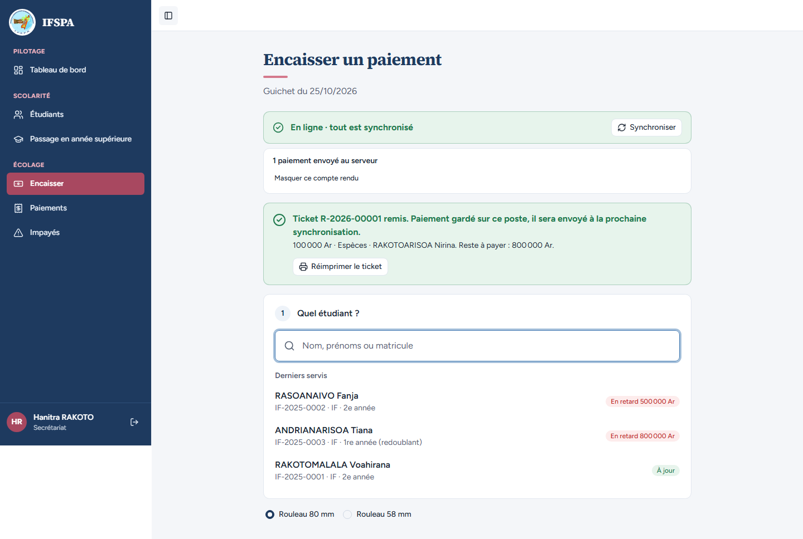 | |
| 8.5 | Administrateur | Menu **Paiements**. | Le reçu **R-2026-00001** est là : RAKOTOARISOA Nirina, IF-2026-0001, 100 000 Ar, Espèces, « Valide » (pas « à vérifier »). Totaux : **5 reçus + 1 annulé**, Total encaissé **1 500 000 Ar**, dont espèces 1 200 000 Ar, Mobile Money 300 000 Ar. En bas : « Numéros non utilisés (19) ». | 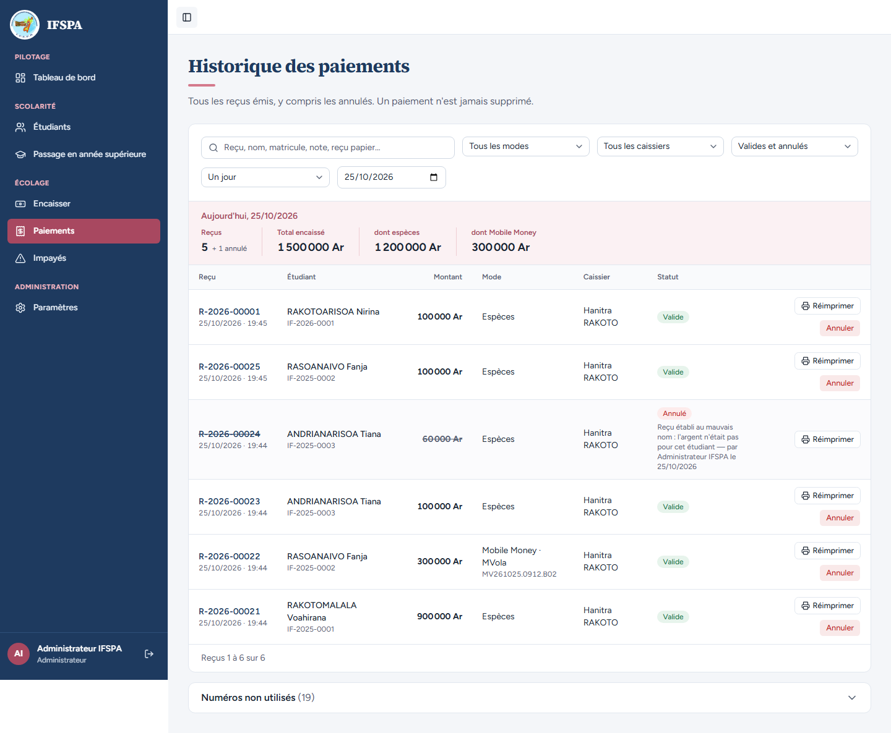 | |

---

## Acte 9. La fin

**Objectif :** vérifier que l'administrateur peut clôturer l'année terminée sans perdre ses impayés, et que le tableau de bord donne la situation finale des deux années.

| # | Qui | Action | Résultat attendu | Capture | ✓ |
|---|---|---|---|---|---|
| 9.1 | Administrateur | **Paramètres** › **Années scolaires**, sur la ligne 2025-2026 cliquer **Clôturer**. | Fenêtre « Clôturer l'année 2025-2026 ? » : « Ses tarifs ne pourront plus être modifiés. Les impayés de cette année restent encaissables, et vous pouvez la rouvrir à tout moment. » |  | |
| 9.2 | Administrateur | Confirmer avec **Clôturer l'année**. | « Année 2025-2026 clôturée. Ses impayés restent encaissables. » La ligne passe à « Clôturée » avec **Rouvrir**. |  | |
| 9.3 | Administrateur | Menu **Tableau de bord** (année 2026-2027). | « année scolaire 2026-2027 » : **Effectif actif 4** (4 Infirmier(e)s : A et B en 2e année, D et E en 1re) ; taux « — », « Rien n'est encore échu » ; **0 sur 4** en retard (avant le 1er novembre). |  | |
| 9.4 | Administrateur | Choisir l'année **2025-2026** en haut à droite. | **Effectif actif 3** (C a quitté) ; **Taux de recouvrement 45,3 %** « 1 400 000 Ar encaissés sur 3 090 000 Ar attendus à date » (900 000 + 400 000 + 100 000 Ar ; 3 090 000 = 3 x 900 000 + les 390 000 Ar dus par C) ; **2 sur 3** en retard (B et D). Derniers paiements : les 6 reçus (00001, 00025, 00024 annulé, 00023, 00022, 00021). |  | |

---

## Situation finale des cinq étudiants

| | Matricule | Ce qui leur est arrivé | Reçus | Situation finale |
|---|---|---|---|---|
| A. RAKOTOMALALA Voahirana | IF-2025-0001 | A tout payé en espèces, passe en 2e année | R-2026-00021 (900 000 Ar) | 2025-2026 soldée ; 2026-2027 (2e année) : reste **960 000 Ar** |
| B. RASOANAIVO Fanja | IF-2025-0002 | Paie en Mobile Money puis en espèces, passe en 2e année | R-2026-00022 (300 000 Ar, MVola), R-2026-00025 (100 000 Ar) | Payé **400 000 Ar** ; reste **1 460 000 Ar** (500 000 Ar de 2025-2026 + 960 000 Ar de 2026-2027) |
| C. RAZAFINDRAKOTO Mialy | SF-2025-0001 | Abandon au 15/12/2025, rien payé | aucun | Sorti ; reste **390 000 Ar** (janvier à juillet 2026 non dus) |
| D. ANDRIANARISOA Tiana | IF-2025-0003 | Paie un peu, un reçu erroné annulé, redouble la 1re année | R-2026-00023 (100 000 Ar), R-2026-00024 annulé (60 000 Ar) | Payé **100 000 Ar** ; reste **1 700 000 Ar** (800 000 Ar de 2025-2026 + 900 000 Ar de 2026-2027) |
| E. RAKOTOARISOA Nirina | IF-2026-0001 | Inscrit à la rentrée 2026-2027, droits payés hors ligne | R-2026-00001 (100 000 Ar) | Reste **800 000 Ar** |

Total encaissé sur l'ensemble du parcours : **1 500 000 Ar** (6 reçus, dont 1 annulé).
