# 00. Préparation des données communes de la recette

Les scénarios de recette partent tous de la même base : le seed (admin, secrétariat, filières IF et SF, année 2026-2027, tarifs d'exemple) complété par ce qui suit, **créé à travers l'interface**, comme vous le feriez au guichet. Rien n'est écrit en base à la main.

Sections A à D : pour UC06 et UC13. Section H : pour UC11 (après A, B, C) et UC05 (après A, B, C, G puis avant D). Section E : pour UC15 (et UC07-06) seulement, à la place des sections A à D (voir plus bas). Section F : pour UC07, après les sections A, B et C (sans la D). Section G : pour UC08 et UC09, après les sections A, B et C (sans la D ni la F). **UC10 (passage en année supérieure) utilise les sections A, B et C seulement, pas la section D** : c'est le cas [UC10-01](UC10-passage/UC10-01-nominal-redoublant.md) qui fait passer la classe IF 1re année, avec ses propres décisions (le redoublant, l'abandon) ; ses cas se déroulent ensuite dans l'ordre UC10-01 à UC10-09. **UC04 n'utilise aucune section** : il part de la base fraîche (seed seul, aucun étudiant) pour que les matricules `IF-2026-0001`, `IF-2026-0002`, `SF-2026-0001`… soient ceux du scénario ; ses cas créent eux-mêmes leurs étudiants (voir [UC04-01](UC04-inscrire/UC04-01-trois-inscriptions.md)).

À faire **une seule fois**, juste après `pnpm recette:base`. Rejouer cette préparation sur une base qui l'a déjà reçue provoquerait des doublons : repartir de `pnpm recette:base`.

## Avant de commencer

1. `pnpm db:up` (si Postgres ne tourne pas), puis `pnpm recette:base` : base `ifspa_recette` vide, migrations, seed.
2. `pnpm build`, puis `pnpm recette:app` et ouvrir `http://localhost:3200`.
3. Deux comptes, créés par le seed : l'**administrateur** (identifiants `SEED_ADMIN_*` de `.env`, affiché « Administrateur IFSPA ») et le **secrétariat** (identifiants `SEED_USER_*`, affiché « Hanitra RAKOTO »). Se connecter avec le compte indiqué à chaque section.

Pourquoi l'astuce de l'année 2025-2026 : l'inscription se fait toujours sur l'année **courante**, et avant le 1er novembre 2026 aucune échéance de 2026-2027 n'est en retard. Pour avoir des étudiants **en retard**, on inscrit d'abord dans 2025-2026 (rendue courante un instant), puis on redonne le statut de courante à 2026-2027. Les échéances d'octobre 2025 à juillet 2026 de ces étudiants sont alors toutes échues.

## Section A. L'année 2025-2026 et ses tarifs (compte administrateur)

| # | Qui | Action | Résultat attendu | Capture | ✓ |
|---|---|---|---|---|---|
| A1 | Administrateur | Menu **Paramètres**, onglet **Années scolaires**. | Une seule année : **2026-2027**, marquée « Année courante », état « En cours ». Le nom « Administrateur IFSPA » est en bas de la barre latérale. | 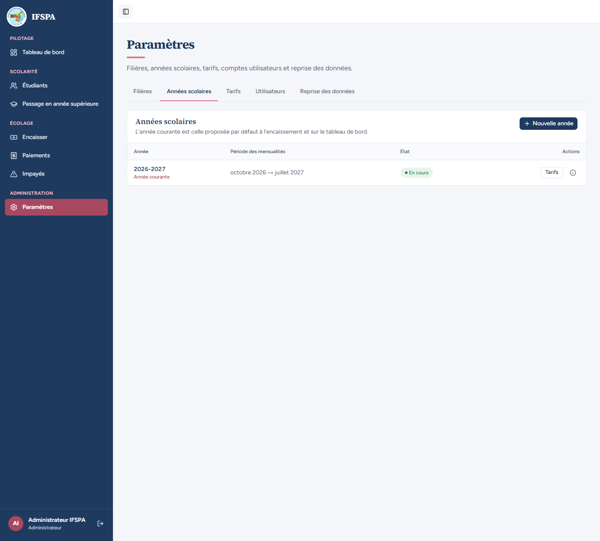 | |
| A2 | Administrateur | Cliquer **Nouvelle année**. Saisir `2025` dans « Année de début ». Laisser « Premier mois des mensualités » sur **Octobre**. | L'aperçu dit « Année **2025-2026** : mensualités de octobre 2025 → juillet 2026. » | 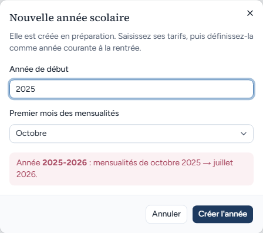 | |
| A3 | Administrateur | Cliquer **Créer l'année**. | Message « Année 2025-2026 créée, en préparation. Saisissez maintenant ses tarifs. » avec le bouton « Saisir les tarifs ». La ligne 2025-2026 apparaît. | | |
| A4 | Administrateur | Cliquer **Tarifs** sur la ligne 2025-2026. Dans la grille, pour **IF 1re année** et **SF 1re année** : « Droits d'inscription (Ar) » `100 000`, « Mensualité (Ar) » `80 000`, « Nombre de mois » `10`. | « 2 classes modifiées, pas encore enregistrées. » Total annuel **900 000 Ar** pour chacune. Les 4 autres classes restent « À saisir ». | 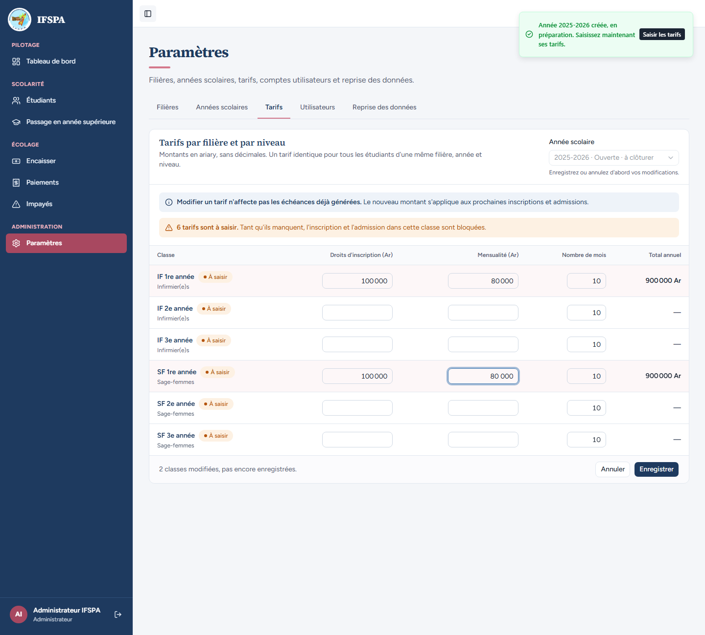 | |
| A5 | Administrateur | Cliquer **Enregistrer**, puis recharger la page. | Les montants sont conservés ; le bandeau dit « 4 tarifs sont à saisir » (les 4 autres classes). | 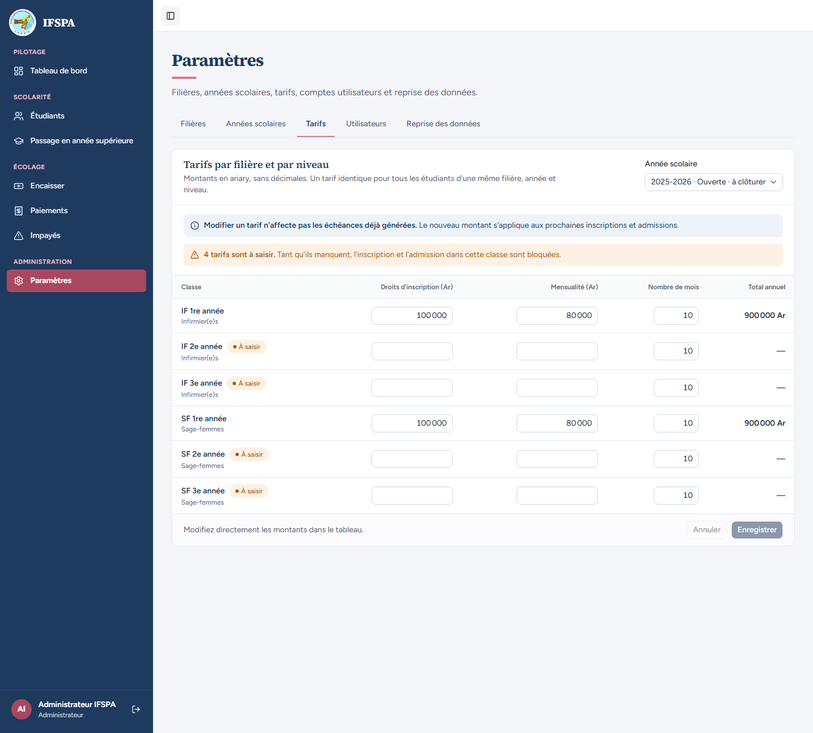 | |
| A6 | Administrateur | Revenir à **Années scolaires**. Sur la ligne 2025-2026, cliquer **Définir comme année courante**. | Fenêtre « Définir 2025-2026 comme année courante ? » (« 2026-2027 n'est pas supprimée : ses impayés restent encaissables. »). | 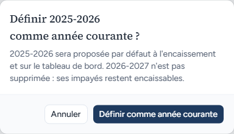 | |
| A7 | Administrateur | Confirmer avec **Définir comme année courante**. | 2025-2026 devient l'année courante ; 2026-2027 propose à son tour « Définir comme année courante ». | | |

## Section B. Six étudiants en retard, inscrits en 2025-2026 (compte secrétariat)

Se connecter avec le compte **secrétariat**. Pour chacun : menu **Étudiants**, bouton **Nouvel étudiant**, remplir le formulaire, laisser le niveau « 1re année » et « En 1 fois », cliquer **Inscrire l'étudiant**. Inscrire **dans cet ordre** : les matricules en dépendent.

| # | Nom | Prénoms | Sexe | Naissance | Lieu | Téléphone | Adresse | Filière | Matricule attendu |
|---|---|---|---|---|---|---|---|---|---|
| B1 | RAKOTOMALALA | Voahirana | Féminin | 14/03/2005 | Toamasina | 034 00 000 01 | Lot II B 12, Tanambao V, Toamasina | Infirmier(e)s · IF | **IF-2025-0001** |
| B2 | RASOANAIVO | Fanja | Féminin | 02/11/2004 | Brickaville | 034 00 000 02 | Lot 45, Ampasimazava, Toamasina | Infirmier(e)s · IF | **IF-2025-0002** |
| B3 | ANDRIANARISOA | Tiana | Masculin | 21/07/2005 | Fenerive-Est | 034 00 000 03 | Lot 8, Morarano, Toamasina | Infirmier(e)s · IF | **IF-2025-0003** |
| B4 | RAZAFINDRAKOTO | Mialy | Féminin | 30/01/2005 | Toamasina | 034 00 000 04 | Lot 102, Ankirihiry, Toamasina | Sage-femmes · SF | **SF-2025-0001** |
| B5 | RABEMANANJARA | Lalaina | Féminin | 09/09/2004 | Vatomandry | 034 00 000 05 | Lot 27, Tanambao II, Toamasina | Sage-femmes · SF | **SF-2025-0002** |
| B6 | RANDRIAMAHEFA | Solofo | Masculin | 17/05/2005 | Mahanoro | 034 00 000 06 | Lot 63, Ambohijafy, Toamasina | Infirmier(e)s · IF | **IF-2025-0004** |

| # | Qui | Action | Résultat attendu | Capture | ✓ |
|---|---|---|---|---|---|
| B-form | Secrétariat | Ouvrir **Nouvel étudiant** et remplir B1. | Le récapitulatif montre le matricule indicatif **IF-2025-0001** et l'écolage 2025-2026 : droits d'inscription 100 000 Ar (octobre), 10 mensualités de 80 000 Ar, total **900 000 Ar**. | 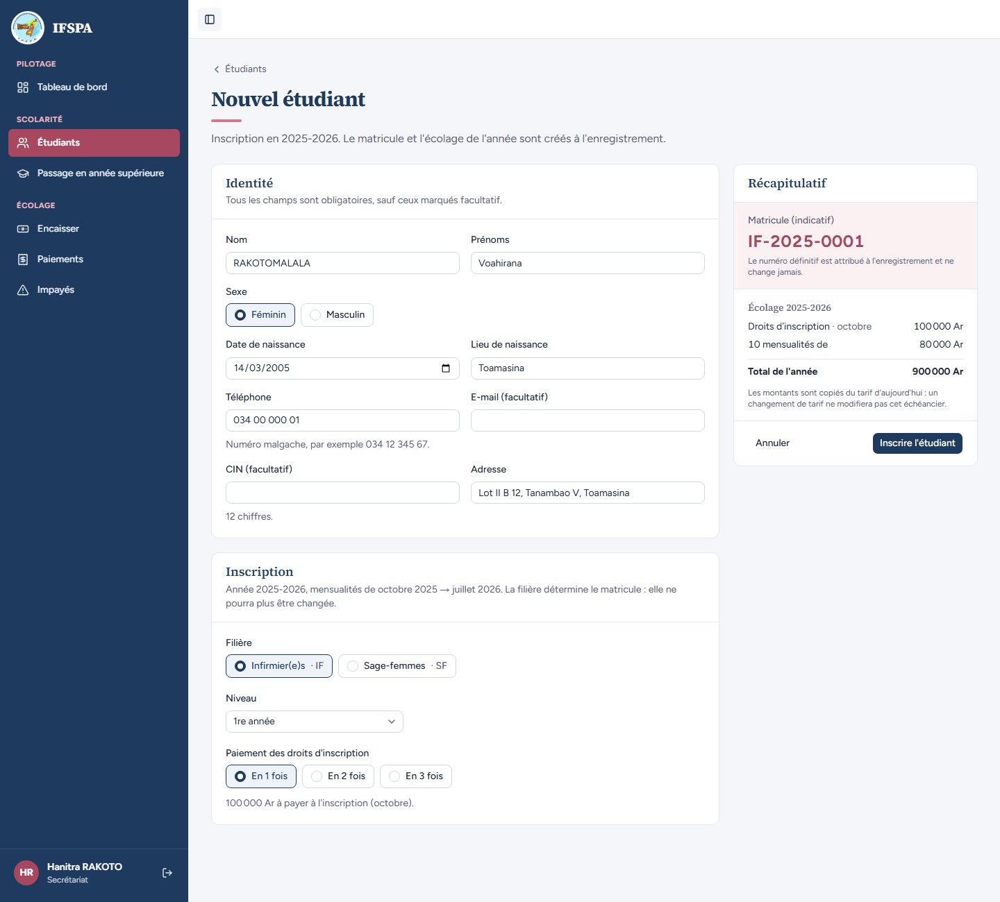 | |
| B-fiche | Secrétariat | Cliquer **Inscrire l'étudiant** (pour B1, puis pour B2 à B6). | La fiche s'ouvre : « Étudiant inscrit sous le matricule IF-2025-0001 ». **Reste à payer 900 000 Ar**, **dont en retard 900 000 Ar**, « 10 mois impayés », 11 échéances « En retard » (droits d'inscription, puis octobre 2025 à juillet 2026). Le nom « Hanitra RAKOTO » est en bas de la barre latérale. |  | |

## Section C. Retour à 2026-2027 et un étudiant à jour (administrateur puis secrétariat)

| # | Qui | Action | Résultat attendu | Capture | ✓ |
|---|---|---|---|---|---|
| C1 | Administrateur | **Paramètres › Années scolaires**. Sur la ligne 2026-2027, **Définir comme année courante**, puis confirmer. | Message « 2026-2027 est désormais l'année courante. » ; 2025-2026 passe à « Ouverte · à clôturer » et ses impayés restent encaissables. | 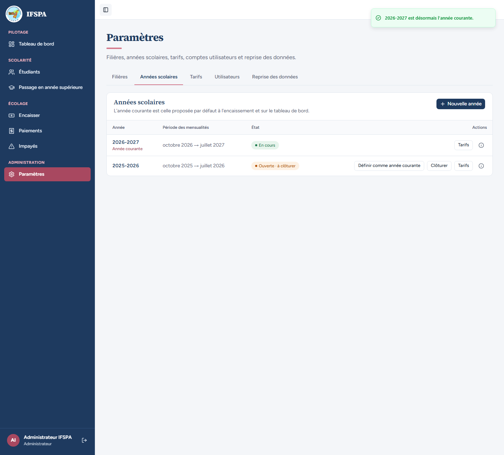 | |
| C2 | Secrétariat | **Étudiants › Nouvel étudiant** : RAKOTOARISOA Nirina, Masculin, 11/02/2006, Toamasina, 034 00 000 07, « Lot 19, Ampasimazava, Toamasina », Infirmier(e)s · IF. **Inscrire l'étudiant**. | Matricule **IF-2026-0001**, « Écolage 2026-2027 · 1re année ». **Reste à payer 900 000 Ar**, **Aucun retard** (octobre 2026 est « Mois en cours », les échéances sont « À venir »). | 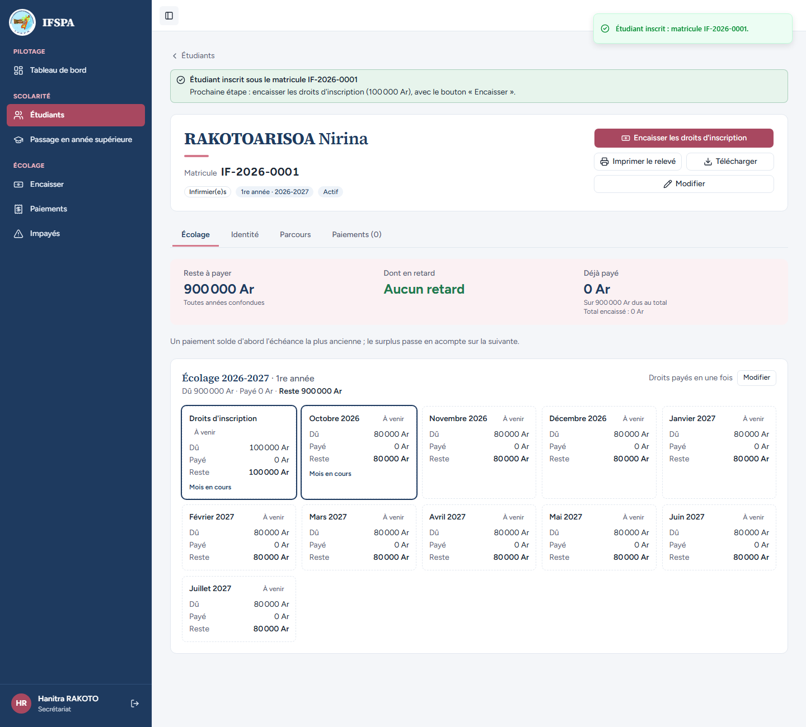 | |
| C3 | Secrétariat | Menu **Étudiants**. | « 7 étudiants inscrits » : six « En retard · 900 000 Ar » (10 mois impayés) et RAKOTOARISOA Nirina « À jour ». | 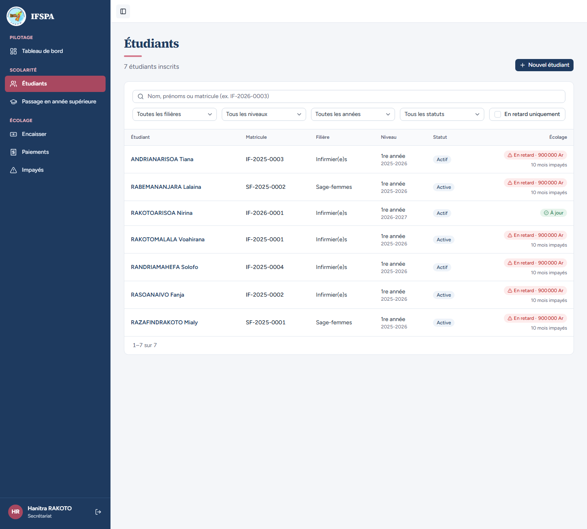 | |

## Section D. La classe IF 1re année passe en 2e année (compte secrétariat) : **seulement pour UC06**

À dérouler après les sections A, B et C, **uniquement** pour les scénarios qui en ont besoin (UC06 : étudiants qui doivent l'année précédente). Elle change les montants des quatre étudiants IF de 2025-2026 : ils doivent ensuite **1 800 000 Ar** sur deux années. Les scénarios UC13 supposent 900 000 Ar : ne pas dérouler cette section avant eux (repartir de `pnpm recette:base`).

| # | Qui | Action | Résultat attendu | Capture | ✓ |
|---|---|---|---|---|---|
| D1 | Secrétariat | Menu **Passage en année supérieure**, classe **Infirmier(e)s 1re année** (liste de gauche). | Titre « Infirmier(e)s 1re année », « 4 étudiants · passage en 2e année pour 2026-2027 » : ANDRIANARISOA Tiana, RAKOTOMALALA Voahirana, RANDRIAMAHEFA Solofo, RASOANAIVO Fanja, tous cochés, « 900 000 Ar en retard » chacun. En bas : « 4 passent en 2e année ». | 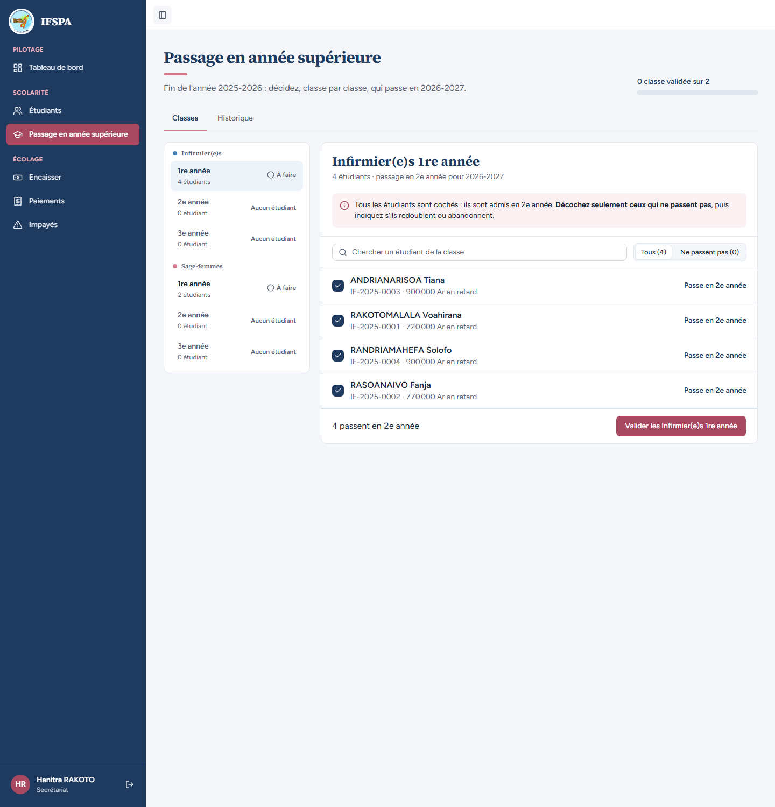 | |
| D2 | Secrétariat | Cliquer **Valider les Infirmier(e)s 1re année**. | Fenêtre « Valider le passage des Infirmier(e)s 1re année ? » : « 4 inscriptions 2026-2027 seront créées, avec leurs mensualités. », « 4 étudiants ont des impayés 2025-2026 : ils restent dus sur cette année. » | 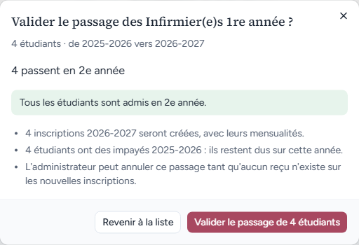 | |
| D3 | Secrétariat | Cliquer **Valider le passage de 4 étudiants**. | Message « … validée : 4 passent en 2e année ». | | |
| D4 | Secrétariat | Menu **Étudiants**, ouvrir RAKOTOMALALA Voahirana. | Fiche IF-2025-0001, « 2e année · 2026-2027 » : **Reste à payer 1 800 000 Ar**, dont en retard 900 000 Ar. Deux grilles : « Écolage 2026-2027 · 2e année » (900 000 Ar, à venir) et « Écolage 2025-2026 · 1re année » (900 000 Ar, en retard). | 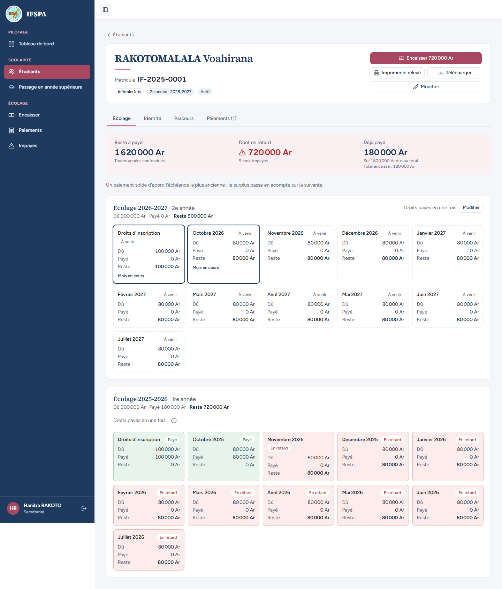 | |

## Section E. L'année 2025-2026 clôturée (compte administrateur) : **seulement pour UC15**

UC15 (reprise des données) part d'une base fraîche **sans les sections A à D** : les matricules `IF-2025-0001`, `SF-2025-0001`… et les reçus `R-2026-00001`… du scénario seraient décalés par les étudiants et les paiements de la préparation. Un étudiant entré en 2025 demande que l'année 2025-2026 existe et soit clôturée : seule cette section est à faire. L'année est créée **sans tarifs** (l'import n'inscrit que sur l'année courante, 2026-2027, dont les tarifs viennent du seed).

| # | Qui | Action | Résultat attendu | Capture | ✓ |
|---|---|---|---|---|---|
| E1 | Administrateur | Menu **Paramètres**, onglet **Années scolaires**. | Une seule année : 2026-2027, « Année courante », « En cours ». | 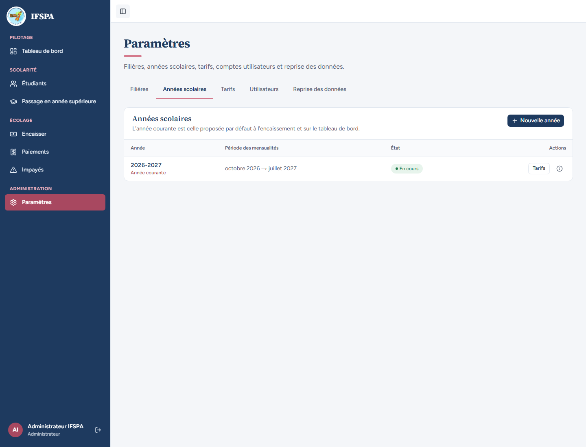 | |
| E2 | Administrateur | **Nouvelle année**, saisir `2025` dans « Année de début », **Créer l'année**. | La ligne 2025-2026 (octobre 2025 → juillet 2026) apparaît avec le bouton « Clôturer ». | | |
| E3 | Administrateur | Cliquer **Clôturer** sur la ligne 2025-2026. | Fenêtre « Clôturer l'année 2025-2026 ? » : « Ses tarifs ne pourront plus être modifiés. Les impayés de cette année restent encaissables, et vous pouvez la rouvrir à tout moment. » |  | |
| E4 | Administrateur | Confirmer avec **Clôturer l'année**. | Message « Année 2025-2026 clôturée. Ses impayés restent encaissables. » ; 2025-2026 est « Clôturée » (boutons Rouvrir, Tarifs, Supprimer), 2026-2027 reste la courante. | 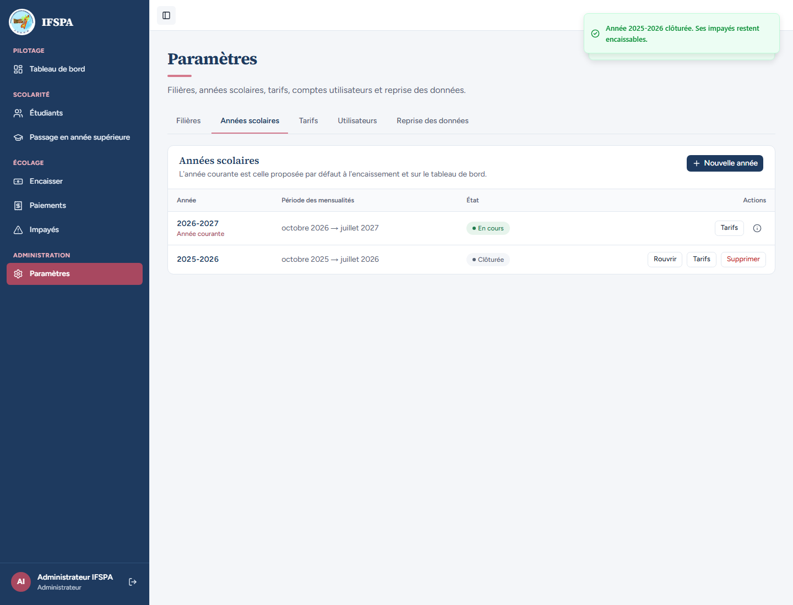 | |

## Section F. Quatre reçus du jour : **seulement pour UC07**

À dérouler après les sections A, B et C, **sans la section D** (les étudiants IF doivent encore 900 000 Ar chacun). Elle crée les reçus que l'administrateur contrôle, annule et réimprime dans UC07. Faire les trois premiers avec le compte **secrétariat**, le quatrième avec le compte **administrateur** (une autre fenêtre), **dans cet ordre**.

Pourquoi R-2026-00021 et pas 00001 : l'écran Encaisser réserve 20 numéros pour le poste dès son ouverture (voir UC06). Le poste du secrétariat prend R-2026-00001 à 00020, ses reçus en ligne partent donc de 00021 ; le poste de l'administrateur réserve ensuite 00024 à 00043, d'où R-2026-00044. Un poste ouvert en plus (autre navigateur) décale les numéros suivants : lire alors les numéros à l'écran.

| # | Qui | Action | Résultat attendu | Capture | ✓ |
|---|---|---|---|---|---|
| F1 | Secrétariat | Menu **Encaisser**, chercher `RAKOTOMALALA`, Entrée. Cliquer la carte **Novembre 2025** pour ne garder que les droits et octobre. **Encaisser 180 000 Ar et imprimer le reçu**. | « Paiement enregistré : reçu **R-2026-00021**. » (180 000 Ar, Espèces, reste à payer 720 000 Ar). | | |
| F2 | Secrétariat | Encaisser, chercher `RAKOTOMALALA`, Entrée, saisir `80000` dans « Montant reçu », **Encaisser 80 000 Ar et imprimer le reçu**. | « Paiement enregistré : reçu **R-2026-00022**. » (novembre 2025, reste à payer 640 000 Ar). | | |
| F3 | Secrétariat | Encaisser, chercher `RASOANAIVO`, Entrée, carte **Novembre 2025** pour la décocher ; choisir **Mobile Money**, **MVola**, référence `MP261017.0915.F03` ; **Encaisser 180 000 Ar et imprimer le reçu**. | « Paiement enregistré : reçu **R-2026-00023**. » (Mobile Money, reste à payer 720 000 Ar). | | |
| F4 | Administrateur | Se connecter en administrateur (autre fenêtre). **Encaisser**, chercher `ANDRIANARISOA`, Entrée, saisir `100000` dans « Montant reçu » (les droits d'inscription), **Mobile Money**, **Orange Money**, référence `OM261017.1105.F04` ; **Encaisser 100 000 Ar et imprimer le reçu**. | « Paiement enregistré : reçu **R-2026-00044**. » (« Administrateur IFSPA » apparaît comme caissier). | | |
| F-contrôle | Administrateur | Menu **Paiements**. | « Aujourd'hui » : Reçus 4, Total encaissé **540 000 Ar**, dont espèces **260 000 Ar**, dont Mobile Money **280 000 Ar** ; R-2026-00044 à 00021, tous « Valide » ; « Numéros non utilisés (40) ». | 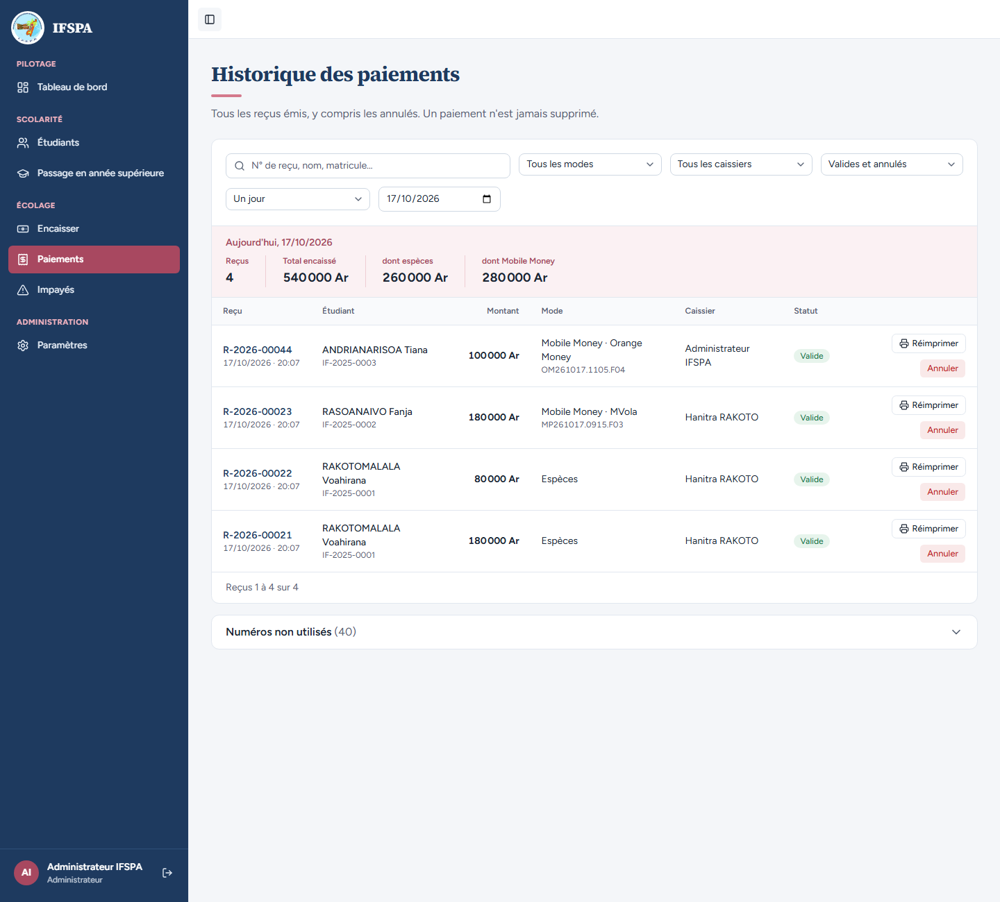 | |

## Section G. Trois paiements du guichet : **seulement pour UC08 et UC09**

À dérouler après les sections A, B et C, **sans les sections D et F**. Elle donne à la liste des impayés des montants et des « derniers paiements » différents d'un étudiant à l'autre, et un étudiant de l'année en cours qui a payé un acompte (le seul cas où un relevé affiche « Partiel », voir [UC09-02](UC09-releve/UC09-02-releve-nirina.md)). Les trois paiements se font avec le compte **secrétariat**, **dans le même navigateur** et dans cet ordre : les numéros de reçu sont alors R-2026-00021, 00022 et 00023 (le premier écran Encaisser ouvert réserve les numéros 00001 à 00020 pour le poste, voir la section F). Dans un autre navigateur, lire les numéros à l'écran.

| # | Qui | Action | Résultat attendu | Capture | ✓ |
|---|---|---|---|---|---|
| G1 | Secrétariat | Menu **Encaisser**, chercher `RAKOTOMALALA`, Entrée. Saisir `180000` dans « Montant reçu », **Encaisser 180 000 Ar et imprimer le reçu**. | « Paiement enregistré : reçu **R-2026-00021**. » Droits d'inscription et octobre 2025 soldés ; RAKOTOMALALA Voahirana doit encore 720 000 Ar. | | |
| G2 | Secrétariat | **Encaisser**, chercher `RASOANAIVO`, Entrée, saisir `130000` dans « Montant reçu », **Encaisser 130 000 Ar et imprimer le reçu**. | « Paiement enregistré : reçu **R-2026-00022**. » 100 000 Ar soldent les droits, 30 000 Ar vont en acompte sur octobre 2025. Sa fiche : « Reste à payer 770 000 Ar », octobre 2025 « En retard » avec 30 000 Ar payés et 50 000 Ar restants (un mois échu reste « En retard » même avec un acompte, voir R-RET). | 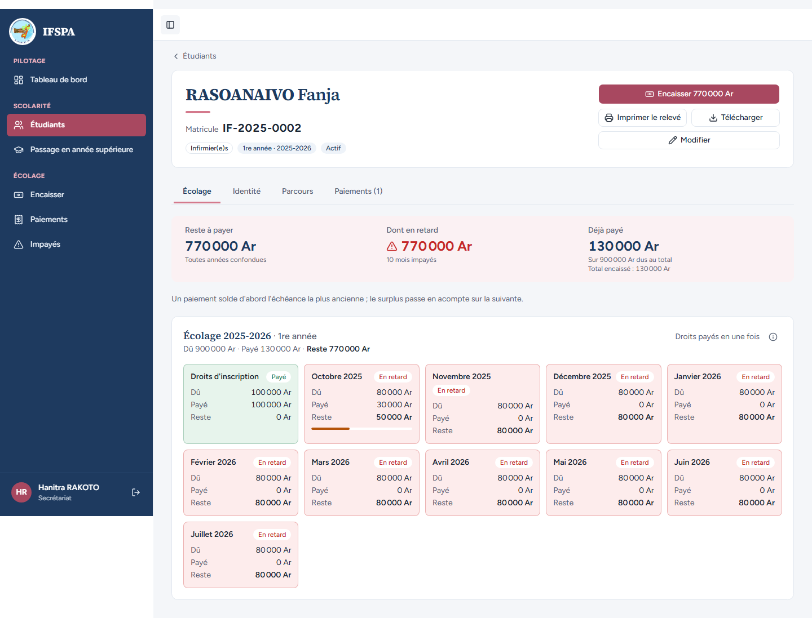 | |
| G3 | Secrétariat | **Encaisser**, chercher `RAKOTOARISOA`, Entrée, saisir `150000` dans « Montant reçu », **Encaisser 150 000 Ar et imprimer le reçu**. | « Paiement enregistré : reçu **R-2026-00023**. » 100 000 Ar soldent les droits, 50 000 Ar vont en acompte sur octobre 2026 (mois en cours) : sa fiche affiche « Partiel » sur octobre 2026. | 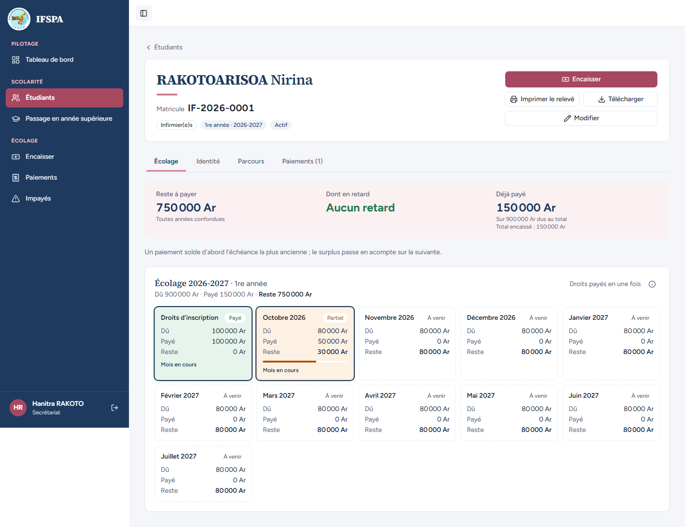 | |

Résultat : RAKOTOMALALA Voahirana 720 000 Ar en retard, RASOANAIVO Fanja 770 000 Ar, ANDRIANARISOA Tiana, RAZAFINDRAKOTO Mialy, RABEMANANJARA Lalaina et RANDRIAMAHEFA Solofo 900 000 Ar chacun (six étudiants en retard, **5 090 000 Ar** au total) ; RAKOTOARISOA Nirina n'est pas en retard.

## Section H. Trois étudiants de 2026-2027 : **pour UC11 et UC05**

À dérouler après les sections A, B et C. **UC11 (sortie)** : sections A, B, C puis H, rien d'autre (sans G ni D) ; ses cas se déroulent ensuite dans l'ordre UC11-01 à UC11-09. **UC05 (liste et fiche)** : sections A, B, C, **G**, H puis **D**, puis le cas [UC11-01](UC11-sortie/UC11-01-abandon-nominal.md) (RAMAROSON Hery abandonne, ce qui donne un étudiant « Abandon » à la liste) : 10 étudiants. Se connecter avec le compte **secrétariat**. Pour chacun : **Étudiants**, **Nouvel étudiant**, remplir le formulaire, **Inscrire l'étudiant**. Inscrire **dans cet ordre** : les matricules en dépendent (RAKOTOARISOA Nirina porte déjà IF-2026-0001).

| # | Nom | Prénoms | Sexe | Naissance | Lieu | Téléphone | Adresse | Filière | Droits | Matricule attendu |
|---|---|---|---|---|---|---|---|---|---|---|
| H1 | RAMAROSON | Hery | Masculin | 19/08/2005 | Toamasina | 034 00 000 10 | Lot 5, Ankirihiry, Toamasina | Infirmier(e)s · IF | En 1 fois | **IF-2026-0002** |
| H2 | RAKOTONIRINA | Hélène | Féminin | 25/04/2005 | Foulpointe | 034 00 000 11 | Lot 77, Ampasimazava, Toamasina | Sage-femmes · SF | **En 3 fois** | **SF-2026-0001** |
| H3 | ANDRIAMAMPIANINA | Faly | Masculin | 12/01/2006 | Mahambo | 034 00 000 12 | Lot 33, Tanambao II, Toamasina | Infirmier(e)s · IF | En 1 fois | **IF-2026-0003** |

| # | Qui | Action | Résultat attendu | Capture | ✓ |
|---|---|---|---|---|---|
| H-fiche | Secrétariat | Inscrire H1, puis H2 (choisir « En 3 fois »), puis H3. | Pour chacun, la fiche s'ouvre sur « Étudiant inscrit sous le matricule … », « Reste à payer 900 000 Ar », « Aucun retard » (octobre 2026 est « Mois en cours »). H2 : « Droits payés en 3 fois », 13 échéances (tranches de 34 000, 33 000 et 33 000 Ar). | 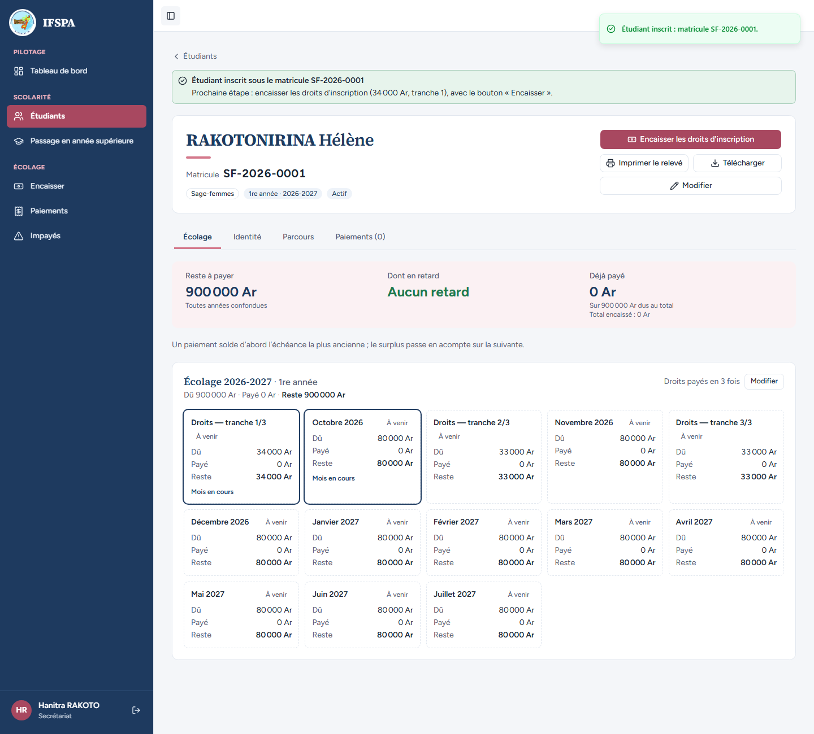 | |
| H-contrôle | Secrétariat | Menu **Étudiants**. | « 10 étudiants inscrits » (les 7 des sections A à C et les 3 de la section H). | 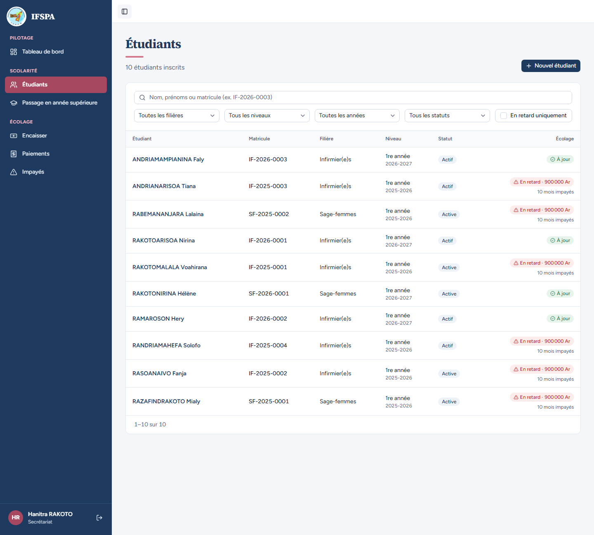 | |

## Section I. Neuf paiements de plus : **seulement pour UC12**

**UC12 (tableau de bord)** : sections A, B, C, **H**, puis **G**, puis **I**, sans la section D (le passage se fait dans [UC12-07](UC12-dashboard/UC12-07-passage-par-niveau.md)). Elle donne au tableau de bord douze reçus (de quoi dépasser la limite des 10 derniers), un étudiant soldé, des acomptes et des paiements sur les deux années. Les neuf paiements se font avec le compte **secrétariat**, **dans le même navigateur que la section G** et dans cet ordre : reçus R-2026-00024 à 00032. Pour chacun : **Encaisser**, chercher le nom, Entrée, saisir le montant dans « Montant reçu », **Encaisser … Ar et imprimer le reçu**.

| # | Étudiant | Montant | Reçu | Effet |
|---|---|---|---|---|
| I1 | ANDRIANARISOA Tiana (IF-2025-0003) | `100000` | R-2026-00024 | droits d'inscription 2025-2026 soldés, reste à payer 800 000 Ar |
| I2 | RAZAFINDRAKOTO Mialy (SF-2025-0001) | `900000` | R-2026-00025 | tout 2025-2026 soldé |
| I3 | RABEMANANJARA Lalaina (SF-2025-0002) | `50000` | R-2026-00026 | droits payés en partie, reste 850 000 Ar |
| I4 | RANDRIAMAHEFA Solofo (IF-2025-0004) | `100000` | R-2026-00027 | droits soldés, reste 800 000 Ar |
| I5 | RAKOTOMALALA Voahirana (IF-2025-0001) | `80000` | R-2026-00028 | novembre 2025 soldé (avec G1 : 260 000 Ar payés, reste 640 000 Ar) |
| I6 | RAKOTOARISOA Nirina (IF-2026-0001) | `30000` | R-2026-00029 | octobre 2026 soldé (avec G3 : 180 000 Ar payés) |
| I7 | RAKOTONIRINA Hélène (SF-2026-0001) | `34000` | R-2026-00030 | 1re tranche des droits (3 fois) soldée |
| I8 | RAMAROSON Hery (IF-2026-0002) | `100000` | R-2026-00031 | droits 2026-2027 soldés |
| I9 | ANDRIAMAMPIANINA Faly (IF-2026-0003) | `100000` | R-2026-00032 | droits 2026-2027 soldés |

Résultat : 12 reçus pour **1 954 000 Ar**. 2025-2026 : 1 540 000 Ar payés (Voahirana 260 000, Fanja 130 000, Tiana 100 000, Solofo 100 000, Mialy 900 000, Lalaina 50 000) ; 2026-2027 : 414 000 Ar payés (Nirina 180 000, Hélène 34 000, Hery 100 000, Faly 100 000). Parcours : [00g-preparation-recouvrement.recette.ts](../parcours/00g-preparation-recouvrement.recette.ts), à lancer avec 00e dans la même commande (`pnpm recette:parcours 00e-preparation 00g-preparation --project ordinateur`) pour garder le même navigateur et les numéros 00021 à 00032.

## Ce que cette préparation donne aux scénarios

- Étudiants **en retard** (900 000 Ar chacun, rien payé) : B1 à B6. Ils servent aux encaissements du guichet.
- Étudiant **à jour** (rien en retard, octobre 2026 en cours) : C2.
- Après la section D (UC06) : B1, B2, B3 et B6 (IF) ont deux années d'impayés (1 800 000 Ar) ; B4, B5 (SF) et C2 sont inchangés.
- Après la section E seule (UC15) : l'année 2025-2026 clôturée, sans tarifs ni étudiants ; aucun autre changement du seed.
- Après la section F (UC07) : RAKOTOMALALA Voahirana (IF-2025-0001) a payé 260 000 Ar en deux reçus (reste à payer 640 000 Ar), RASOANAIVO Fanja 180 000 Ar (720 000 Ar), ANDRIANARISOA Tiana 100 000 Ar (800 000 Ar) ; les autres étudiants n'ont rien payé.
- Après la section G (UC08, UC09) : six étudiants en retard pour **5 090 000 Ar** ; RAKOTOMALALA Voahirana (IF-2025-0001) a payé 180 000 Ar, RASOANAIVO Fanja (IF-2025-0002) 130 000 Ar, RAKOTOARISOA Nirina (IF-2026-0001) 150 000 Ar (octobre 2026 « Partiel »).
- Après la section H (UC11, UC05) : trois étudiants de plus en 2026-2027, tous à 900 000 Ar à payer et à jour (RAMAROSON Hery IF-2026-0002, RAKOTONIRINA Hélène SF-2026-0001 en droits 3 fois, ANDRIAMAMPIANINA Faly IF-2026-0003).
- Deux filières, deux classes tarifées en 2025-2026 (IF 1re année et SF 1re année). Les autres classes de 2025-2026 restent « À saisir » : un scénario qui en a besoin (passage en année supérieure par exemple) devra les saisir et le dira.

## Ce que cette préparation ne couvre pas

- Aucun paiement n'est encaissé ici.
- Étudiants inscrits en droits « En 2 fois » ou « En 3 fois » : à créer dans le scénario qui en a besoin.

## Dernière exécution par l'agent

- 17/10/2026 : ✅ sections A à C (7 parcours sur 7) et section D (1 parcours sur 1, `00b-preparation-admission.recette.ts`). Rapports : [UC13](../rapports/RAPPORT_2026-10-17_UC13.md), [UC06](../rapports/RAPPORT_2026-10-17_UC06.md).
- 17/10/2026 : ✅ section E (1 parcours sur 1, base fraîche sans les sections A à D). Rapport : [UC15](../rapports/RAPPORT_2026-10-17_UC15.md).
- 17/10/2026 : ✅ section F (1 parcours sur 1, [00d-preparation-journee.recette.ts](../parcours/00d-preparation-journee.recette.ts), après les sections A à C). Rapport : [UC07](../rapports/RAPPORT_2026-10-17_UC07.md).
- 17/10/2026 : UC04 (10 cas) déroulé sur base fraîche **sans** préparation 00 ; ses aides propres sont dans [aides-inscription.ts](../parcours/aides-inscription.ts). Rapport : [UC04](../rapports/RAPPORT_2026-10-17_UC04.md).
- 17/10/2026 : ✅ sections A à C rejouées quatre fois sur base fraîche (7 parcours sur 7 à chaque fois) pour UC10, sans la section D. Rapport : [UC10](../rapports/RAPPORT_2026-10-17_UC10.md).
- 17/10/2026 : ✅ section G (1 parcours sur 1, [00e-preparation-relances.recette.ts](../parcours/00e-preparation-relances.recette.ts), après les sections A à C) ; sections A à C rejouées une dernière fois pour UC08 et UC09. Rapport : [UC08](../rapports/RAPPORT_2026-10-17_UC08.md).
- 18/10/2026 : ✅ section H (1 parcours sur 1, [00f-preparation-sorties.recette.ts](../parcours/00f-preparation-sorties.recette.ts), après les sections A à C) ; sections A à C rejouées pour UC11 puis pour UC05 (avec G, H et D). Rapports : [UC11](../rapports/RAPPORT_2026-10-18_UC11.md), [UC05](../rapports/RAPPORT_2026-10-18_UC05.md).
- Parcours rejouant ces sections : [00-preparation.recette.ts](../parcours/00-preparation.recette.ts) (aides partagées : [aides.ts](../parcours/aides.ts)) ; section E : [00c-preparation-reprise.recette.ts](../parcours/00c-preparation-reprise.recette.ts) ; section F : [00d-preparation-journee.recette.ts](../parcours/00d-preparation-journee.recette.ts) ; section G : [00e-preparation-relances.recette.ts](../parcours/00e-preparation-relances.recette.ts) ; section H : [00f-preparation-sorties.recette.ts](../parcours/00f-preparation-sorties.recette.ts) (aides : [aides-sorties.ts](../parcours/aides-sorties.ts)).
- 18/10/2026 : ✅ section I (1 parcours sur 1, [00g-preparation-recouvrement.recette.ts](../parcours/00g-preparation-recouvrement.recette.ts), avec 00e dans la même commande, après les sections A à C et H). Rapport : [UC12](../rapports/RAPPORT_2026-10-18_UC12.md).
- 18/10/2026 : ✅ sections A à C rejouées une fois sur base fraîche (7 parcours sur 7) pour UC02, avant les cas UC02-01 à UC02-10. Rapport : [UC02](../rapports/RAPPORT_2026-10-18_UC02.md).
