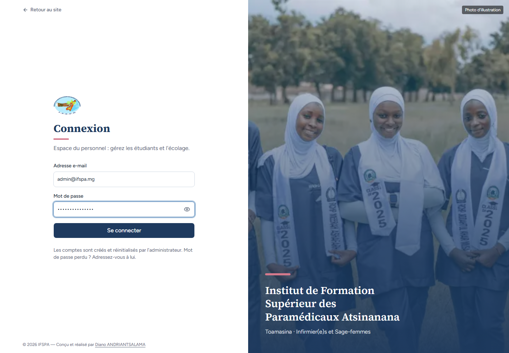
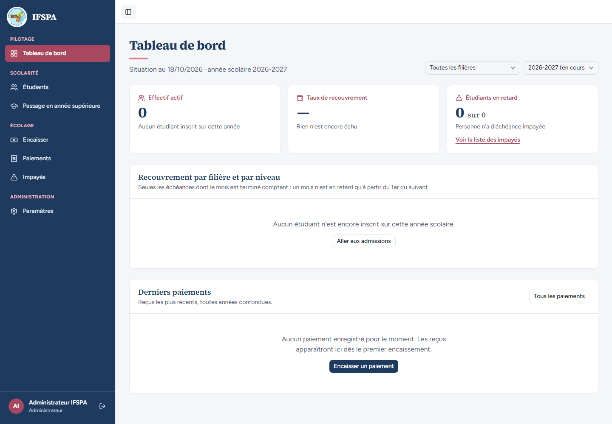
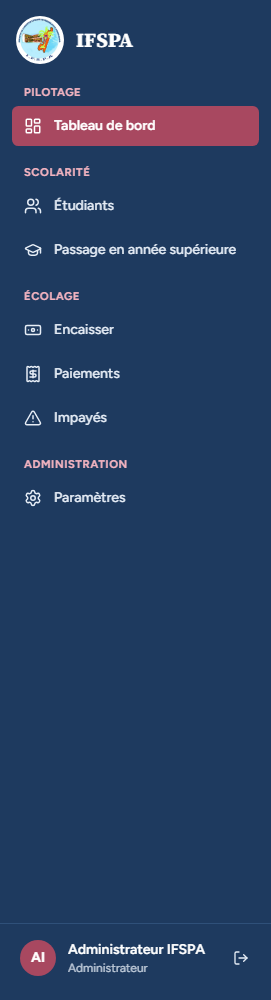
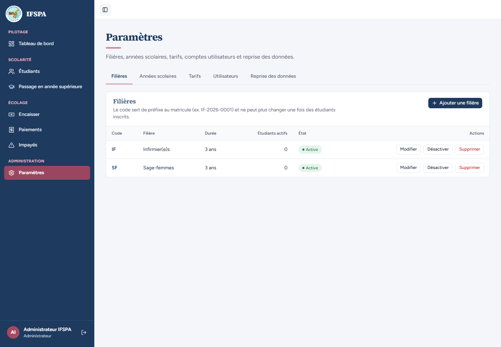

# UC01-01. L'administrateur se connecte et retrouve tous les écrans

| | |
|---|---|
| Use case | UC01. Se connecter et retrouver son espace |
| Règles couvertes | R-ROLE (l'administrateur voit Paramètres) |
| Rôle | Administrateur |
| Durée estimée | 3 minutes |

## La situation

Le matin, l'administrateur de l'institut ouvre l'application depuis son ordinateur. Il tape son adresse et son mot de passe, arrive sur le tableau de bord et vérifie que tous les écrans, Paramètres compris, sont à sa disposition.

## Avant de commencer

1. `pnpm recette:base`, `pnpm build`, `pnpm recette:app`, puis ouvrir `http://localhost:3200`.
2. Aucune donnée de préparation (`00-PREPARATION.md` n'est pas nécessaire) : le seed suffit.
3. Aucune session ouverte dans le navigateur (fenêtre de navigation privée si besoin).
4. Se connecter avec le compte **administrateur** (identifiants `SEED_ADMIN_*` de `.env`, affiché « Administrateur IFSPA »).
5. Si vous enchaînez plusieurs cas, patientez une dizaine de secondes entre deux séries de connexions : après trois connexions rapprochées, la suivante est refusée (voir [UC01-09](UC01-09-tentatives-rapprochees.md)).

## Étapes

| # | Qui | Action | Résultat attendu | Capture | ✓ |
|---|---|---|---|---|---|
| 1 | — | Ouvrir `http://localhost:3200/connexion`. | Titre « **Connexion** », « Espace du personnel : gérez les étudiants et l'écolage. », champs « Adresse e-mail » (exemple « nom@ifspa.mg ») et « Mot de passe », bouton « Se connecter », lien « Retour au site » et la phrase « Les comptes sont créés et réinitialisés par l'administrateur. Mot de passe perdu ? Adressez-vous à lui. ». |  | |
| 2 | Administrateur | Saisir l'adresse et le mot de passe de l'administrateur. | L'adresse est lisible, le mot de passe s'affiche en points. |  | |
| 3 | Administrateur | Cliquer **Se connecter**. | Le **Tableau de bord** s'ouvre (adresse `/app/dashboard`). En bas de la barre latérale : « Administrateur IFSPA » et « Administrateur ». |  | |
| 4 | Administrateur | Regarder le menu à gauche. | Quatre groupes : « Pilotage » (Tableau de bord), « Scolarité » (Étudiants, Passage en année supérieure), « Écolage » (Encaisser, Paiements, Impayés), « Administration » (**Paramètres**). « Tableau de bord » est l'entrée active. |  | |
| 5 | Administrateur | Cliquer **Paramètres**. | Titre « Paramètres » et cinq onglets : « Filières » (ouvert, avec IF et SF), « Années scolaires », « Tarifs », « Utilisateurs », « Reprise des données ». |  | |

## Ce que ce scénario ne couvre pas

- Le contenu du tableau de bord (cartes, tableau, derniers paiements) : UC12, non testé ici.
- La durée de la session (12 h) : non démontré.
- Ordinateur seulement ; le téléphone est dans [UC01-08](UC01-08-telephone.md).

## Dernière exécution par l'agent

- 18/10/2026 : ✅ 5 étapes sur 5. Voir [RAPPORT_2026-10-18_UC01](../../rapports/RAPPORT_2026-10-18_UC01.md).
- Parcours : [UC01-01-admin-se-connecte.recette.ts](../../parcours/UC01-01-admin-se-connecte.recette.ts).
