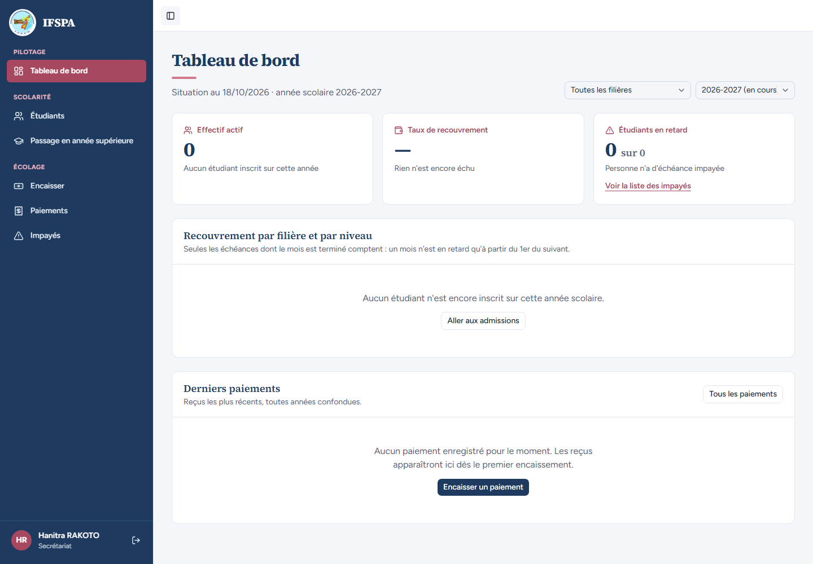
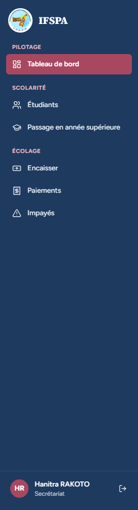
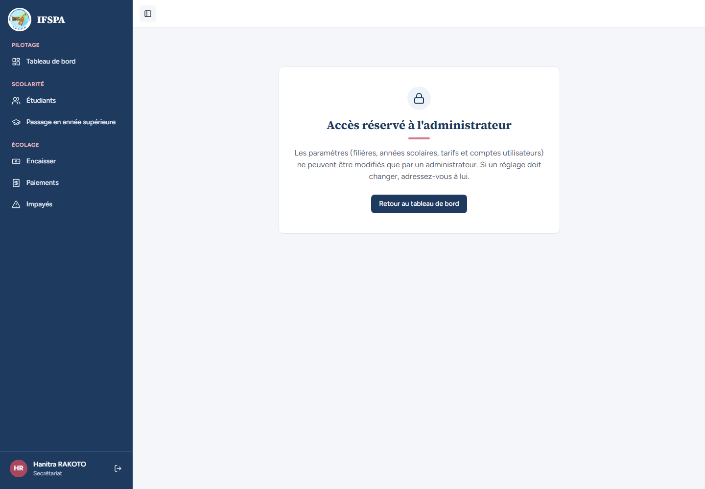

# UC01-02. Le secrétariat se connecte, sans accès aux Paramètres

| | |
|---|---|
| Use case | UC01. Se connecter et retrouver son espace |
| Règles couvertes | R-ROLE (le secrétariat n'accède pas aux Paramètres) |
| Rôle | Secrétariat |
| Durée estimée | 3 minutes |

## La situation

La secrétaire arrive au guichet et ouvre l'application. Elle retrouve ses six écrans de travail ; la rubrique Paramètres n'existe pas pour elle, et si elle tape l'adresse à la main, on lui explique que c'est réservé à l'administrateur.

## Avant de commencer

1. `pnpm recette:base`, `pnpm build`, `pnpm recette:app`, puis ouvrir `http://localhost:3200`.
2. Aucune donnée de préparation (`00-PREPARATION.md` n'est pas nécessaire) : le seed suffit.
3. Aucune session ouverte dans le navigateur.
4. Se connecter avec le compte **secrétariat** (identifiants `SEED_USER_*` de `.env`, affiché « Hanitra RAKOTO »).
5. Si vous enchaînez plusieurs cas, patientez une dizaine de secondes entre deux séries de connexions : après trois connexions rapprochées, la suivante est refusée (voir [UC01-09](UC01-09-tentatives-rapprochees.md)).

## Étapes

| # | Qui | Action | Résultat attendu | Capture | ✓ |
|---|---|---|---|---|---|
| 1 | Secrétariat | Ouvrir `http://localhost:3200/connexion`, saisir l'adresse et le mot de passe du secrétariat, cliquer **Se connecter**. | Le Tableau de bord s'ouvre. En bas de la barre latérale : « Hanitra RAKOTO » et « Secrétariat ». |  | |
| 2 | Secrétariat | Regarder le menu à gauche. | Six entrées : Tableau de bord, Étudiants, Passage en année supérieure, Encaisser, Paiements, Impayés. **Pas** de groupe « Administration », pas de « Paramètres ». |  | |
| 3 | Secrétariat | Ouvrir `http://localhost:3200/app/parametres`. | Titre « **Accès réservé à l'administrateur** », « Les paramètres (filières, années scolaires, tarifs et comptes utilisateurs) ne peuvent être modifiés que par un administrateur. Si un réglage doit changer, adressez-vous à lui. » et le bouton « Retour au tableau de bord ». Le menu et « Hanitra RAKOTO » restent affichés ; aucun onglet de paramètres. |  | |
| 4 | Secrétariat | Ouvrir `http://localhost:3200/app/parametres/utilisateurs`. | Même panneau « Accès réservé à l'administrateur », pas de bouton « Nouvel utilisateur ». |  | |
| 5 | Secrétariat | Cliquer **Retour au tableau de bord**. | Le Tableau de bord s'ouvre. |  | |

## Ce que ce scénario ne couvre pas

- Le refus **côté serveur** des actions des Paramètres (appel direct sans passer par l'écran) : couvert par Vitest, `tests/unit/actions-parametres-refus.test.ts` (« le refus passe avant la validation : une entrée invalide reçoit le même refus ») et `tests/unit/acces.test.ts` (bloc `exigerAdmin`). Non démontrable dans le navigateur.
- Ordinateur seulement.

## Dernière exécution par l'agent

- 18/10/2026 : ✅ 5 étapes sur 5. Voir [RAPPORT_2026-10-18_UC01](../../rapports/RAPPORT_2026-10-18_UC01.md).
- Parcours : [UC01-02-secretariat-se-connecte.recette.ts](../../parcours/UC01-02-secretariat-se-connecte.recette.ts).
