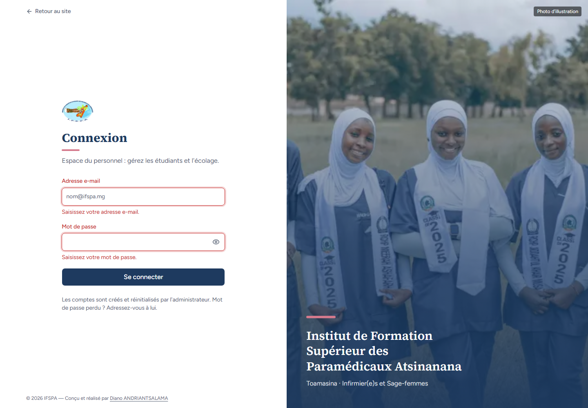
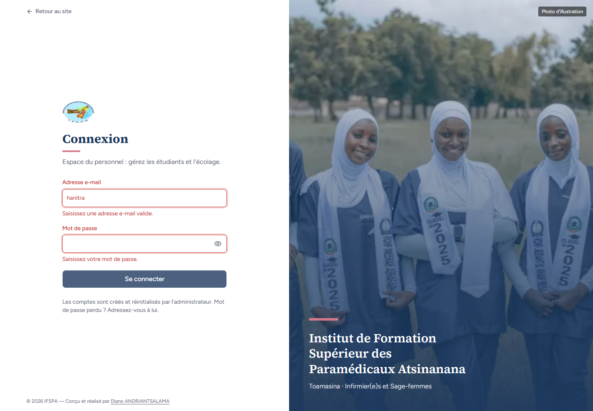
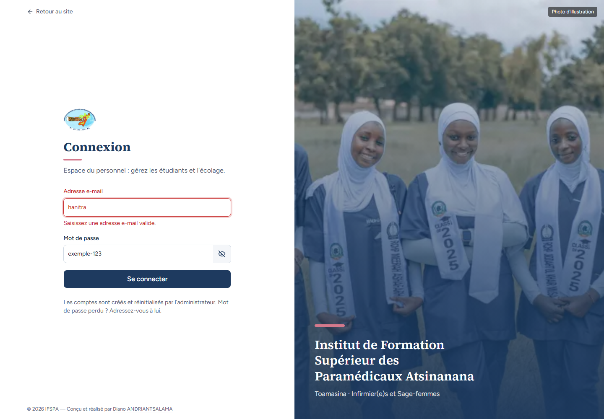
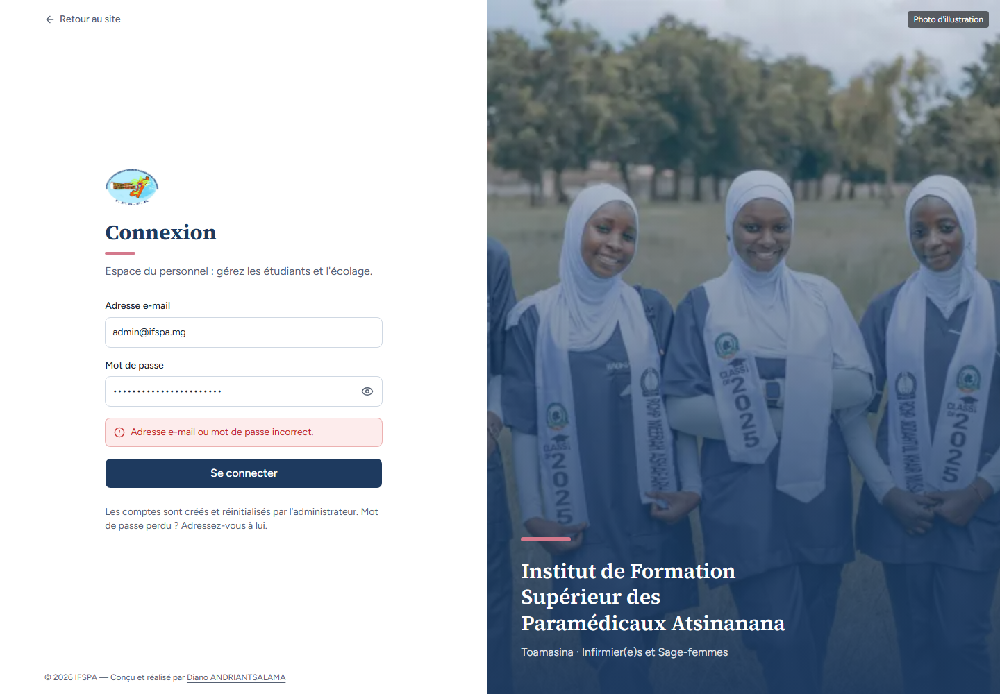
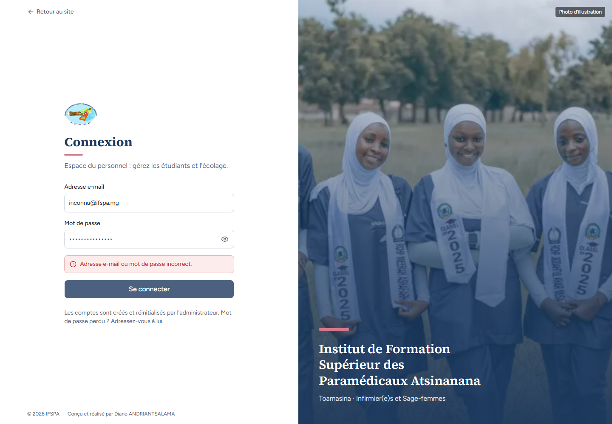

# UC01-03. Saisies incomplètes et identifiants faux sont refusés

| | |
|---|---|
| Use case | UC01. Se connecter et retrouver son espace |
| Règles couvertes | Connexion (messages d'erreur) |
| Rôle | Aucune session (visiteur du poste) |
| Durée estimée | 4 minutes |

## La situation

Une secrétaire valide le formulaire sans rien écrire, se trompe d'adresse, puis de mot de passe, ou tape une adresse qui n'existe pas. L'écran la guide sans jamais dire lequel des deux champs est faux.

## Avant de commencer

1. `pnpm recette:base`, `pnpm build`, `pnpm recette:app`, puis ouvrir `http://localhost:3200`.
2. Aucune donnée de préparation (`00-PREPARATION.md` n'est pas nécessaire) : le seed suffit.
3. Aucune session ouverte dans le navigateur.
4. Si vous enchaînez plusieurs cas, patientez une dizaine de secondes entre deux séries de connexions : après trois connexions rapprochées, la suivante est refusée (voir [UC01-09](UC01-09-tentatives-rapprochees.md)).

## Étapes

| # | Qui | Action | Résultat attendu | Capture | ✓ |
|---|---|---|---|---|---|
| 1 | — | Ouvrir `/connexion` puis cliquer **Se connecter** sans rien saisir. | Sous « Adresse e-mail » : « Saisissez votre adresse e-mail. » ; sous « Mot de passe » : « Saisissez votre mot de passe. ». On reste sur la page de connexion. |  | |
| 2 | — | Saisir `hanitra` (sans « @ ») dans « Adresse e-mail », laisser le mot de passe vide, cliquer **Se connecter**. | « Saisissez une adresse e-mail valide. » et « Saisissez votre mot de passe. ». |  | |
| 3 | — | Saisir `exemple-123` dans « Mot de passe », cliquer l'œil « Afficher le mot de passe ». | Le mot de passe est lisible (`exemple-123`) ; le bouton devient « Masquer le mot de passe ». Un second clic remet les points. |  | |
| 4 | — | Saisir l'adresse de l'administrateur et un mauvais mot de passe, cliquer **Se connecter**. | Encadré rouge : « **Adresse e-mail ou mot de passe incorrect.** ». On reste sur `/connexion`. |  | |
| 5 | — | Saisir `inconnu@ifspa.mg` et `peu-importe-123`, cliquer **Se connecter**. | Le **même** message « Adresse e-mail ou mot de passe incorrect. » : on ne sait pas si l'adresse ou le mot de passe est faux. |  | |
| 6 | — | Saisir l'adresse et le mot de passe corrects du secrétariat, cliquer **Se connecter**. | Le Tableau de bord s'ouvre : les refus précédents n'ont bloqué personne. |  | |

## Ce que ce scénario ne couvre pas

- Compte désactivé : [UC01-06](UC01-06-compte-desactive.md). Quatrième tentative en moins de dix secondes : [UC01-09](UC01-09-tentatives-rapprochees.md).
- Message « Connexion au serveur impossible. Vérifiez votre connexion Internet. » (serveur ou réseau coupé) : non démontré (pas de coupure réelle en recette).
- Ordinateur seulement.

## Dernière exécution par l'agent

- 18/10/2026 : ✅ 6 étapes sur 6. Voir [RAPPORT_2026-10-18_UC01](../../rapports/RAPPORT_2026-10-18_UC01.md).
- Parcours : [UC01-03-refus-identifiants.recette.ts](../../parcours/UC01-03-refus-identifiants.recette.ts).
