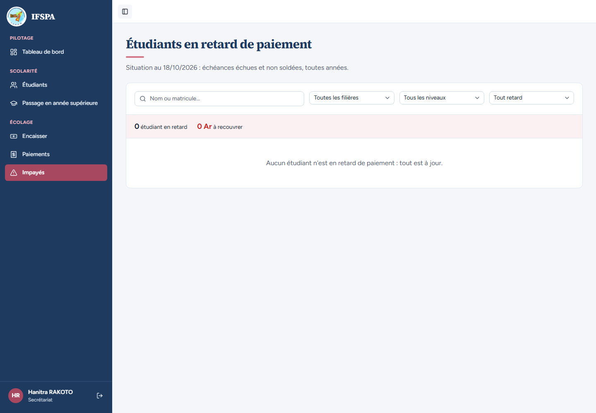

# UC01-04. Sans session, on est renvoyé à la connexion puis ramené à la page demandée

| | |
|---|---|
| Use case | UC01. Se connecter et retrouver son espace |
| Règles couvertes | Connexion (adresse de retour) |
| Rôle | Secrétariat |
| Durée estimée | 4 minutes |

## La situation

La secrétaire a mis la page des Impayés en favori. Au matin, sa session est fermée : en cliquant son favori, elle passe par la connexion puis retombe directement sur les Impayés. Une adresse de retour piégée (vers un autre site) est ignorée.

## Avant de commencer

1. `pnpm recette:base`, `pnpm build`, `pnpm recette:app`, puis ouvrir `http://localhost:3200`.
2. Aucune donnée de préparation (`00-PREPARATION.md` n'est pas nécessaire) : le seed suffit.
3. Aucune session ouverte dans le navigateur.
4. Se connecter avec le compte **secrétariat** (identifiants `SEED_USER_*` de `.env`, affiché « Hanitra RAKOTO »).
5. Si vous enchaînez plusieurs cas, patientez une dizaine de secondes entre deux séries de connexions : après trois connexions rapprochées, la suivante est refusée (voir [UC01-09](UC01-09-tentatives-rapprochees.md)).

## Étapes

| # | Qui | Action | Résultat attendu | Capture | ✓ |
|---|---|---|---|---|---|
| 1 | — | Sans être connecté, ouvrir `http://localhost:3200/app/impayes`. | La page « Connexion » s'affiche ; l'adresse est `/connexion?retour=%2Fapp%2Fimpayes`. |  | |
| 2 | Secrétariat | Saisir l'adresse et le mot de passe du secrétariat, cliquer **Se connecter**. | La page « Étudiants en retard de paiement » (écran Impayés) s'ouvre, **pas** le tableau de bord. « Hanitra RAKOTO » est en bas de la barre latérale. |  | |
| 3 | Secrétariat | Déjà connecté, ouvrir `http://localhost:3200/connexion`. | On est renvoyé directement au Tableau de bord, sans revoir le formulaire. |  | |
| 4 | Secrétariat | Supprimer les cookies du site (ou se déconnecter), puis ouvrir `http://localhost:3200/connexion?retour=https%3A%2F%2Fexemple.com` et se connecter. | Le Tableau de bord de l'application s'ouvre : l'adresse externe est ignorée (on reste sur `localhost:3200`). |  | |
| 5 | — | Sans session, sur `/connexion`, cliquer **Retour au site**. | La page publique de l'institut s'ouvre (« Se former aux métiers paramédicaux à Toamasina », boutons « Découvrir les filières » et « Nous contacter »). |  | |

## Ce que ce scénario ne couvre pas

- La règle de sûreté de l'adresse de retour (chemin interne seulement, avec sa requête) : couvert par Vitest, `tests/unit/roles.test.ts` (`destinationApresConnexion`).
- Ordinateur seulement.

## Dernière exécution par l'agent

- 18/10/2026 : ✅ 5 étapes sur 5. Voir [RAPPORT_2026-10-18_UC01](../../rapports/RAPPORT_2026-10-18_UC01.md).
- Parcours : [UC01-04-retour-page-demandee.recette.ts](../../parcours/UC01-04-retour-page-demandee.recette.ts).
