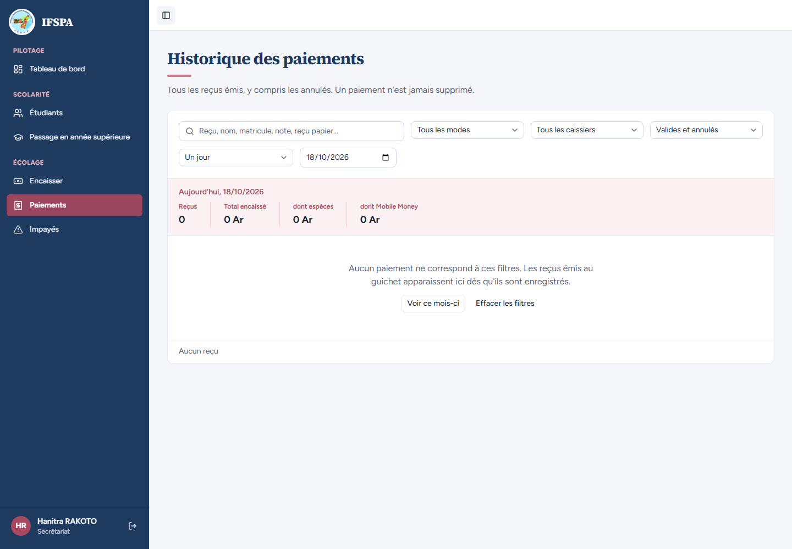

# UC01-05. Se déconnecter ferme l'accès, un autre compte peut ouvrir sa session sur le même poste

| | |
|---|---|
| Use case | UC01. Se connecter et retrouver son espace |
| Règles couvertes | R-ROLE (changement de compte sur un poste partagé) |
| Rôle | Secrétariat puis administrateur |
| Durée estimée | 4 minutes |

## La situation

En fin de journée la secrétaire se déconnecte. Le bouton « Précédent » ne doit pas rouvrir sa page. L'administrateur qui passe ensuite sur le même poste se connecte et ne voit que son propre nom et ses propres droits.

## Avant de commencer

1. `pnpm recette:base`, `pnpm build`, `pnpm recette:app`, puis ouvrir `http://localhost:3200`.
2. Aucune donnée de préparation (`00-PREPARATION.md` n'est pas nécessaire) : le seed suffit.
3. Aucune session ouverte dans le navigateur.
4. Se connecter avec le compte **secrétariat** (identifiants `SEED_USER_*` de `.env`, affiché « Hanitra RAKOTO »), puis, à l'étape 5, avec le compte **administrateur** (identifiants `SEED_ADMIN_*` de `.env`, affiché « Administrateur IFSPA »).
5. Si vous enchaînez plusieurs cas, patientez une dizaine de secondes entre deux séries de connexions : après trois connexions rapprochées, la suivante est refusée (voir [UC01-09](UC01-09-tentatives-rapprochees.md)).

## Étapes

| # | Qui | Action | Résultat attendu | Capture | ✓ |
|---|---|---|---|---|---|
| 1 | Secrétariat | Se connecter, puis cliquer **Paiements** dans le menu. | « Historique des paiements » s'ouvre. « Hanitra RAKOTO » et « Secrétariat » sont en bas de la barre latérale. |  | |
| 2 | Secrétariat | Cliquer le bouton **Se déconnecter** (flèche, en bas de la barre latérale). | Retour à la page « Connexion », champs vides. |  | |
| 3 | — | Cliquer le bouton « Précédent » du navigateur. | La page Paiements ne se rouvre pas : on revoit la page de connexion. |  | |
| 4 | — | Ouvrir `http://localhost:3200/app/etudiants`. | La connexion est redemandée (`/connexion?retour=%2Fapp%2Fetudiants`). |  | |
| 5 | Administrateur | Se connecter avec le compte administrateur. | Le Tableau de bord s'ouvre avec « Administrateur IFSPA » et « Administrateur » ; aucune trace de « Hanitra RAKOTO » ; « Paramètres » est dans le menu. |  | |

## Ce que ce scénario ne couvre pas

- Déconnexion **hors ligne** ou avec des paiements en attente d'envoi (bouton refusé) : [UC13-04](../UC13-hors-ligne/UC13-04-menu-deconnexion.md).
- La session supprimée côté serveur à la déconnexion n'est pas démontrable à l'écran.
- Ordinateur seulement.

## Dernière exécution par l'agent

- 18/10/2026 : ✅ 5 étapes sur 5. Voir [RAPPORT_2026-10-18_UC01](../../rapports/RAPPORT_2026-10-18_UC01.md).
- Parcours : [UC01-05-deconnexion.recette.ts](../../parcours/UC01-05-deconnexion.recette.ts).
