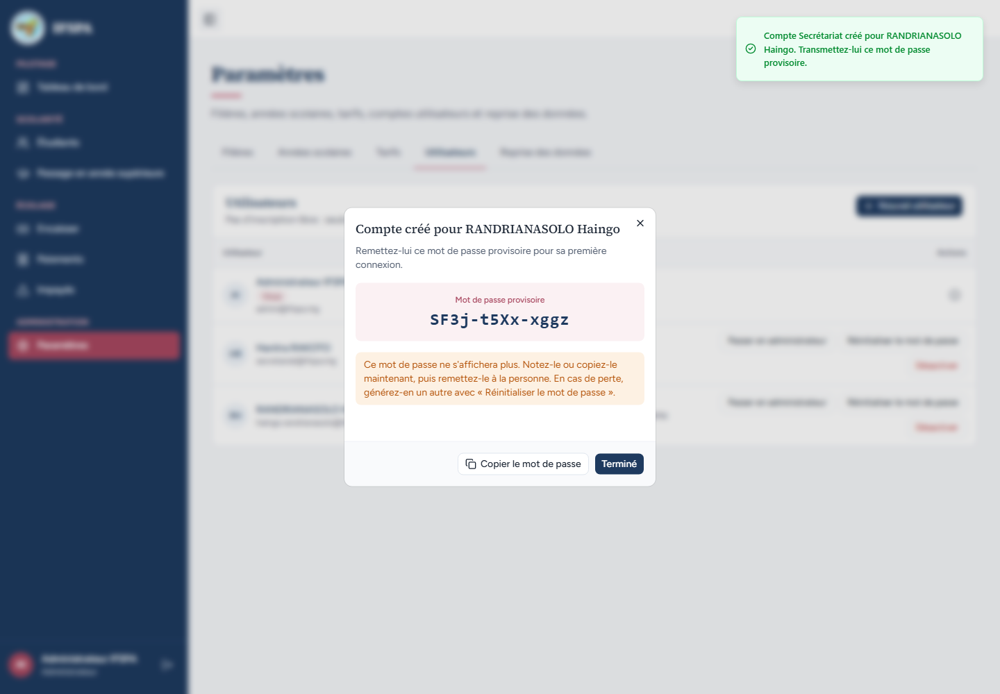
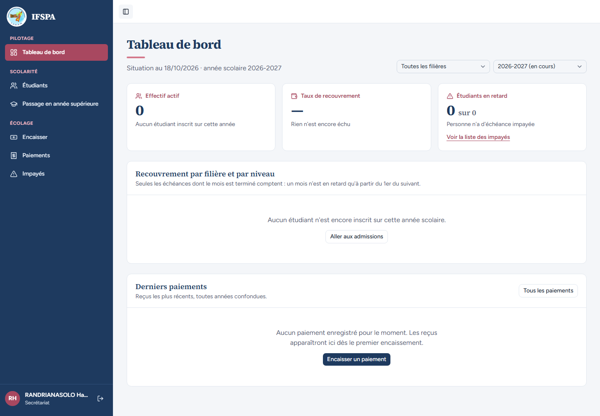
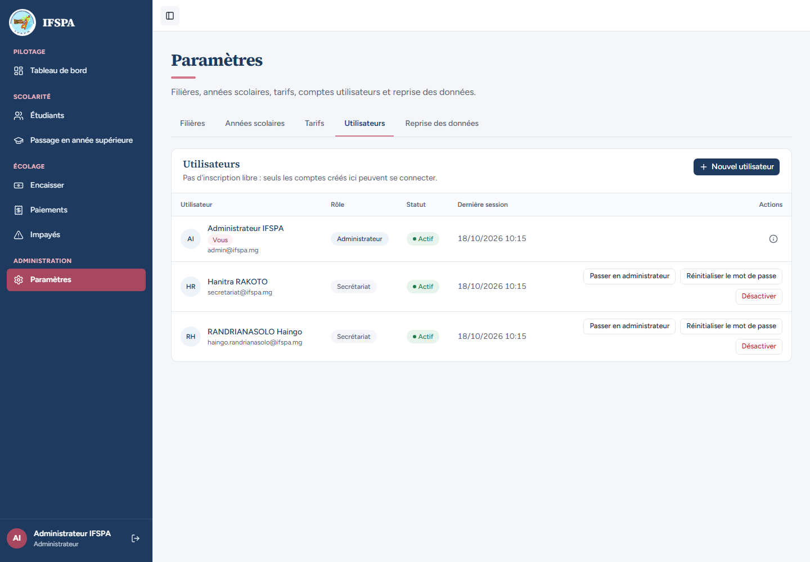
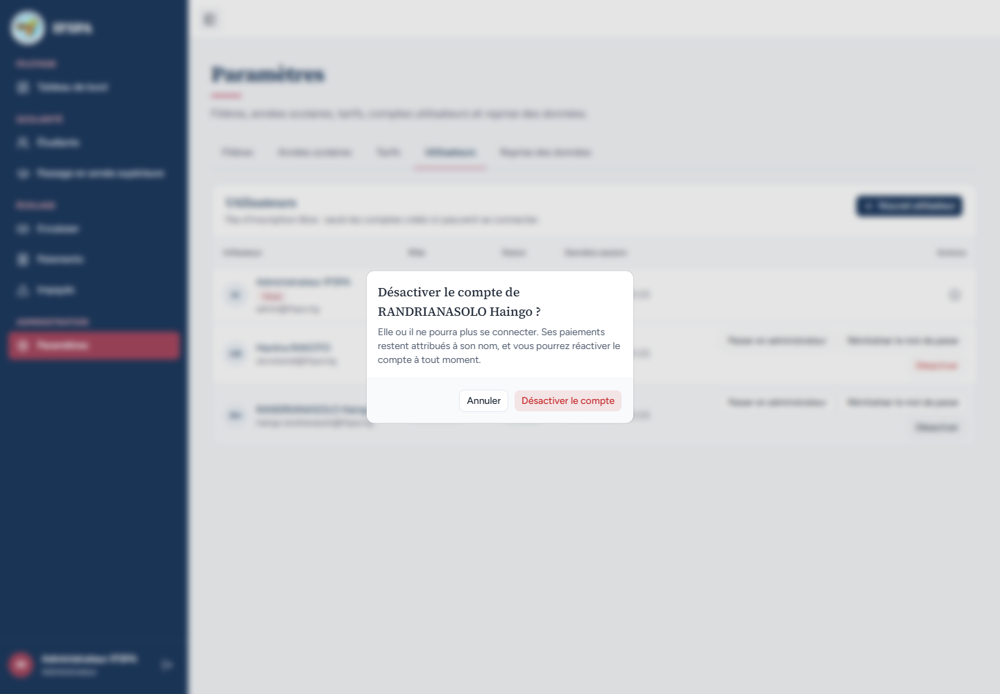
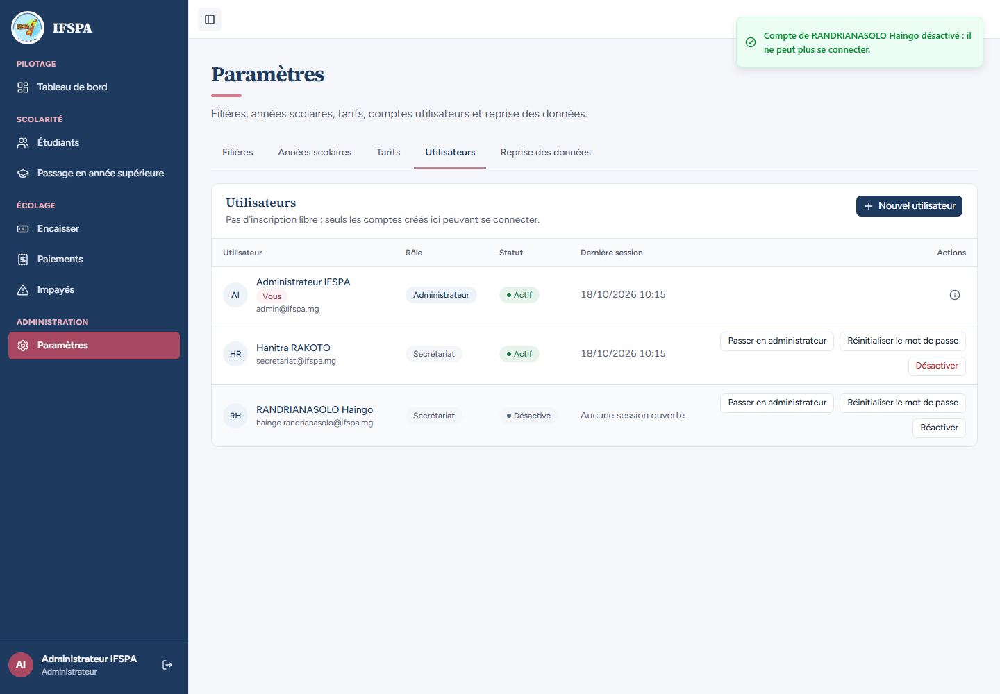
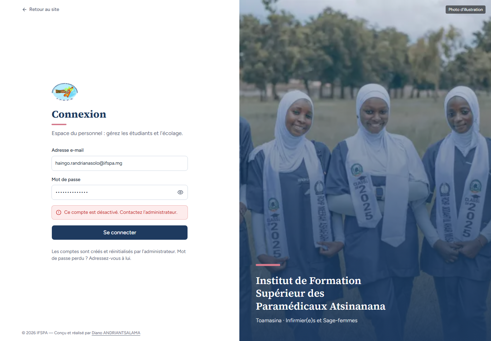
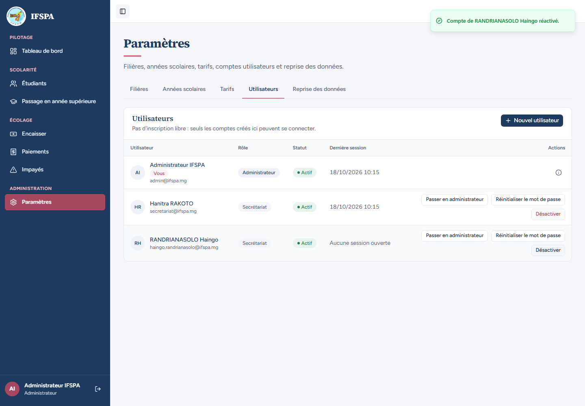

# UC01-06. Un compte désactivé ne peut plus se connecter, ni garder sa session

| | |
|---|---|
| Use case | UC01. Se connecter et retrouver son espace |
| Règles couvertes | R-ROLE (comptes du personnel, sessions fermées) |
| Rôle | Administrateur et secrétariat (nouveau compte) |
| Durée estimée | 8 minutes |

## La situation

Une nouvelle secrétaire, RANDRIANASOLO Haingo, reçoit un compte. Elle se connecte, puis quitte l'institut : l'administrateur désactive son compte. Elle ne doit plus pouvoir se connecter, ni continuer à travailler dans une fenêtre restée ouverte. Si elle revient, l'administrateur réactive le compte.

## Avant de commencer

1. `pnpm recette:base`, `pnpm build`, `pnpm recette:app`, puis ouvrir `http://localhost:3200`.
2. Aucune donnée de préparation (`00-PREPARATION.md` n'est pas nécessaire) : le seed suffit.
3. Ce cas **crée un compte** (écran de [UC03](../../MATRICE.md)) : repartir de `pnpm recette:base` pour le rejouer.
4. Deux fenêtres de navigateur : l'une avec le compte **administrateur** (identifiants `SEED_ADMIN_*` de `.env`, affiché « Administrateur IFSPA »), l'autre sans session.
5. Si vous enchaînez plusieurs cas, patientez une dizaine de secondes entre deux séries de connexions : après trois connexions rapprochées, la suivante est refusée (voir [UC01-09](UC01-09-tentatives-rapprochees.md)).

## Étapes

| # | Qui | Action | Résultat attendu | Capture | ✓ |
|---|---|---|---|---|---|
| 1 | Administrateur | **Paramètres › Utilisateurs**, bouton **Nouvel utilisateur** : Nom `RANDRIANASOLO Haingo`, Courriel `haingo.randrianasolo@ifspa.mg`, Rôle « Secrétariat » (déjà choisi), **Créer le compte**. | Fenêtre « Compte créé pour RANDRIANASOLO Haingo » avec le « Mot de passe provisoire » (affiché une seule fois ; il change à chaque rejeu : le noter) et le message « Compte Secrétariat créé pour RANDRIANASOLO Haingo. Transmettez-lui ce mot de passe provisoire. ». Après **Terminé**, sa ligne indique « Aucune session ouverte ». |  | |
| 2 | Haingo | Dans l'autre fenêtre, ouvrir `/connexion` et se connecter avec ce courriel et ce mot de passe provisoire. | Le Tableau de bord s'ouvre avec « RANDRIANASOLO Haingo » et « Secrétariat », sans « Paramètres » dans le menu. (Le bouton de déconnexion est rogné par le bord de la barre : constat 3 du rapport.) |  | |
| 3 | Administrateur | Recharger **Paramètres › Utilisateurs**. | La ligne de Haingo est « Actif » avec la date et l'heure de sa dernière session (plus « Aucune session ouverte »). |  | |
| 4 | Administrateur | Cliquer **Désactiver** sur sa ligne. | Fenêtre « Désactiver le compte de RANDRIANASOLO Haingo ? » : « Elle ou il ne pourra plus se connecter. Ses paiements restent attribués à son nom, et vous pourrez réactiver le compte à tout moment. ». Après **Désactiver le compte** : message « Compte de RANDRIANASOLO Haingo désactivé : il ne peut plus se connecter. », statut « Désactivé », « Aucune session ouverte », bouton « Réactiver ». |   | |
| 5 | Haingo | Dans sa fenêtre restée ouverte sur le tableau de bord, cliquer **Étudiants** dans le menu. | **Attendu** (la désactivation ferme les sessions, comme l'annonce déjà le changement de rôle) : la connexion est redemandée. **Obtenu** : ❌ la liste « Étudiants » s'ouvre, avec « RANDRIANASOLO Haingo » en bas de la barre latérale (constat 1 du rapport). |  | |
| 6 | Haingo | Recharger la page (F5). | La page « Connexion » s'affiche : la session est bien fermée. |  | |
| 7 | Haingo | Ouvrir `/connexion`, saisir le même courriel et mot de passe, cliquer **Se connecter**. | Encadré rouge « **Ce compte est désactivé. Contactez l'administrateur.** ». On reste sur `/connexion`. |  | |
| 8 | Administrateur | Cliquer **Réactiver** sur la ligne de Haingo, puis dans l'autre fenêtre cliquer **Se connecter** avec les mêmes identifiants. | Message « Compte de RANDRIANASOLO Haingo réactivé. », statut « Actif ». Haingo arrive sur le Tableau de bord. |   | |

## Ce que ce scénario ne couvre pas

- Changement de rôle et réinitialisation du mot de passe (sessions fermées aussi) : UC03, non testé ici.
- Le refus serveur des actions de comptes par le secrétariat : couvert par Vitest, `tests/unit/actions-parametres-refus.test.ts`.
- Les Server Actions envoyées depuis la fenêtre ouverte du compte désactivé : non démontré (la session n'existe plus, `requireSession` renvoie vers la connexion).
- Ordinateur seulement.

## Dernière exécution par l'agent

- 18/10/2026 : ❌ étape 5 sur 8 : après la désactivation, un clic dans le menu d'une fenêtre restée ouverte ouvre encore la liste des étudiants (les 7 autres étapes ✅). Le rechargement de la page ferme bien la session. Voir [RAPPORT_2026-10-18_UC01](../../rapports/RAPPORT_2026-10-18_UC01.md).
- Parcours : [UC01-06-compte-desactive.recette.ts](../../parcours/UC01-06-compte-desactive.recette.ts).
