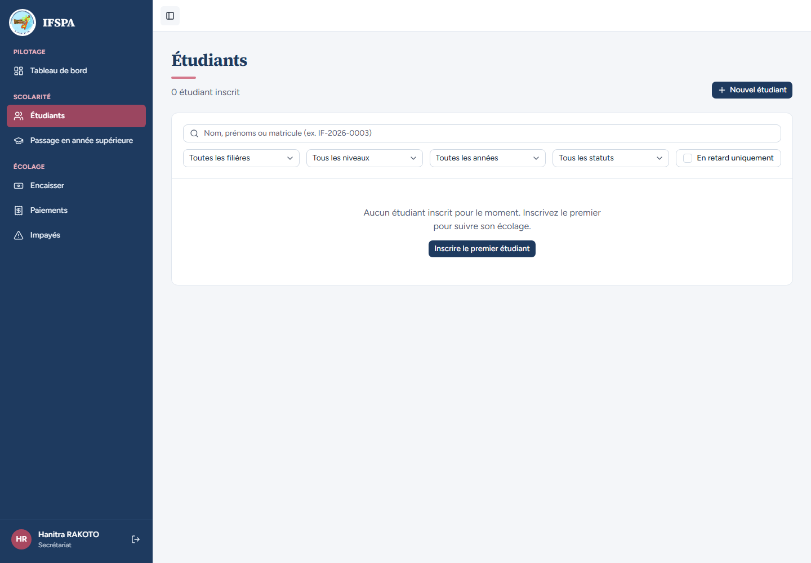
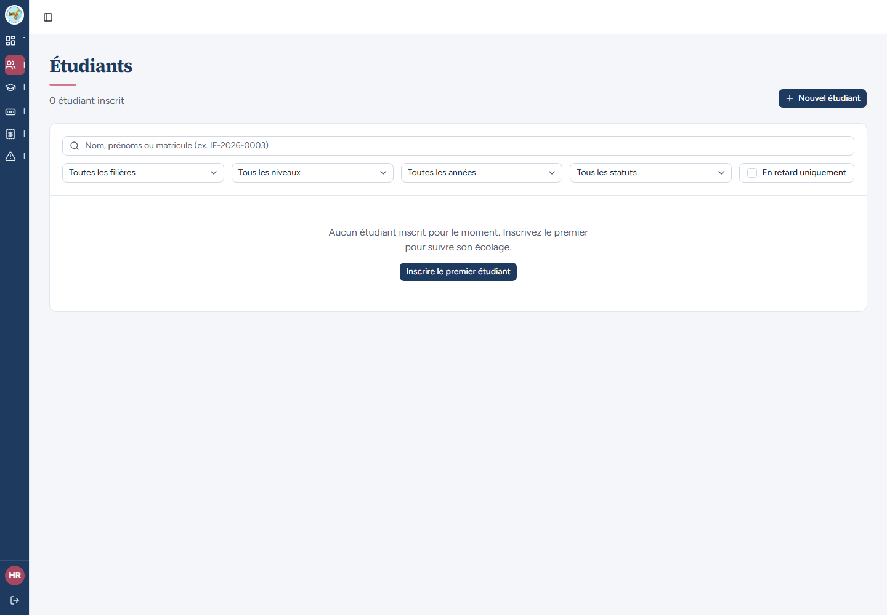
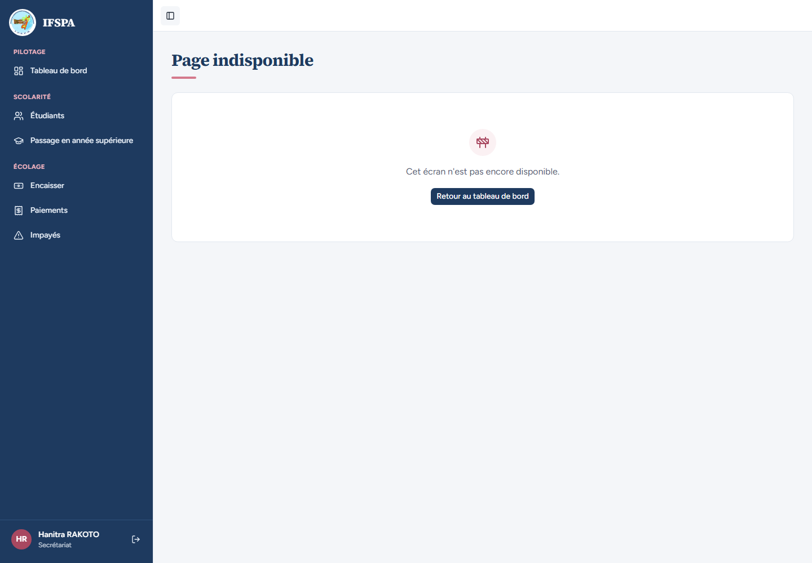
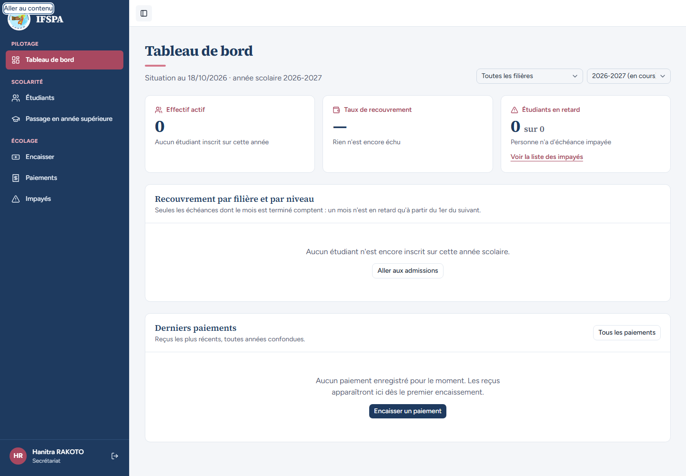

# UC01-07. Le cadre de l'application sur ordinateur : menu, repli, page indisponible

| | |
|---|---|
| Use case | UC01. Se connecter et retrouver son espace |
| Règles couvertes | Cadre de l'application |
| Rôle | Secrétariat |
| Durée estimée | 4 minutes |

## La situation

La secrétaire se déplace dans l'application : le menu marque la page où elle est, la barre peut être repliée pour gagner de la place, une adresse inconnue reste dans le cadre, et au clavier un lien permet de sauter le menu.

## Avant de commencer

1. `pnpm recette:base`, `pnpm build`, `pnpm recette:app`, puis ouvrir `http://localhost:3200`.
2. Aucune donnée de préparation (`00-PREPARATION.md` n'est pas nécessaire) : le seed suffit.
3. Aucune session ouverte dans le navigateur.
4. Se connecter avec le compte **secrétariat** (identifiants `SEED_USER_*` de `.env`, affiché « Hanitra RAKOTO »).
5. Si vous enchaînez plusieurs cas, patientez une dizaine de secondes entre deux séries de connexions : après trois connexions rapprochées, la suivante est refusée (voir [UC01-09](UC01-09-tentatives-rapprochees.md)).

## Étapes

| # | Qui | Action | Résultat attendu | Capture | ✓ |
|---|---|---|---|---|---|
| 1 | Secrétariat | Se connecter. | Le Tableau de bord est l'unique entrée active du menu. |  | |
| 2 | Secrétariat | Cliquer **Encaisser** puis **Étudiants** dans le menu. | L'entrée active suit la page (« Encaisser » puis « Étudiants »), une seule à la fois. La liste « Étudiants » s'affiche. |  | |
| 3 | Secrétariat | Cliquer le bouton **Replier le menu** (en haut à gauche). | La barre se réduit aux icônes ; le bouton de déconnexion reste visible ; la page ne déborde pas à droite. (Petits traits à droite des icônes : constat 4 du rapport.) |  | |
| 4 | Secrétariat | Cliquer **Déplier le menu**. | Les libellés reviennent, avec « Hanitra RAKOTO » et « Secrétariat » en bas. |  | |
| 5 | Secrétariat | Ouvrir `http://localhost:3200/app/ecran-inexistant`. | Titre « **Page indisponible** », « Cet écran n'est pas encore disponible. » et bouton « Retour au tableau de bord ». Le menu reste affiché. |  | |
| 6 | Secrétariat | Cliquer **Retour au tableau de bord**, puis **Paiements**, puis le logo **IFSPA** en haut de la barre. | Le Tableau de bord, puis Paiements, puis de nouveau le Tableau de bord. |  | |
| 7 | Secrétariat | Ouvrir `http://localhost:3200/app`. | Redirection vers le Tableau de bord. |  | |
| 8 | Secrétariat | Ouvrir le Tableau de bord, puis appuyer une fois sur la touche **Tab**. | Le lien « Aller au contenu » apparaît en haut à gauche, entouré (focus visible). |  | |

## Ce que ce scénario ne couvre pas

- Le téléphone : [UC01-08](UC01-08-telephone.md). Le menu grisé hors ligne : [UC13-04](../UC13-hors-ligne/UC13-04-menu-deconnexion.md).
- Lecture d'écran réelle : à faire par Diano.
- La page « Page indisponible » reçoit le code 404 (vérifié par le parcours), non visible à l'écran.

## Dernière exécution par l'agent

- 18/10/2026 : ✅ 8 étapes sur 8. Voir [RAPPORT_2026-10-18_UC01](../../rapports/RAPPORT_2026-10-18_UC01.md).
- Parcours : [UC01-07-cadre-application.recette.ts](../../parcours/UC01-07-cadre-application.recette.ts).
