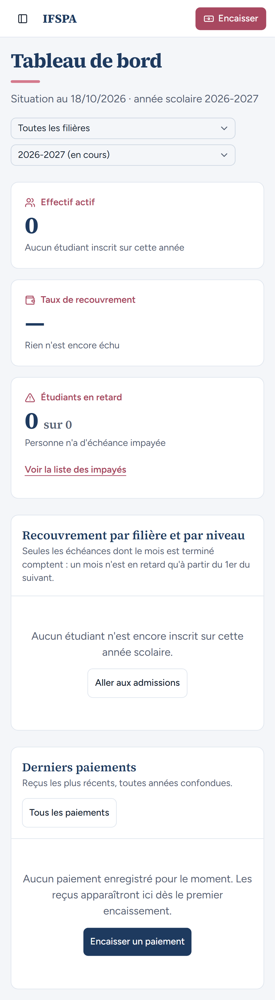
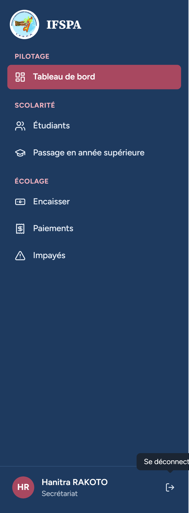
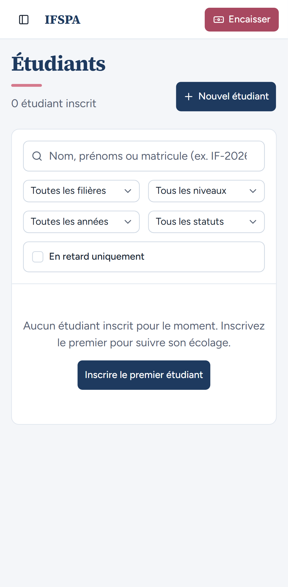
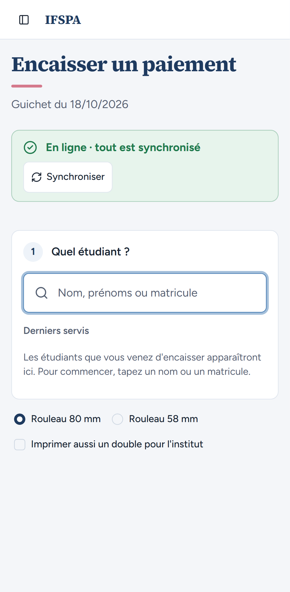
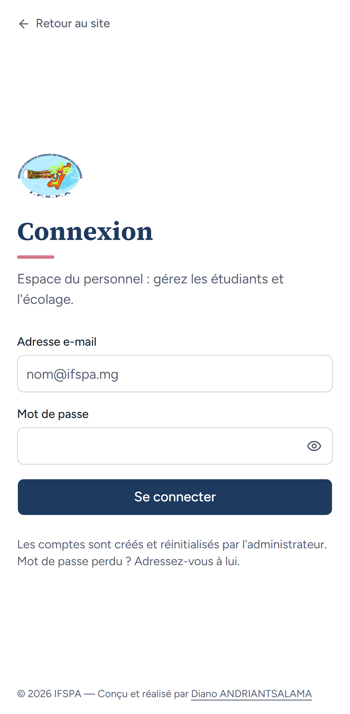

# UC01-08. Sur téléphone : connexion, tiroir du menu et bouton Encaisser

| | |
|---|---|
| Use case | UC01. Se connecter et retrouver son espace |
| Règles couvertes | Cadre de l'application (mobile) |
| Rôle | Secrétariat |
| Durée estimée | 4 minutes |

## La situation

Au guichet, la secrétaire utilise son téléphone. L'écran de connexion tient dans la page, le menu s'ouvre en tiroir, le bouton « Encaisser » est toujours à portée du pouce, et le tiroir se referme quand elle choisit un écran.

## Avant de commencer

1. `pnpm recette:base`, `pnpm build`, `pnpm recette:app`, puis ouvrir `http://localhost:3200`.
2. Aucune donnée de préparation (`00-PREPARATION.md` n'est pas nécessaire) : le seed suffit.
3. Un téléphone, ou le navigateur en mode appareil mobile (ex. Pixel 7).
4. Se connecter avec le compte **secrétariat** (identifiants `SEED_USER_*` de `.env`, affiché « Hanitra RAKOTO »).
5. Si vous enchaînez plusieurs cas, patientez une dizaine de secondes entre deux séries de connexions : après trois connexions rapprochées, la suivante est refusée (voir [UC01-09](UC01-09-tentatives-rapprochees.md)).

## Étapes

| # | Qui | Action | Résultat attendu | Capture | ✓ |
|---|---|---|---|---|---|
| 1 | — | Ouvrir `http://localhost:3200/connexion` sur le téléphone. | Le formulaire tient dans la largeur, sans défilement horizontal, avec « Se connecter » en pleine largeur. |  | |
| 2 | Secrétariat | Se connecter. | Le Tableau de bord s'affiche en une colonne. En-tête : bouton de menu, « IFSPA » et bouton rose « **Encaisser** ». |  | |
| 3 | Secrétariat | Toucher le bouton de menu (« Ouvrir le menu »). | Le tiroir montre les six entrées, « Hanitra RAKOTO » et « Secrétariat » en bas, et la flèche de déconnexion. Pas de « Paramètres ». |  | |
| 4 | Secrétariat | Toucher **Étudiants**. | Le tiroir se referme sur la liste « Étudiants ». |  | |
| 5 | Secrétariat | Toucher le bouton **Encaisser** de l'en-tête. | L'écran « Encaisser un paiement » s'ouvre (« Guichet du 18/10/2026 », « En ligne · tout est synchronisé »). Le bouton « Encaisser » de l'en-tête disparaît (on y est). |  | |
| 6 | Secrétariat | Rouvrir le menu, toucher **Se déconnecter**. | La page « Connexion » s'affiche. |  | |

## Ce que ce scénario ne couvre pas

- L'encaissement lui-même sur téléphone : UC06 (non couvert sur mobile).
- Appareil réel : à faire par Diano.

## Dernière exécution par l'agent

- 18/10/2026 : ✅ 6 étapes sur 6 (projet `mobile`, Pixel 7). Voir [RAPPORT_2026-10-18_UC01](../../rapports/RAPPORT_2026-10-18_UC01.md).
- Parcours : [UC01-08-telephone.recette.ts](../../parcours/UC01-08-telephone.recette.ts).
- Lancer avec `--project mobile`.
