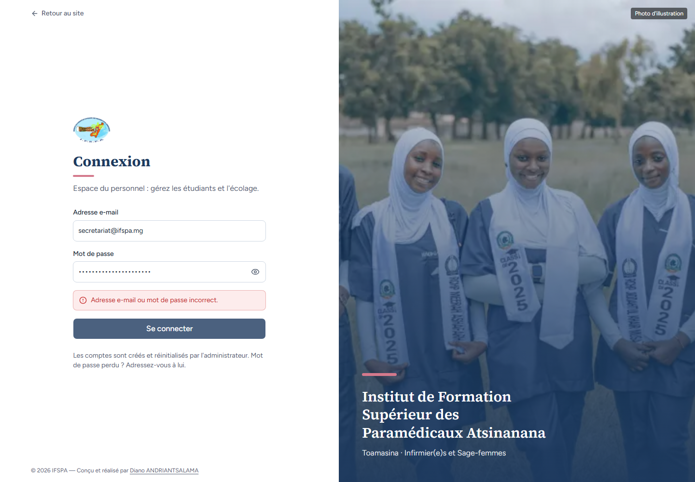

# UC01-09. Quatre tentatives de connexion en moins de dix secondes

| | |
|---|---|
| Use case | UC01. Se connecter et retrouver son espace |
| Règles couvertes | Connexion (limite de tentatives) |
| Rôle | Secrétariat (compte légitime) |
| Durée estimée | 3 minutes |

## La situation

Une secrétaire se trompe trois fois de mot de passe en quelques secondes, puis tape enfin le bon. L'application refuse la quatrième tentative, même correcte, tant que dix secondes ne se sont pas écoulées.

## Avant de commencer

1. `pnpm recette:base`, `pnpm build`, `pnpm recette:app`, puis ouvrir `http://localhost:3200`.
2. Aucune donnée de préparation (`00-PREPARATION.md` n'est pas nécessaire) : le seed suffit.
3. Aucune session ouverte. Attendre dix secondes après toute connexion précédente.
4. Utiliser le compte **secrétariat** (identifiants `SEED_USER_*` de `.env`, affiché « Hanitra RAKOTO ») (le mot de passe correct sert à l'étape 2).

## Étapes

| # | Qui | Action | Résultat attendu | Capture | ✓ |
|---|---|---|---|---|---|
| 1 | — | Sur `/connexion`, saisir l'adresse du secrétariat et trois mots de passe faux **à la suite**, en cliquant **Se connecter** à chaque fois. | « Adresse e-mail ou mot de passe incorrect. » à chaque tentative. |  | |
| 2 | — | Immédiatement, saisir le **bon** mot de passe et cliquer **Se connecter**. | La connexion est refusée avec le même message « Adresse e-mail ou mot de passe incorrect. », alors que le mot de passe est correct (constat 2 du rapport : le message ne dit pas d'attendre). |  | |
| 3 | — | Attendre dix secondes sans toucher à la page, puis recliquer **Se connecter**. | Le Tableau de bord s'ouvre. |  | |

## Ce que ce scénario ne couvre pas

- La limite (3 connexions par 10 s et par adresse IP) vient de Better Auth, en mémoire du serveur : non testée par Vitest. Plusieurs postes derrière la même adresse Internet de l'institut partagent ce plafond (question du rapport).
- Ordinateur seulement.

## Dernière exécution par l'agent

- 18/10/2026 : ✅ 3 étapes sur 3 (comportement constaté ; message trompeur noté en constat mineur, le plan ne dit rien de ce cas). Voir [RAPPORT_2026-10-18_UC01](../../rapports/RAPPORT_2026-10-18_UC01.md).
- Parcours : [UC01-09-tentatives-rapprochees.recette.ts](../../parcours/UC01-09-tentatives-rapprochees.recette.ts).
