# UC02-01. Ajouter, corriger, désactiver et supprimer une filière

| | |
|---|---|
| Use case | UC02. Préparer l'année : filières, années scolaires, tarifs |
| Règles couvertes | R-ROLE (Paramètres réservés à l'administrateur), R-MAT (le code de la filière est le préfixe du matricule) |
| Rôle | Administrateur |
| Durée estimée | 6 minutes |

## La situation

L'institut ouvre une formation de kinésithérapeutes. L'administrateur ajoute la filière « KN » dans Paramètres, se trompe d'abord de code, la corrige, la renomme, la désactive un instant (elle disparaît du formulaire d'inscription), la réactive, puis la supprime : aucun étudiant n'y est rattaché. Il constate aussi que IF, qui a des étudiants, ne peut pas être supprimée.

## Avant de commencer

1. `pnpm recette:base`, `pnpm build`, `pnpm recette:app`, puis ouvrir `http://localhost:3200`.
2. Préparation : sections A, B et C de [00-PREPARATION.md](../00-PREPARATION.md) (parcours `00-preparation`). Le compteur « Étudiants actifs » de IF (5) et de SF (2) en dépend : 5 étudiants IF (4 de 2025-2026, Nirina) et 2 SF.
3. Compte **administrateur** (identifiants `SEED_ADMIN_*` de `.env`, affiché « Administrateur IFSPA »).
4. Les cas d'UC02 s'enchaînent dans l'ordre UC02-01 à UC02-10 sur la même base ; celui-ci laisse la base telle qu'il l'a trouvée (KN est supprimée à la fin) et se rejoue donc seul.

## Étapes

| # | Qui | Action | Résultat attendu | Capture | ✓ |
|---|---|---|---|---|---|
| 1 | Administrateur | Se connecter, ouvrir **Paramètres** (onglet **Filières**). | Titre « Paramètres », onglets Filières, Années scolaires, Tarifs, Utilisateurs, Reprise des données. Tableau : **IF** « Infirmier(e)s », 3 ans, 5 étudiants actifs, « Active » ; **SF** « Sage-femmes », 3 ans, 2 étudiants actifs, « Active ». Chaque ligne a « Modifier » et « Désactiver », **pas de « Supprimer »**, mais une icône d'information. « Administrateur IFSPA » est en bas de la barre latérale. | 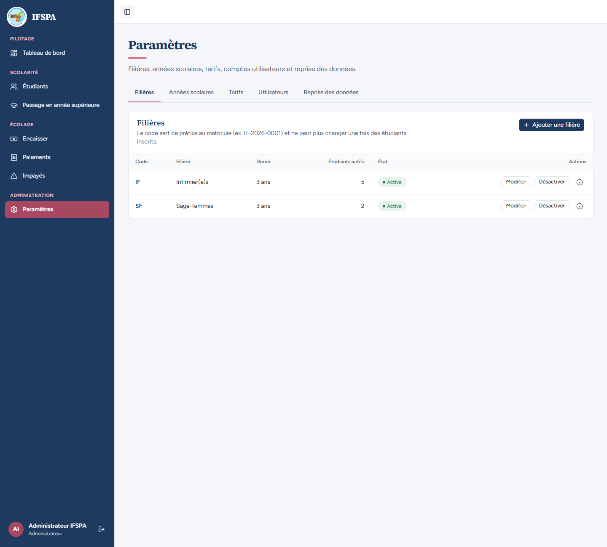 | |
| 2 | Administrateur | Cliquer l'icône d'information de la ligne IF. | « Cette filière ne peut pas être supprimée : 5 étudiants y sont rattachés. Désactivez-la plutôt : elle ne sera plus proposée à l'inscription. » | 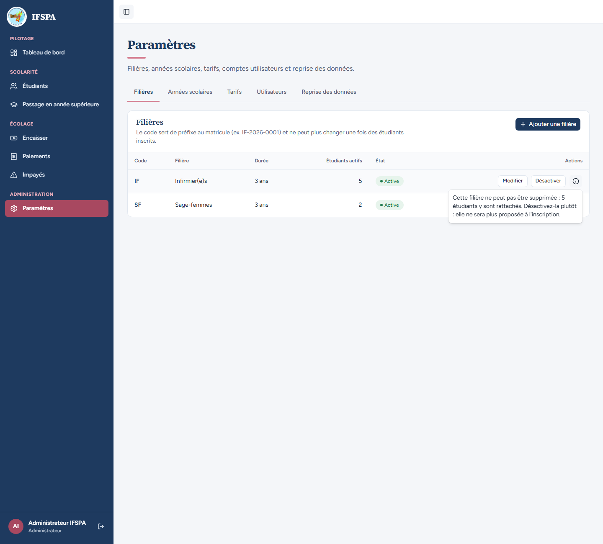 | |
| 3 | Administrateur | Cliquer **Ajouter une filière**. Code `if`, Nom de la filière `Kinésithérapeutes`, **Enregistrer la filière**. | Le code est mis en majuscules ; sous « Code » : « Le code IF est déjà utilisé par une autre filière. » Rien n'est créé. | 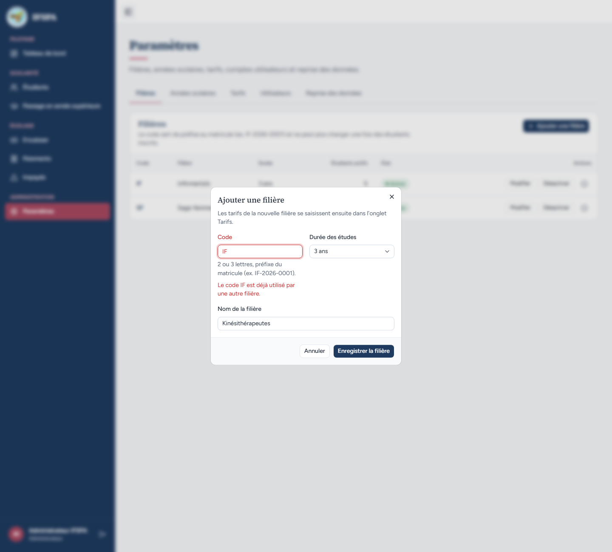 | |
| 4 | Administrateur | Remplacer le code par `K` et vider le nom, **Enregistrer la filière**. | Sous « Code » : « Le code compte 2 ou 3 lettres sans accent (ex. IF). » ; sous « Nom de la filière » : « Indiquez le nom de la filière. » | 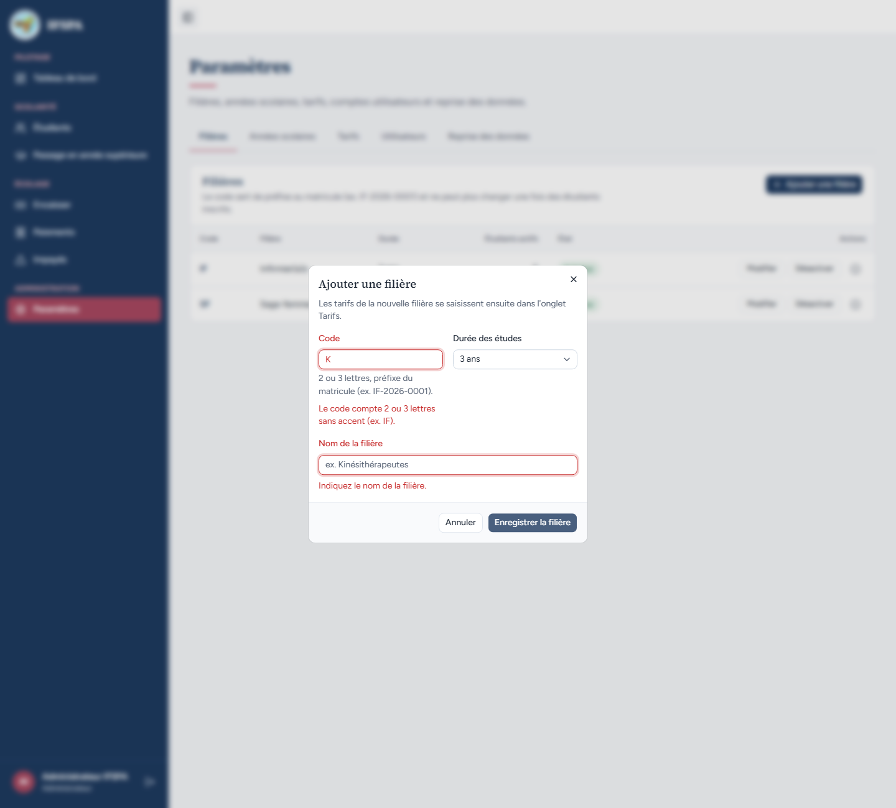 | |
| 5 | Administrateur | Code `kn`, Nom `Kinésithérapeutes`, « Durée des études » **4 ans**. | Le formulaire est prêt : « 2 ou 3 lettres, préfixe du matricule (ex. IF-2026-0001). » sous le code. | 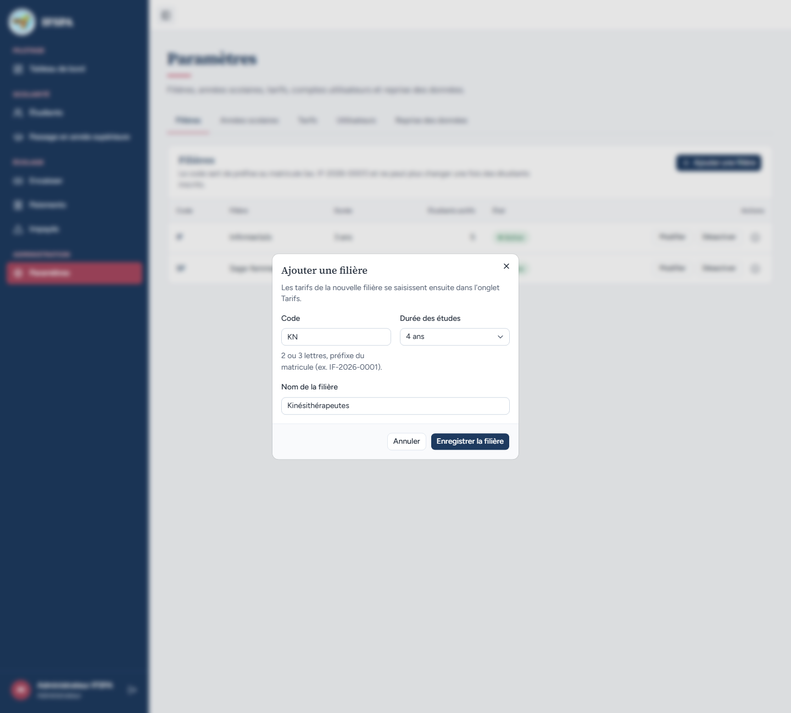 | |
| 6 | Administrateur | **Enregistrer la filière**. | Message « Filière KN créée. Saisissez maintenant ses tarifs. » avec le bouton « Saisir les tarifs ». Nouvelle ligne **KN**, « Kinésithérapeutes », 4 ans, 0 étudiant, « Active », avec « Modifier », « Désactiver » et « Supprimer » (aucun étudiant). | 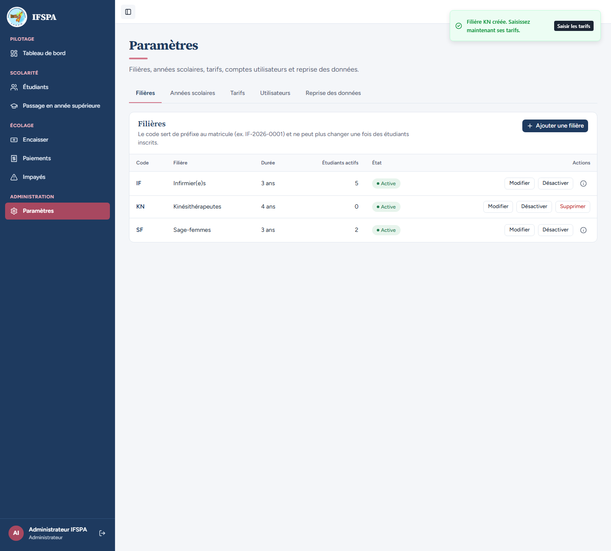 | |
| 7 | Administrateur | Cliquer **Modifier** sur la ligne KN. Dans « Modifier la filière KN », le code `KN` est affiché ; changer le nom en `Kinésithérapie`, **Enregistrer la filière**. | « Filière KN enregistrée. » La ligne KN affiche « Kinésithérapie ». | 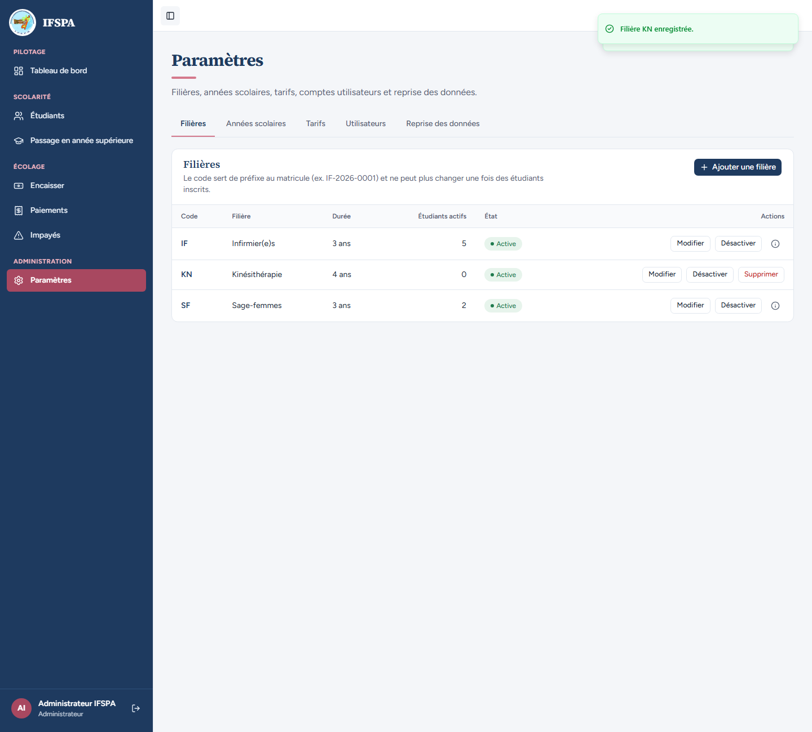 | |
| 8 | Administrateur | Cliquer **Désactiver** sur la ligne KN. | « Filière désactivée : elle n'est plus proposée à l'inscription. » Badge « Désactivée » ; le bouton devient « Réactiver ». | 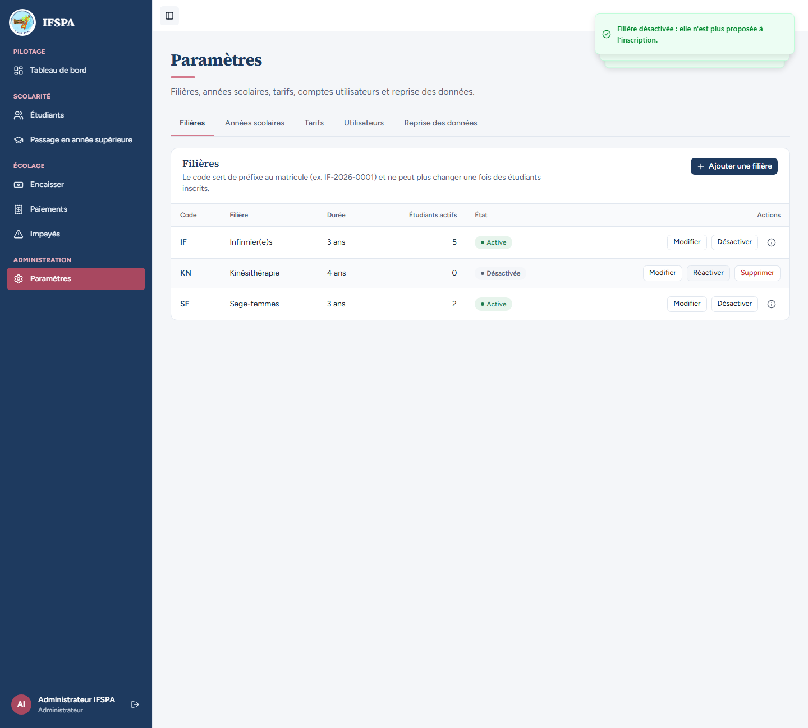 | |
| 9 | Administrateur | Menu **Étudiants**, bouton **Nouvel étudiant**. | Dans « Filière », seulement « Infirmier(e)s · IF » et « Sage-femmes · SF » : pas de Kinésithérapie. |  | |
| 10 | Administrateur | Retourner dans **Paramètres › Filières**, cliquer **Réactiver** sur KN, puis rouvrir **Étudiants › Nouvel étudiant**. | « Filière activée. » Badge « Active » ; le formulaire propose de nouveau « Infirmier(e)s · IF », « Kinésithérapie · KN » et « Sage-femmes · SF ». | 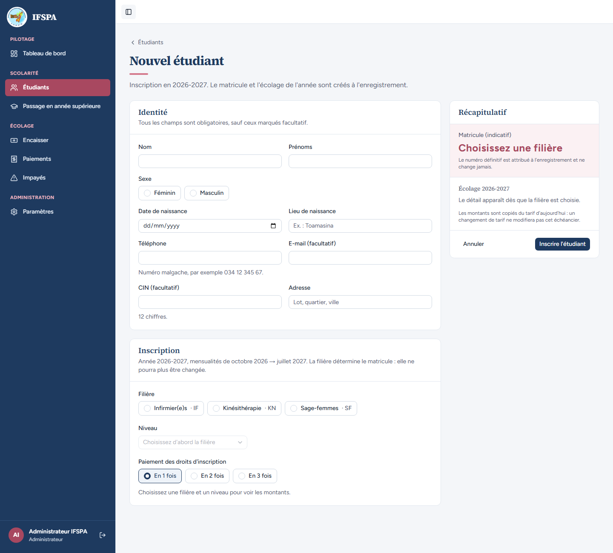 | |
| 11 | Administrateur | Retourner dans **Paramètres › Filières**, cliquer **Supprimer** sur la ligne KN. | Fenêtre « Supprimer la filière KN ? » : « Aucun étudiant n'y est rattaché. Cette suppression est définitive. » avec « Annuler » et « Supprimer la filière ». | 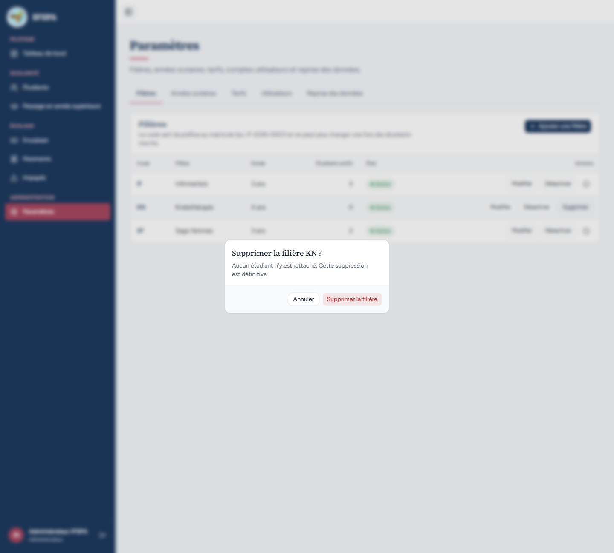 | |
| 12 | Administrateur | Cliquer **Supprimer la filière**. | « Filière KN supprimée, avec ses tarifs. » Il ne reste que IF et SF. | 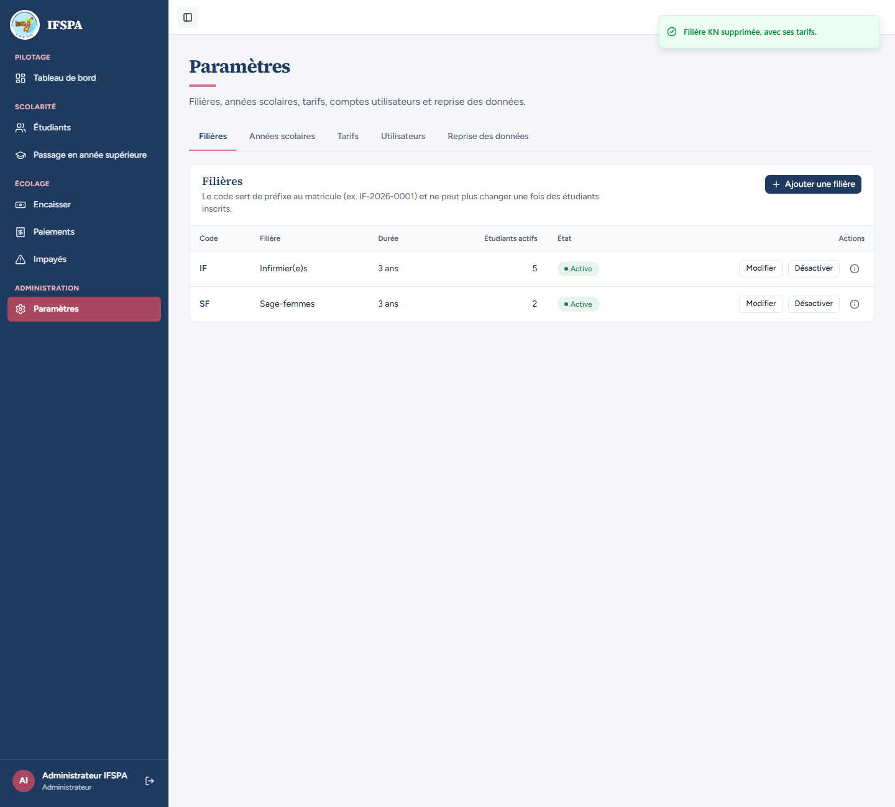 | |

## Ce que ce scénario ne couvre pas

- Le **secrétariat** n'ouvre pas cet écran : voir [UC02-08](UC02-08-secretariat-refuse.md). L'appel direct des Server Actions par un compte non administrateur n'est pas démontrable dans le navigateur : couvert par Vitest, `tests/unit/actions-parametres-refus.test.ts` (chacune des neuf actions de Paramètres, dont `creerFiliere`, `modifierFiliere`, `activerFiliere` et `supprimerFiliere`, renvoie « Cette action est réservée à l'administrateur. » sans toucher à la base).
- Refus serveur d'une suppression ou d'un code changé alors que des étudiants existent, code pris entre-temps : couvert par Vitest, `tests/integration/actions-parametres.test.ts` (blocs « suppression d'une filière » et « filières : création et modification ») et `tests/unit/parametres.test.ts`.
- Motif « des admissions y ont été enregistrées » : non démontré à l'écran (couvert par `tests/unit/parametres.test.ts`).
- Décisions provisoires n° 1 (suppression d'une filière seulement si rien ne la référence, sinon désactivation) et n° 4 (code de 2 à 3 lettres) de `STATUS.md`.
- Ordinateur seulement.

## Dernière exécution par l'agent

- 18/10/2026 : ✅ 12 étapes sur 12.
- Rapport : [RAPPORT_2026-10-18_UC02.md](../../rapports/RAPPORT_2026-10-18_UC02.md). Parcours : [UC02-01-filieres.recette.ts](../../parcours/UC02-01-filieres.recette.ts).
