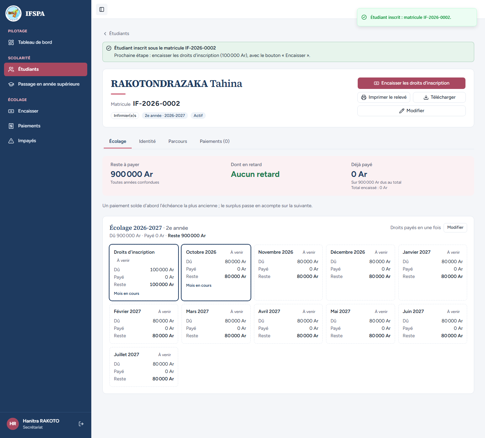
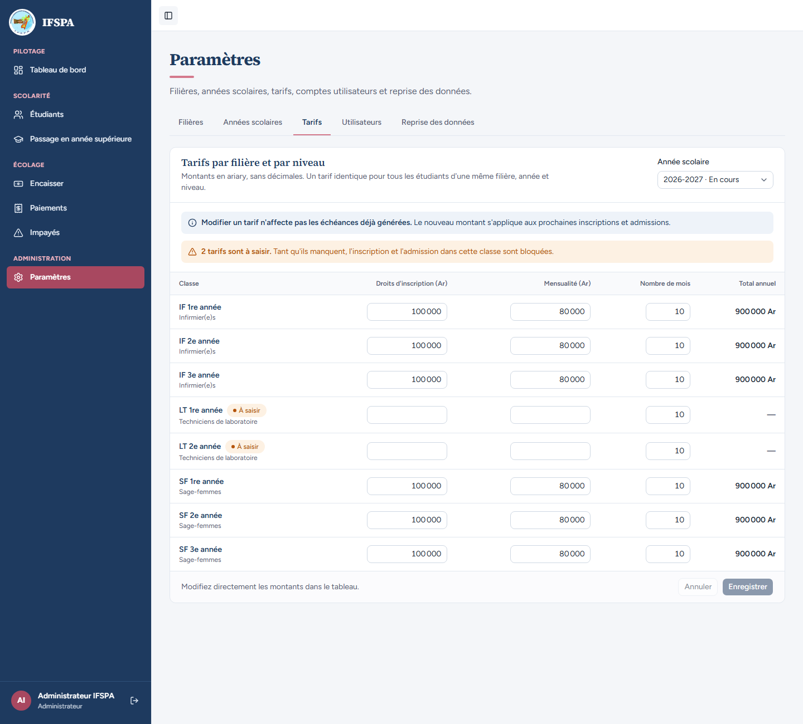
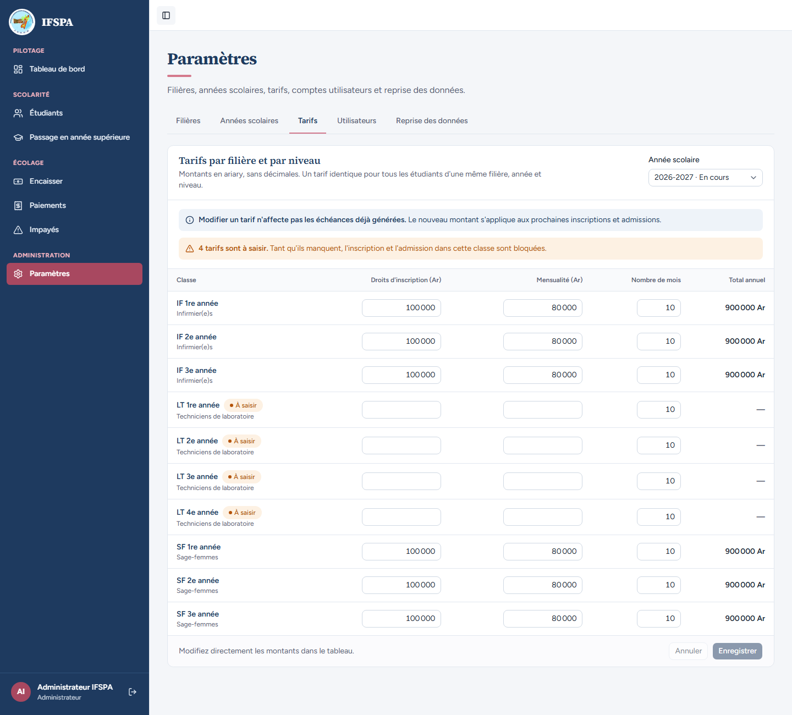
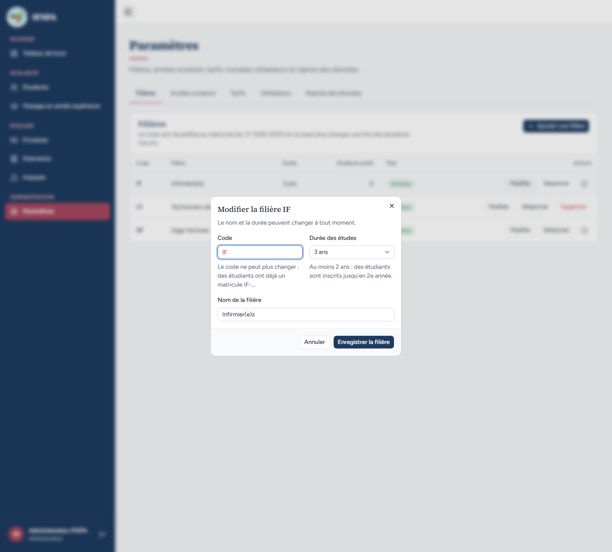
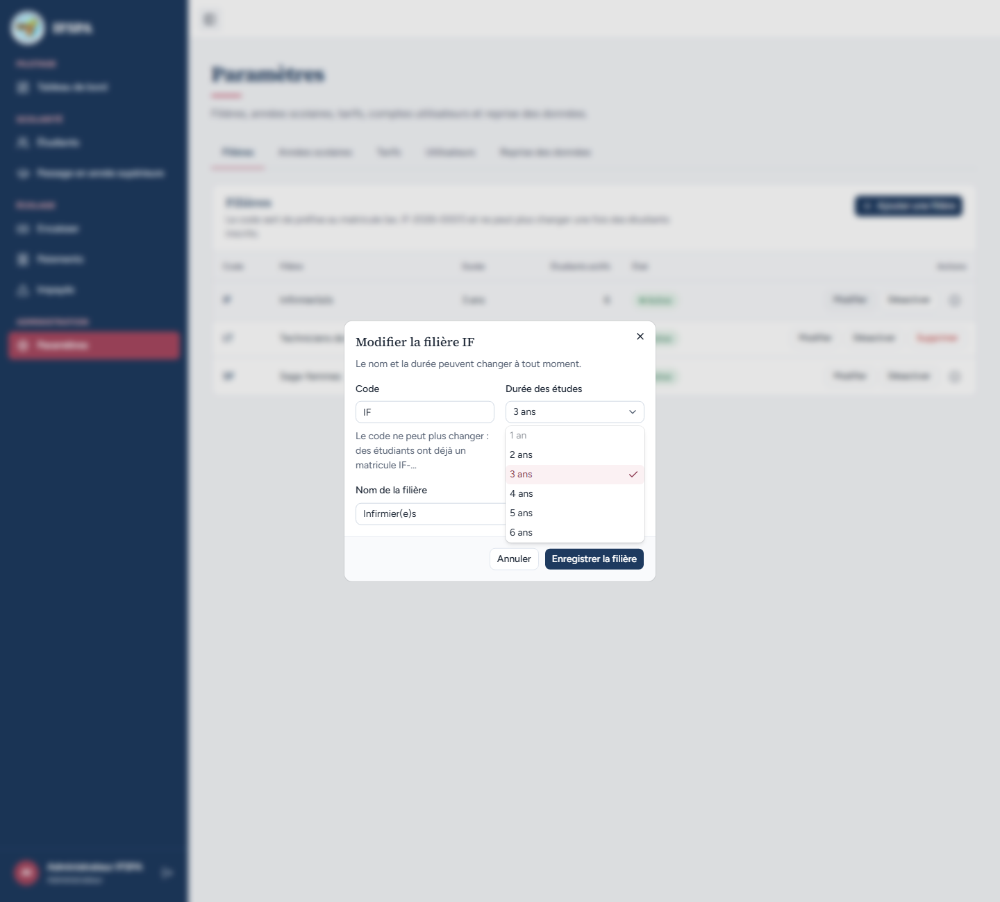

# UC02-02. La durée d'une filière fixe les classes à tarifer et ne descend pas sous le niveau inscrit

| | |
|---|---|
| Use case | UC02. Préparer l'année : filières, années scolaires, tarifs |
| Règles couvertes | R-ECH (une classe sans tarif bloque l'inscription), R-MAT (le code est figé dès qu'un étudiant a un matricule), R-ROLE |
| Rôle | Secrétariat pour l'étape 1, puis administrateur |
| Durée estimée | 7 minutes |

## La situation

Un étudiant entre directement en 2e année d'infirmier. Plus tard, l'administrateur ajoute la filière « LT » (Techniciens de laboratoire) sur 2 ans, la passe à 4 ans, et vérifie à chaque fois les classes à tarifer. Il constate qu'on ne peut plus ramener la durée de la filière IF à 1 an (un étudiant est en 2e année) ni changer son code.

## Avant de commencer

1. `pnpm recette:base`, `pnpm build`, `pnpm recette:app`, puis ouvrir `http://localhost:3200`.
2. Préparation : sections A, B et C de [00-PREPARATION.md](../00-PREPARATION.md). Idéalement après [UC02-01](UC02-01-filieres.md) (sans incidence).
3. Ce cas **inscrit Tahina IF-2026-0002** : on ne le rejoue pas sans repartir de `pnpm recette:base`. Il laisse la base avec un étudiant IF en 2e année, que les cas suivants utilisent.
4. Compte **secrétariat** (`SEED_USER_*`, « Hanitra RAKOTO ») pour l'étape 1, compte **administrateur** ensuite.

## Étapes

| # | Qui | Action | Résultat attendu | Capture | ✓ |
|---|---|---|---|---|---|
| 1 | Secrétariat | **Étudiants › Nouvel étudiant** : RAKOTONDRAZAKA Tahina, Masculin, 23/08/2004, Toamasina, 034 00 000 11, « Lot 5, Ankirihiry, Toamasina ». Filière « Infirmier(e)s · IF », niveau **2e année**. **Inscrire l'étudiant**. | « Étudiant inscrit sous le matricule IF-2026-0002 », « Écolage 2026-2027 · 2e année », reste à payer 900 000 Ar. « Hanitra RAKOTO » est en bas de la barre latérale. |  | |
| 2 | Administrateur | **Paramètres › Filières › Ajouter une filière** : Code `LT`, Nom `Techniciens de laboratoire`, Durée **2 ans**, **Enregistrer la filière**. | « Filière LT créée. Saisissez maintenant ses tarifs. » La ligne LT affiche « 2 ans ». | | |
| 3 | Administrateur | Onglet **Tarifs** (année 2026-2027). | Les classes de LT sont **LT 1re année** et **LT 2e année**, toutes deux « À saisir » ; pas de « LT 3e année ». Bandeau « 2 tarifs sont à saisir. Tant qu'ils manquent, l'inscription et l'admission dans cette classe sont bloquées. » |  | |
| 4 | Administrateur | **Filières › Modifier** sur LT : fenêtre « Modifier la filière LT » (« Le nom et la durée peuvent changer à tout moment. »). Durée **4 ans**, **Enregistrer la filière**, puis onglet **Tarifs**. | « Filière LT enregistrée. », la ligne indique « 4 ans ». La grille propose maintenant LT 1re, 2e, 3e et 4e année, « 4 tarifs sont à saisir. » |  | |
| 5 | Administrateur | **Filières › Modifier** sur IF (Tahina est en 2e année). | Le code `IF` est en lecture seule : « Le code ne peut plus changer : des étudiants ont déjà un matricule IF-… ». Sous la durée : « Au moins 2 ans : des étudiants sont inscrits jusqu'en 2e année. » |  | |
| 6 | Administrateur | Ouvrir la liste « Durée des études ». | « 1 an » est grisé et ne se choisit pas ; 2, 3 (coché), 4, 5 et 6 ans sont choisissables. Fermer la liste puis **Annuler**. |  | |
| 7 | Administrateur | **Tarifs** : LT 1re année, droits `90 000`, mensualité `70 000`, **Enregistrer** (« Tarifs 2026-2027 enregistrés. »). Puis **Filières › Supprimer** sur LT, confirmer **Supprimer la filière**. | « Filière LT supprimée, avec ses tarifs. » | | |
| 8 | Administrateur | Onglet **Tarifs**. | Plus aucune ligne LT : seules restent IF 1re à 3e année et SF 1re à 3e année, à 900 000 Ar chacune. |  | |

## Ce que ce scénario ne couvre pas

- Le refus **serveur** d'une durée sous le niveau inscrit et d'un code changé malgré les étudiants (écran contourné) : couvert par Vitest, `tests/integration/actions-parametres.test.ts` (« fige le code et la durée minimale d'une filière qui a des inscrits ») et `tests/unit/parametres.test.ts` (« refuse une durée sous le plus haut niveau inscrit, accepte cette durée exacte »). À l'écran, l'option « 1 an » est simplement grisée.
- Réduire la durée d'une filière **sans** étudiant inscrit (permis) : couvert par `tests/unit/parametres.test.ts`.
- Rôle secrétariat sur Paramètres : voir [UC02-08](UC02-08-secretariat-refuse.md).
- Ordinateur seulement.

## Dernière exécution par l'agent

- 18/10/2026 : ✅ 8 étapes sur 8.
- Rapport : [RAPPORT_2026-10-18_UC02.md](../../rapports/RAPPORT_2026-10-18_UC02.md). Parcours : [UC02-02-duree-filiere.recette.ts](../../parcours/UC02-02-duree-filiere.recette.ts).
