# UC02-03. Préparer une année scolaire et la définir comme année courante

| | |
|---|---|
| Use case | UC02. Préparer l'année : filières, années scolaires, tarifs |
| Règles couvertes | R-INS (l'inscription se fait toujours sur l'année courante, bloquée si le tarif manque), R-ECH (période des mensualités : 10 mois, d'octobre à juillet par défaut), R-ROLE |
| Rôle | Administrateur |
| Durée estimée | 8 minutes |

## La situation

À l'approche de la rentrée suivante, l'administrateur crée l'année 2027-2028. Il se trompe de saisie (année déjà créée, hors limites, décimale), vérifie que l'année peut aussi commencer en septembre ou en novembre, crée puis supprime une année d'essai, et définit 2027-2028 comme année courante pour voir ce que cela change : l'inscription se fait alors en 2027-2028 et reste bloquée tant que son tarif manque. Il revient ensuite à 2026-2027.

## Avant de commencer

1. `pnpm recette:base`, `pnpm build`, `pnpm recette:app`, puis ouvrir `http://localhost:3200`.
2. Préparation : sections A, B et C de [00-PREPARATION.md](../00-PREPARATION.md) : la liste de départ contient 2026-2027 (courante) et 2025-2026 (« Ouverte · à clôturer »).
3. Compte **administrateur** (`SEED_ADMIN_*`, « Administrateur IFSPA »).
4. Ce cas **crée l'année 2027-2028** (laissée « En préparation » à la fin) : pas de rejeu sans repartir de `pnpm recette:base`. [UC02-04](UC02-04-cloture.md) et [UC02-05](UC02-05-tarif-copie.md) la retrouvent.

## Étapes

| # | Qui | Action | Résultat attendu | Capture | ✓ |
|---|---|---|---|---|---|
| 1 | Administrateur | **Paramètres › Années scolaires**. | **2026-2027**, « Année courante », « octobre 2026 → juillet 2027 », badge « En cours », bouton « Tarifs » seulement ; **2025-2026**, « octobre 2025 → juillet 2026 », badge « Ouverte · à clôturer », boutons « Définir comme année courante », « Clôturer », « Tarifs ». | 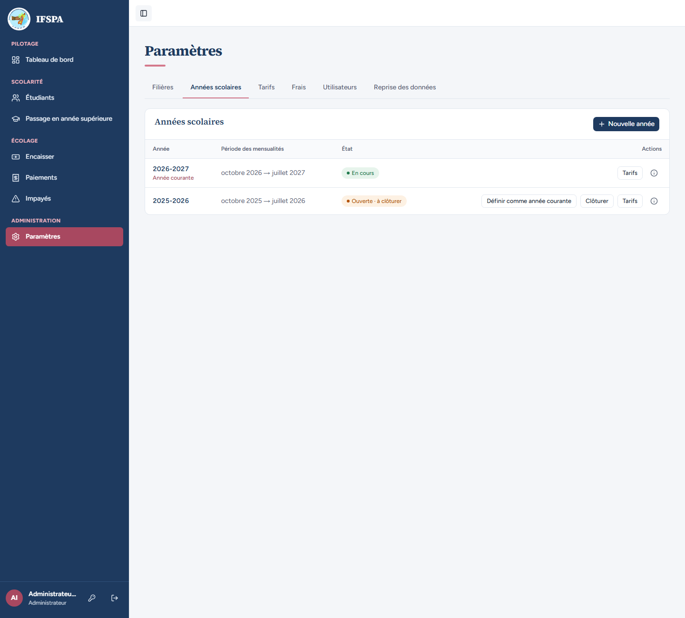 | |
| 2 | Administrateur | Cliquer l'icône d'information de la ligne 2026-2027 (ni « Clôturer » ni « Supprimer » n'y sont proposés). | « L'année courante ne peut pas être supprimée. Définissez d'abord une autre année comme courante. » et « L'année courante ne peut pas être clôturée. Définissez d'abord une autre année comme courante. » | 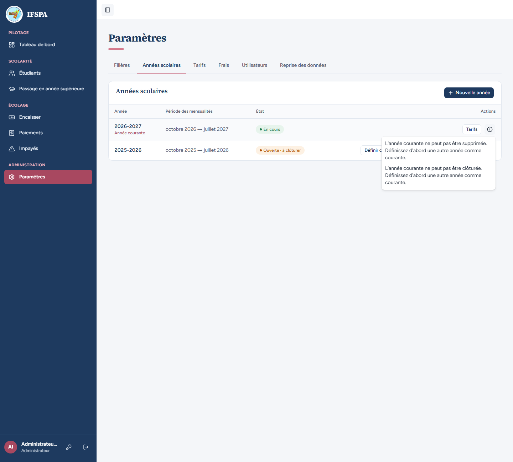 | |
| 3 | Administrateur | Cliquer **Nouvelle année**. | Fenêtre « Nouvelle année scolaire » : « Année de début » proposée `2027`, « Premier mois des mensualités » sur **Octobre**, aperçu « Année 2027-2028 : mensualités de octobre 2027 → juillet 2028. » | 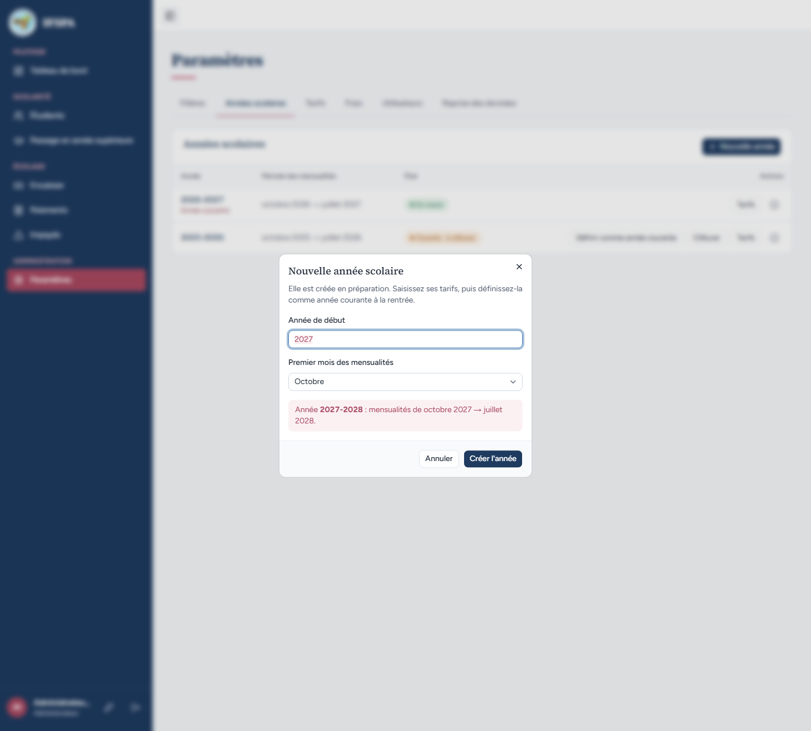 | |
| 4 | Administrateur | Ouvrir la liste « Premier mois des mensualités », choisir **Novembre**, puis revenir à **Octobre**. | La liste propose seulement Septembre, Octobre, Novembre. Avec Novembre : « Année 2027-2028 : mensualités de novembre 2027 → août 2028. » (toujours 10 mois). | 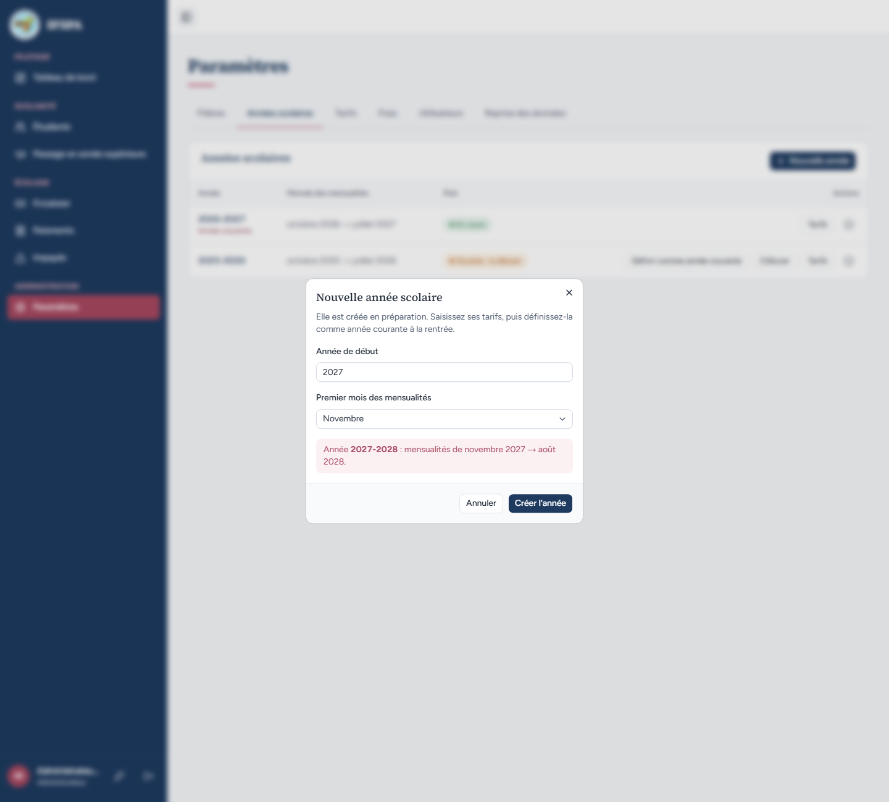 | |
| 5 | Administrateur | Saisir `2026` dans « Année de début », **Créer l'année**. | Sous le champ : « L'année 2026-2027 existe déjà. » Rien n'est créé. | 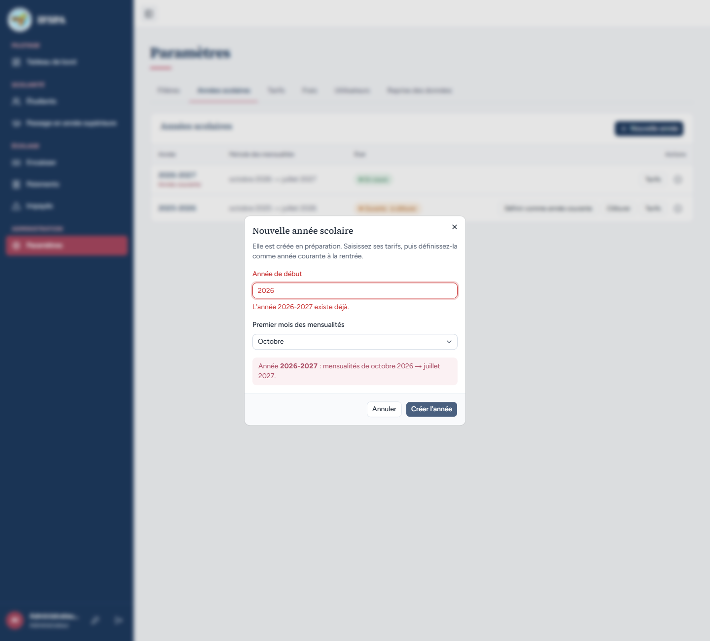 | |
| 6 | Administrateur | Saisir `1999`, **Créer l'année**, puis `2101`, puis vider le champ. | `1999` et `2101` : « L'année de début est comprise entre 2000 et 2100. » Champ vide : « Indiquez l'année de début. » | 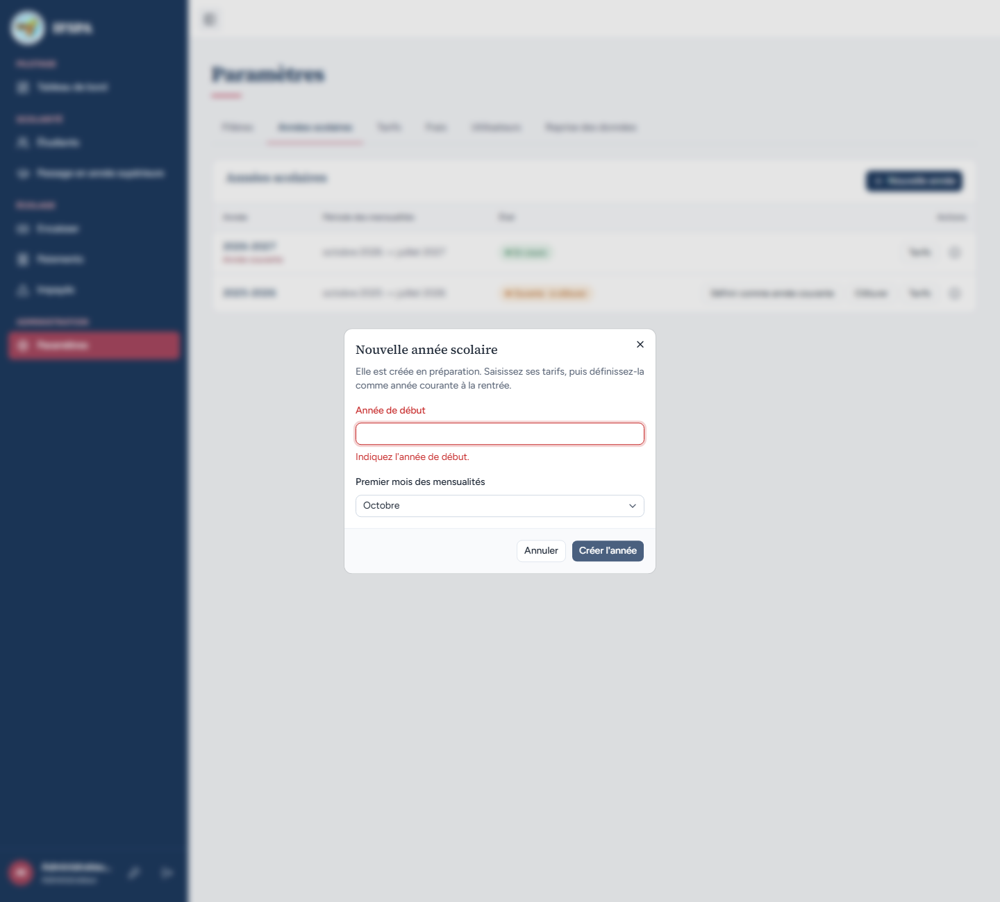 | |
| 7 | Administrateur | Saisir `2027.5`, **Créer l'année**. | « Indiquez l'année de début sans décimales. » |  | |
| 8 | Administrateur | Saisir `2027`, **Créer l'année**. | « Année 2027-2028 créée, en préparation. Saisissez maintenant ses tarifs. » (bouton « Saisir les tarifs »). La ligne **2027-2028**, « octobre 2027 → juillet 2028 », badge « En préparation », offre « Définir comme année courante », « Clôturer », « Tarifs » et « Supprimer ». | 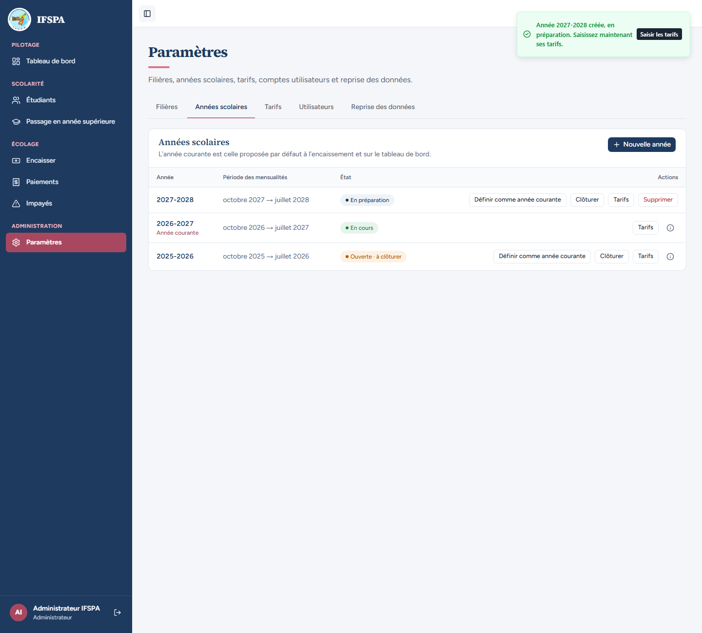 | |
| 9 | Administrateur | **Nouvelle année**, `2028`, premier mois **Septembre** : aperçu, **Créer l'année**, puis **Supprimer** sur la ligne 2028-2029 et confirmer. | Aperçu « Année 2028-2029 : mensualités de septembre 2028 → juin 2029. » ; création « Année 2028-2029 créée, en préparation. … » ; la ligne affiche « septembre 2028 → juin 2029 ». Confirmation « Supprimer l'année 2028-2029 ? » (« Aucun étudiant n'y est inscrit. Ses tarifs seront supprimés avec elle, définitivement. ») puis « Année 2028-2029 supprimée, avec ses tarifs. » | 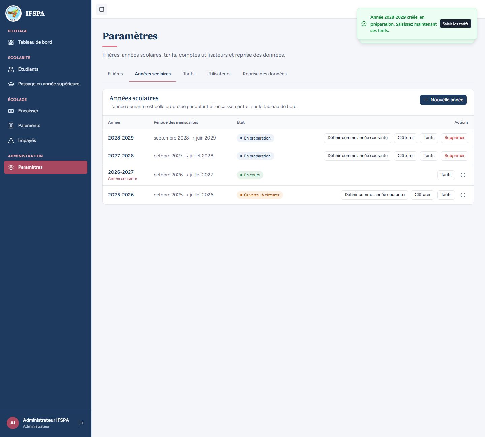 | |
| 10 | Administrateur | Sur la ligne 2027-2028, cliquer **Définir comme année courante**. | Fenêtre « Définir 2027-2028 comme année courante ? » : « 2027-2028 sera proposée par défaut à l'encaissement et sur le tableau de bord. 2026-2027 n'est pas supprimée : ses impayés restent encaissables. » | 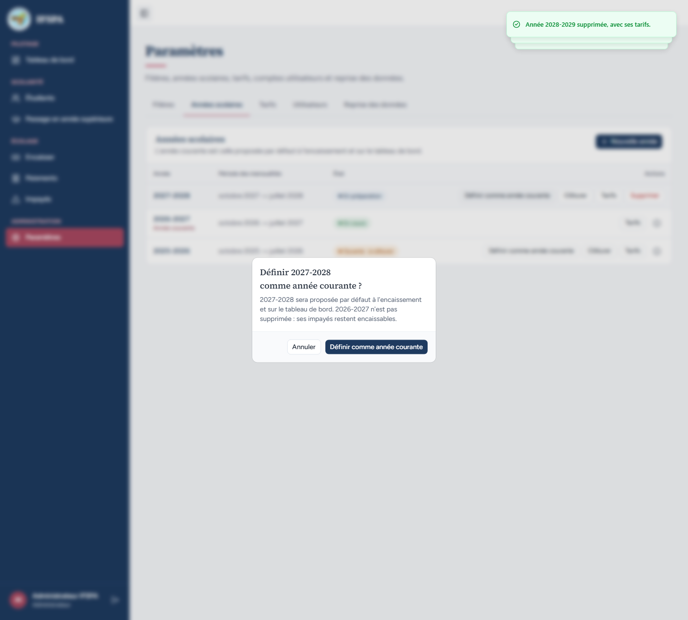 | |
| 11 | Administrateur | Cliquer **Définir comme année courante**. | « 2027-2028 est désormais l'année courante. » La ligne 2027-2028 porte « Année courante » et « En cours » ; 2026-2027 passe à « Ouverte · à clôturer » et propose « Définir comme année courante », « Clôturer ». | 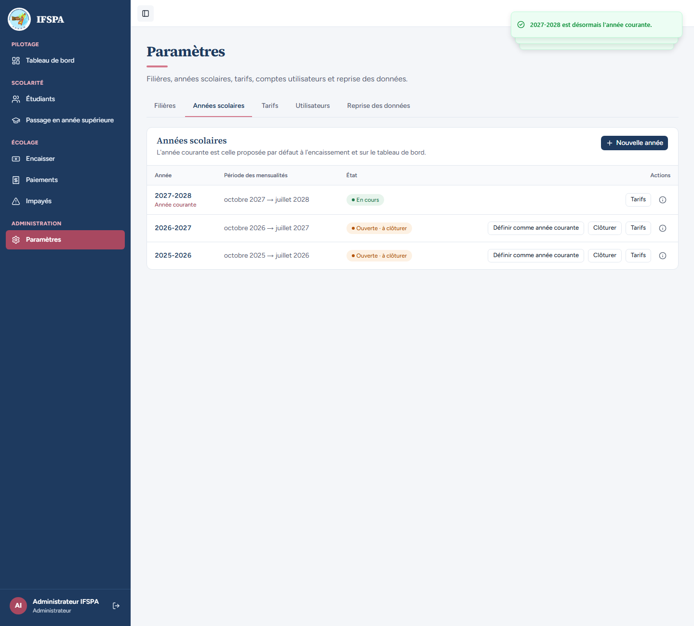 | |
| 12 | Administrateur | Menu **Étudiants › Nouvel étudiant**, choisir la filière Infirmier(e)s · IF. | « Inscription en 2027-2028. » ; récapitulatif : « Le tarif de Infirmier(e)s 1re année manque pour 2027-2028. Ajoutez-le dans Paramètres › Tarifs. » ; le niveau se lit « 1re année · tarif manquant » ; le bouton « Inscrire l'étudiant » est grisé, « Inscription bloquée tant que le tarif de ce niveau manque. » (le matricule indicatif `IF-2027-0001` est affiché malgré le blocage : décision n° 68). | 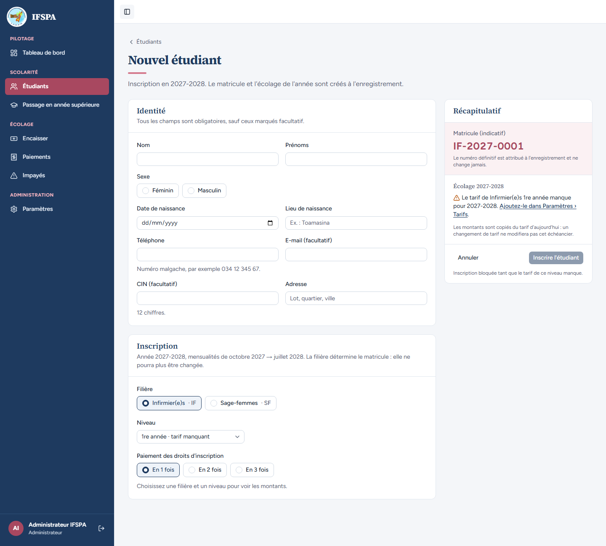 | |
| 13 | Administrateur | **Paramètres › Années scolaires**, ligne 2026-2027, **Définir comme année courante**, confirmer. | « 2026-2027 est désormais l'année courante. » 2026-2027 « En cours », 2027-2028 retourne à « En préparation ». | 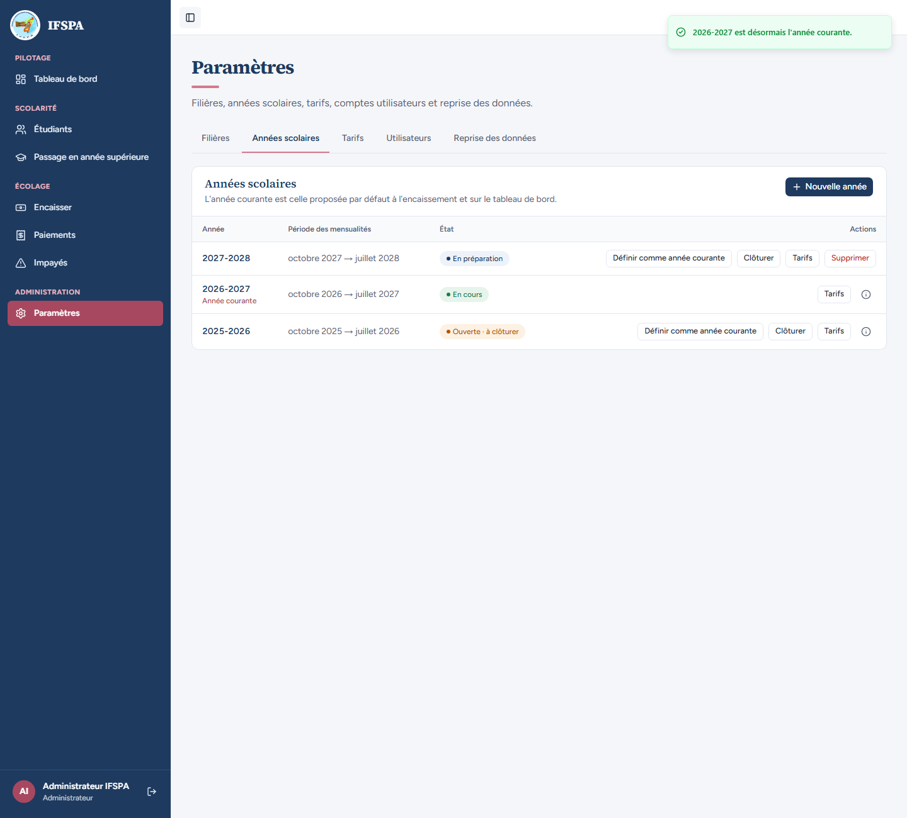 | |

## Ce que ce scénario ne couvre pas

- L'**inscription d'un étudiant sur une année qui commence en septembre ou en novembre** (échéances de septembre à juin, ou de novembre à août) : non démontré à l'écran ; la durée de l'année et la génération des échéances sont couvertes par Vitest (`tests/unit/parametres.test.ts`, « couvre 10 mois quel que soit le mois de début, avec passage d'année » ; `tests/unit/ecolage.test.ts`).
- Les refus serveur (année qui existe déjà entre-temps, deux années courantes en même temps, année clôturée) : couverts par Vitest, `tests/integration/actions-parametres.test.ts` (blocs « définir l'année courante », « années : création et suppression »). L'appel direct des actions par le secrétariat : `tests/unit/actions-parametres-refus.test.ts`.
- Une année qui n'a pas encore commencé peut être définie « courante » (ici 2027-2028, « En cours » alors qu'elle commence en octobre 2027) : à confirmer (voir le rapport).
- Clôture et réouverture : [UC02-04](UC02-04-cloture.md). Suppression d'une année qui a des tarifs : [UC02-10](UC02-10-annee-supprimee.md).
- Ordinateur seulement.

## Dernière exécution par l'agent

- 18/10/2026 : ✅ 13 étapes sur 13.
- Rapport : [RAPPORT_2026-10-18_UC02.md](../../rapports/RAPPORT_2026-10-18_UC02.md). Parcours : [UC02-03-annees.recette.ts](../../parcours/UC02-03-annees.recette.ts).
