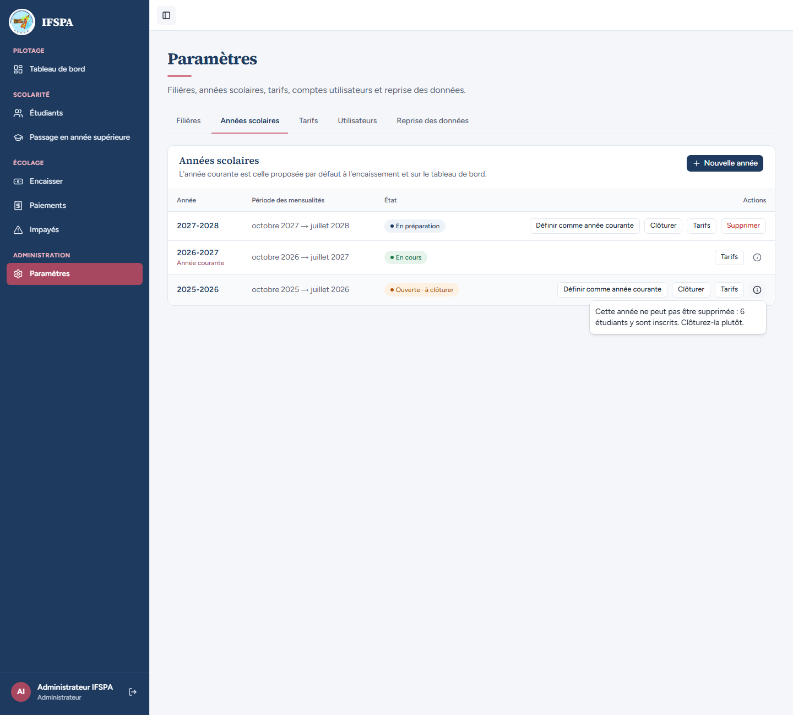
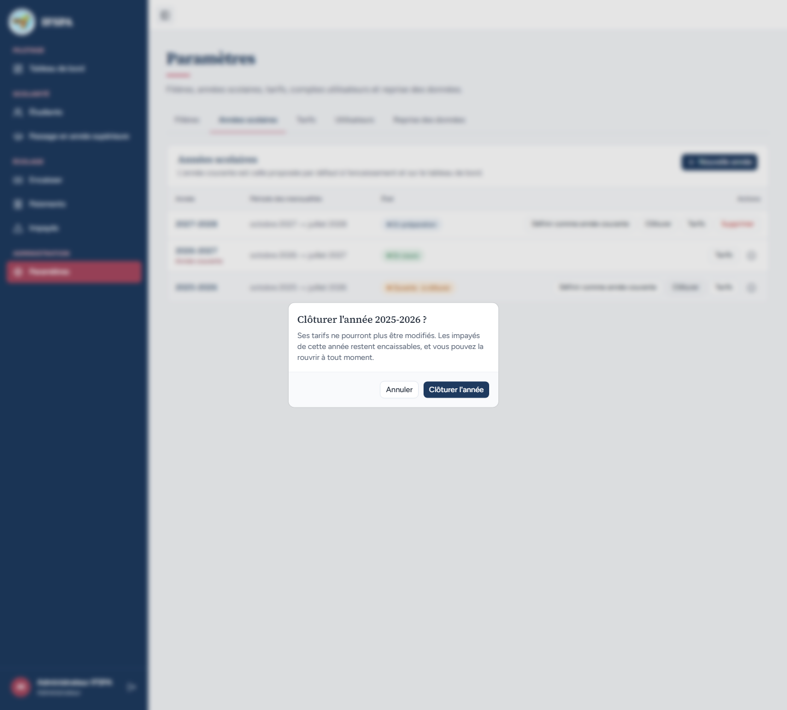
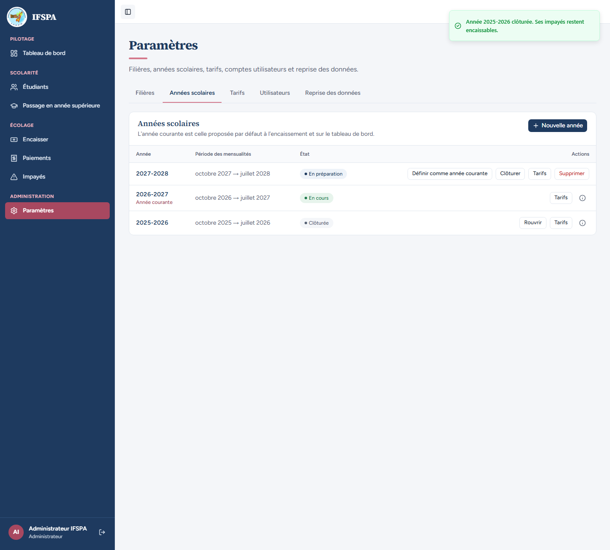
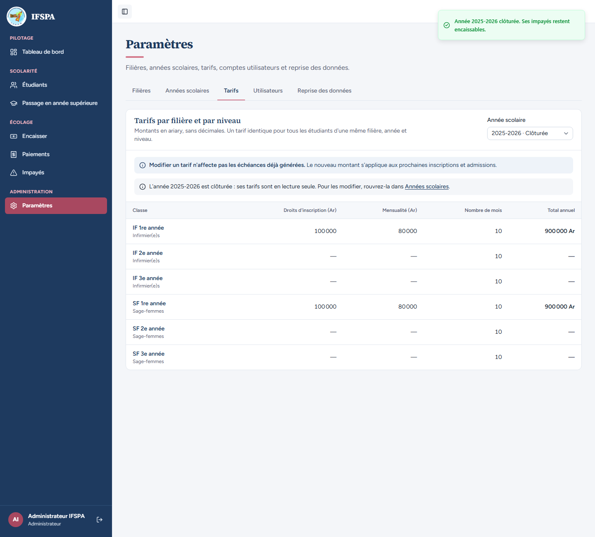
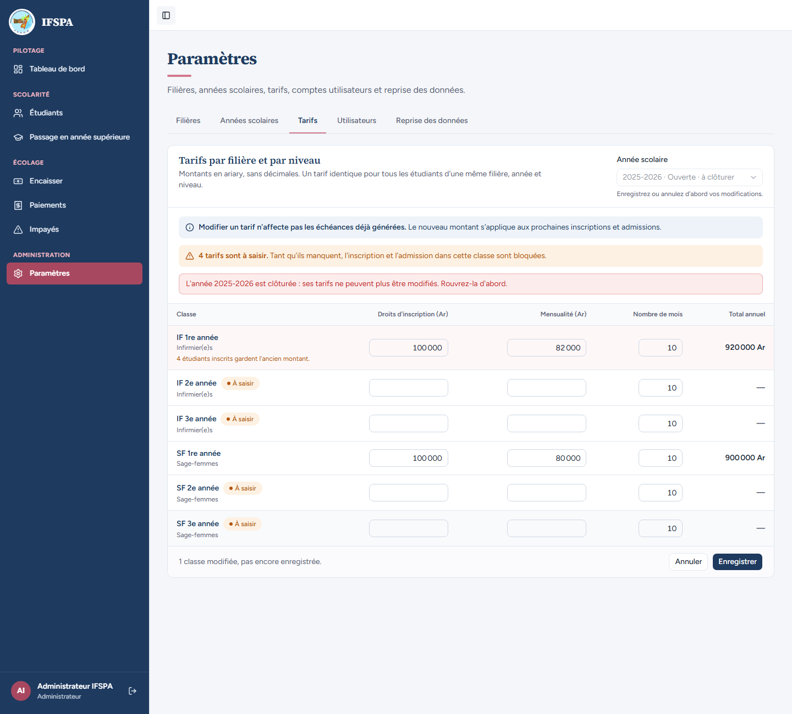
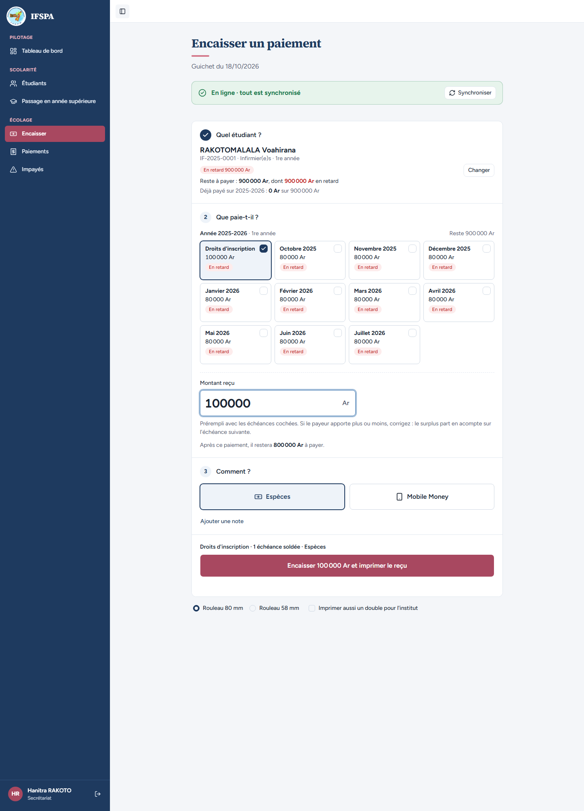
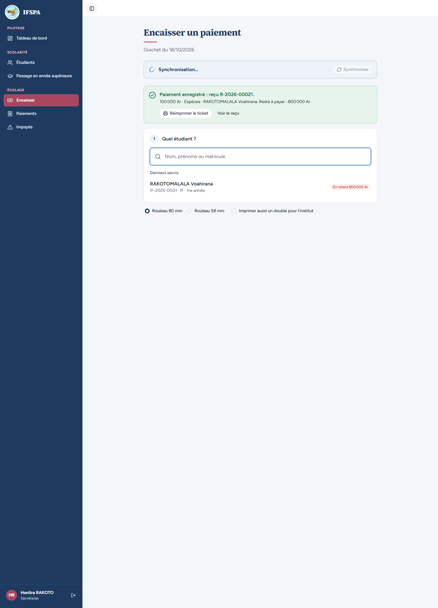
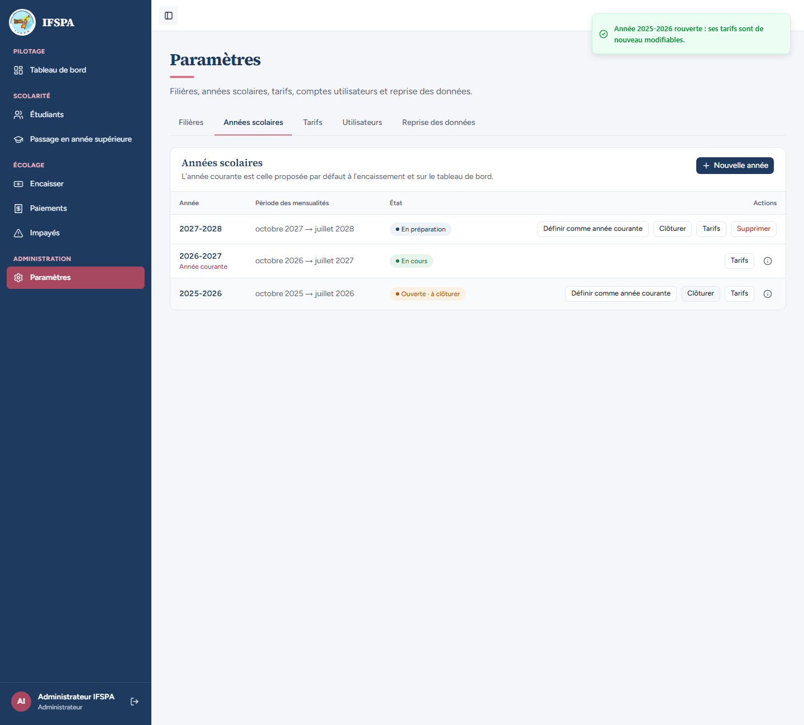
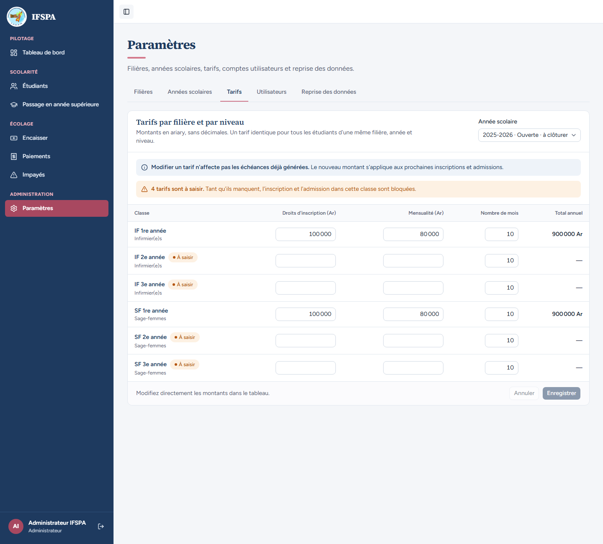

# UC02-04. Clôturer une année : les tarifs sont verrouillés, les impayés restent encaissables

| | |
|---|---|
| Use case | UC02. Préparer l'année : filières, années scolaires, tarifs |
| Règles couvertes | R-ROLE (clôture réservée à l'administrateur), R-REP (un impayé d'une année clôturée se solde au guichet), R-ECH (un tarif clôturé ne se modifie plus) |
| Rôle | Administrateur, puis secrétariat pour l'encaissement, puis administrateur |
| Durée estimée | 8 minutes |

## La situation

L'année 2025-2026 est terminée. L'administrateur la clôture : ses tarifs ne peuvent plus bouger. Un parent vient pourtant régler les droits de 2025-2026 de sa fille : le secrétariat doit pouvoir encaisser. Plus tard, l'administrateur rouvre l'année.

## Avant de commencer

1. `pnpm recette:base`, `pnpm build`, `pnpm recette:app`, puis ouvrir `http://localhost:3200`.
2. Préparation : sections A, B et C de [00-PREPARATION.md](../00-PREPARATION.md) (6 étudiants inscrits en 2025-2026, RAKOTOMALALA Voahirana IF-2025-0001 y doit 900 000 Ar). Idéalement après [UC02-03](UC02-03-annees.md) : les captures montrent aussi l'année 2027-2028.
3. Comptes : **administrateur** (étapes 1 à 5, 8 et 9), **secrétariat** (étapes 6 et 7).
4. L'étape 2 demande **deux onglets** du navigateur connectés en administrateur (le second sert à l'étape 5). Ce cas encaisse 100 000 Ar : le n° de reçu, `R-2026-00021` sur une base fraîche, est le premier qui suit les 20 numéros réservés au poste lorsqu'on ouvre Encaisser (décision n° 48).

## Étapes

| # | Qui | Action | Résultat attendu | Capture | ✓ |
|---|---|---|---|---|---|
| 1 | Administrateur | **Paramètres › Années scolaires**. Sur la ligne 2025-2026, cliquer l'icône d'information. | La ligne propose « Définir comme année courante », « Clôturer », « Tarifs », **pas de « Supprimer »**. Motif : « Cette année ne peut pas être supprimée : 6 étudiants y sont inscrits. Clôturez-la plutôt. » |  | |
| 2 | Administrateur | Dans un **second onglet**, ouvrir **Tarifs**, choisir l'année « 2025-2026 · Ouverte · à clôturer » et passer la mensualité de **IF 1re année** à `82 000` **sans enregistrer**. | « 1 classe modifiée, pas encore enregistrée. » (modification restée en attente pour l'étape 5). | | |
| 3 | Administrateur | Premier onglet : cliquer **Clôturer** sur la ligne 2025-2026. | Fenêtre « Clôturer l'année 2025-2026 ? » : « Ses tarifs ne pourront plus être modifiés. Les impayés de cette année restent encaissables, et vous pouvez la rouvrir à tout moment. » |  | |
| 4 | Administrateur | Cliquer **Clôturer l'année**. | « Année 2025-2026 clôturée. Ses impayés restent encaissables. » La ligne 2025-2026 : badge « Clôturée », boutons « Rouvrir » et « Tarifs » ; plus de « Définir comme année courante », de « Clôturer » ni de « Supprimer ». |  | |
| 5 | Administrateur | Cliquer **Tarifs** sur la ligne 2025-2026. | Sélecteur « 2025-2026 · Clôturée ». Bandeau « L'année 2025-2026 est clôturée : ses tarifs sont en lecture seule. Pour les modifier, rouvrez-la dans Années scolaires. » Les montants sont du texte (100 000, 80 000, 900 000 Ar pour IF 1re et SF 1re année), plus de champs ni de bouton « Enregistrer ». |  | |
| 6 | Administrateur | Second onglet (resté éditable depuis l'étape 2) : cliquer **Enregistrer**. | Bandeau rouge « L'année 2025-2026 est clôturée : ses tarifs ne peuvent plus être modifiés. Rouvrez-la d'abord. » La mensualité n'est **pas** enregistrée (refus côté serveur). |  | |
| 7 | Secrétariat | Menu **Encaisser**, rechercher RAKOTOMALALA, choisir Voahirana (IF-2025-0001). Saisir `100000` dans « Montant reçu ». | « Reste à payer : 900 000 Ar, dont 900 000 Ar en retard », année « Année 2025-2026 · 1re année » (clôturée) avec « Droits d'inscription » coché ; « Après ce paiement, il restera 800 000 Ar à payer. » « Hanitra RAKOTO » est en bas de la barre latérale. |  | |
| 8 | Secrétariat | Cliquer **Encaisser 100 000 Ar et imprimer le reçu**. | « Paiement enregistré : reçu R-2026-00021. » « 100 000 Ar · Espèces · RAKOTOMALALA Voahirana. Reste à payer : 800 000 Ar. » |  | |
| 9 | Administrateur | **Paramètres › Années scolaires**, cliquer **Rouvrir** sur la ligne 2025-2026. | « Année 2025-2026 rouverte : ses tarifs sont de nouveau modifiables. » Badge « Ouverte · à clôturer », boutons « Définir comme année courante », « Clôturer » et « Tarifs » de retour. |  | |
| 10 | Administrateur | **Tarifs**, année 2025-2026. | Les champs et « Enregistrer » sont revenus ; la mensualité de IF 1re année vaut toujours `80 000` (la saisie de l'étape 2 a bien été refusée). |  | |

## Ce que ce scénario ne couvre pas

- Le bouton « Définir comme année courante » n'est pas proposé sur une année clôturée, et **aucun message ne l'explique** (l'icône d'information de la ligne ne parle que de la suppression) : le refus serveur « Une année clôturée ne peut pas devenir l'année courante. Rouvrez-la d'abord. » est couvert par Vitest, `tests/integration/actions-parametres.test.ts` (« refuse une année clôturée et ne change pas l'année courante »). Voir le rapport.
- Le refus de clôturer l'année courante est lisible à l'écran ([UC02-03](UC02-03-annees.md), étape 2) ; son refus serveur est couvert par `tests/integration/actions-parametres.test.ts` (« refuse de clôturer l'année courante »).
- **Inscriptions et admissions** d'une année clôturée (verrouillées d'après le code) : non démontrées à l'écran, l'inscription se fait sur l'année courante qui ne peut pas être clôturée ; refus serveur « année clôturée » de l'inscription couvert par `tests/integration/actions-etudiants.test.ts` (voir R-INS dans la matrice).
- Décision provisoire n° 3 de `STATUS.md` : une clôture n'empêche **pas** d'encaisser ses impayés (c'est ce que l'étape 8 montre).
- Ordinateur seulement.

## Dernière exécution par l'agent

- 18/10/2026 : ✅ 10 étapes sur 10 (étapes 2 et 6 avec deux onglets).
- Rapport : [RAPPORT_2026-10-18_UC02.md](../../rapports/RAPPORT_2026-10-18_UC02.md). Parcours : [UC02-04-cloture.recette.ts](../../parcours/UC02-04-cloture.recette.ts).
