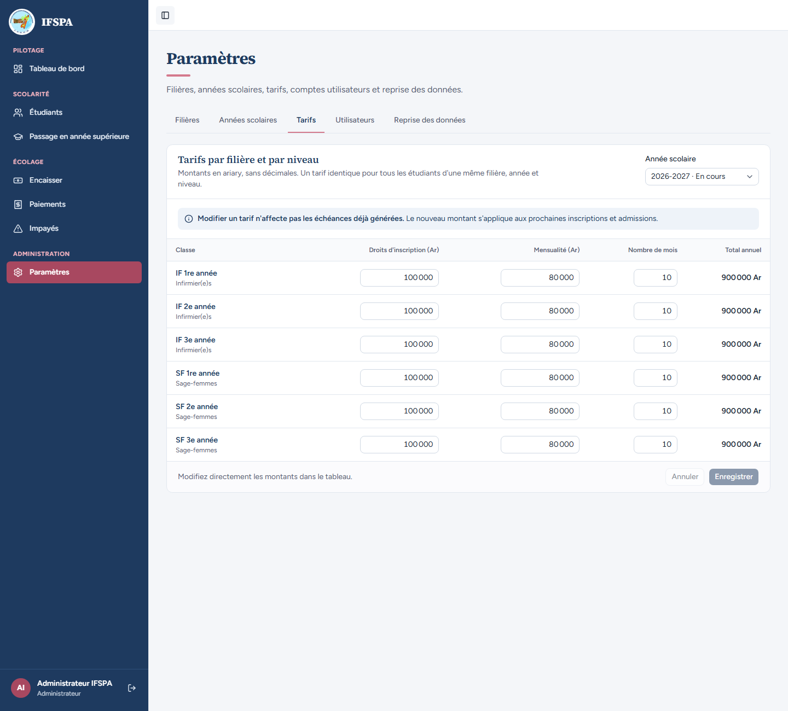
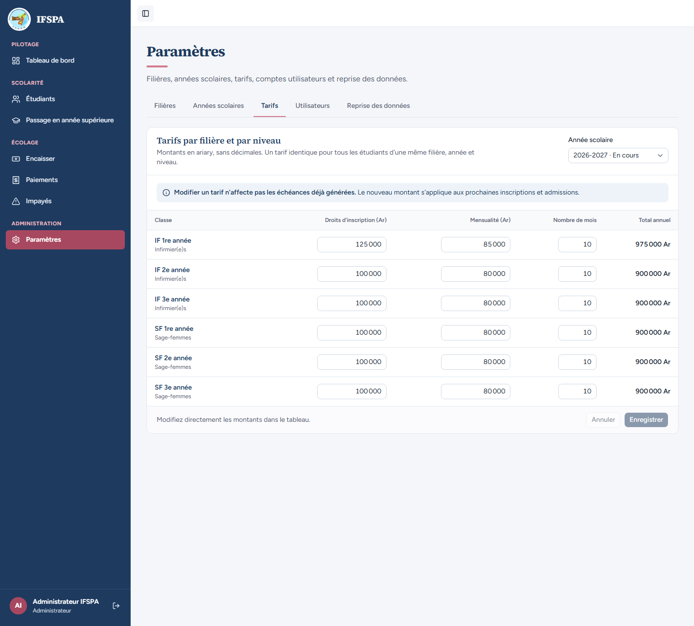
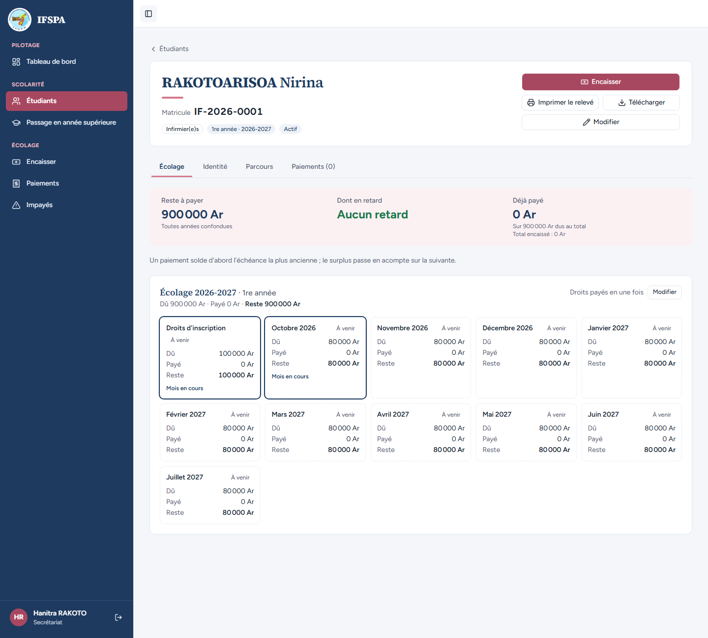
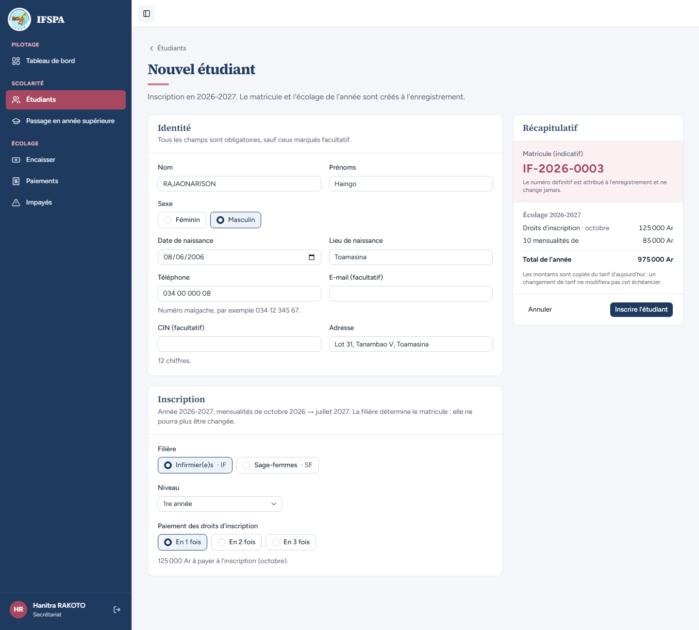
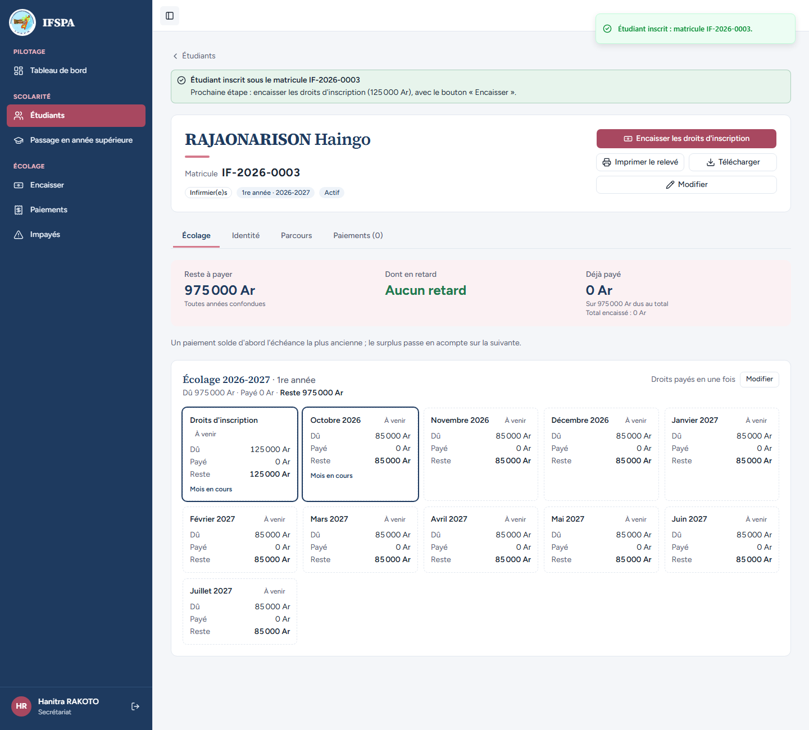
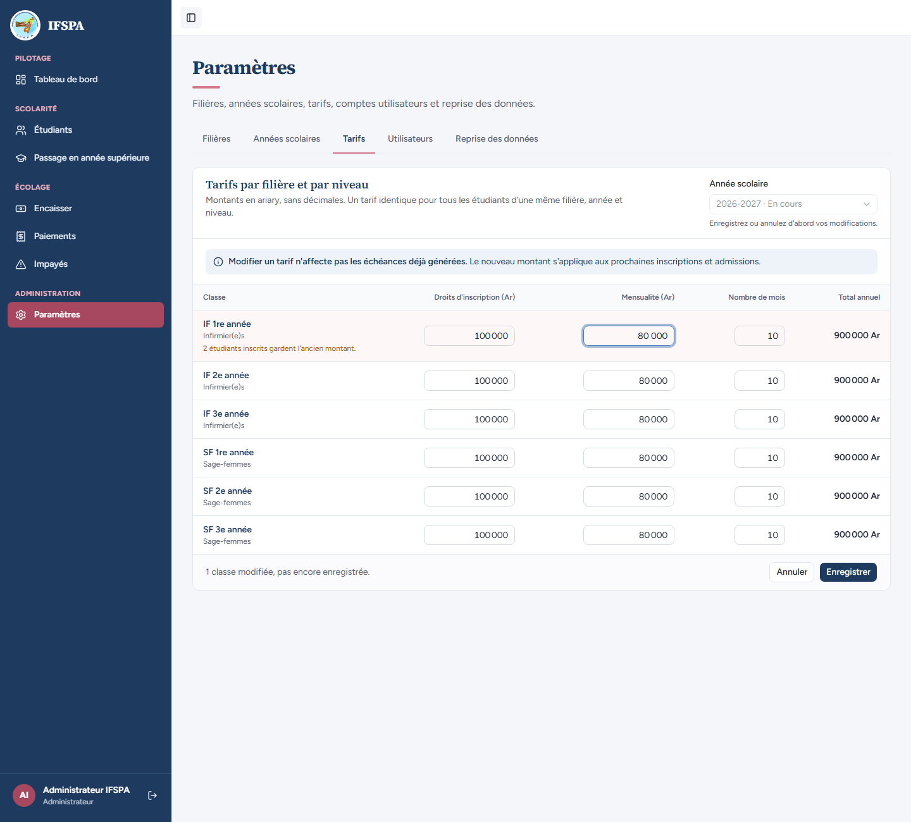
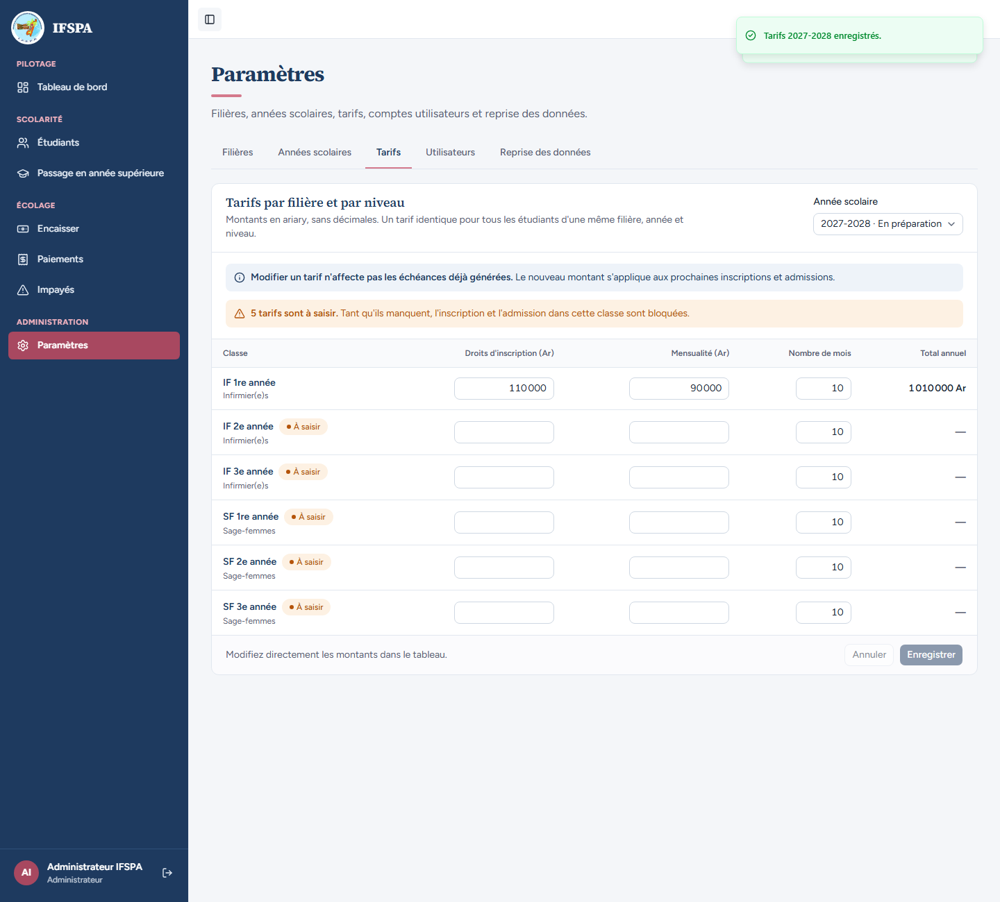
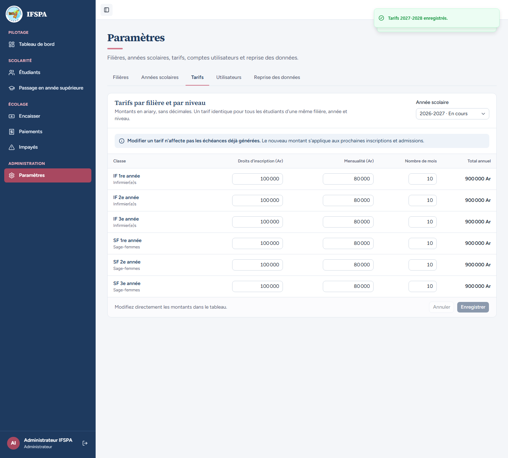

# UC02-05. Un changement de tarif ne réécrit pas les échéances déjà générées

| | |
|---|---|
| Use case | UC02. Préparer l'année : filières, années scolaires, tarifs |
| Règles couvertes | R-ECH (le montant des échéances est copié du tarif à l'inscription), R-TRA (découpage des droits sur le nouveau tarif), R-ROLE |
| Rôle | Administrateur et secrétariat, en alternance |
| Durée estimée | 10 minutes |

## La situation

L'institut augmente le tarif de la 1re année d'infirmier : 125 000 Ar de droits et 85 000 Ar par mois. L'administrateur modifie la grille, hésite (« Annuler »), enregistre. Nirina, déjà inscrit, doit continuer à payer 900 000 Ar ; le nouvel inscrit, Haingo, paie 975 000 Ar. Quand l'administrateur remet ensuite l'ancien tarif, c'est l'inverse : Haingo garde 975 000 Ar. Chaque année a sa propre grille : celle de 2027-2028 est indépendante de celle de 2026-2027.

## Avant de commencer

1. `pnpm recette:base`, `pnpm build`, `pnpm recette:app`, puis ouvrir `http://localhost:3200`.
2. Préparation : sections A, B et C de [00-PREPARATION.md](../00-PREPARATION.md) (Nirina, IF-2026-0001, à 900 000 Ar), **puis** [UC02-02](UC02-02-duree-filiere.md) (Tahina IF-2026-0002, en 2e année : le prochain matricule IF est donc `IF-2026-0003`) **et** [UC02-03](UC02-03-annees.md) (l'année 2027-2028 existe, sans tarif).
3. Comptes : **administrateur** (étapes 1 à 4, 8 à 10) et **secrétariat** (étapes 5 à 7 et 11).
4. Ce cas **inscrit Haingo (IF-2026-0003)** : pas de rejeu sans repartir de `pnpm recette:base`.

## Étapes

| # | Qui | Action | Résultat attendu | Capture | ✓ |
|---|---|---|---|---|---|
| 1 | Administrateur | **Paramètres › Tarifs** (année « 2026-2027 · En cours »). | Message « Modifier un tarif n'affecte pas les échéances déjà générées. Le nouveau montant s'applique aux prochaines inscriptions et admissions. » **IF 1re année** : droits d'inscription `100 000`, mensualité `80 000`, nombre de mois `10`, total annuel **900 000 Ar**. |  | |
| 2 | Administrateur | Saisir `125 000` en droits et `85 000` en mensualité pour **IF 1re année**. | Total de la ligne **975 000 Ar** ; sous la classe : « 1 étudiant inscrit garde l'ancien montant. » (Nirina) ; « 1 classe modifiée, pas encore enregistrée. » ; le sélecteur d'année est grisé : « Enregistrez ou annulez d'abord vos modifications. » |  | |
| 3 | Administrateur | Cliquer **Annuler**. | Les montants d'origine reviennent (100 000, 80 000, 900 000 Ar), « Modifiez directement les montants dans le tableau. », « Enregistrer » grisé. |  | |
| 4 | Administrateur | Saisir de nouveau 125 000 et 85 000, **Enregistrer**, puis recharger la page. | « Tarifs 2026-2027 enregistrés. » Après rechargement : 125 000, 85 000, total **975 000 Ar** ; les autres classes sont inchangées (900 000 Ar). |  | |
| 5 | Secrétariat | **Étudiants**, ouvrir la fiche de RAKOTOARISOA Nirina (IF-2026-0001). | Rien n'a bougé : 11 échéances, droits d'inscription 100 000 Ar, 10 mensualités de 80 000 Ar, « Sur 900 000 Ar dus au total ». « Hanitra RAKOTO » est en bas de la barre latérale. |  | |
| 6 | Secrétariat | **Nouvel étudiant** : RAJAONARISON Haingo, Masculin, 08/06/2006, Toamasina, 034 00 000 08, « Lot 31, Tanambao V, Toamasina », filière Infirmier(e)s · IF, niveau 1re année, droits « En 1 fois ». | Récapitulatif : matricule indicatif `IF-2026-0003` ; « Droits d'inscription · octobre 125 000 Ar », « 10 mensualités de 85 000 Ar », « Total de l'année 975 000 Ar ». |  | |
| 7 | Secrétariat | **Inscrire l'étudiant**. | « Étudiant inscrit sous le matricule IF-2026-0003 ». Fiche : reste à payer **975 000 Ar**, droits 125 000 Ar, 10 mensualités de 85 000 Ar. |  | |
| 8 | Administrateur | **Tarifs** : remettre `100 000` et `80 000` pour **IF 1re année**. | « 2 étudiants inscrits gardent l'ancien montant. » (Nirina et Haingo) ; **Enregistrer** : « Tarifs 2026-2027 enregistrés. » |  | |
| 9 | Administrateur | Dans « Année scolaire », choisir **2027-2028 · En préparation**. Saisir `110 000` et `90 000` pour IF 1re année, **Enregistrer**. | Avant : « 6 tarifs sont à saisir. », champs vides. Après saisie : total **1 010 000 Ar** ; « Tarifs 2027-2028 enregistrés. » ; « 5 tarifs sont à saisir. » |  | |
| 10 | Administrateur | Revenir à l'année **2026-2027 · En cours**. | IF 1re année vaut toujours `100 000` et `80 000` : la grille de 2027-2028 est indépendante. |  | |
| 11 | Secrétariat | Rouvrir les fiches de Nirina et de Haingo. | Nirina : « Sur 900 000 Ar dus au total ». Haingo : « Sur 975 000 Ar dus au total », mensualités de 85 000 Ar : l'ancien tarif remis n'a pas réécrit son échéancier. |  | |

## Ce que ce scénario ne couvre pas

- Le redécoupage des droits en 3 fois après un changement de tarif (la part part du montant copié, pas du tarif actuel) : démontré par [UC04-10](../UC04-inscrire/UC04-10-changement-de-tarif.md) (étape 6).
- Le fait qu'`enregistrerTarifs` **n'écrit jamais dans les échéances** (garantie côté serveur) : couvert par Vitest, `tests/integration/actions-parametres.test.ts` (« n'écrit jamais dans les échéances : les inscrits gardent le montant copié »). À l'écran on ne voit que le résultat sur les fiches.
- Le même principe pour l'**admission** (passage en année supérieure : tarif de l'année cible copié à la création des échéances) : [UC10](../UC10-passage/UC10-02-resultat-fiches-guichet.md) ; non distinguable à l'écran avec des tarifs identiques.
- Ordinateur seulement.

## Dernière exécution par l'agent

- 18/10/2026 : ✅ 11 étapes sur 11.
- Rapport : [RAPPORT_2026-10-18_UC02.md](../../rapports/RAPPORT_2026-10-18_UC02.md). Parcours : [UC02-05-tarif-copie.recette.ts](../../parcours/UC02-05-tarif-copie.recette.ts).
