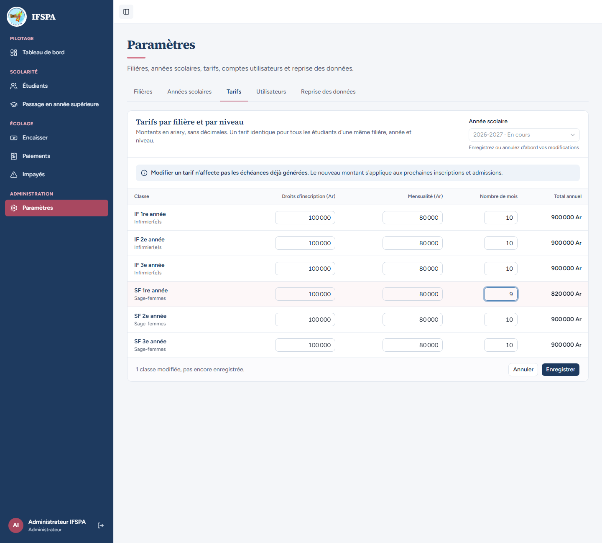
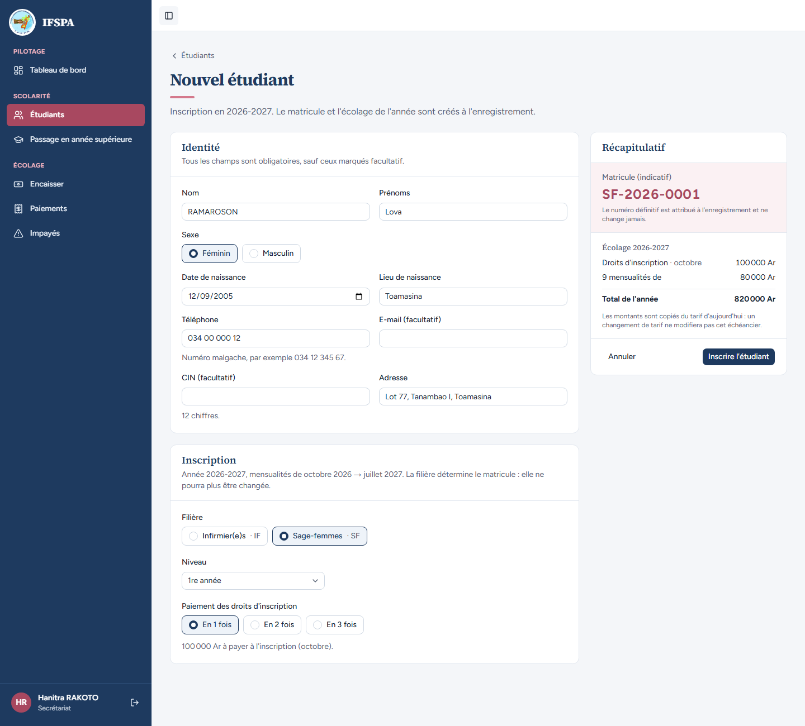
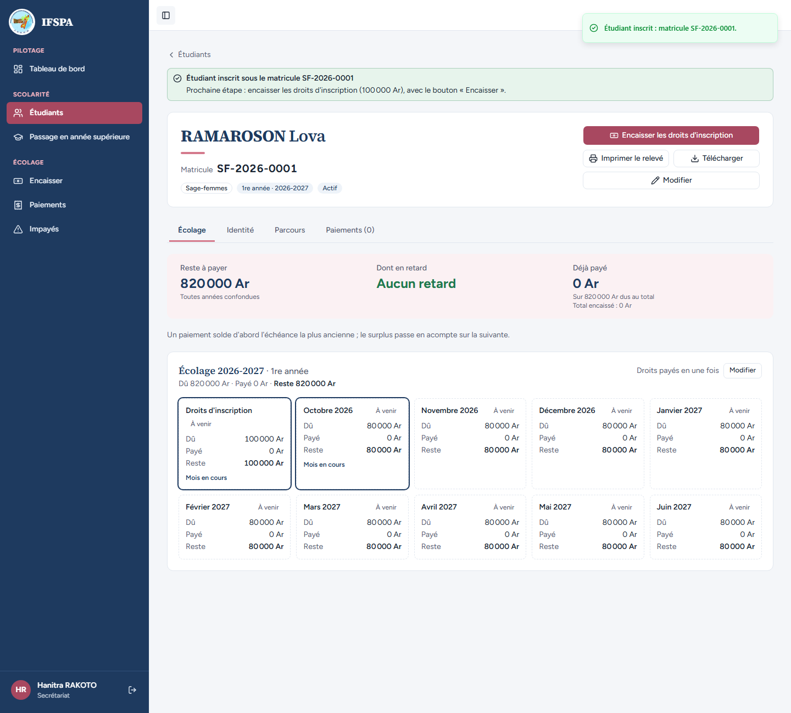
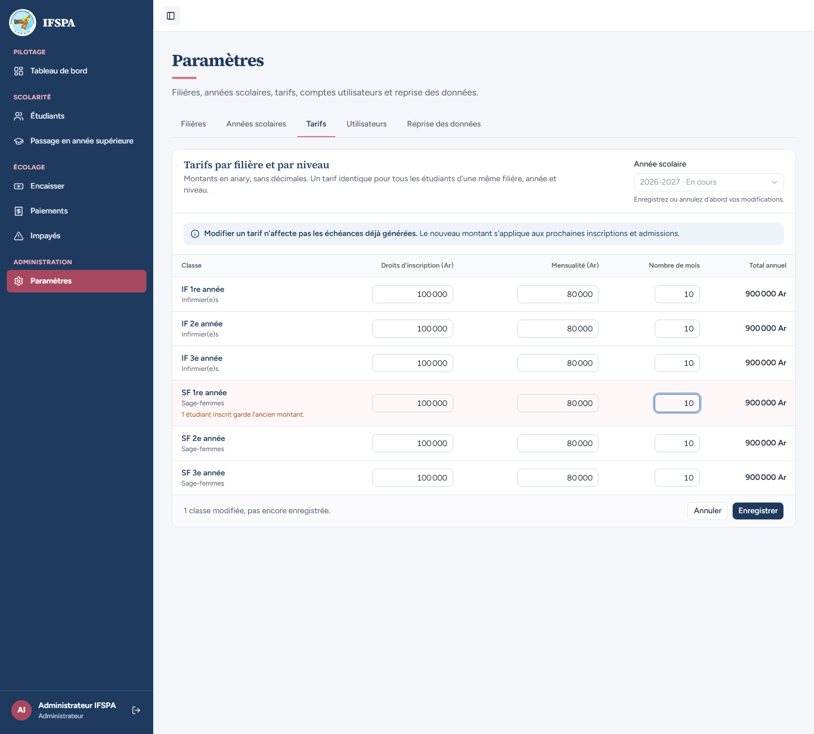
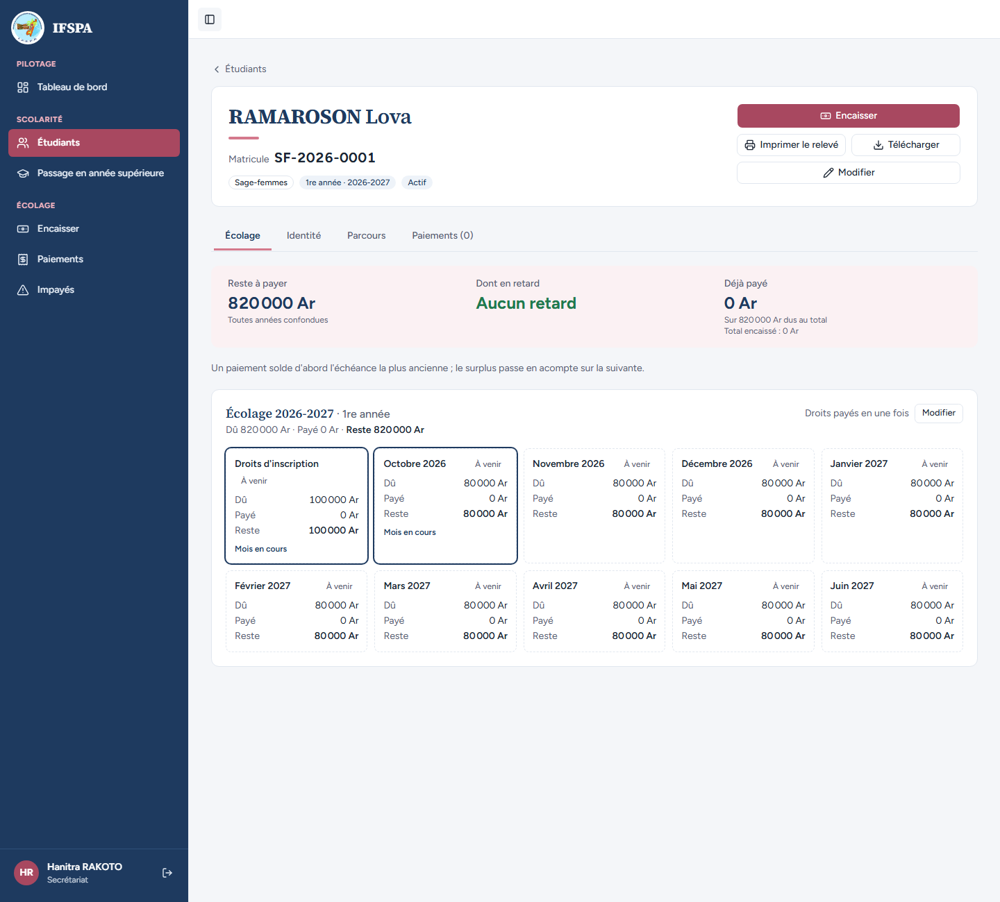

# UC02-06. Le nombre de mois d'un tarif fixe la longueur de l'échéancier

| | |
|---|---|
| Use case | UC02. Préparer l'année : filières, années scolaires, tarifs |
| Règles couvertes | R-ECH (mensualités à partir du tarif, d'octobre vers juillet, au plus 10), R-INS (inscription sur l'année complète), R-ROLE |
| Rôle | Administrateur et secrétariat, en alternance |
| Durée estimée | 6 minutes |

## La situation

Pour la 1re année de sage-femmes, l'institut décide de ne facturer que 9 mensualités. L'administrateur passe le nombre de mois à 9 ; Lova s'inscrit : son échéancier s'arrête en juin 2027 (pas de juillet) et son total est de 820 000 Ar. L'administrateur remet ensuite 10 mois : Lova garde ses 9 mensualités.

## Avant de commencer

1. `pnpm recette:base`, `pnpm build`, `pnpm recette:app`, puis ouvrir `http://localhost:3200`.
2. Préparation : sections A, B et C de [00-PREPARATION.md](../00-PREPARATION.md). Aucun étudiant SF ne doit être inscrit en 2026-2027 (le matricule de Lova est `SF-2026-0001`). Se déroule indifféremment avant ou après [UC02-05](UC02-05-tarif-copie.md).
3. Comptes : **administrateur** (étapes 1 et 4), **secrétariat** (étapes 2, 3 et 5).
4. Ce cas **inscrit Lova (SF-2026-0001)** : pas de rejeu sans repartir de `pnpm recette:base`. [UC02-09](UC02-09-filiere-desactivee.md) la retrouve.

## Étapes

| # | Qui | Action | Résultat attendu | Capture | ✓ |
|---|---|---|---|---|---|
| 1 | Administrateur | **Paramètres › Tarifs** (2026-2027). Pour **SF 1re année**, mettre « Nombre de mois » à `9`. | Total de la ligne **820 000 Ar** (100 000 + 9 x 80 000) ; « 1 classe modifiée, pas encore enregistrée. » **Enregistrer** : « Tarifs 2026-2027 enregistrés. » |  | |
| 2 | Secrétariat | **Étudiants › Nouvel étudiant** : RAMAROSON Lova, Féminin, 12/09/2005, Toamasina, 034 00 000 12, « Lot 77, Tanambao I, Toamasina », filière Sage-femmes · SF, 1re année, droits « En 1 fois ». | Récapitulatif : matricule indicatif `SF-2026-0001`, « Droits d'inscription · octobre 100 000 Ar », **« 9 mensualités de 80 000 Ar »**, « Total de l'année 820 000 Ar ». |  | |
| 3 | Secrétariat | **Inscrire l'étudiant**. | « Étudiant inscrit sous le matricule SF-2026-0001 ». La fiche : 10 échéances (droits d'inscription + octobre 2026 à **juin 2027**), **pas de juillet 2027**, « Sur 820 000 Ar dus au total ». |  | |
| 4 | Administrateur | **Tarifs** : remettre `10` mois pour SF 1re année. | Total **900 000 Ar** ; « 1 étudiant inscrit garde l'ancien montant. » **Enregistrer** : « Tarifs 2026-2027 enregistrés. » |  | |
| 5 | Secrétariat | Rouvrir la fiche de RAMAROSON Lova. | Toujours 10 échéances, aucune en juillet 2027, « Sur 820 000 Ar dus au total ». |  | |

## Ce que ce scénario ne couvre pas

- Les bornes du nombre de mois (11 et 0 refusés, « Le nombre de mois est compris entre 1 et 10. ») : [UC02-07](UC02-07-tarifs-refuses.md).
- Une année dont les mensualités commencent en septembre ou en novembre : non démontrée à l'écran (voir [UC02-03](UC02-03-annees.md)).
- Décision provisoire n° 7 de `STATUS.md` : au plus 10 mois (l'année scolaire couvre 10 mois).
- Ordinateur seulement.

## Dernière exécution par l'agent

- 18/10/2026 : ✅ 5 étapes sur 5.
- Rapport : [RAPPORT_2026-10-18_UC02.md](../../rapports/RAPPORT_2026-10-18_UC02.md). Parcours : [UC02-06-nombre-de-mois.recette.ts](../../parcours/UC02-06-nombre-de-mois.recette.ts).
