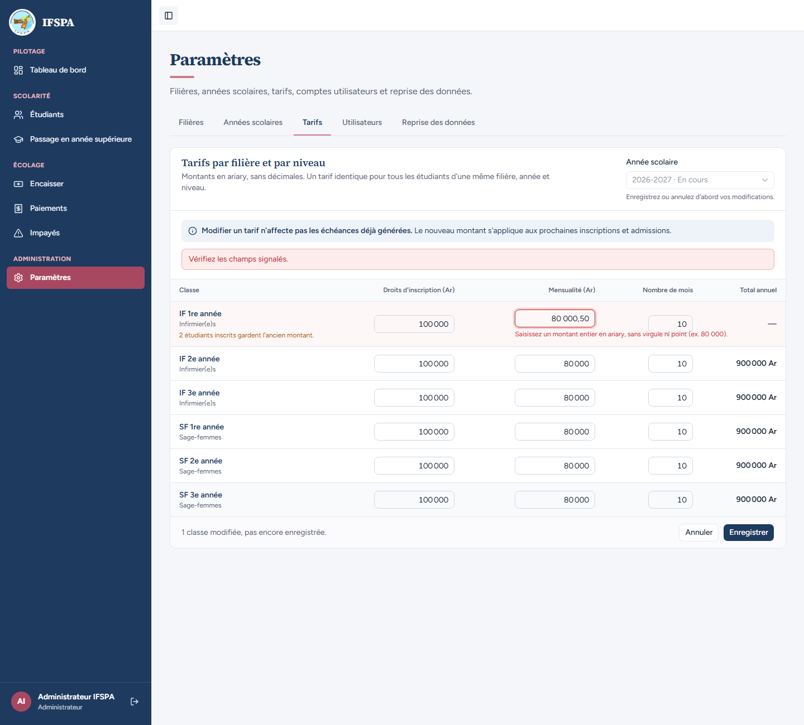
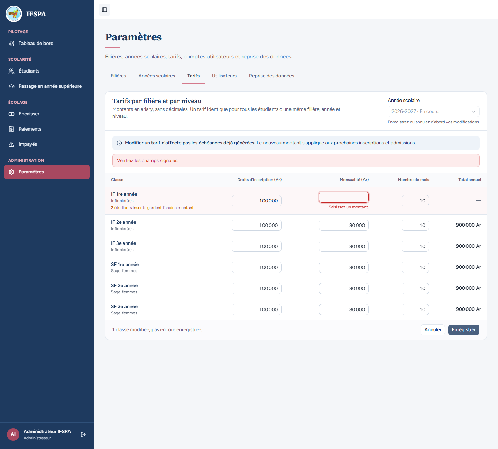
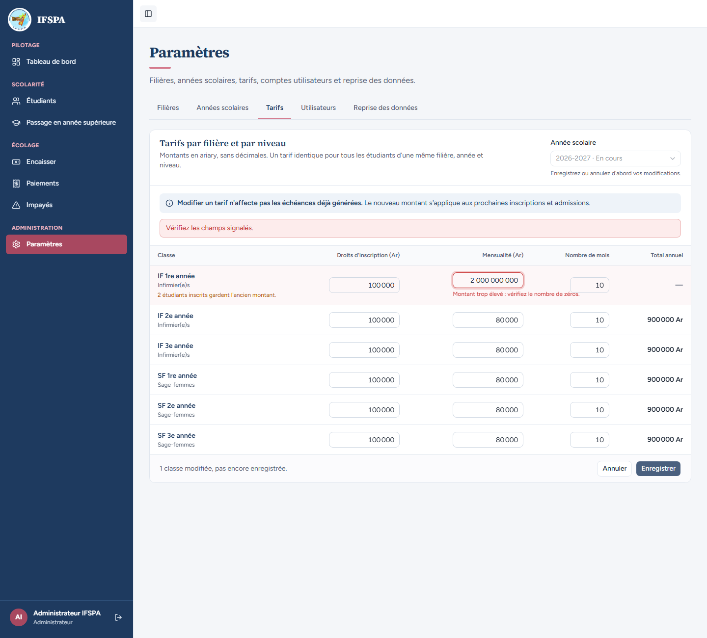
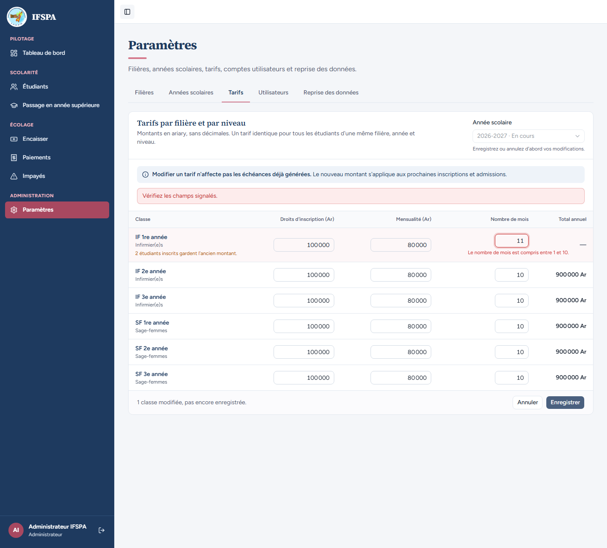
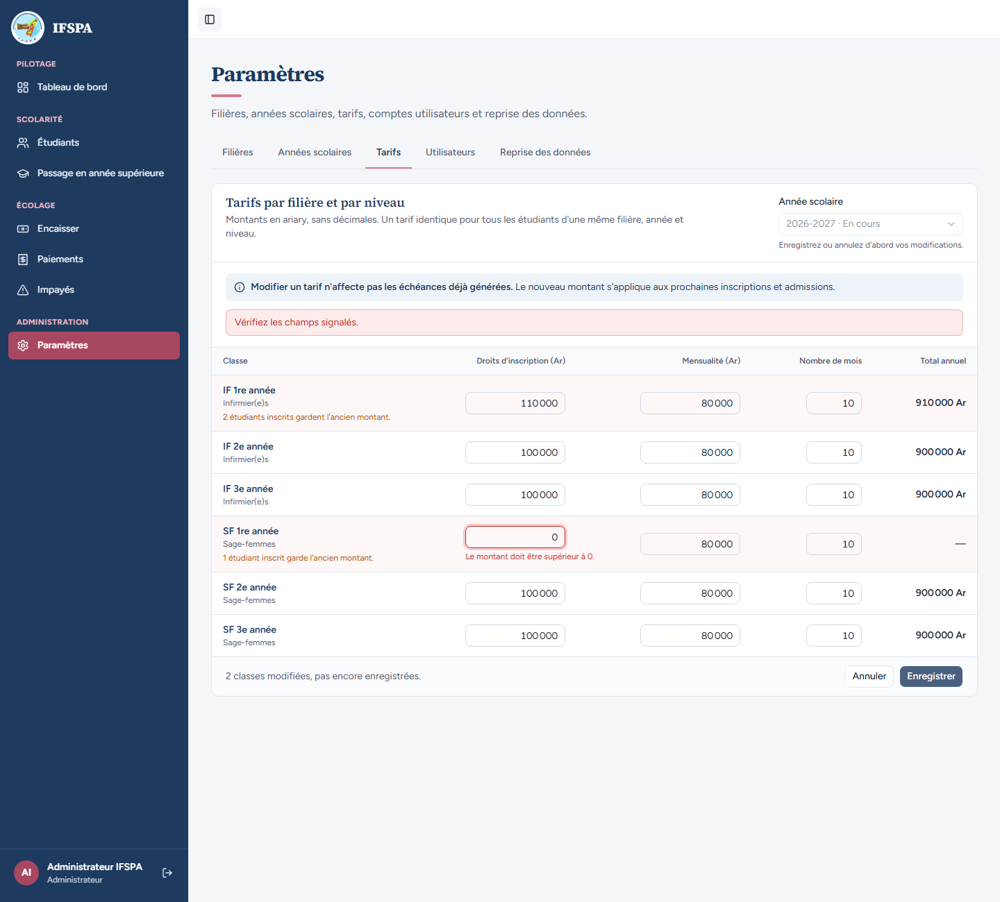
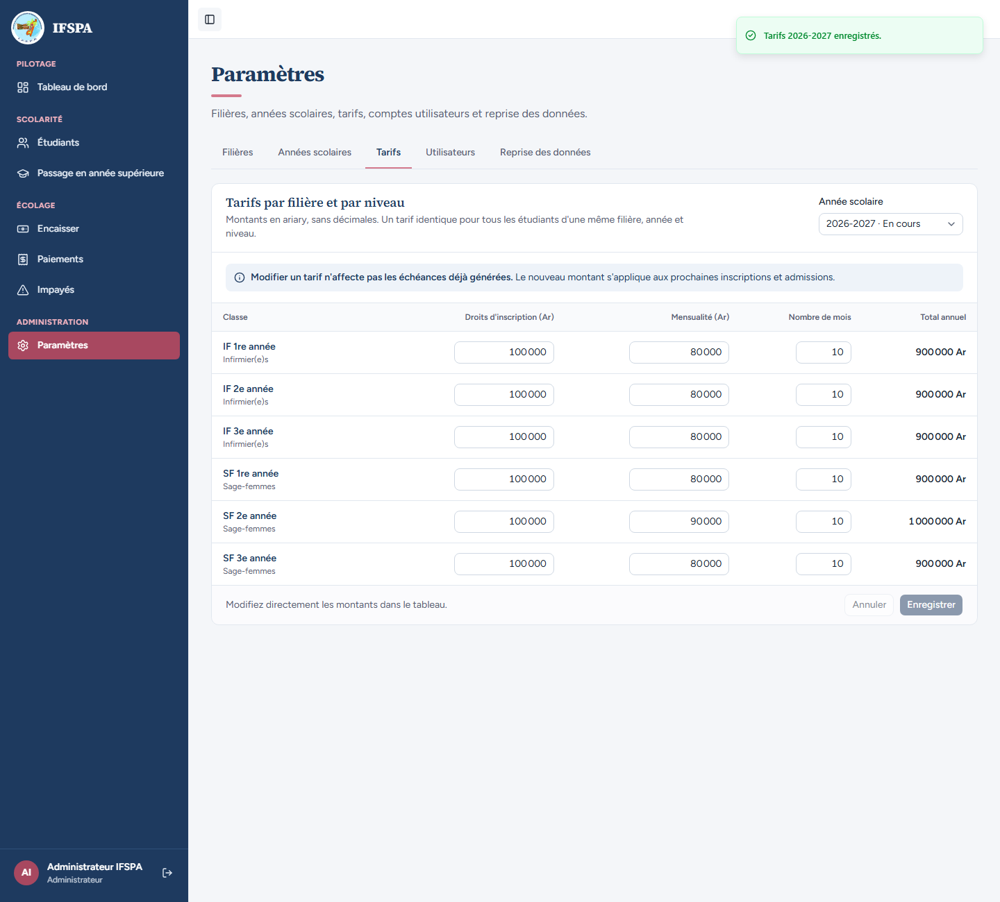

# UC02-07. Les montants de tarif sont des entiers en ariary, et l'enregistrement est tout ou rien

| | |
|---|---|
| Use case | UC02. Préparer l'année : filières, années scolaires, tarifs |
| Règles couvertes | Montants entiers en ariary, jamais de décimales (CLAUDE.md), R-ECH (nombre de mois), R-ROLE |
| Rôle | Administrateur |
| Durée estimée | 6 minutes |

## La situation

En saisissant la grille des tarifs, l'administrateur tape de mauvais montants : une virgule, un point, zéro, un nombre négatif, du texte, un champ vide, un montant démesuré, onze mois. Chaque erreur est signalée sur la bonne case. Quand une seule ligne est mauvaise, **aucune** ligne n'est enregistrée, même les bonnes. Il vérifie enfin que « 90 000 Ar » est compris et remis en forme.

## Avant de commencer

1. `pnpm recette:base`, `pnpm build`, `pnpm recette:app`, puis ouvrir `http://localhost:3200`.
2. Préparation : sections A, B et C de [00-PREPARATION.md](../00-PREPARATION.md). Ce cas ne laisse rien derrière lui (les tarifs reviennent à leurs valeurs de départ) ; l'indication « 2 étudiants inscrits gardent l'ancien montant » des captures suppose que [UC02-02](UC02-02-duree-filiere.md) à [UC02-05](UC02-05-tarif-copie.md) ont été déroulés avant (sinon le nombre est plus petit, sans incidence).
3. Compte **administrateur** (`SEED_ADMIN_*`, « Administrateur IFSPA »).

## Étapes

| # | Qui | Action | Résultat attendu | Capture | ✓ |
|---|---|---|---|---|---|
| 1 | Administrateur | **Paramètres › Tarifs** (2026-2027). | La grille s'affiche, « Administrateur IFSPA » en bas de la barre latérale. | | |
| 2 | Administrateur | **IF 1re année**, mensualité `80 000,50`, **Enregistrer**. | Bandeau rouge « Vérifiez les champs signalés. » ; sous la mensualité : « Saisissez un montant entier en ariary, sans virgule ni point (ex. 80 000). » Le champ est cerclé de rouge, le total de la ligne devient « — ». |  | |
| 3 | Administrateur | Mensualité `80.000`, **Enregistrer**. | Même message : « Saisissez un montant entier en ariary, sans virgule ni point (ex. 80 000). » | | |
| 4 | Administrateur | Tour à tour : `0`, `-5000`, `abc`, champ vide, puis **Enregistrer** à chaque fois. | `0` : « Le montant doit être supérieur à 0. » ; `-5000` : « Le montant ne peut pas être négatif. » ; `abc` : « Saisissez uniquement des chiffres (ex. 80 000). » ; vide : « Saisissez un montant. » |  | |
| 5 | Administrateur | Mensualité `2 000 000 000`, **Enregistrer**. | « Montant trop élevé : vérifiez le nombre de zéros. » |  | |
| 6 | Administrateur | Remettre `80 000`, puis « Nombre de mois » `11`, **Enregistrer** ; essayer ensuite `0`, puis `dix`. | `11` et `0` : « Le nombre de mois est compris entre 1 et 10. » ; `dix` : « Indiquez le nombre de mois. » |  | |
| 7 | Administrateur | Remettre `10` mois. **IF 1re année** : droits `110 000` (valide). **SF 1re année** : droits `0` (invalide). **Enregistrer**. | « 2 classes modifiées, pas encore enregistrées. » ; sous les droits de SF 1re année : « Le montant doit être supérieur à 0. » Aucune des deux lignes n'est enregistrée. |  | |
| 8 | Administrateur | Recharger la page. | IF 1re année et SF 1re année valent toujours `100 000` de droits : rien n'a été enregistré, pas même le tarif valide. |  | |
| 9 | Administrateur | **SF 2e année** : droits `100000` (sans espace), mensualité `90 000 Ar`. Quitter chaque champ, puis **Enregistrer**. | Les champs sont remis en forme : `100 000` et `90 000` ; total **1 000 000 Ar**. « Tarifs 2026-2027 enregistrés. » |  | |
| 10 | Administrateur | Remettre la mensualité de SF 2e année à `80 000`, **Enregistrer**, recharger. | « Tarifs 2026-2027 enregistrés. » ; la grille retrouve ses valeurs de départ (80 000). | | |

## Ce que ce scénario ne couvre pas

- Les refus sont les mêmes quand l'écran est contourné : le serveur relit chaque montant avec le même schéma, couvert par Vitest, `tests/unit/montant.test.ts` et `tests/unit/parametres.test.ts` (« tarif : montants lus depuis la saisie ou un nombre, entiers et strictement positifs »), et le tout-ou-rien par `tests/integration/actions-parametres.test.ts` (« tout ou rien : une ligne invalide à la saisie (11 mois) et rien n'est écrit »).
- Décision provisoire n° 8 de `STATUS.md` : un montant à 0 (droits ou mensualité gratuits) est refusé ; « 100.000 » est refusé aussi (le point est ambigu).
- Un message d'erreur long déborde sous les colonnes voisines de la grille (voir le rapport).
- Ordinateur seulement.

## Dernière exécution par l'agent

- 18/10/2026 : ✅ 10 étapes sur 10.
- Rapport : [RAPPORT_2026-10-18_UC02.md](../../rapports/RAPPORT_2026-10-18_UC02.md). Parcours : [UC02-07-tarifs-refuses.recette.ts](../../parcours/UC02-07-tarifs-refuses.recette.ts).
