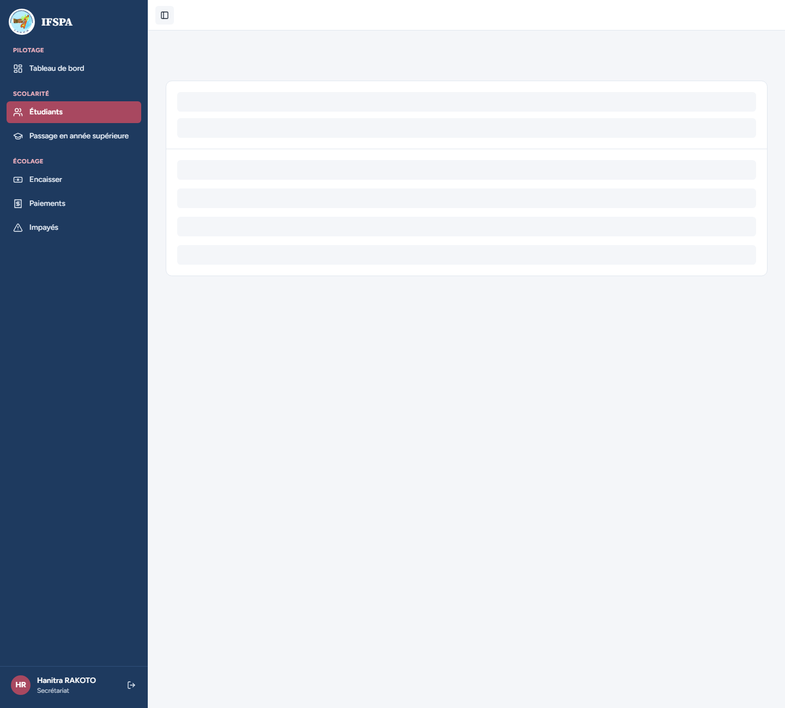
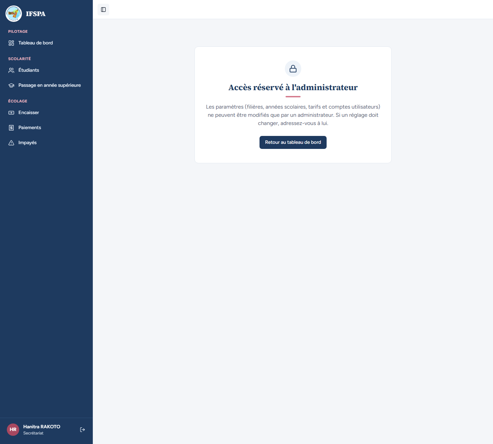

# UC02-08. Le secrétariat n'accède ni aux filières, ni aux années, ni aux tarifs

| | |
|---|---|
| Use case | UC02. Préparer l'année : filières, années scolaires, tarifs |
| Règles couvertes | R-ROLE (le secrétariat n'accède pas aux Paramètres) |
| Rôle | Secrétariat (Hanitra RAKOTO) |
| Durée estimée | 4 minutes |

## La situation

Hanitra RAKOTO, du secrétariat, ne doit pas pouvoir modifier une filière, une année scolaire ni un tarif, ni même lire la grille des tarifs. Si elle tape l'adresse d'une page de Paramètres, elle doit être renvoyée vers un message clair.

## Avant de commencer

1. `pnpm recette:base`, `pnpm build`, `pnpm recette:app`, puis ouvrir `http://localhost:3200`. Aucune donnée particulière (le seed suffit ; après la préparation et les cas précédents, le résultat est le même).
2. Compte **secrétariat** (identifiants `SEED_USER_*` de `.env`, affiché « Hanitra RAKOTO »).
3. Les étapes 5 (code source de la page) sont vérifiées par le parcours ; à la main, se contenter des étapes 1 à 4 et 6.

## Étapes

| # | Qui | Action | Résultat attendu | Capture | ✓ |
|---|---|---|---|---|---|
| 1 | Secrétariat | Se connecter, ouvrir **Étudiants**, regarder le menu. | « Hanitra RAKOTO » et « Secrétariat » en bas de la barre. Les rubriques sont Tableau de bord, Étudiants, Passage en année supérieure, Encaisser, Paiements, Impayés : **pas de rubrique « Paramètres »**, pas de section « Administration ». |  | |
| 2 | Secrétariat | Ouvrir `http://localhost:3200/app/parametres/filieres`. | « Accès réservé à l'administrateur » : « Les paramètres (filières, années scolaires, tarifs et comptes utilisateurs) ne peuvent être modifiés que par un administrateur. Si un réglage doit changer, adressez-vous à lui. » Ni onglets, ni tableau, ni bouton « Ajouter une filière ». |  | |
| 3 | Secrétariat | Ouvrir `http://localhost:3200/app/parametres/annees`. | Même panneau « Accès réservé à l'administrateur » : pas de « Nouvelle année », pas de liste d'années. |  | |
| 4 | Secrétariat | Ouvrir `http://localhost:3200/app/parametres/tarifs`. | Même panneau : aucun champ « Droits d'inscription, … », aucun bouton « Enregistrer ». |  | |
| 5 | Secrétariat | Afficher le code source de `/app/parametres/tarifs` puis de `/app/parametres/filieres` (clic droit, « Afficher le code source »). | Aucune grille de tarifs (« Mensualité (Ar) », « Droits d'inscription, IF 1re année »), ni « Ajouter une filière », « Étudiants actifs » ou « Modifier la filière » : les données ne sont pas transmises au navigateur. | (vérifié par le parcours, sans capture) | |
| 6 | Secrétariat | Depuis le panneau, cliquer **Retour au tableau de bord**. | Le Tableau de bord s'ouvre (`/app/dashboard`). | | |

## Ce que ce scénario ne couvre pas

- L'appel **direct d'une Server Action** par le secrétariat (créer, modifier, désactiver, supprimer une filière ; créer, définir courante, clôturer, rouvrir, supprimer une année ; enregistrer des tarifs) : non démontrable dans le navigateur ; couvert par Vitest, `tests/unit/actions-parametres-refus.test.ts` (chacune des neuf actions de Paramètres renvoie « Cette action est réservée à l'administrateur. » sans toucher à la base, même avec une entrée invalide) et `tests/unit/acces.test.ts`.
- Les comptes du personnel et la reprise des données : [UC03-06](../UC03-comptes/UC03-06-secretariat-refuse.md) et [UC15-07](../UC15-reprise/UC15-07-secretariat-refuse.md).
- Décision provisoire n° 6 de `STATUS.md` : panneau « Accès réservé » plutôt qu'une redirection.
- Ordinateur seulement.

## Dernière exécution par l'agent

- 18/10/2026 : ✅ 6 étapes sur 6 (étape 5 vérifiée par le parcours).
- Rapport : [RAPPORT_2026-10-18_UC02.md](../../rapports/RAPPORT_2026-10-18_UC02.md). Parcours : [UC02-08-secretariat-refuse.recette.ts](../../parcours/UC02-08-secretariat-refuse.recette.ts).
