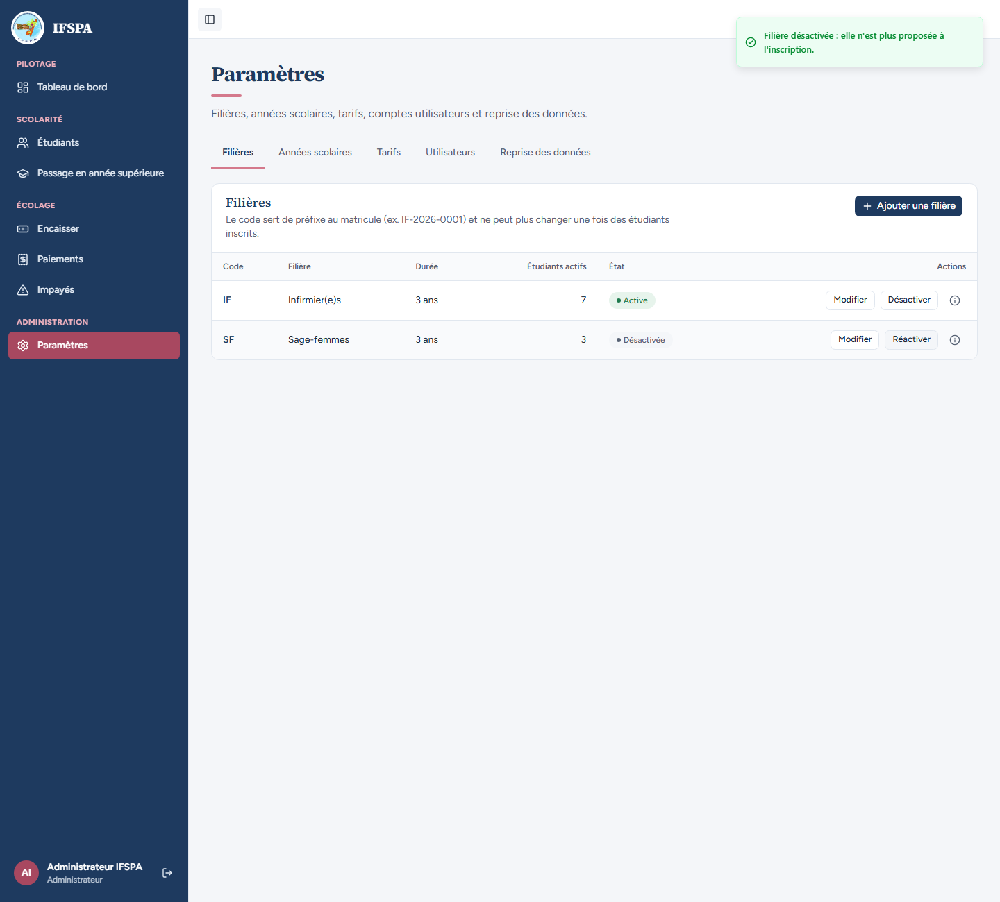
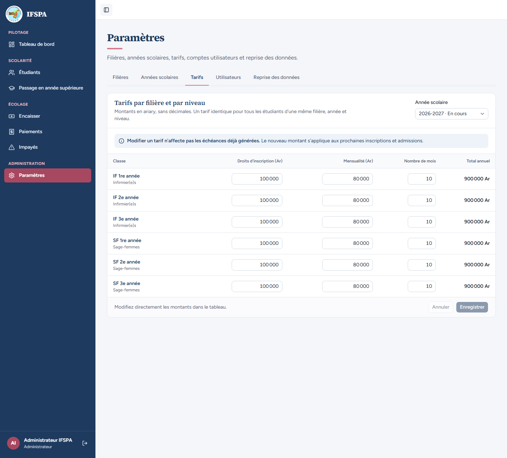
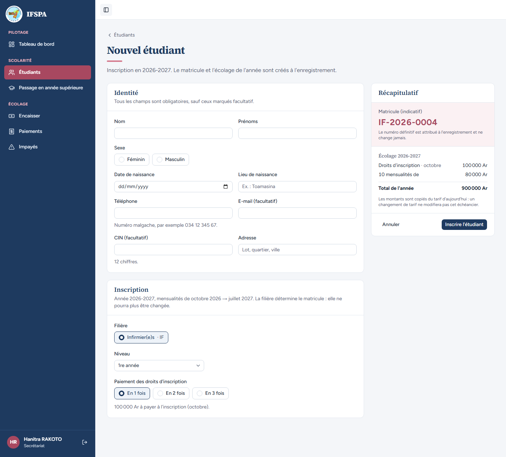
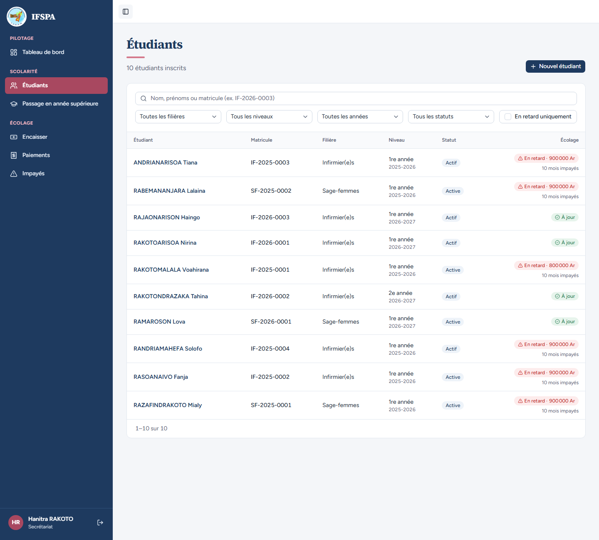
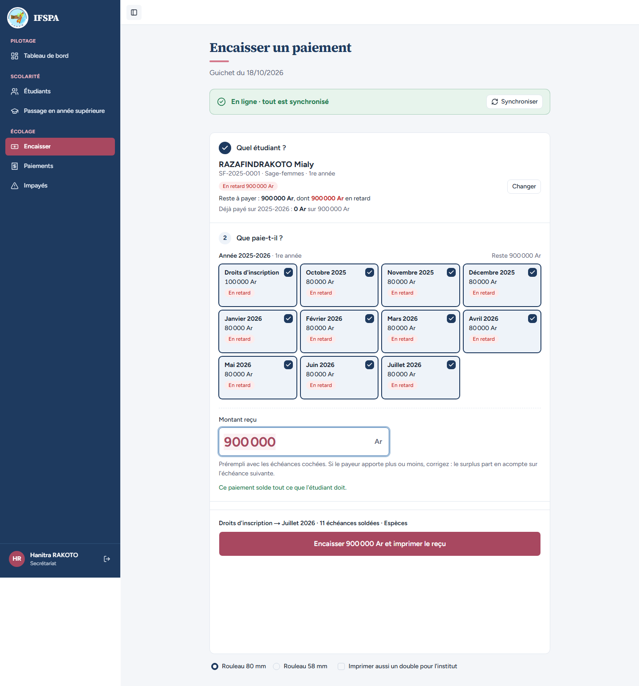
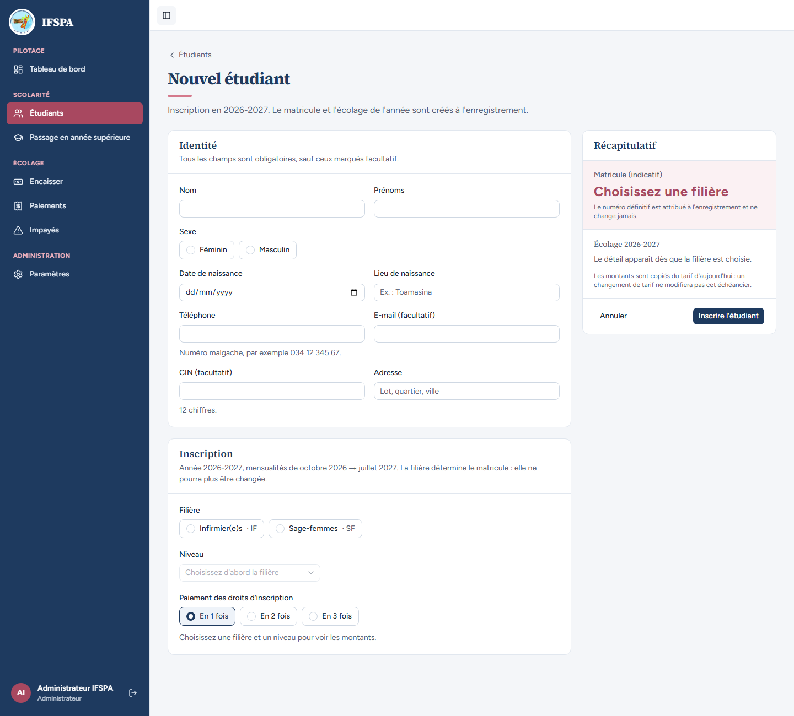

# UC02-09. Désactiver une filière qui a des étudiants : plus d'inscription, mais ses étudiants restent suivis

| | |
|---|---|
| Use case | UC02. Préparer l'année : filières, années scolaires, tarifs |
| Règles couvertes | R-INS (inscription), R-REP (encaissement d'un étudiant d'une filière désactivée), R-ROLE |
| Rôle | Administrateur, puis secrétariat, puis administrateur |
| Durée estimée | 6 minutes |

## La situation

L'institut suspend les inscriptions en sage-femmes : l'administrateur désactive la filière SF. Les étudiantes déjà inscrites doivent rester visibles dans la liste, encaissables au guichet, et la filière garde ses tarifs saisissables (pour leur passage en année supérieure). Le secrétariat ne peut plus inscrire de nouvelle sage-femme. L'administrateur réactive ensuite la filière.

## Avant de commencer

1. `pnpm recette:base`, `pnpm build`, `pnpm recette:app`, puis ouvrir `http://localhost:3200`.
2. Préparation : sections A, B et C de [00-PREPARATION.md](../00-PREPARATION.md), puis [UC02-06](UC02-06-nombre-de-mois.md) (Lova, SF-2026-0001). Les compteurs de la capture 1 (IF 7, SF 3) supposent aussi [UC02-02](UC02-02-duree-filiere.md) et [UC02-05](UC02-05-tarif-copie.md).
3. Comptes : **administrateur** (étapes 1, 2, 6), **secrétariat** (étapes 3 à 5). Ce cas laisse la base comme il l'a trouvée (SF est réactivée).

## Étapes

| # | Qui | Action | Résultat attendu | Capture | ✓ |
|---|---|---|---|---|---|
| 1 | Administrateur | **Paramètres › Filières**, cliquer **Désactiver** sur SF. | « Filière désactivée : elle n'est plus proposée à l'inscription. » Badge « Désactivée » ; le bouton devient « Réactiver » ; les étudiants actifs sont toujours comptés (3 pour SF, 7 pour IF). Aucune confirmation n'est demandée. |  | |
| 2 | Administrateur | Onglet **Tarifs** (2026-2027). | Les classes de **SF 1re à 3e année** sont toujours dans la grille, saisissables, à côté de celles de IF (décision provisoire n° 29). |  | |
| 3 | Secrétariat | **Étudiants › Nouvel étudiant**. | « Inscription en 2026-2027. » Dans « Filière », seulement « Infirmier(e)s · IF » (pas de Sage-femmes). |  | |
| 4 | Secrétariat | Menu **Étudiants**. | La liste montre toujours les étudiantes SF : RAZAFINDRAKOTO Mialy (SF-2025-0001), RABEMANANJARA Lalaina (SF-2025-0002), RAMAROSON Lova (SF-2026-0001), filière « Sage-femmes ». |  | |
| 5 | Secrétariat | Menu **Encaisser**, rechercher RAZAFINDRAKOTO, choisir Mialy. | La situation s'affiche : « Reste à payer : 900 000 Ar, dont 900 000 Ar en retard », les 11 échéances de 2025-2026 cochées d'office, « Ce paiement solde tout ce que l'étudiant doit. » : l'encaissement reste possible. |  | |
| 6 | Administrateur | **Paramètres › Filières**, cliquer **Réactiver** sur SF, puis ouvrir **Étudiants › Nouvel étudiant**. | « Filière activée. » Badge « Active » ; le formulaire propose de nouveau « Sage-femmes · SF ». |  | |

## Ce que ce scénario ne couvre pas

- Le **passage en année supérieure** d'une filière désactivée (ses classes restent proposées, décision n° 29) : non rejoué ici ; couvert côté lectures par Vitest, `tests/integration/lectures-admissions.test.ts`.
- Le refus **serveur** d'une inscription dans une filière désactivée (écran contourné) : couvert par Vitest, `tests/integration/actions-etudiants.test.ts` (voir R-INS dans la matrice).
- La grille des tarifs **n'indique pas** que SF est désactivée (ses lignes ressemblent à celles de IF) : question dans le rapport.
- Ordinateur seulement.

## Dernière exécution par l'agent

- 18/10/2026 : ✅ 6 étapes sur 6.
- Rapport : [RAPPORT_2026-10-18_UC02.md](../../rapports/RAPPORT_2026-10-18_UC02.md). Parcours : [UC02-09-filiere-desactivee.recette.ts](../../parcours/UC02-09-filiere-desactivee.recette.ts).
