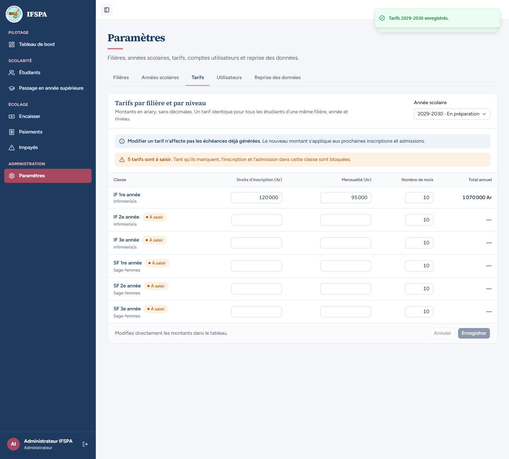
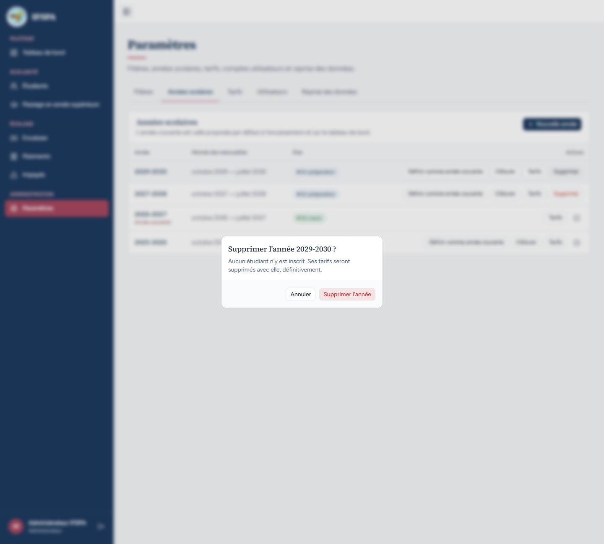
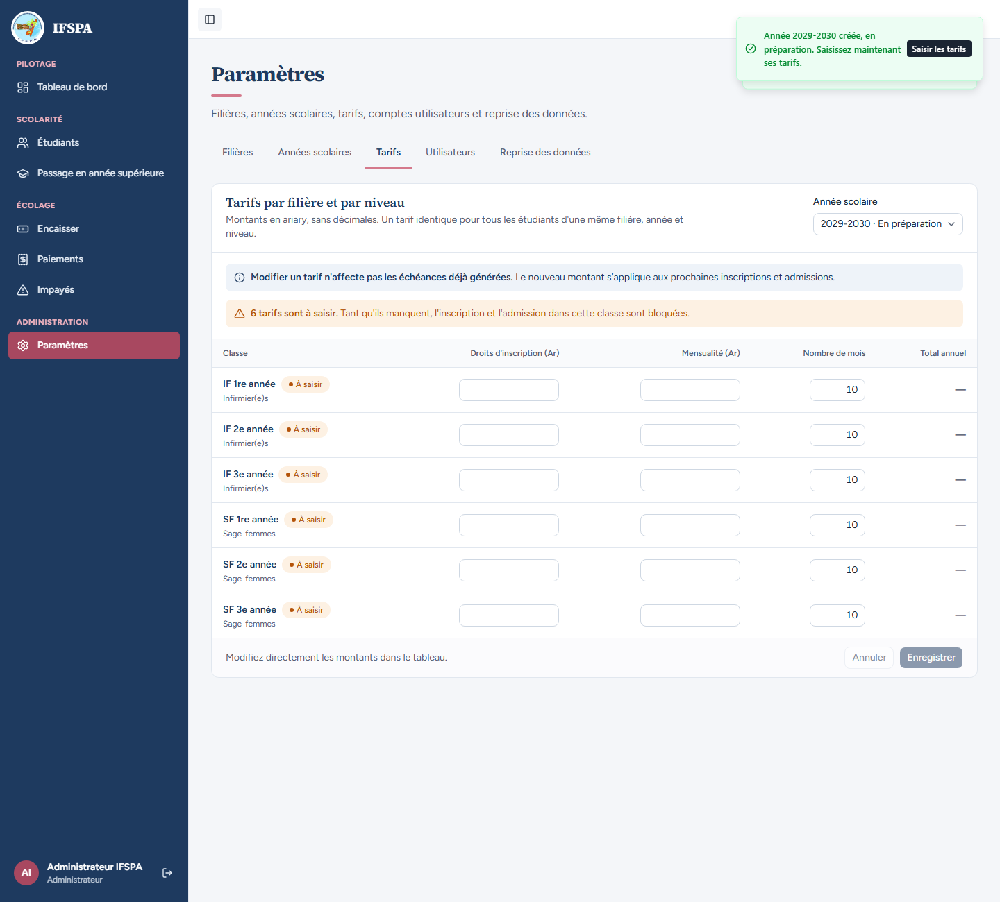
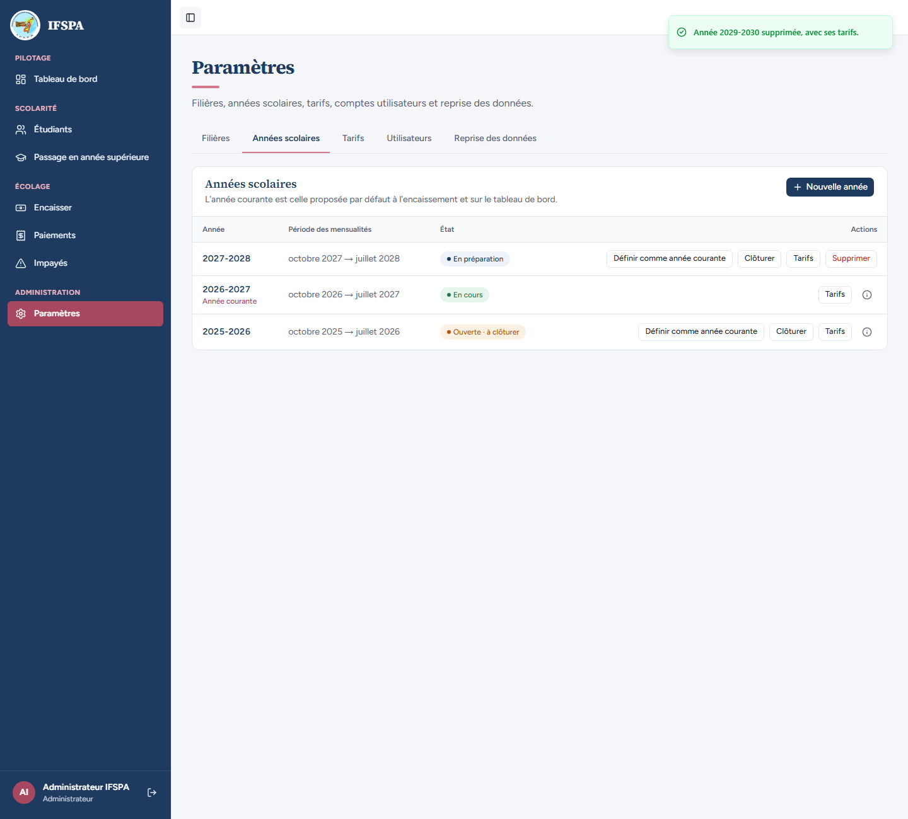

# UC02-10. Une année sans étudiant se supprime avec ses tarifs

| | |
|---|---|
| Use case | UC02. Préparer l'année : filières, années scolaires, tarifs |
| Règles couvertes | R-ROLE (suppression réservée à l'administrateur), R-ECH (les tarifs d'une année lui appartiennent) |
| Rôle | Administrateur |
| Durée estimée | 5 minutes |

## La situation

L'administrateur crée par erreur l'année 2029-2030 et y saisit un tarif, puis la supprime. En la recréant, il vérifie que les tarifs de l'ancienne année n'ont pas survécu.

## Avant de commencer

1. `pnpm recette:base`, `pnpm build`, `pnpm recette:app`, puis ouvrir `http://localhost:3200`.
2. Préparation : sections A, B et C de [00-PREPARATION.md](../00-PREPARATION.md). Ce cas ne laisse rien derrière lui (2029-2030 est supprimée à la fin) et se rejoue seul. Les captures ont été prises après [UC02-03](UC02-03-annees.md) : la liste contient aussi 2027-2028.
3. Compte **administrateur** (`SEED_ADMIN_*`, « Administrateur IFSPA »).

## Étapes

| # | Qui | Action | Résultat attendu | Capture | ✓ |
|---|---|---|---|---|---|
| 1 | Administrateur | **Paramètres › Années scolaires › Nouvelle année**, `2029`, **Créer l'année**. Cliquer **Tarifs** sur la ligne 2029-2030. Saisir pour IF 1re année `120 000` et `95 000`, **Enregistrer**. | « Année 2029-2030 créée, en préparation. Saisissez maintenant ses tarifs. » Grille « 2029-2030 · En préparation », total de IF 1re année **1 070 000 Ar**, « Tarifs 2029-2030 enregistrés. », « 5 tarifs sont à saisir. » |  | |
| 2 | Administrateur | Retour à **Années scolaires**, cliquer **Supprimer** sur 2029-2030. | Fenêtre « Supprimer l'année 2029-2030 ? » : « Aucun étudiant n'y est inscrit. Ses tarifs seront supprimés avec elle, définitivement. » |  | |
| 3 | Administrateur | Cliquer **Supprimer l'année**. | « Année 2029-2030 supprimée, avec ses tarifs. » La ligne 2029-2030 a disparu. | | |
| 4 | Administrateur | **Nouvelle année**, `2029`, **Créer l'année**, puis **Tarifs** sur la nouvelle ligne 2029-2030. | La grille est vierge : « 6 tarifs sont à saisir. », champs vides, le tarif 120 000 / 95 000 de l'ancienne année n'existe plus. |  | |
| 5 | Administrateur | Supprimer de nouveau 2029-2030 (**Supprimer** puis **Supprimer l'année**). | « Année 2029-2030 supprimée, avec ses tarifs. » La liste ne contient que les années d'avant. |  | |

## Ce que ce scénario ne couvre pas

- Le refus de supprimer une année qui a des étudiants, ou l'année courante : lisible à l'écran pour 2025-2026 et 2026-2027 ([UC02-03](UC02-03-annees.md) étape 2, [UC02-04](UC02-04-cloture.md) étape 1) ; refus serveur couvert par Vitest, `tests/integration/actions-parametres.test.ts` (« supprime une année inutilisée avec ses tarifs, jamais l'année courante ») et `tests/unit/parametres.test.ts` (« année : refusée si des inscriptions, des étudiants entrés ou des admissions la concernent »).
- Décision provisoire n° 1 de `STATUS.md` : pas de suppression d'un tarif isolé, ni d'une année qui a des inscrits ou des admissions (on clôture à la place).
- Ordinateur seulement.

## Dernière exécution par l'agent

- 18/10/2026 : ✅ 5 étapes sur 5.
- Rapport : [RAPPORT_2026-10-18_UC02.md](../../rapports/RAPPORT_2026-10-18_UC02.md). Parcours : [UC02-10-annee-supprimee.recette.ts](../../parcours/UC02-10-annee-supprimee.recette.ts).
