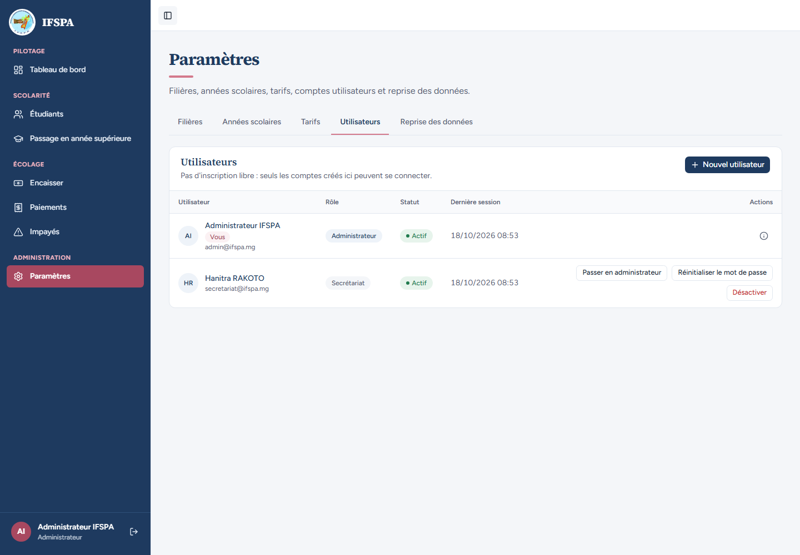
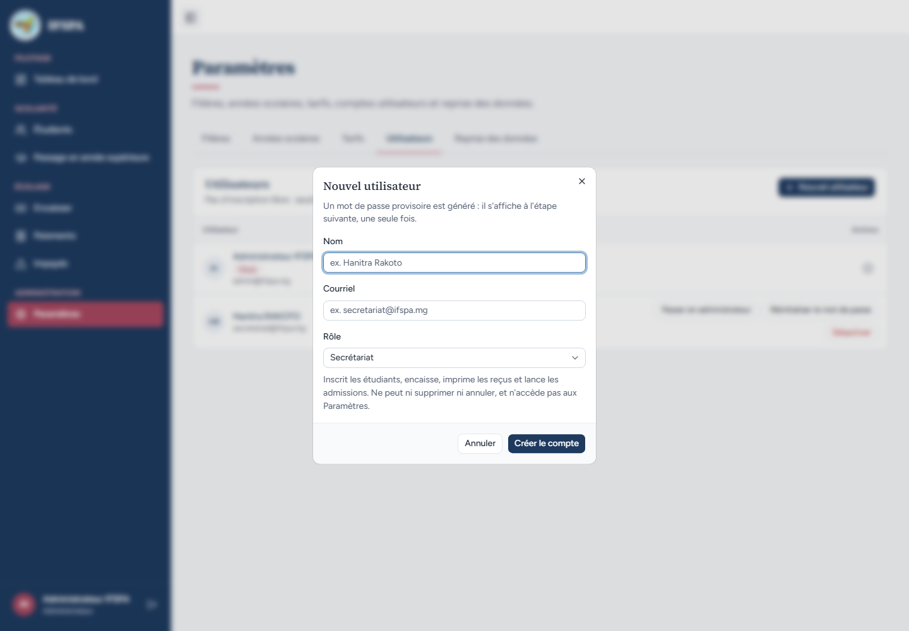
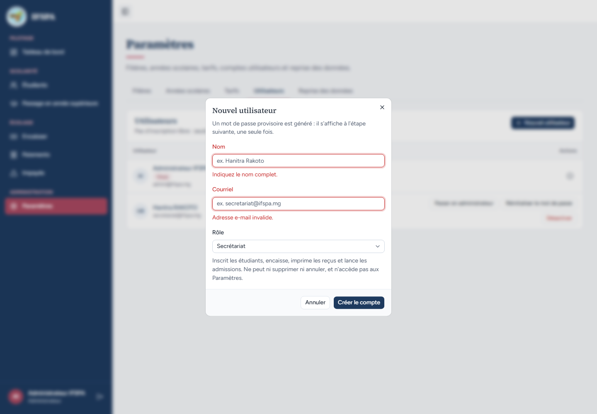
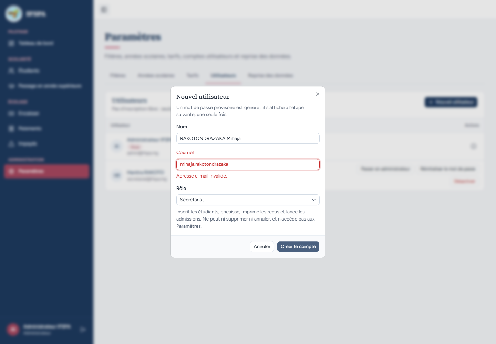
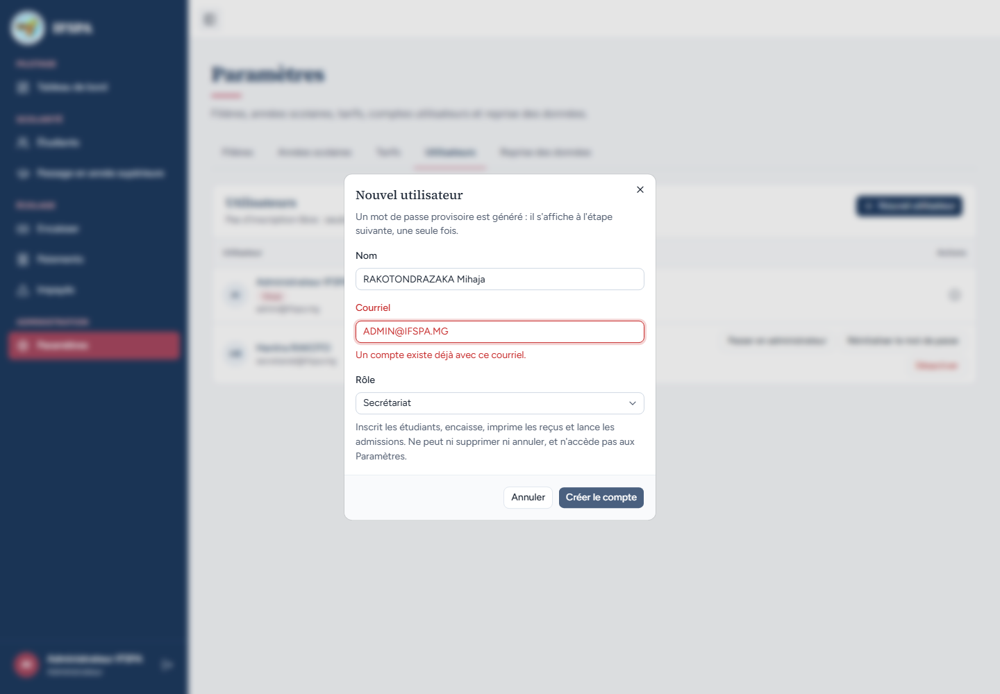
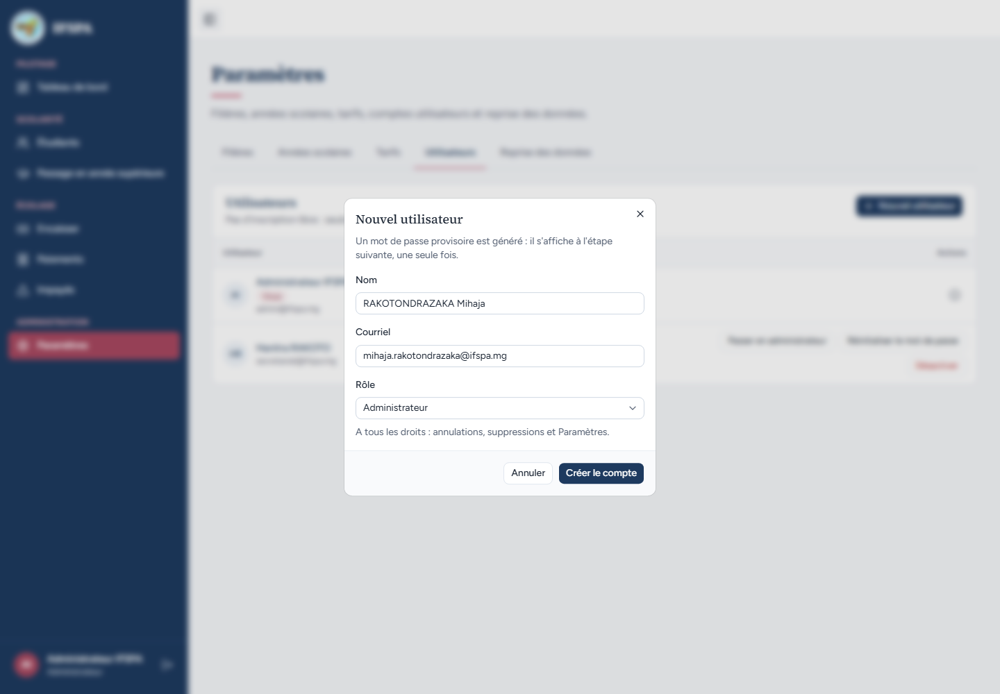
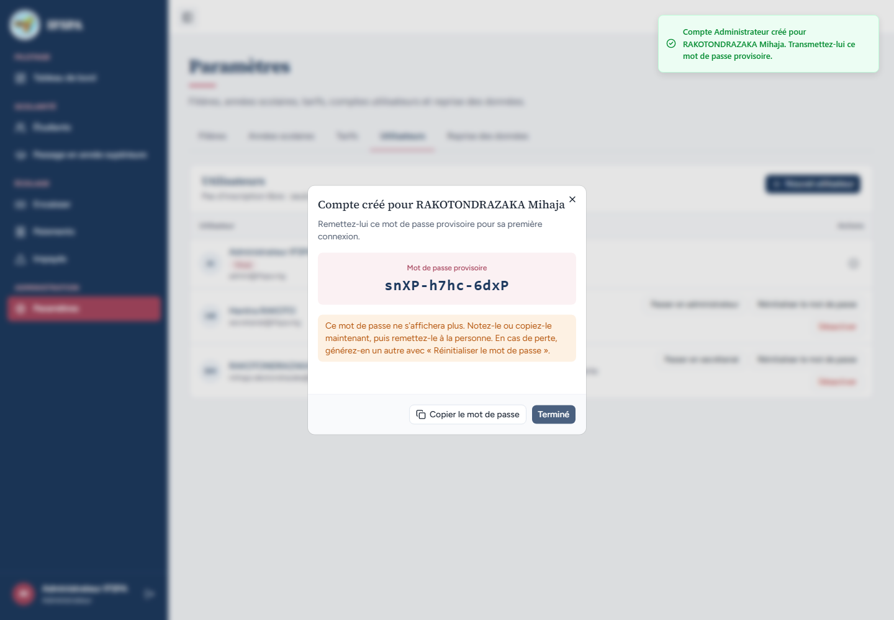
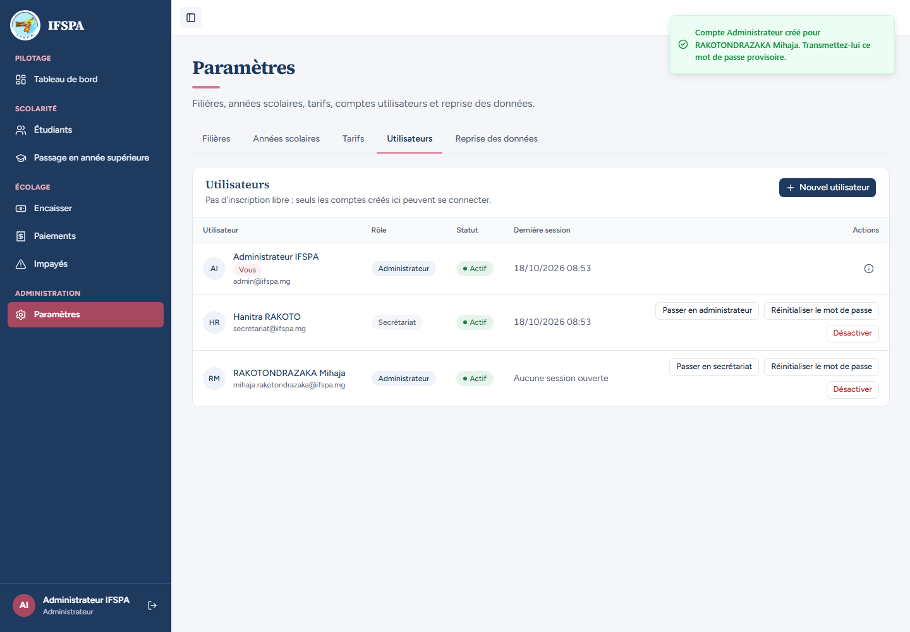
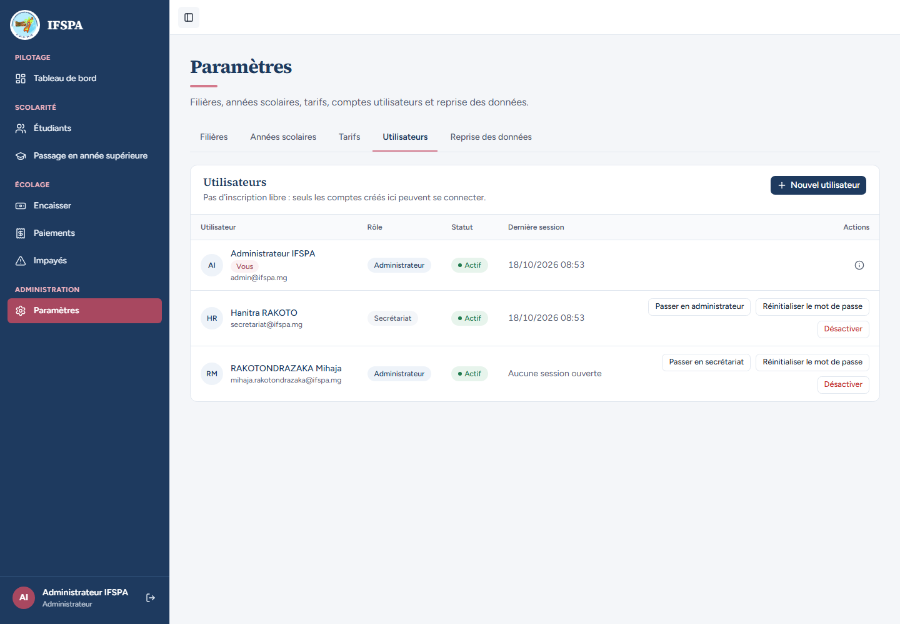
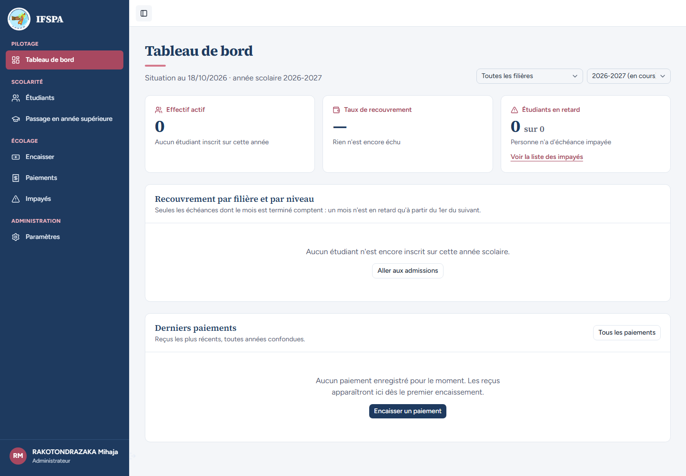

# UC03-01. Créer un compte : refus du formulaire, puis un administrateur créé d'emblée

| | |
|---|---|
| Use case | UC03. Gérer les comptes du personnel |
| Règles couvertes | R-ROLE (comptes créés par l'administrateur seul, mot de passe provisoire) |
| Rôle | Administrateur ; la personne créée (RAKOTONDRAZAKA Mihaja) pour la connexion finale |
| Durée estimée | 6 minutes |

## La situation

L'institut recrute un second administrateur, RAKOTONDRAZAKA Mihaja. L'administrateur ouvre le formulaire, se trompe d'abord (champs vides, courriel mal écrit, courriel déjà pris), puis crée le compte avec le rôle « Administrateur » et remet le mot de passe provisoire. Mihaja se connecte.

## Avant de commencer

1. `pnpm recette:base`, `pnpm build`, `pnpm recette:app`, puis ouvrir `http://localhost:3200`. Aucune donnée de préparation : le seed suffit.
2. Ce cas **crée le compte** `mihaja.rakotondrazaka@ifspa.mg` : repartir de `pnpm recette:base` pour le rejouer. Les cas suivants d'UC03 créent chacun leurs propres comptes et peuvent s'enchaîner sur la même base. Les captures ont été prises dans cet ordre : les listes y contiennent les comptes des cas précédents.
3. Compte **administrateur** (identifiants `SEED_ADMIN_*` de `.env`, affiché « Administrateur IFSPA »). Une seconde fenêtre sans session pour Mihaja.
4. La création simple d'un compte « Secrétariat » est déjà déroulée dans [UC01-06](../UC01-connexion/UC01-06-compte-desactive.md).

## Étapes

| # | Qui | Action | Résultat attendu | Capture | ✓ |
|---|---|---|---|---|---|
| 1 | Administrateur | Ouvrir **Paramètres › Utilisateurs**, puis cliquer **Nouvel utilisateur**. | Liste de départ : « Administrateur IFSPA » (badge « Vous ») et « Hanitra RAKOTO ». La fenêtre « Nouvel utilisateur » propose le rôle « Secrétariat » avec son aide : « Inscrit les étudiants, encaisse, imprime les reçus et lance les admissions. Ne peut ni supprimer ni annuler, et n'accède pas aux Paramètres. » |   | |
| 2 | Administrateur | Cliquer **Créer le compte** sans rien saisir. | Sous « Nom » : « Indiquez le nom complet. ». Sous « Courriel » : « Adresse e-mail invalide. » (le message « Indiquez le courriel. » n'apparaît pas : constat 1 du rapport). |  | |
| 3 | Administrateur | Nom `RAKOTONDRAZAKA Mihaja`, Courriel `mihaja.rakotondrazaka` (sans le domaine), **Créer le compte**. | « Adresse e-mail invalide. » sous « Courriel ». |  | |
| 4 | Administrateur | Courriel `ADMIN@IFSPA.MG` (celui de l'administrateur, en majuscules), **Créer le compte**. | « Un compte existe déjà avec ce courriel. » sous « Courriel » : la casse ne change rien. Aucun compte créé. |  | |
| 5 | Administrateur | Courriel `mihaja.rakotondrazaka@ifspa.mg`, Rôle **Administrateur**. | L'aide du rôle devient « A tous les droits : annulations, suppressions et Paramètres. » |  | |
| 6 | Administrateur | Cliquer **Créer le compte**. | Fenêtre « Compte créé pour RAKOTONDRAZAKA Mihaja » avec le « Mot de passe provisoire » (forme `Xxxx-Xxxx-Xxxx`, change à chaque rejeu : le noter), l'avertissement « Ce mot de passe ne s'affichera plus. Notez-le ou copiez-le maintenant… » et la notification « Compte Administrateur créé pour RAKOTONDRAZAKA Mihaja. Transmettez-lui ce mot de passe provisoire. » |  | |
| 7 | Administrateur | Cliquer **Copier le mot de passe**, puis **Terminé**. | « Mot de passe copié. » ; le presse-papiers contient le mot de passe. Après « Terminé », la ligne de Mihaja : « Administrateur », « Actif », « Aucune session ouverte ». |   | |
| 8 | Administrateur | Recharger la page. | Le mot de passe n'est nulle part : seul « Réinitialiser le mot de passe » en génère un autre. |  | |
| 9 | Mihaja | Dans l'autre fenêtre, `/connexion` avec ce courriel et le mot de passe provisoire. | Tableau de bord, « RAKOTONDRAZAKA Mihaja » et « Administrateur » en bas de la barre latérale, rubrique **Paramètres** présente. |  | |

## Ce que ce scénario ne couvre pas

- Création d'un compte « Secrétariat » : voir UC01-06.
- Refus serveur de la création par le secrétariat : couvert par Vitest, `tests/unit/actions-parametres-refus.test.ts` (« creerUtilisateur renvoie le refus sans toucher à la base ni à Better Auth »).
- Nom de plus de 80 caractères : règle de `tests/unit/parametres.test.ts`, non démontrée à l'écran.
- Pas de changement forcé du mot de passe provisoire à la première connexion (décision provisoire n° 5).
- Ordinateur seulement (téléphone : [UC03-07](UC03-07-telephone.md)).

## Dernière exécution par l'agent

- 18/10/2026 : ✅ 9 étapes sur 9 (constat mineur 1 à l'étape 2 : [rapport](../../rapports/RAPPORT_2026-10-18_UC03.md)).
- Parcours : [UC03-01-creation-refus.recette.ts](../../parcours/UC03-01-creation-refus.recette.ts).
