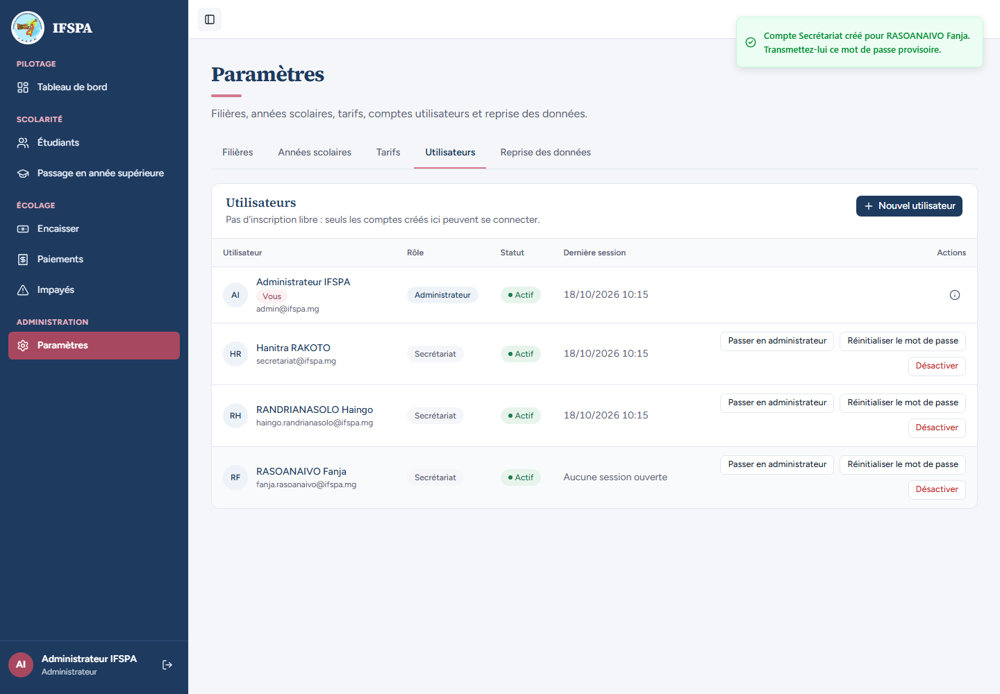
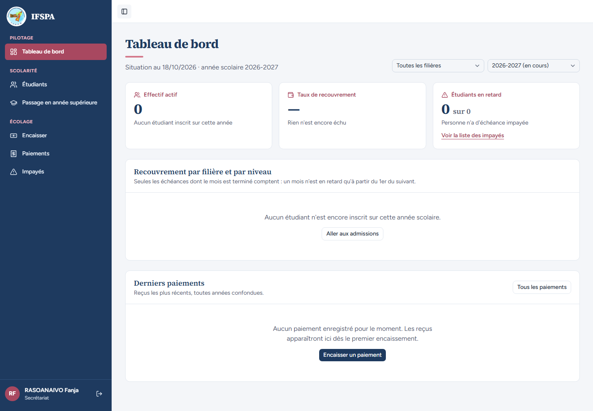
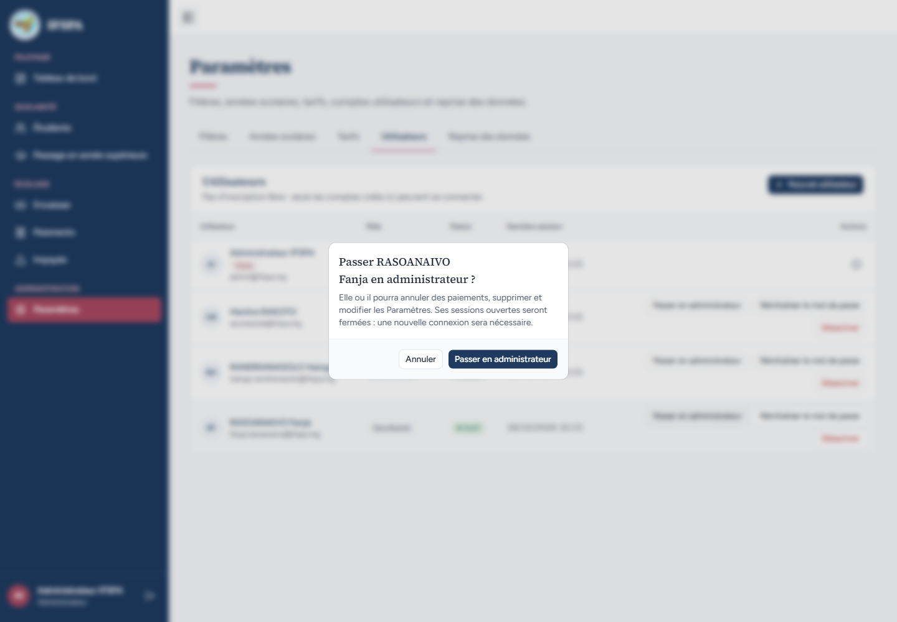
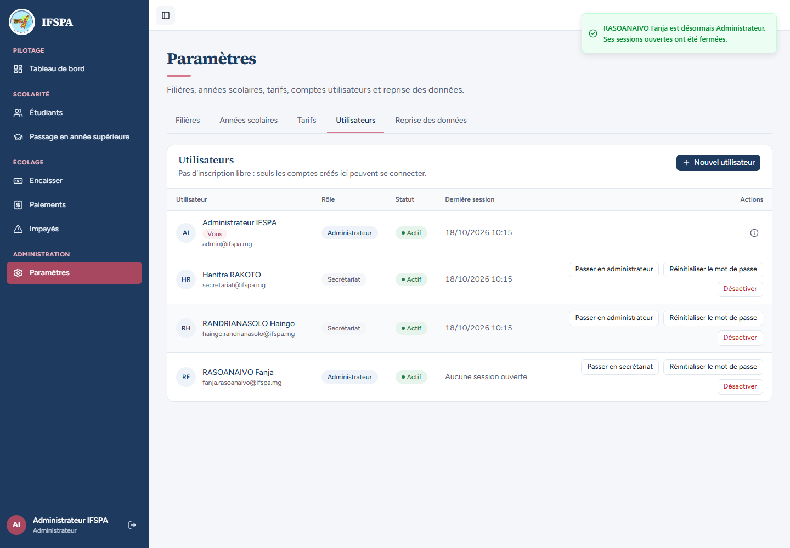
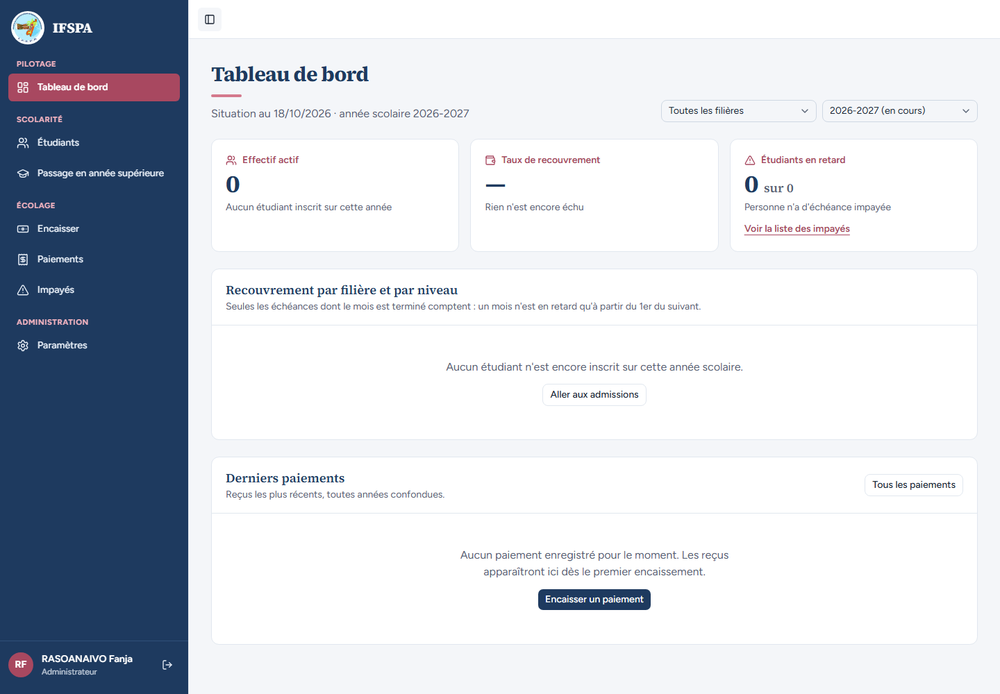
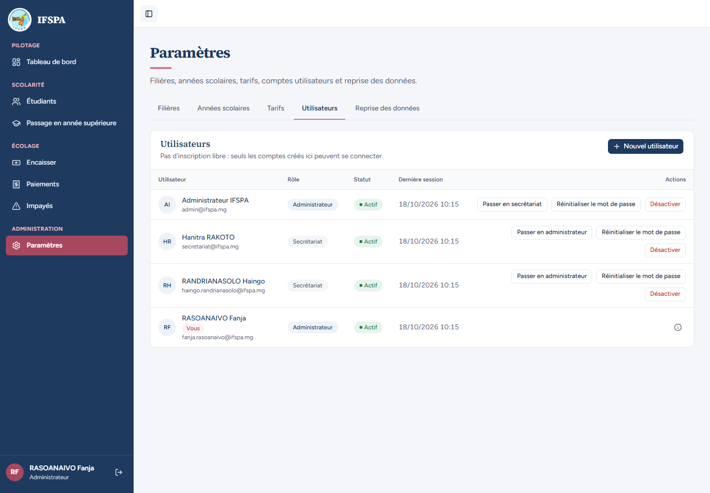

# UC03-02. Une secrétaire devient administratrice : sa session est fermée

| | |
|---|---|
| Use case | UC03. Gérer les comptes du personnel |
| Règles couvertes | R-ROLE (changement de rôle, sessions fermées) |
| Rôle | Administrateur ; RASOANAIVO Fanja (secrétariat puis administratrice) |
| Durée estimée | 6 minutes |

## La situation

RASOANAIVO Fanja travaille au secrétariat. La direction décide de lui confier aussi les Paramètres : l'administrateur la passe en administratrice. Sa session ouverte est fermée, elle se reconnecte avec le même mot de passe et voit la rubrique Paramètres.

## Avant de commencer

1. `pnpm recette:base`, `pnpm build`, `pnpm recette:app`, puis ouvrir `http://localhost:3200`. Aucune donnée de préparation.
2. Ce cas **crée le compte** `fanja.rasoanaivo@ifspa.mg` : repartir de `pnpm recette:base` pour le rejouer (ou l'enchaîner après UC03-01 : les captures montrent alors Mihaja dans la liste).
3. Deux fenêtres : le compte **administrateur** (`SEED_ADMIN_*`, « Administrateur IFSPA ») et une fenêtre sans session pour Fanja.
4. Si vous enchaînez plusieurs cas, patientez une dizaine de secondes entre deux séries de connexions (voir [UC01-09](../UC01-connexion/UC01-09-tentatives-rapprochees.md)).

## Étapes

| # | Qui | Action | Résultat attendu | Capture | ✓ |
|---|---|---|---|---|---|
| 1 | Administrateur | **Paramètres › Utilisateurs › Nouvel utilisateur** : Nom `RASOANAIVO Fanja`, Courriel `fanja.rasoanaivo@ifspa.mg`, Rôle « Secrétariat », **Créer le compte** (noter le mot de passe provisoire), **Terminé**. | Sa ligne : « Secrétariat », bouton « Passer en administrateur ». |  | |
| 2 | Fanja | Dans l'autre fenêtre, se connecter avec ce courriel et ce mot de passe. | Tableau de bord, « RASOANAIVO Fanja » et « Secrétariat » en bas de la barre, **sans** Paramètres dans le menu. |  | |
| 3 | Administrateur | Cliquer **Passer en administrateur** sur la ligne de Fanja. | Fenêtre « Passer RASOANAIVO Fanja en administrateur ? » : « Elle ou il pourra annuler des paiements, supprimer et modifier les Paramètres. Ses sessions ouvertes seront fermées : une nouvelle connexion sera nécessaire. » |  | |
| 4 | Administrateur | Confirmer par **Passer en administrateur**. | Notification « RASOANAIVO Fanja est désormais Administrateur. Ses sessions ouvertes ont été fermées. » Sa ligne : « Administrateur », bouton « Passer en secrétariat », « Aucune session ouverte ». |  | |
| 5 | Fanja | Dans sa fenêtre restée ouverte, cliquer **Étudiants** dans le menu. | **Attendu** : la connexion est redemandée (sa session est fermée). **Obtenu** : ❌ la liste « Étudiants » s'ouvre, avec « RASOANAIVO Fanja » et « Secrétariat » encore affichés (même constat que [UC01-06](../UC01-connexion/UC01-06-compte-desactive.md) étape 5 ; constat 2 du rapport). |  | |
| 6 | Fanja | Recharger la page (F5). | La page « Connexion » s'affiche : la session est fermée. |  | |
| 7 | Fanja | Se reconnecter avec le **même** courriel et mot de passe. | Tableau de bord, « RASOANAIVO Fanja » et « Administrateur », rubrique **Paramètres** présente. |  | |
| 8 | Fanja | Ouvrir **Paramètres › Utilisateurs**. | La liste s'ouvre, sa ligne porte « Vous » et n'a aucune action ; le bouton « Nouvel utilisateur » est là. |  | |

## Ce que ce scénario ne couvre pas

- Refus serveur du changement de rôle par le secrétariat : couvert par Vitest, `tests/unit/actions-parametres-refus.test.ts` (« changerRole renvoie le refus sans toucher à la base ni à Better Auth »). Règles pures (rôle déjà détenu, soi-même) : `tests/unit/parametres.test.ts`, bloc `controleActionUtilisateur`.
- Fermeture des sessions : démontrée au rechargement (étape 6), pas dans la fenêtre ouverte (étape 5, ❌).
- Aucun test d'intégration des actions de comptes (changement de rôle, sessions réellement supprimées en base) : non démontré par Vitest.
- Ordinateur seulement.

## Dernière exécution par l'agent

- 18/10/2026 : ❌ étape 5 sur 8 (la navigation par le menu continue après la fermeture de la session) ; les 7 autres étapes ✅. Voir le [rapport](../../rapports/RAPPORT_2026-10-18_UC03.md).
- Parcours : [UC03-02-promotion-administrateur.recette.ts](../../parcours/UC03-02-promotion-administrateur.recette.ts).
