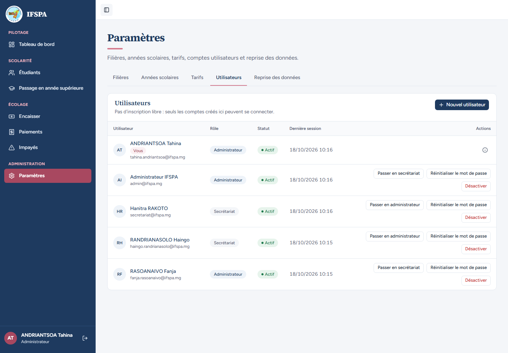
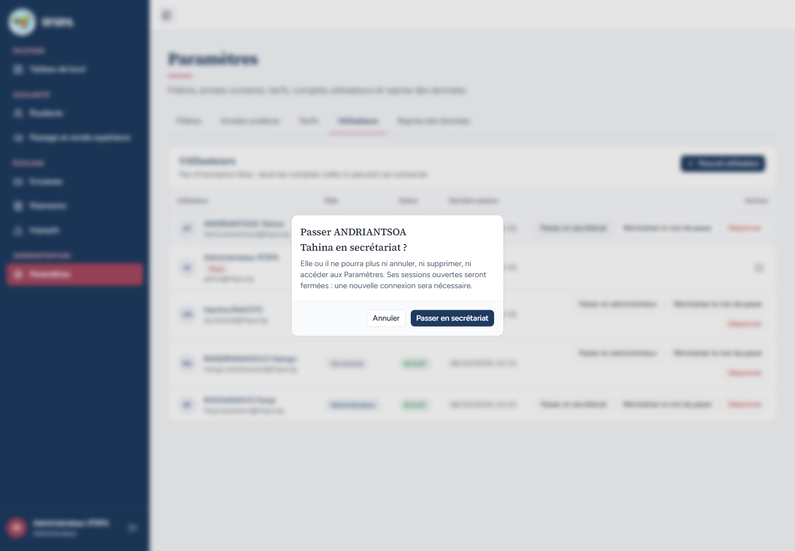
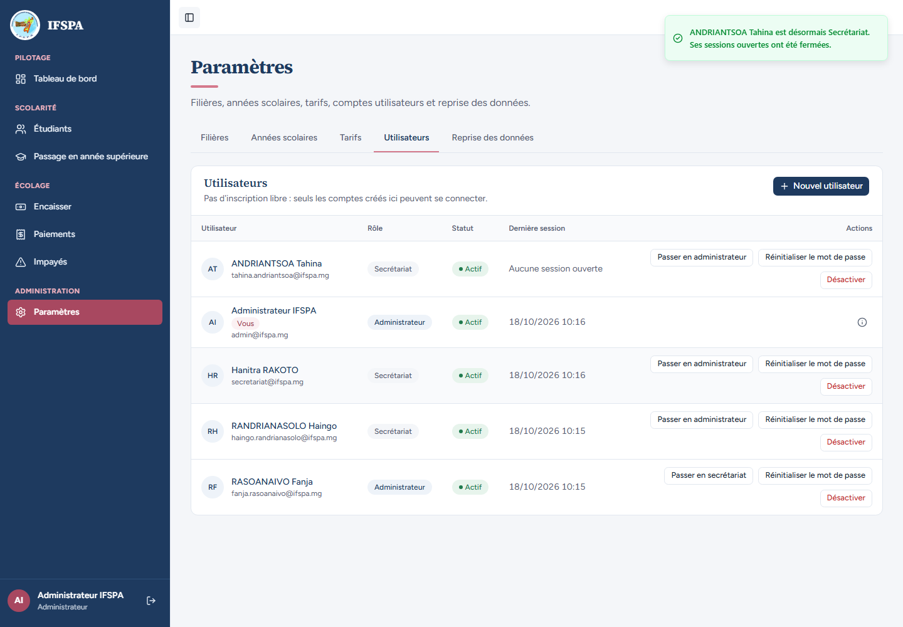
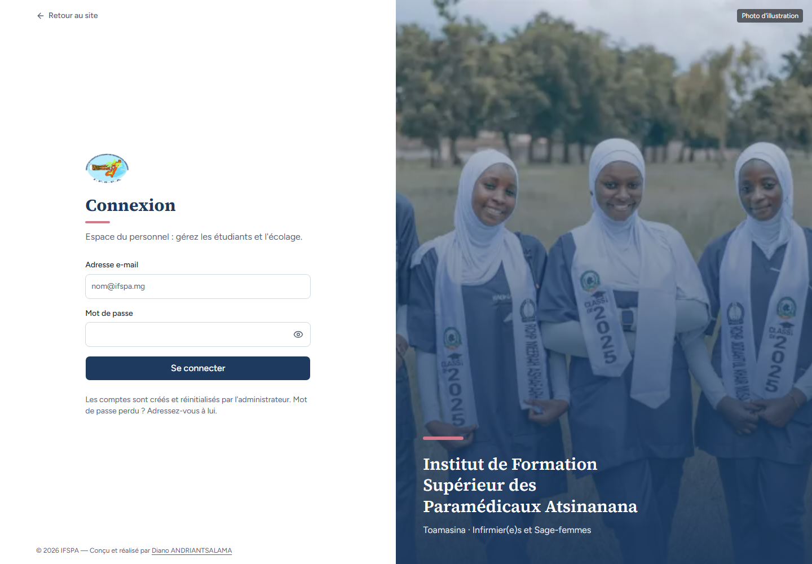
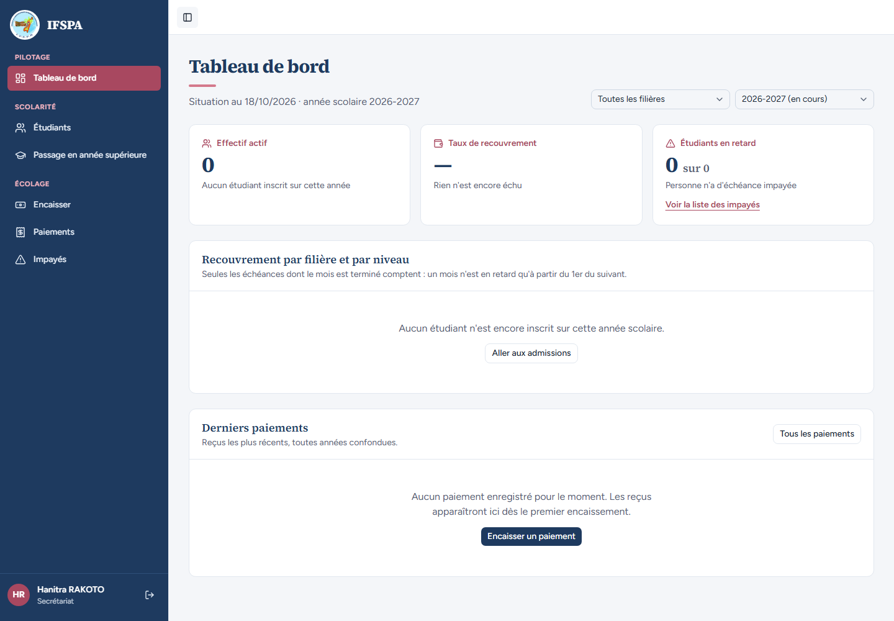
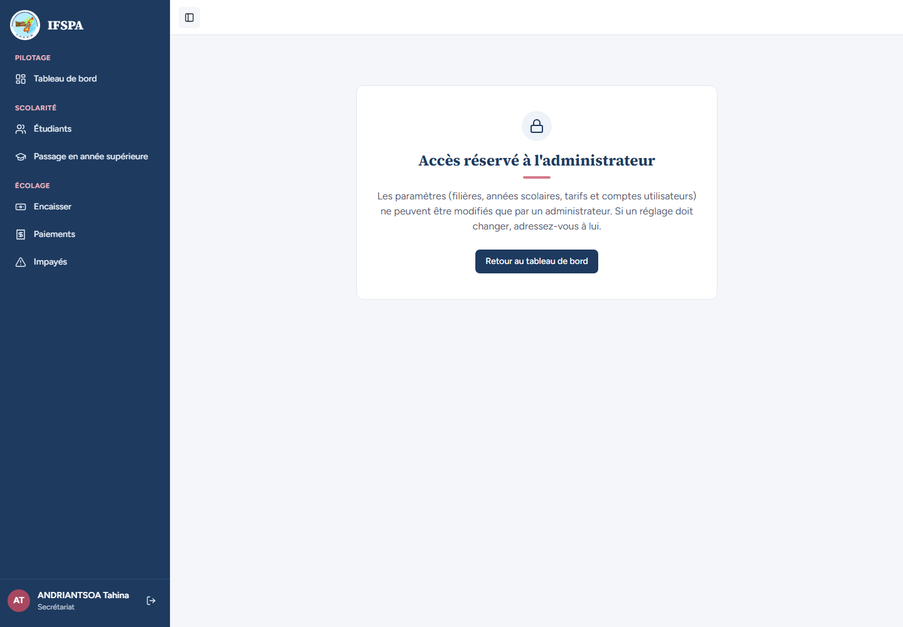

# UC03-03. Un administrateur repasse en secrétariat : ses fenêtres ouvertes n'ont plus la main

| | |
|---|---|
| Use case | UC03. Gérer les comptes du personnel |
| Règles couvertes | R-ROLE (perte des droits d'administration, contrôle du rôle côté serveur) |
| Rôle | Administrateur ; ANDRIANTSOA Tahina (administratrice puis secrétariat) |
| Durée estimée | 8 minutes |

## La situation

ANDRIANTSOA Tahina est administratrice et travaille sur l'écran Utilisateurs dans deux fenêtres. La direction la repasse au secrétariat. Elle ne doit plus pouvoir modifier un compte, ni voir les Paramètres, même dans ses fenêtres restées ouvertes.

## Avant de commencer

1. `pnpm recette:base`, `pnpm build`, `pnpm recette:app`, puis ouvrir `http://localhost:3200`. Aucune donnée de préparation.
2. Ce cas **crée le compte** `tahina.andriantsoa@ifspa.mg` : repartir de `pnpm recette:base` pour le rejouer (ou l'enchaîner après UC03-01 et 02).
3. Trois fenêtres : l'**administrateur** (`SEED_ADMIN_*`), et deux fenêtres sans session pour Tahina (A et B). La connexion du seed secrétariat (`SEED_USER_*`, Hanitra RAKOTO) sert à l'étape 6.
4. Patientez une dizaine de secondes entre deux séries de connexions (voir [UC01-09](../UC01-connexion/UC01-09-tentatives-rapprochees.md)) : ce cas en fait quatre.

## Étapes

| # | Qui | Action | Résultat attendu | Capture | ✓ |
|---|---|---|---|---|---|
| 1 | Administrateur, Tahina | L'administrateur crée le compte **Administrateur** de `ANDRIANTSOA Tahina` (`tahina.andriantsoa@ifspa.mg`, voir [UC03-01](UC03-01-creation-refus.md)). Tahina se connecte dans ses fenêtres A et B, qu'elle laisse sur **Paramètres › Utilisateurs**. | Fenêtre A : « ANDRIANTSOA Tahina » et « Administrateur », la liste avec les boutons « Réinitialiser le mot de passe » sur les autres comptes. |  | |
| 2 | Administrateur | Cliquer **Passer en secrétariat** sur la ligne de Tahina. | Fenêtre « Passer ANDRIANTSOA Tahina en secrétariat ? » : « Elle ou il ne pourra plus ni annuler, ni supprimer, ni accéder aux Paramètres. Ses sessions ouvertes seront fermées : une nouvelle connexion sera nécessaire. » |  | |
| 3 | Administrateur | Confirmer par **Passer en secrétariat**. | Notification « ANDRIANTSOA Tahina est désormais Secrétariat. Ses sessions ouvertes ont été fermées. » Sa ligne : « Secrétariat », bouton « Passer en administrateur », « Aucune session ouverte ». |  | |
| 4 | Tahina (fenêtre A) | Dans sa fenêtre restée ouverte, cliquer **Réinitialiser le mot de passe** sur la ligne de Hanitra RAKOTO, puis confirmer. | Rien n'est exécuté : la page « Connexion » s'affiche (sa session n'existe plus), sans message. |  | |
| 5 | Tahina (fenêtre B) | Dans sa seconde fenêtre restée sur Paramètres, cliquer l'onglet **Tarifs**. | **Attendu** : la connexion est redemandée. **Obtenu** : ❌ l'onglet « Tarifs » est sélectionné mais le panneau reste **vide**, sans message ni redirection ; la barre latérale affiche encore « ANDRIANTSOA Tahina » et « Administrateur ». Aucune donnée de Paramètres n'est affichée (constat 2 du rapport). |  | |
| 6 | Hanitra RAKOTO | Dans une autre fenêtre, se connecter avec le compte secrétariat du seed. | Le mot de passe de Hanitra n'a pas changé : Tableau de bord, « Hanitra RAKOTO » et « Secrétariat ». |  | |
| 7 | Tahina | Dans la fenêtre A, se reconnecter avec son mot de passe provisoire (inchangé). | Tableau de bord, « ANDRIANTSOA Tahina » et « Secrétariat », **sans** Paramètres dans le menu. |  | |
| 8 | Tahina | Ouvrir `/app/parametres/utilisateurs`. | « Accès réservé à l'administrateur » ; ni liste, ni bouton « Nouvel utilisateur ». |  | |

## Ce que ce scénario ne couvre pas

- Refus serveur par le **rôle** (compte encore connecté mais rétrogradé) : le test d'intégration manque ; ici la session est déjà fermée, donc c'est la session et non le rôle qui arrête l'action de l'étape 4. Refus du rôle `user` sans session valide : couvert par Vitest, `tests/unit/actions-parametres-refus.test.ts`.
- Rétrograder le dernier administrateur actif : voir [UC03-05](UC03-05-garde-fous.md).
- Ordinateur seulement.

## Dernière exécution par l'agent

- 18/10/2026 : ❌ étape 5 sur 8 (panneau vide au lieu d'une demande de connexion, constat 2 du [rapport](../../rapports/RAPPORT_2026-10-18_UC03.md)) ; les 7 autres étapes ✅.
- Parcours : [UC03-03-retrogradation.recette.ts](../../parcours/UC03-03-retrogradation.recette.ts).
