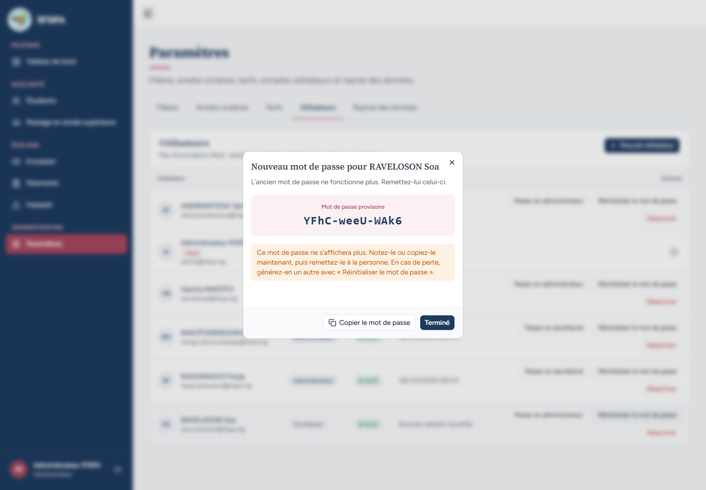
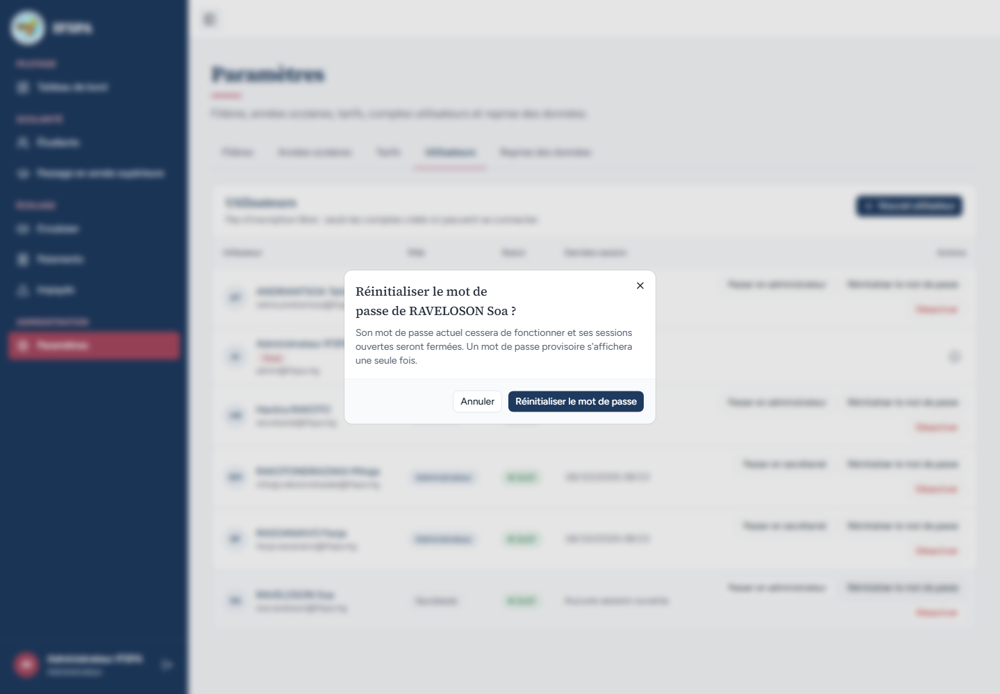
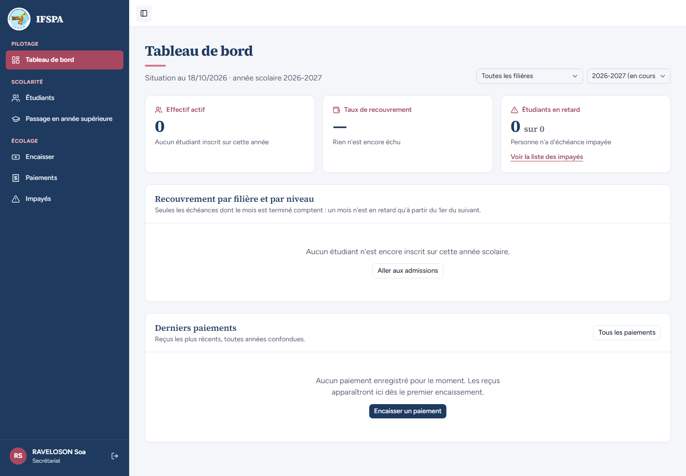
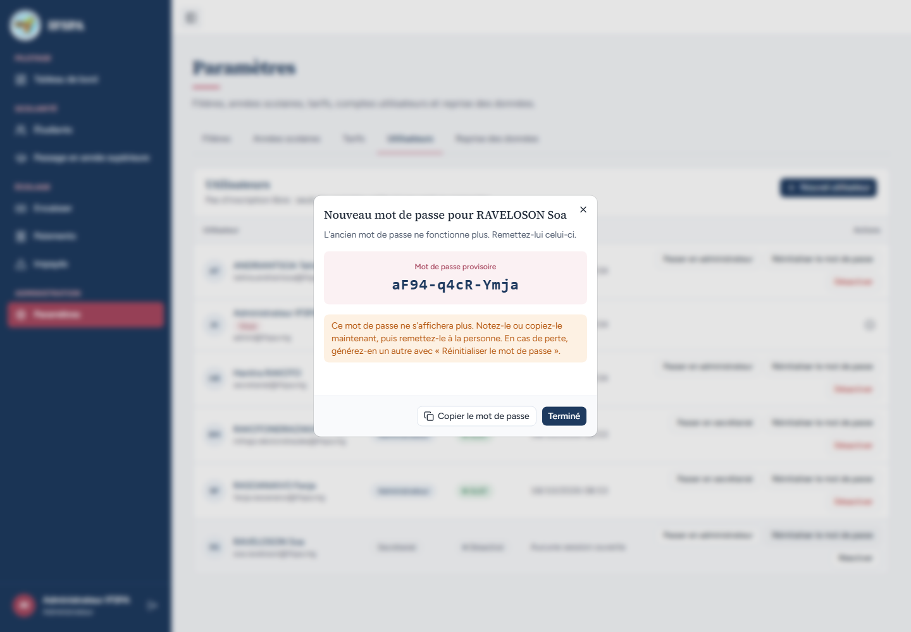
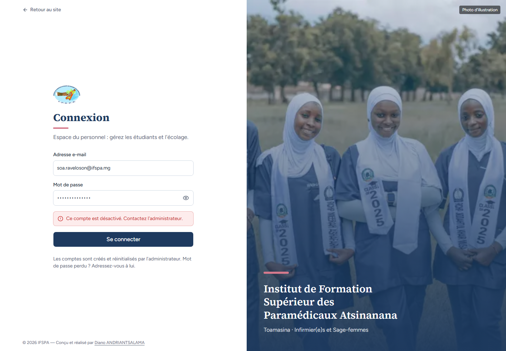

# UC03-04. Mot de passe perdu : l'administrateur en génère un nouveau

| | |
|---|---|
| Use case | UC03. Gérer les comptes du personnel |
| Règles couvertes | R-ROLE (réinitialisation par l'administrateur seul, sessions fermées) |
| Rôle | Administrateur ; RAVELOSON Soa (secrétariat) |
| Durée estimée | 10 minutes |

## La situation

RAVELOSON Soa, du secrétariat, a perdu son mot de passe. L'administrateur lui en génère un nouveau, qui ne s'affiche qu'une fois. L'ancien ne fonctionne plus, sa session ouverte est fermée. Une seconde réinitialisation invalide à son tour le mot de passe précédent, et un compte désactivé reste fermé même après réinitialisation.

## Avant de commencer

1. `pnpm recette:base`, `pnpm build`, `pnpm recette:app`, puis ouvrir `http://localhost:3200`. Aucune donnée de préparation.
2. Ce cas **crée le compte** `soa.raveloson@ifspa.mg` : repartir de `pnpm recette:base` pour le rejouer (ou l'enchaîner après UC03-01 à 03).
3. Deux fenêtres : l'**administrateur** (`SEED_ADMIN_*`) et une fenêtre sans session pour Soa.
4. Ce cas fait 5 tentatives de connexion : patientez dix secondes quand l'écran refuse (voir [UC01-09](../UC01-connexion/UC01-09-tentatives-rapprochees.md)).

## Étapes

| # | Qui | Action | Résultat attendu | Capture | ✓ |
|---|---|---|---|---|---|
| 1 | Administrateur, Soa | L'administrateur crée le compte « Secrétariat » de `RAVELOSON Soa` (`soa.raveloson@ifspa.mg`), note le mot de passe provisoire **P1**. Soa se connecte avec P1 et reste sur le tableau de bord. | « RAVELOSON Soa » et « Secrétariat » en bas de la barre latérale. |  | |
| 2 | Administrateur | Sur la ligne de Soa, cliquer **Réinitialiser le mot de passe**. | Fenêtre « Réinitialiser le mot de passe de RAVELOSON Soa ? » : « Son mot de passe actuel cessera de fonctionner et ses sessions ouvertes seront fermées. Un mot de passe provisoire s'affichera une seule fois. » **Annuler** ferme la fenêtre sans rien changer (Soa reste « Actif »). |  | |
| 3 | Administrateur | Rouvrir la fenêtre, cliquer **Réinitialiser le mot de passe**. | Fenêtre « Nouveau mot de passe pour RAVELOSON Soa » : « L'ancien mot de passe ne fonctionne plus. Remettez-lui celui-ci. », un « Mot de passe provisoire » **P2** (forme `Xxxx-Xxxx-Xxxx`, différent de P1) et « Ce mot de passe ne s'affichera plus… ». Aucune notification n'apparaît (constat 4 du rapport). |  | |
| 4 | Administrateur | Cliquer **Terminé**, puis de nouveau **Réinitialiser le mot de passe** sur la ligne de Soa. | Le mot de passe n'est plus affiché nulle part ; la fenêtre repart de la confirmation (un nouveau mot de passe ne se génère qu'après un nouveau clic). **Annuler**. |  | |
| 5 | Soa | Dans sa fenêtre restée ouverte, recharger la page. | La page « Connexion » s'affiche : sa session est fermée. |  | |
| 6 | Soa | Se connecter avec l'ancien mot de passe P1. | Encadré rouge « Adresse e-mail ou mot de passe incorrect. » ; on reste sur `/connexion`. |  | |
| 7 | Soa | Se connecter avec P2. | Tableau de bord, « RAVELOSON Soa » et « Secrétariat ». |  | |
| 8 | Administrateur, Soa | L'administrateur réinitialise une deuxième fois (P3, différent de P2). Soa tente P2. | « Adresse e-mail ou mot de passe incorrect. » : seul le dernier mot de passe généré fonctionne. |  | |
| 9 | Administrateur | Cliquer **Désactiver** sur la ligne de Soa et confirmer ; puis **Réinitialiser le mot de passe** (P4). | La ligne reste proposée avec « Réinitialiser le mot de passe » et « Réactiver » ; un nouveau mot de passe s'affiche pour le compte « Désactivé ». |  | |
| 10 | Soa | Se connecter avec P4. | Encadré rouge « Ce compte est désactivé. Contactez l'administrateur. » : réinitialiser ne réactive pas le compte. |  | |

## Ce que ce scénario ne couvre pas

- Réinitialiser **son propre** mot de passe : aucun bouton, la pastille d'information l'explique (voir [UC03-05](UC03-05-garde-fous.md)) ; il n'existe pas d'écran « Changer mon mot de passe » (décision provisoire n° 9).
- Pas de changement forcé du mot de passe provisoire à la première connexion (décision provisoire n° 5).
- Refus serveur par le secrétariat : couvert par Vitest, `tests/unit/actions-parametres-refus.test.ts` (« reinitialiserMotDePasse renvoie le refus… »). Le cas « sessions non fermées » (« …mais ses sessions ouvertes n'ont pas pu être fermées. ») n'est pas provocable à l'écran.
- Ordinateur seulement.

## Dernière exécution par l'agent

- 18/10/2026 : ✅ 10 étapes sur 10 (constat mineur 4 à l'étape 3 : [rapport](../../rapports/RAPPORT_2026-10-18_UC03.md)).
- Parcours : [UC03-04-reinitialisation-mot-de-passe.recette.ts](../../parcours/UC03-04-reinitialisation-mot-de-passe.recette.ts).
