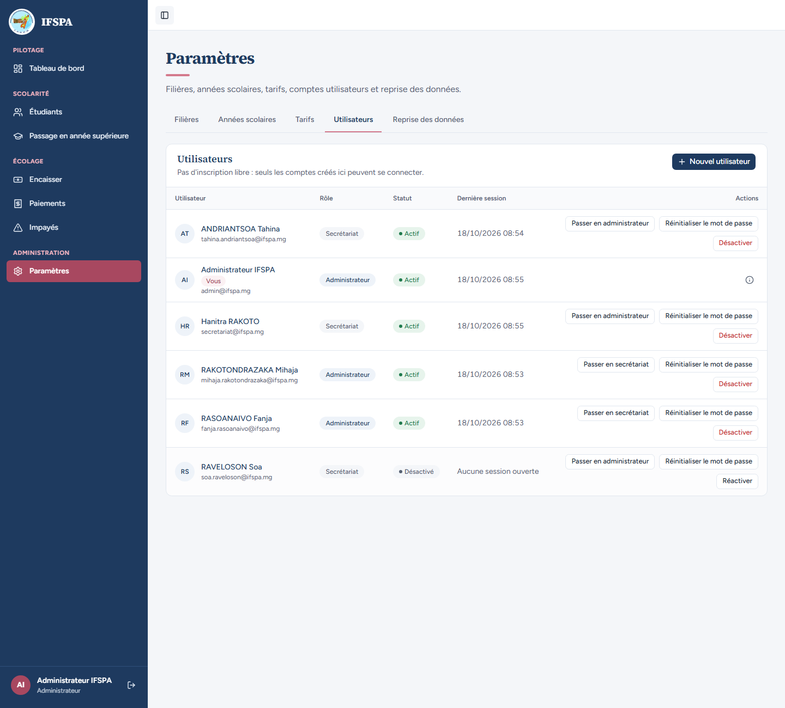
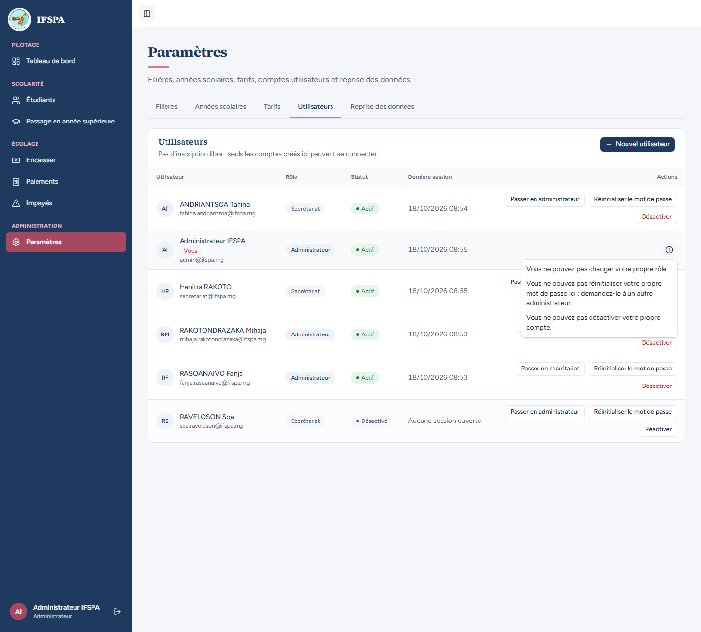
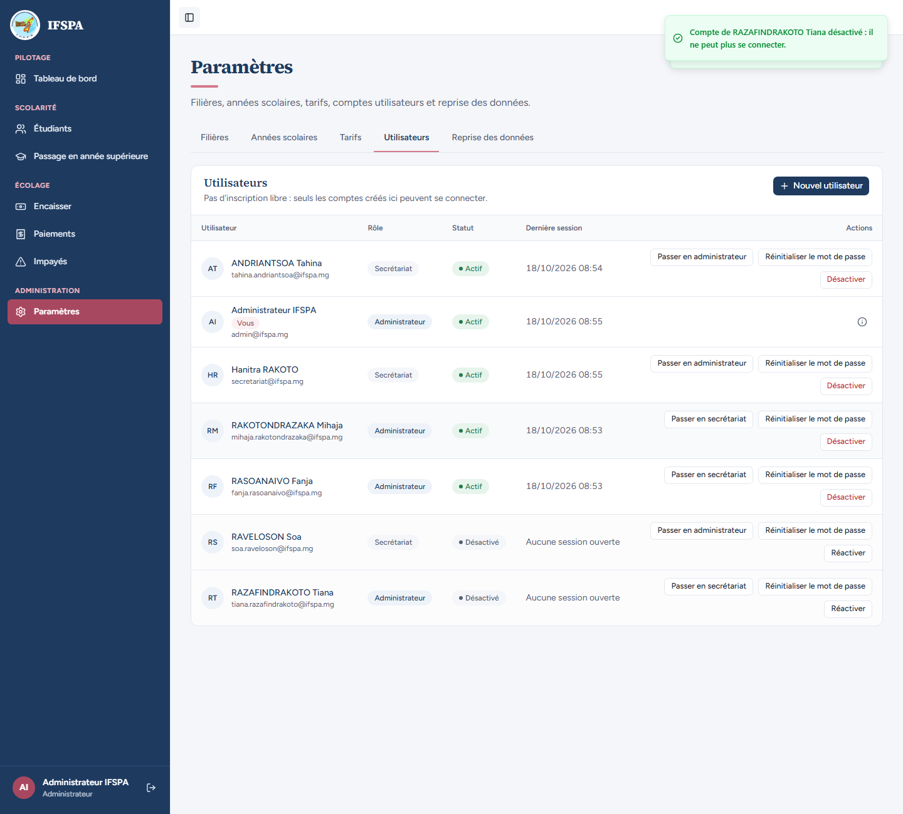
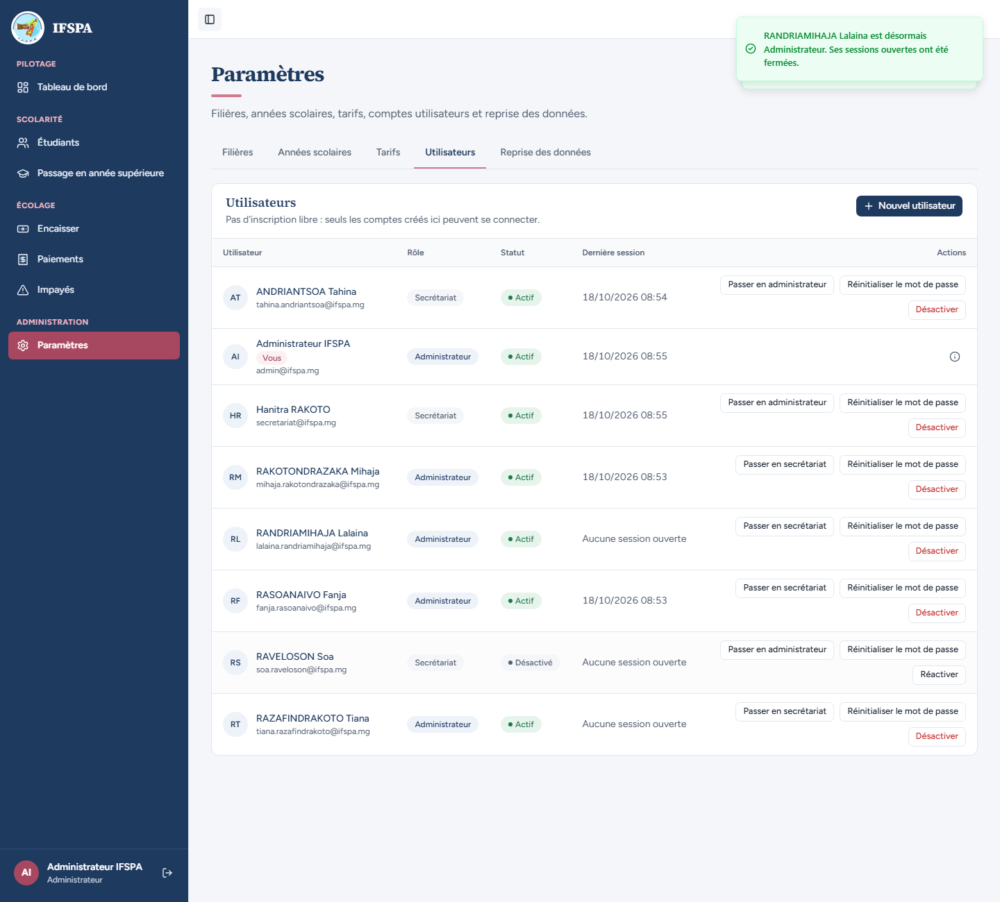
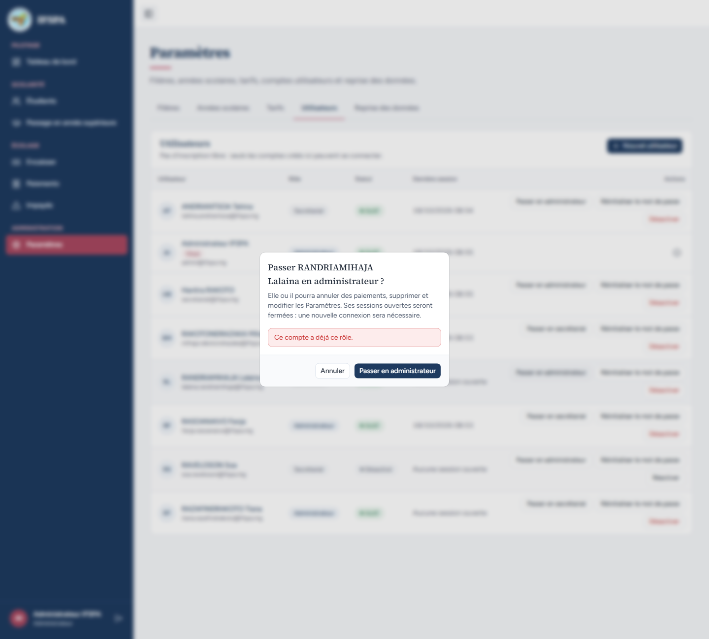
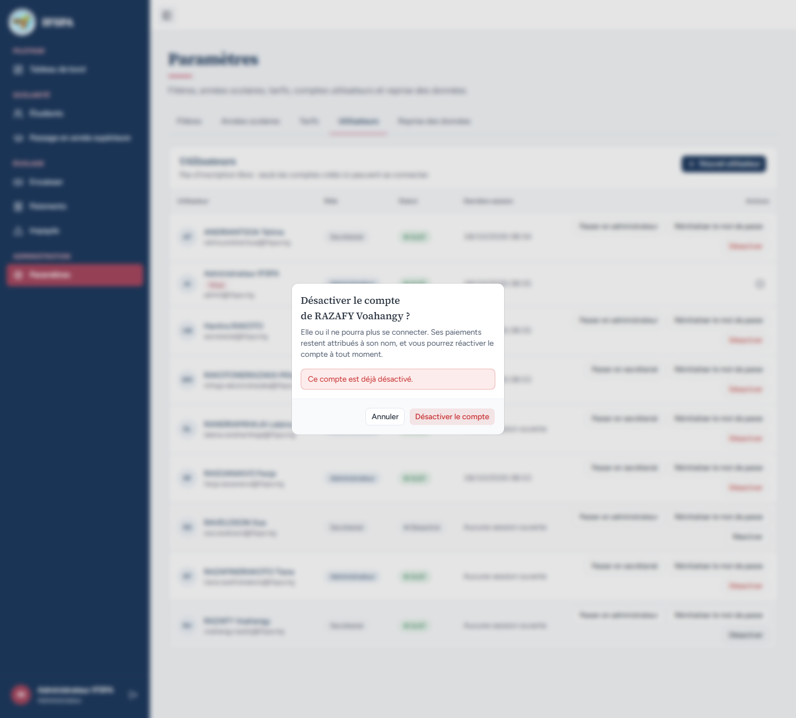
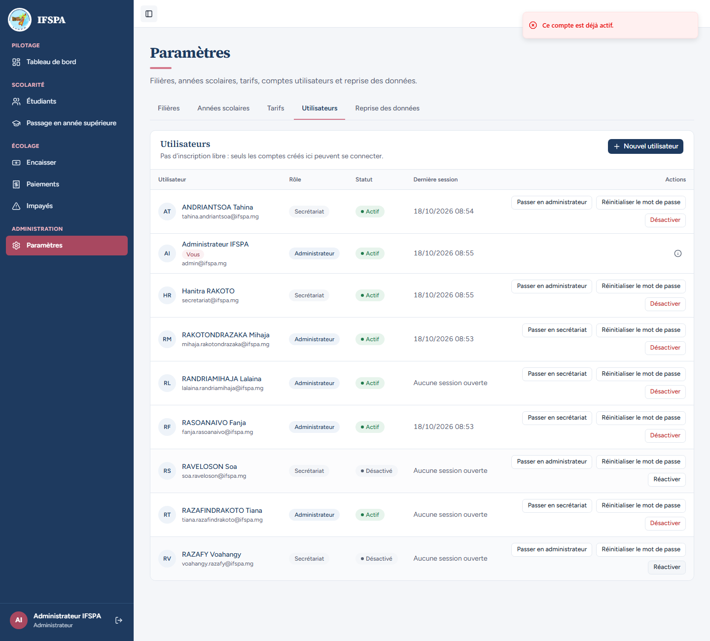

# UC03-05. Garde-fous : soi-même, autre administrateur, comptes modifiés entre-temps

| | |
|---|---|
| Use case | UC03. Gérer les comptes du personnel |
| Règles couvertes | R-ROLE (protection de l'administrateur, contrôles côté serveur) |
| Rôle | Administrateur (deux fenêtres) |
| Durée estimée | 8 minutes |

## La situation

L'administrateur ne doit pas pouvoir se couper lui-même l'accès (changer son rôle, se désactiver, réinitialiser son mot de passe). Il peut en revanche désactiver un autre administrateur tant qu'il en reste un. Enfin, si deux personnes travaillent en même temps sur la liste, la seconde action sur un compte déjà modifié est refusée par le serveur avec un message clair.

## Avant de commencer

1. `pnpm recette:base`, `pnpm build`, `pnpm recette:app`, puis ouvrir `http://localhost:3200`. Aucune donnée de préparation.
2. Ce cas **crée trois comptes** (`tiana.razafindrakoto`, `lalaina.randriamihaja`, `voahangy.razafy`, tous en `@ifspa.mg`) : repartir de `pnpm recette:base` pour le rejouer.
3. **Deux fenêtres connectées avec le compte administrateur** (`SEED_ADMIN_*`), appelées ici « fenêtre 1 » et « fenêtre 2 » : la fenêtre 1 reste sur une liste qui devient périmée.

## Étapes

| # | Qui | Action | Résultat attendu | Capture | ✓ |
|---|---|---|---|---|---|
| 1 | Administrateur | Ouvrir **Paramètres › Utilisateurs**. | Sur la ligne « Administrateur IFSPA » (badge « Vous ») : aucun bouton, seulement une pastille d'information. Les autres comptes (Hanitra RAKOTO…) ont leurs boutons. |  | |
| 2 | Administrateur | Cliquer la pastille d'information de sa ligne. | Trois motifs : « Vous ne pouvez pas changer votre propre rôle. », « Vous ne pouvez pas réinitialiser votre propre mot de passe ici : demandez-le à un autre administrateur. », « Vous ne pouvez pas désactiver votre propre compte. » |  | |
| 3 | Administrateur (fenêtre 2) | Créer `RAZAFINDRAKOTO Tiana` avec le rôle **Administrateur**, puis **Désactiver** sa ligne et confirmer ; enfin **Réactiver**. | Possible, puisqu'un autre administrateur reste actif : « Compte de RAZAFINDRAKOTO Tiana désactivé : il ne peut plus se connecter. » (statut « Désactivé »), puis « Compte de RAZAFINDRAKOTO Tiana réactivé. » |  | |
| 4 | Administrateur (fenêtre 2, puis 1) | Fenêtre 2 : créer `RANDRIAMIHAJA Lalaina` (Secrétariat). Fenêtre 1 : recharger la liste (bouton « Passer en administrateur » sur sa ligne). Fenêtre 2 : la passer en administrateur (« RANDRIAMIHAJA Lalaina est désormais Administrateur. Ses sessions ouvertes ont été fermées. »). | La liste de la fenêtre 1 est maintenant périmée. |  | |
| 5 | Administrateur (fenêtre 1) | Cliquer **Passer en administrateur** sur la ligne de Lalaina, puis confirmer. | La fenêtre de confirmation reste ouverte avec l'encadré rouge « Ce compte a déjà ce rôle. » Rien n'est modifié. **Annuler**. |  | |
| 6 | Administrateur (fenêtres 2 puis 1) | Fenêtre 2 : créer `RAZAFY Voahangy` (Secrétariat). Fenêtre 1 : recharger. Fenêtre 2 : la désactiver. Fenêtre 1 : **Désactiver** sur sa ligne, puis confirmer. | Encadré rouge dans la confirmation : « Ce compte est déjà désactivé. » **Annuler**. |  | |
| 7 | Administrateur (fenêtres 1 puis 2) | Fenêtre 1 : recharger (bouton « Réactiver » sur Voahangy). Fenêtre 2 : recharger puis **Réactiver** (« Compte de RAZAFY Voahangy réactivé. »). Fenêtre 1 : cliquer **Réactiver**. | Notification rouge « Ce compte est déjà actif. » La ligne de la fenêtre 1 reste périmée (bouton « Réactiver » encore là) jusqu'au rechargement (constat 3 du rapport). |  | |

## Ce que ce scénario ne couvre pas

- **Dernier administrateur actif** (« C'est le dernier administrateur actif : nommez d'abord un autre administrateur… ») : non démontrable à l'écran. L'acteur doit lui-même être un administrateur actif et ne peut pas agir sur son propre compte, donc la cible n'est jamais seule. Règle couverte par Vitest, `tests/unit/parametres.test.ts` (« protège le dernier administrateur actif contre la rétrogradation et la désactivation », « permet de rétrograder ou désactiver un administrateur s'il en reste un autre actif »). Le verrou de concurrence de `sousControle` n'a pas de test d'intégration.
- Refus des actions de comptes pour le secrétariat : couvert par Vitest, `tests/unit/actions-parametres-refus.test.ts` ; à l'écran : [UC03-06](UC03-06-secretariat-refuse.md).
- Ordinateur seulement.

## Dernière exécution par l'agent

- 18/10/2026 : ✅ 7 étapes sur 7 (constat mineur 3 à l'étape 7 : [rapport](../../rapports/RAPPORT_2026-10-18_UC03.md)).
- Parcours : [UC03-05-garde-fous.recette.ts](../../parcours/UC03-05-garde-fous.recette.ts).
