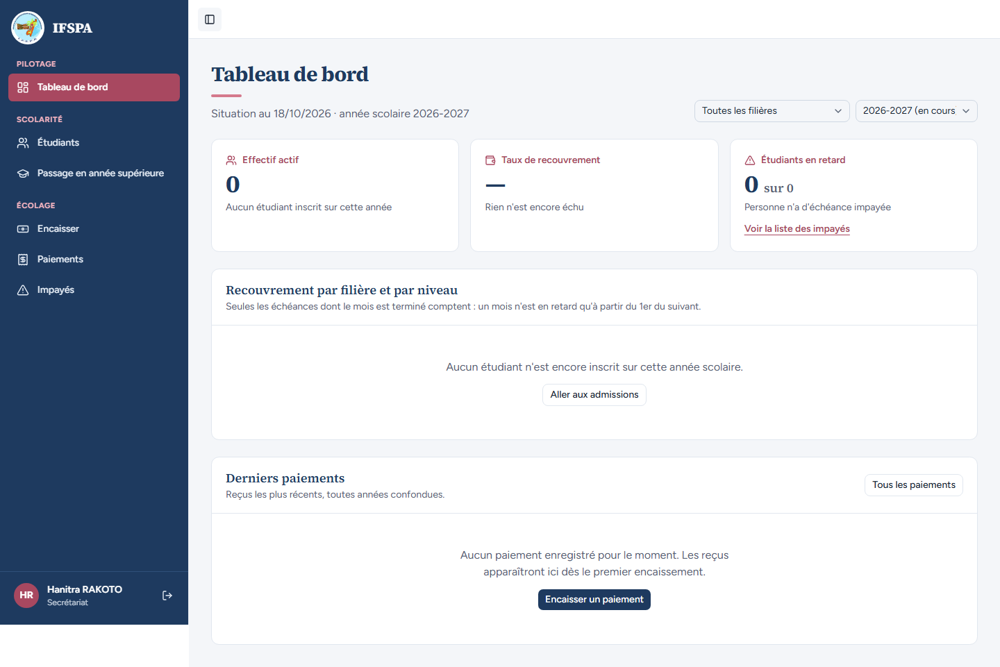
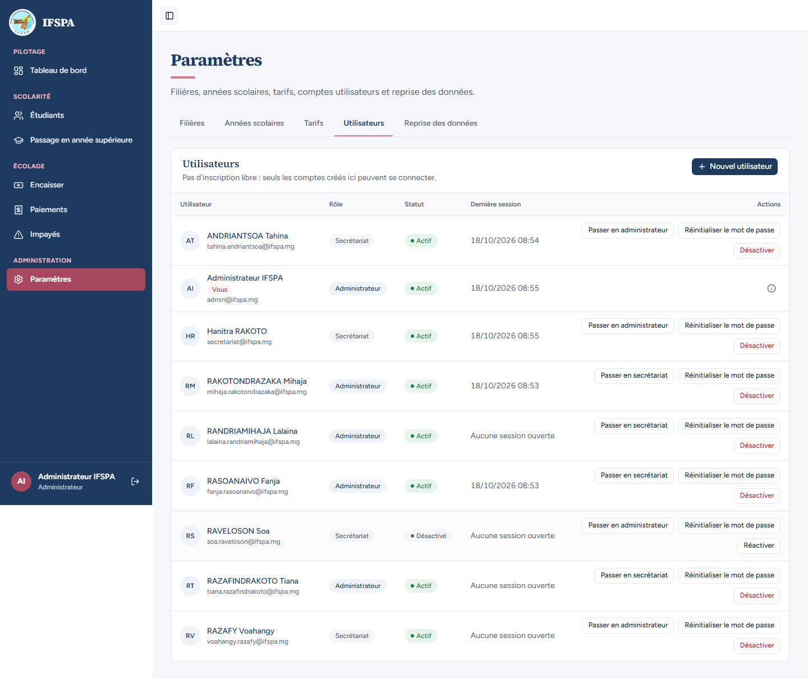

# UC03-06. Le secrétariat n'a pas accès aux comptes, ni par l'écran ni par l'URL

| | |
|---|---|
| Use case | UC03. Gérer les comptes du personnel |
| Règles couvertes | R-ROLE |
| Rôle | Secrétariat (Hanitra RAKOTO), puis administrateur pour la dernière étape |
| Durée estimée | 4 minutes |

## La situation

Hanitra RAKOTO, du secrétariat, ne doit pas pouvoir lister, créer, rétrograder ni réinitialiser les comptes du personnel, ni en lire les courriels. Personne, pas même l'administrateur, ne doit pouvoir passer par les routes d'administration internes de Better Auth.

## Avant de commencer

1. `pnpm recette:base`, `pnpm build`, `pnpm recette:app`, puis ouvrir `http://localhost:3200`. Aucune donnée de préparation (idéalement après UC03-01 à 05 : des comptes existent, sans incidence).
2. Le compte **secrétariat** (`SEED_USER_*`, « Hanitra RAKOTO ») ; pour l'étape 6, le compte **administrateur** (`SEED_ADMIN_*`).
3. Les étapes 3 et 5 utilisent les outils de développement du navigateur (onglet Réseau, console) : elles sont automatisées par le parcours ; à la main, se contenter des étapes 1, 2 et 4.

## Étapes

| # | Qui | Action | Résultat attendu | Capture | ✓ |
|---|---|---|---|---|---|
| 1 | Secrétariat | Se connecter, regarder le menu. | « Hanitra RAKOTO » et « Secrétariat » en bas de la barre ; aucune rubrique **Paramètres**. |  | |
| 2 | Secrétariat | Ouvrir `http://localhost:3200/app/parametres/utilisateurs`. | « Accès réservé à l'administrateur » : « Les paramètres (filières, années scolaires, tarifs et comptes utilisateurs) ne peuvent être modifiés que par un administrateur. Si un réglage doit changer, adressez-vous à lui. » Ni onglets, ni liste, ni bouton « Nouvel utilisateur ». |  | |
| 3 | Secrétariat | Afficher le code source de cette page (clic droit, « Afficher le code source »). | Aucun courriel de compte (`admin@ifspa.mg`…) ni libellé « Réinitialiser le mot de passe » : la liste n'est pas transmise au navigateur. | (vérifié par le parcours, sans capture) | |
| 4 | Secrétariat | Cliquer **Retour au tableau de bord**. | Le Tableau de bord s'ouvre. | | |
| 5 | Secrétariat | Ouvrir `/api/auth/admin/list-users` (GET) ; la console peut envoyer en POST `/api/auth/admin/set-role`, `/api/auth/admin/ban-user` et `/api/auth/admin/set-user-password`. | Chaque appel répond **404** (routes fermées, décision provisoire n° 10). | (vérifié par le parcours, sans capture) | |
| 6 | Administrateur | Avec la session de l'administrateur, mêmes appels que l'étape 5, puis ouvrir Paramètres › Utilisateurs. | Mêmes réponses **404** : l'administrateur ne contourne pas les gardes (soi-même, dernier administrateur). La liste reste intacte. |  | |

## Ce que ce scénario ne couvre pas

- L'appel **direct d'une Server Action** par le secrétariat (créer, changer le rôle, désactiver, réactiver, réinitialiser) : non démontrable dans le navigateur ; couvert par Vitest, `tests/unit/actions-parametres-refus.test.ts` (les cinq actions de comptes renvoient « Cette action est réservée à l'administrateur. » sans toucher à la base ni à Better Auth, même avec une entrée invalide).
- Pas de test d'intégration des actions de comptes sur une base réelle.
- Ordinateur seulement.

## Dernière exécution par l'agent

- 18/10/2026 : ✅ 6 étapes sur 6 (étapes 3 et 5 vérifiées par le parcours, sans capture).
- Parcours : [UC03-06-secretariat-refuse.recette.ts](../../parcours/UC03-06-secretariat-refuse.recette.ts).
