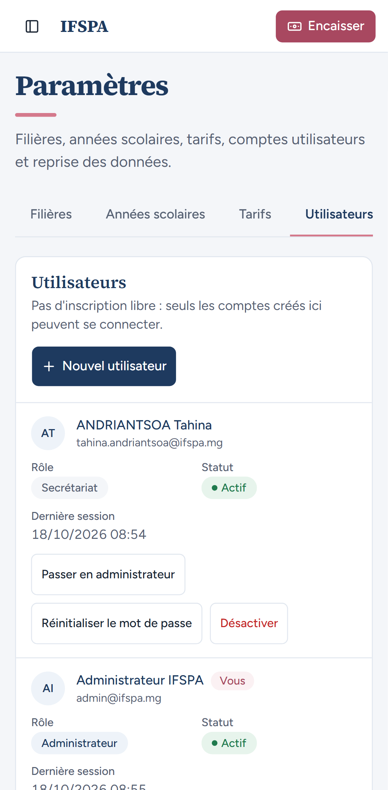
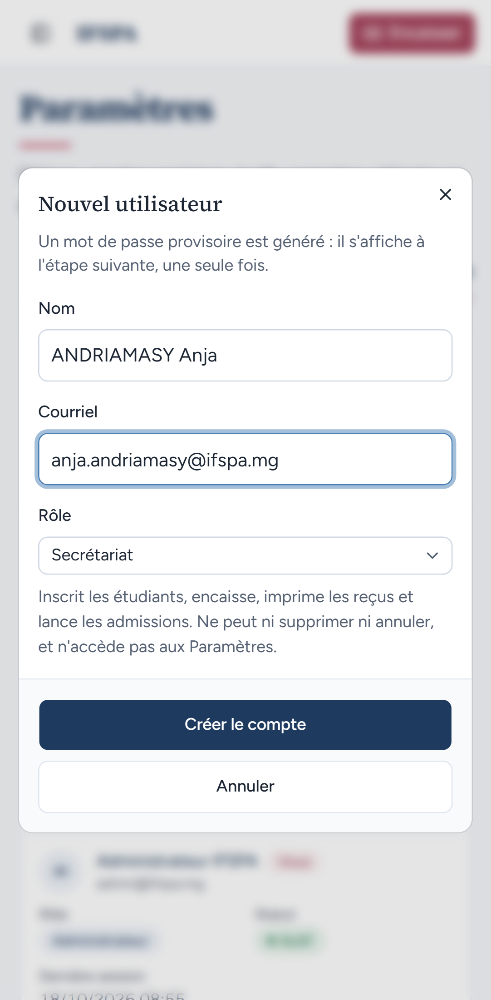
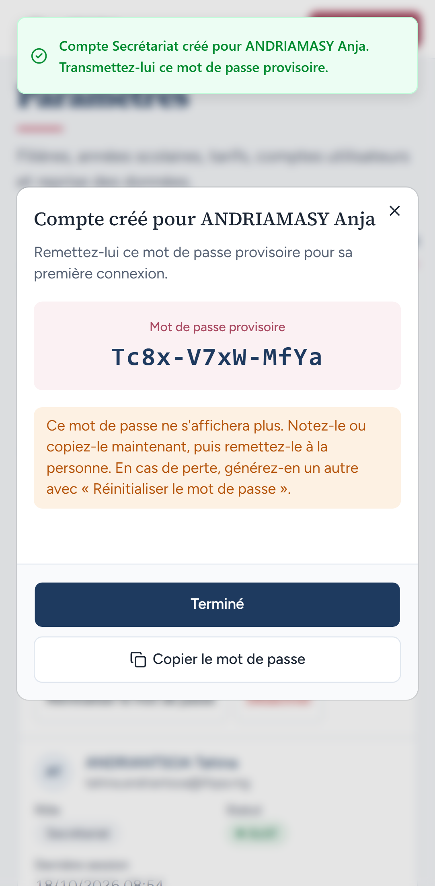
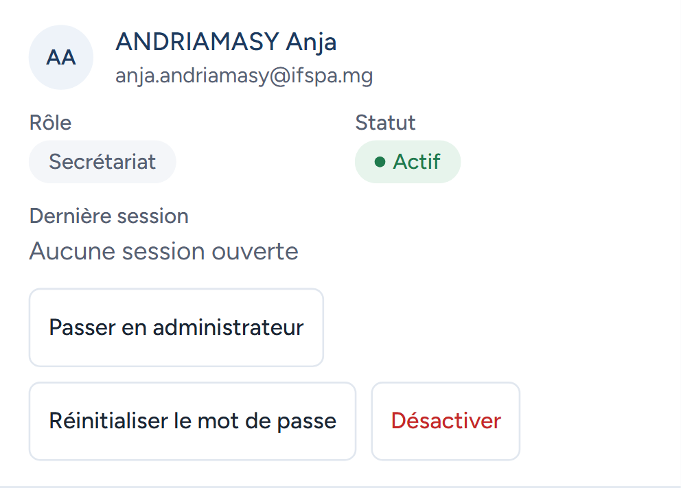
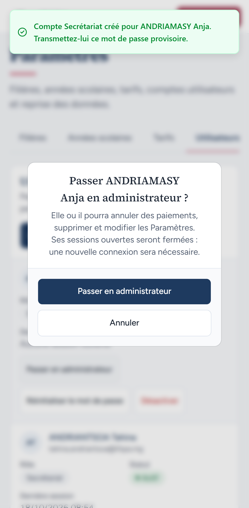
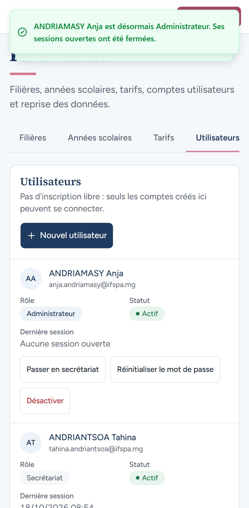
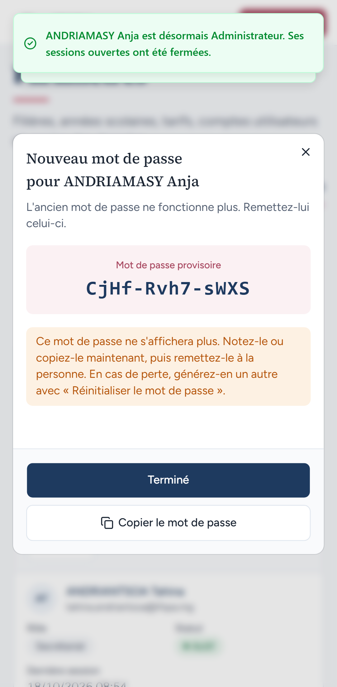
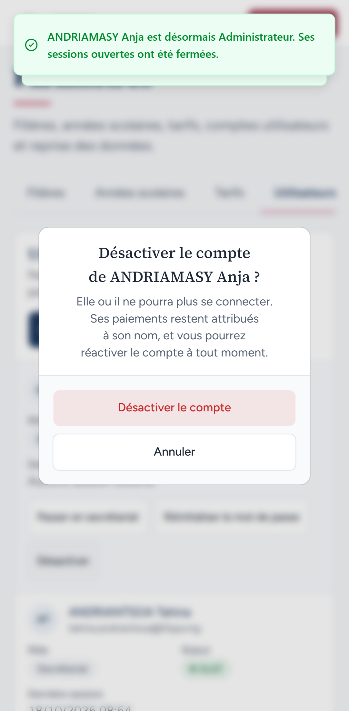
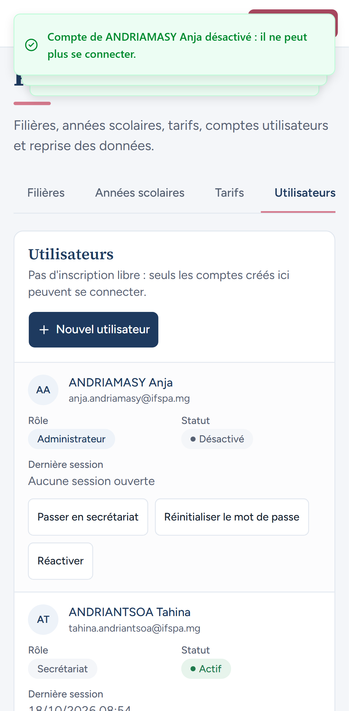
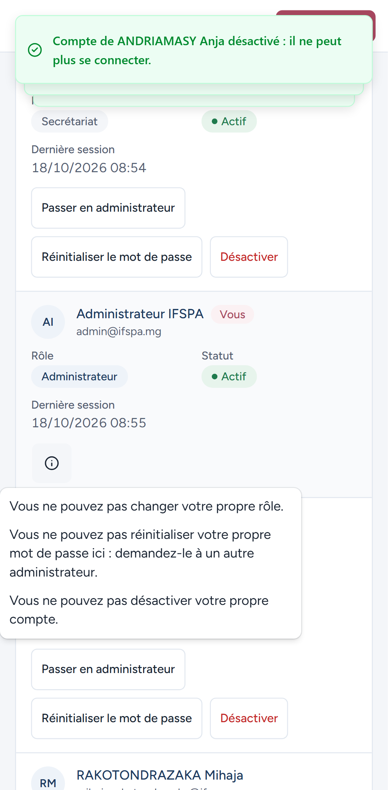

# UC03-07. Gérer les comptes depuis un téléphone

| | |
|---|---|
| Use case | UC03. Gérer les comptes du personnel |
| Règles couvertes | R-ROLE (lisibilité et usage tactile de l'écran Utilisateurs) |
| Rôle | Administrateur |
| Durée estimée | 6 minutes |

## La situation

L'administrateur est hors de l'institut, avec son téléphone (Pixel 7, 412 px de large). Il crée un compte, le passe administrateur, réinitialise son mot de passe puis le désactive.

## Avant de commencer

1. `pnpm recette:base`, `pnpm build`, `pnpm recette:app`, puis ouvrir `http://localhost:3200` sur un téléphone, ou dans les outils de développement en émulation « Pixel 7 ».
2. Ce cas **crée le compte** `anja.andriamasy@ifspa.mg` : repartir de `pnpm recette:base` pour le rejouer. Les captures ont été prises après UC03-01 à 06 : la liste contient leurs comptes.
3. Compte **administrateur** (`SEED_ADMIN_*`). Le tiroir de menu n'est pas utilisé : ouvrir directement `/app/parametres/utilisateurs`.

## Étapes

| # | Qui | Action | Résultat attendu | Capture | ✓ |
|---|---|---|---|---|---|
| 1 | Administrateur | Ouvrir `/app/parametres/utilisateurs`. | Une carte par compte (Rôle, Statut, Dernière session, boutons d'action), bouton « Nouvel utilisateur » en haut, aucun défilement horizontal. |  | |
| 2 | Administrateur | **Nouvel utilisateur** : Nom `ANDRIAMASY Anja`, Courriel `anja.andriamasy@ifspa.mg`, Rôle « Secrétariat », **Créer le compte**. | Le formulaire tient à l'écran ; puis « Compte créé pour ANDRIAMASY Anja » avec le mot de passe provisoire, sans débordement. **Terminé**. |   | |
| 3 | Administrateur | Regarder la carte d'Anja. | « Secrétariat », « Actif », « Aucune session ouverte » ; boutons « Passer en administrateur », « Réinitialiser le mot de passe », « Désactiver » d'au moins 44 px de haut. |  | |
| 4 | Administrateur | **Passer en administrateur**, puis confirmer. | Confirmation « Passer ANDRIAMASY Anja en administrateur ? » avec deux boutons pleine largeur ; puis « ANDRIAMASY Anja est désormais Administrateur. Ses sessions ouvertes ont été fermées. » et le badge « Administrateur ». |   | |
| 5 | Administrateur | **Réinitialiser le mot de passe**, confirmer ; **Terminé** ; puis **Désactiver** et confirmer. | « Nouveau mot de passe pour ANDRIAMASY Anja » lisible en entier ; confirmation « Désactiver le compte de ANDRIAMASY Anja ? » ; puis « Compte de ANDRIAMASY Anja désactivé : il ne peut plus se connecter. » et statut « Désactivé ». |    | |
| 6 | Administrateur | Sur sa propre carte (« Vous »), toucher la pastille d'information. | Aucune action ; les trois motifs s'affichent dans une bulle (« Vous ne pouvez pas changer votre propre rôle. »…). La bulle touche le bord gauche de l'écran (constat 5 du rapport). |  | |

## Ce que ce scénario ne couvre pas

- Téléphone réel (outils d'émulation seulement), tiroir de menu (voir [UC01-08](../UC01-connexion/UC01-08-telephone.md)).
- Connexion d'un compte créé depuis le téléphone : voir UC03-01 à 04.

## Dernière exécution par l'agent

- 18/10/2026 : ✅ 6 étapes sur 6 (constat mineur 5 à l'étape 6 : [rapport](../../rapports/RAPPORT_2026-10-18_UC03.md)).
- Parcours : [UC03-07-telephone.recette.ts](../../parcours/UC03-07-telephone.recette.ts) (`--project mobile`).
