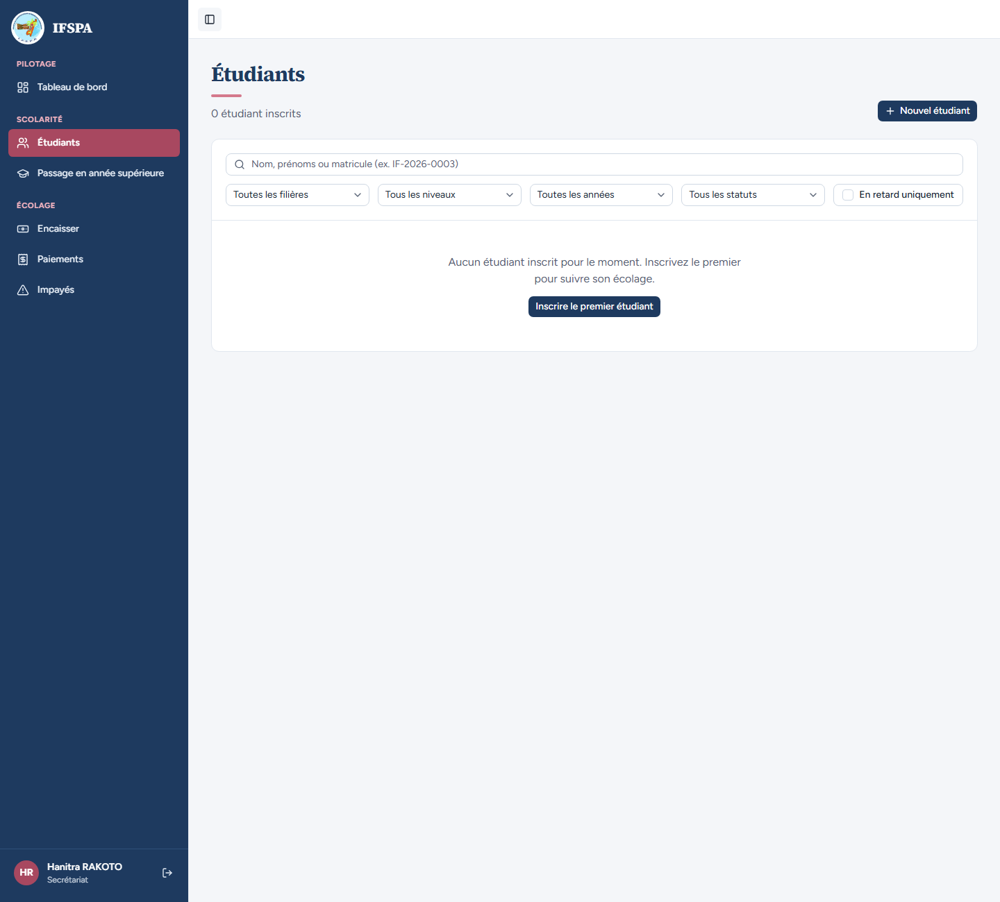
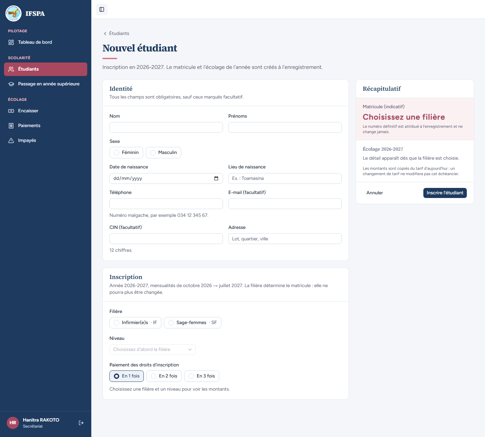
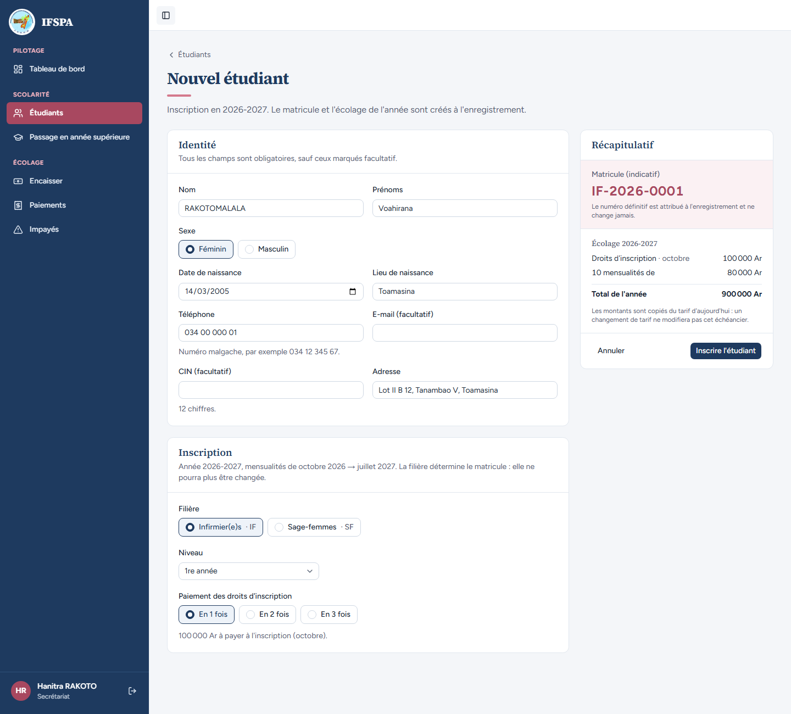
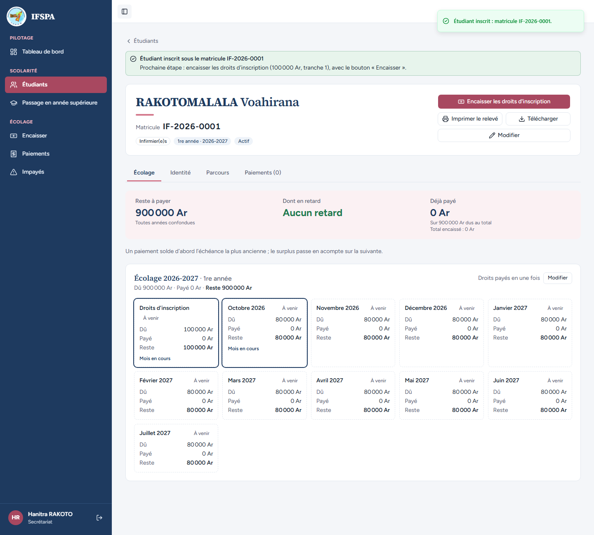
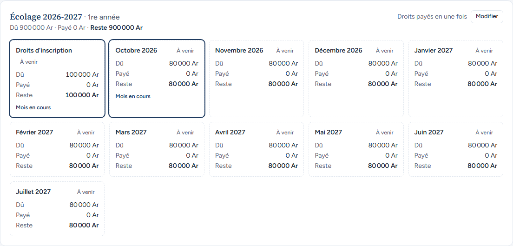
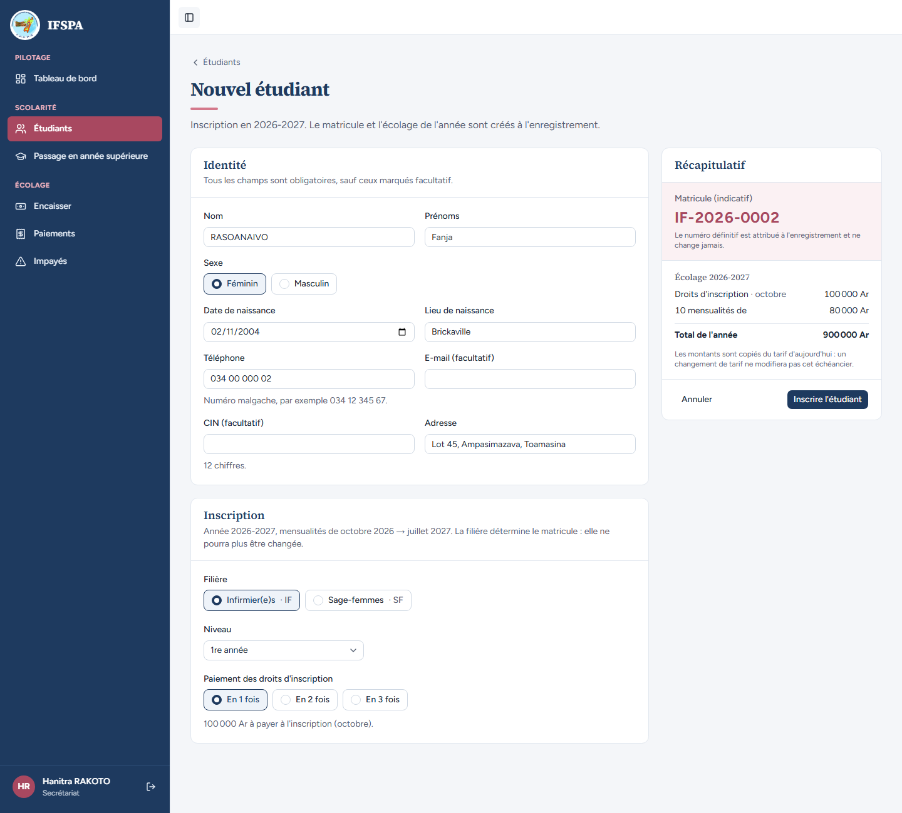
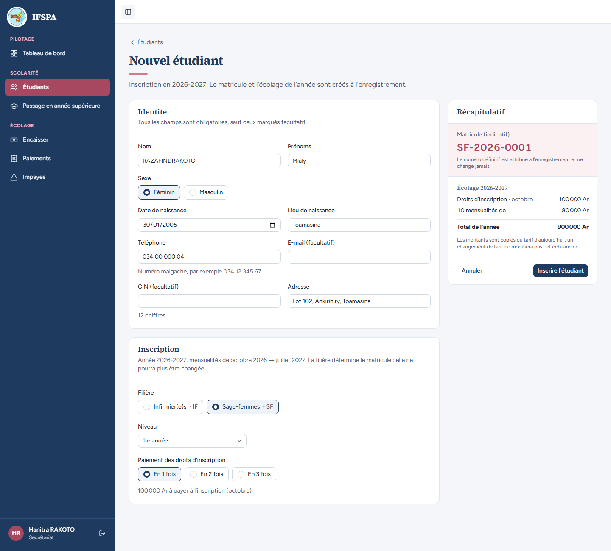
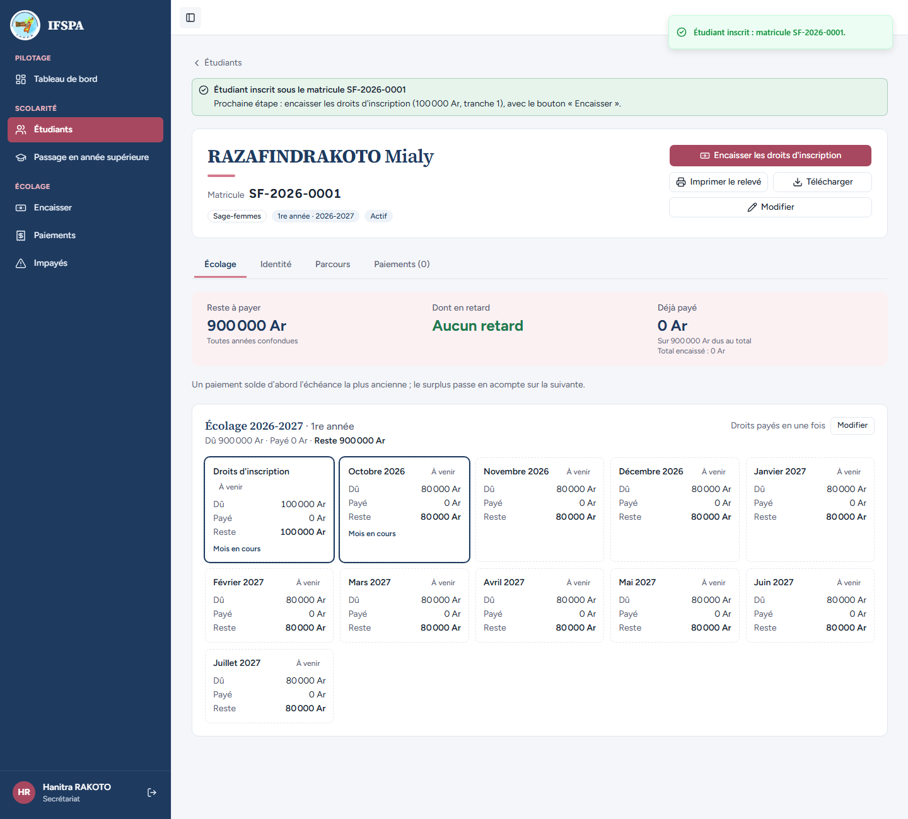
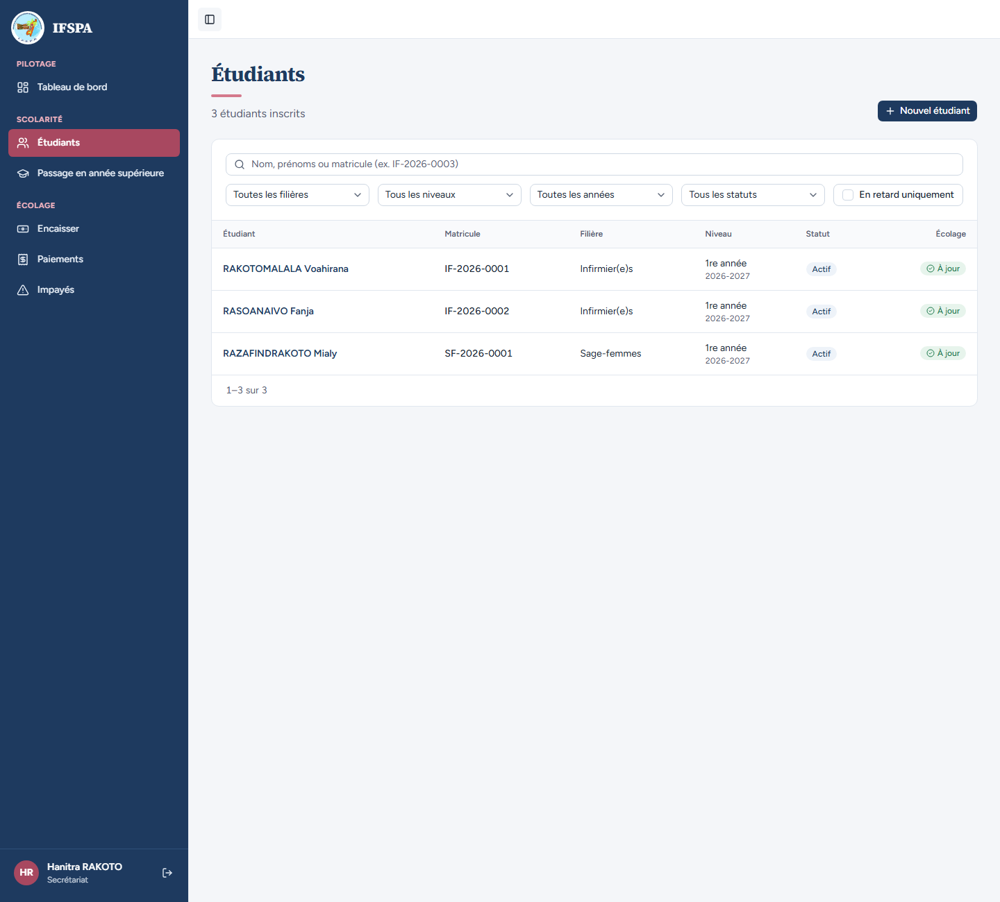
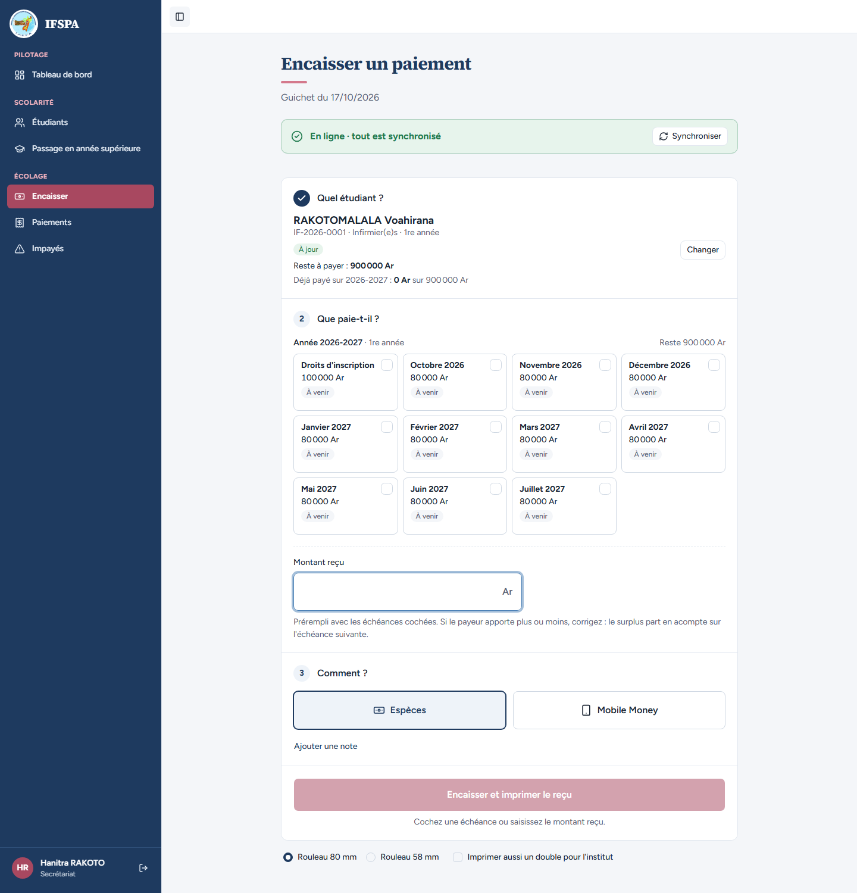

# UC04-01. Trois nouveaux étudiants s'inscrivent : une séquence de matricule par filière

| | |
|---|---|
| Use case | UC04. Inscrire un nouvel étudiant |
| Règles couvertes | R-MAT (matricule `{CODE}-{ANNEE}-{NNNN}`, séquence propre à chaque filière), R-ECH (échéances générées à l'inscription, montants du tarif), R-INS (année complète, d'octobre à juillet), R-RET (« À venir », « Aucun retard ») |
| Rôle | Secrétariat, compte « Hanitra RAKOTO » |
| Durée estimée | 15 minutes |

## La situation

C'est la rentrée. La secrétaire inscrit Voahirana RAKOTOMALALA et Fanja RASOANAIVO en Infirmier(e)s, puis Mialy RAZAFINDRAKOTO en Sage-femmes. Chacune reçoit son matricule automatiquement : les deux premières IF-2026-0001 et IF-2026-0002, la troisième SF-2026-0001 (la numérotation des Sage-femmes repart de 1). Dès l'inscription, l'écolage de l'année (droits + dix mensualités) existe et l'étudiante apparaît au guichet avec 900 000 Ar à payer.

## Avant de commencer

- `pnpm db:up`, puis `pnpm recette:base` (base vide : seul le seed est présent), `pnpm build`, `pnpm recette:app` et ouvrir `http://localhost:3200`.
- **Ne pas dérouler la préparation [00-PREPARATION.md](../00-PREPARATION.md)** : ses étudiants prendraient les matricules attendus ici. UC04 part de la base fraîche, sans aucun étudiant.
- Se connecter avec le compte secrétariat (identifiants `SEED_USER_*` de `.env`). Le nom « Hanitra RAKOTO » est en bas de la barre latérale.
- Les cas UC04-01 à UC04-10 s'enchaînent sur la même base, dans l'ordre : chacun suppose les précédents (matricules, effectifs).
- Date de déroulé : 17/10/2026. Octobre 2026 est le mois en cours : les échéances sont « À venir » et il n'y a aucun retard. À partir du 1er novembre 2026, les échéances d'octobre passent « En retard » et les mentions « Aucun retard » changent en conséquence.

## Étapes

| # | Qui | Action | Résultat attendu | Capture | ✓ |
|---|---|---|---|---|---|
| 1 | Secrétariat | Menu **Étudiants**. | Titre « Étudiants », « 0 étudiant inscrits », message « Aucun étudiant inscrit pour le moment. Inscrivez le premier pour suivre son écolage. » avec le bouton « Inscrire le premier étudiant » ; bouton « Nouvel étudiant » en haut à droite. |  | |
| 2 | Secrétariat | Cliquer **Nouvel étudiant**. | Page « Nouvel étudiant » : « Inscription en 2026-2027. Le matricule et l'écolage de l'année sont créés à l'enregistrement. » Récapitulatif à droite : « Matricule (indicatif) » **Choisissez une filière**, « Le détail apparaît dès que la filière est choisie. » « En 1 fois » est coché. |  | |
| 3 | Secrétariat | Saisir Nom `RAKOTOMALALA`, Prénoms `Voahirana`, Féminin, naissance `14/03/2005`, Lieu `Toamasina`, Téléphone `034 00 000 01`, Adresse `Lot II B 12, Tanambao V, Toamasina`. Choisir la filière **Infirmier(e)s · IF**. | Niveau « 1re année ». Récapitulatif : matricule indicatif **IF-2026-0001** ; « Écolage 2026-2027 » : Droits d'inscription · octobre **100 000 Ar**, 10 mensualités de **80 000 Ar**, Total de l'année **900 000 Ar** ; « Les montants sont copiés du tarif d'aujourd'hui : un changement de tarif ne modifiera pas cet échéancier. » Sous « En 1 fois » : « 100 000 Ar à payer à l'inscription (octobre). » |  | |
| 4 | Secrétariat | Cliquer **Inscrire l'étudiant**. | Message « Étudiant inscrit : matricule IF-2026-0001. » La fiche s'ouvre : bandeau « Étudiant inscrit sous le matricule IF-2026-0001 » (« Prochaine étape : encaisser les droits d'inscription (100 000 Ar, tranche 1), avec le bouton « Encaisser ». »), « RAKOTOMALALA Voahirana », Matricule **IF-2026-0001**, pastilles « Infirmier(e)s », « 1re année · 2026-2027 », « Actif ». **Reste à payer 900 000 Ar**, « Aucun retard », Déjà payé 0 Ar « Sur 900 000 Ar dus au total ». |  | |
| 5 | Secrétariat | Regarder la grille « Écolage 2026-2027 · 1re année ». | « Dû 900 000 Ar · Payé 0 Ar · Reste 900 000 Ar », « Droits payés en une fois ». **11 cartes** : « Droits d'inscription » 100 000 Ar, puis Octobre 2026, Novembre 2026, Décembre 2026, Janvier 2027, Février 2027, Mars 2027, Avril 2027, Mai 2027, Juin 2027, Juillet 2027, 80 000 Ar chacune. Toutes « À venir » ; « Droits d'inscription » et « Octobre 2026 » portent « Mois en cours ». |  | |
| 6 | Secrétariat | **Étudiants**, **Nouvel étudiant** : `RASOANAIVO` Fanja, Féminin, `02/11/2004`, `Brickaville`, `034 00 000 02`, `Lot 45, Ampasimazava, Toamasina`, **Infirmier(e)s · IF**. Avant d'enregistrer, lire le récapitulatif, puis **Inscrire l'étudiant**. | Matricule indicatif **IF-2026-0002** (la séquence d'Infirmier(e)s continue). Après l'enregistrement : « Étudiant inscrit sous le matricule IF-2026-0002 ». |  | |
| 7 | Secrétariat | **Nouvel étudiant** : `RAZAFINDRAKOTO` Mialy, Féminin, `30/01/2005`, `Toamasina`, `034 00 000 04`, `Lot 102, Ankirihiry, Toamasina`, filière **Sage-femmes · SF**. | Matricule indicatif **SF-2026-0001** : la séquence des Sage-femmes repart de 1, indépendante de celle d'Infirmier(e)s. Même écolage (900 000 Ar). |  | |
| 8 | Secrétariat | Cliquer **Inscrire l'étudiant**. | Message « Étudiant inscrit : matricule SF-2026-0001. » Fiche de RAZAFINDRAKOTO Mialy : matricule **SF-2026-0001**, pastille « Sage-femmes », reste à payer 900 000 Ar, aucun retard. |  | |
| 9 | Secrétariat | Menu **Étudiants**. | « 3 étudiants inscrits », « 1–3 sur 3 » : RAKOTOMALALA Voahirana **IF-2026-0001**, RASOANAIVO Fanja **IF-2026-0002**, RAZAFINDRAKOTO Mialy **SF-2026-0001**, tous « 1re année 2026-2027 », « Actif », « À jour ». |  | |
| 10 | Secrétariat | Menu **Encaisser**, taper `RAKOTOMALALA` dans « Rechercher l'étudiant », Entrée. | « RAKOTOMALALA Voahirana », « IF-2026-0001 · Infirmier(e)s · 1re année », « À jour », « Reste à payer : 900 000 Ar », « Déjà payé sur 2026-2027 : 0 Ar sur 900 000 Ar ». Les 11 cartes sont « À venir », aucune n'est cochée. |  | |

## Ce que ce scénario ne couvre pas

- Les refus de saisie, le doublon, les droits en plusieurs fois, la 2e année, le tarif manquant, le changement de tarif : cas UC04-02 à UC04-10.
- Pas d'inscription en cours d'année (R-INS) : le formulaire n'offre aucun choix de mois de début ; l'écolage commence toujours en octobre (étape 5). Le refus serveur « année clôturée » ou « pas d'année courante » n'est pas démontrable à l'écran : couvert par Vitest, `tests/integration/actions-etudiants.test.ts` (« année courante clôturée : refusé », « pas d'année courante : refusé, sans numéro consommé »).
- Matricules distincts quand plusieurs secrétaires inscrivent en même temps : couvert par Vitest, `tests/integration/actions-etudiants.test.ts` (« 5 créations concurrentes : matricules distincts de 0001 à 0005, sans trou »).
- Écran du téléphone mobile : non déroulé.
- Observé, mineur : « 0 étudiant inscrits » (accord au singulier) ; « tranche 1 » dans le bandeau d'inscription alors que les droits sont en une fois. Voir le rapport.

## Dernière exécution par l'agent

- 17/10/2026 : ✅ 10 étapes sur 10. Voir [RAPPORT_2026-10-17_UC04](../../rapports/RAPPORT_2026-10-17_UC04.md).
- Parcours : [UC04-01-trois-inscriptions.recette.ts](../../parcours/UC04-01-trois-inscriptions.recette.ts).
