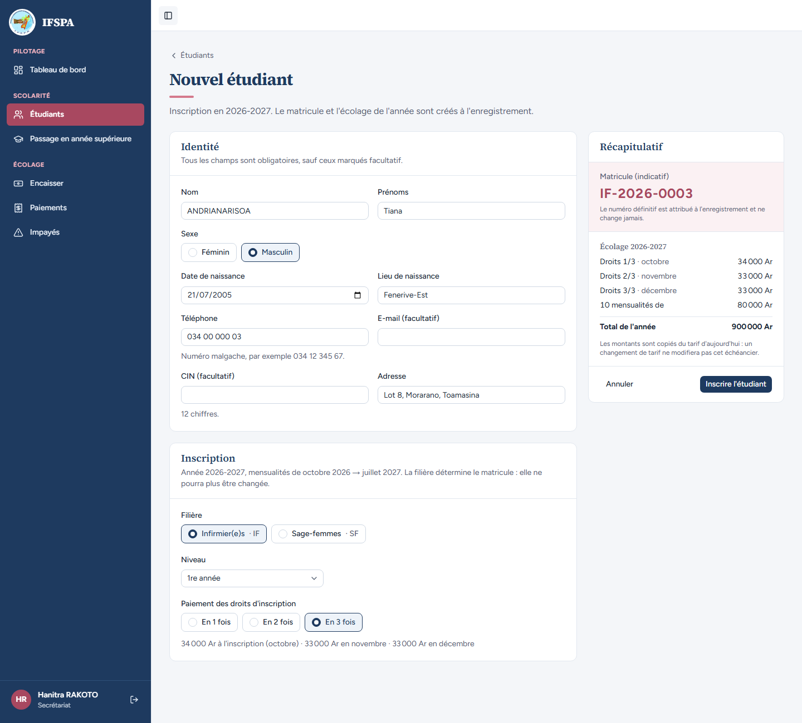
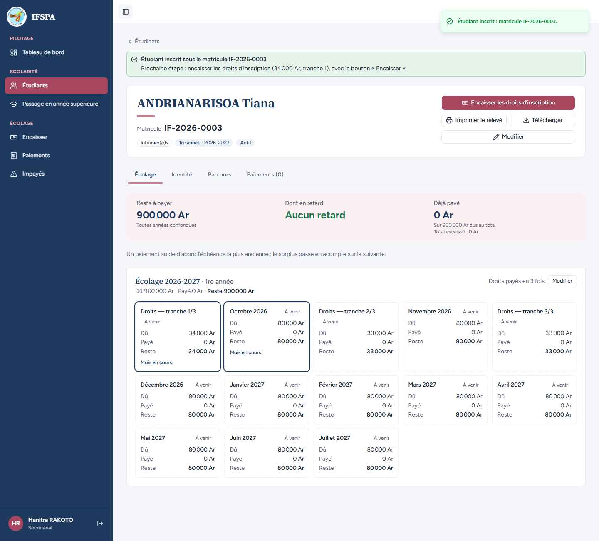
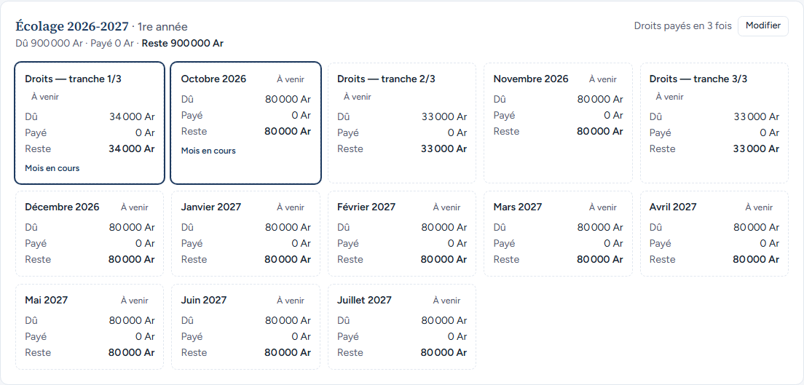

# UC04-02. Un étudiant paie ses droits d'inscription en trois fois

| | |
|---|---|
| Use case | UC04. Inscrire un nouvel étudiant |
| Règles couvertes | R-TRA (droits en 3 tranches : octobre, novembre, décembre ; parts arrondies au millier, le reste sur la 1re), R-ECH (montants copiés du tarif), R-MAT |
| Rôle | Secrétariat, compte « Hanitra RAKOTO » |
| Durée estimée | 5 minutes |

## La situation

Le père de Tiana ANDRIANARISOA ne peut pas payer les 100 000 Ar de droits d'un seul coup. La secrétaire inscrit Tiana en Infirmier(e)s avec les droits « En 3 fois » : 34 000 Ar à l'inscription, puis 33 000 Ar en novembre et 33 000 Ar en décembre.

## Avant de commencer

- Mêmes préparatifs que [UC04-01](UC04-01-trois-inscriptions.md) (base fraîche, sans la préparation 00). Avoir déroulé UC04-01 : le matricule attendu est **IF-2026-0003**.
- Compte secrétariat, identifiants `SEED_USER_*` de `.env`.

## Étapes

| # | Qui | Action | Résultat attendu | Capture | ✓ |
|---|---|---|---|---|---|
| 1 | Secrétariat | **Étudiants**, **Nouvel étudiant** : `ANDRIANARISOA` Tiana, Masculin, `21/07/2005`, `Fenerive-Est`, `034 00 000 03`, `Lot 8, Morarano, Toamasina`, **Infirmier(e)s · IF**, 1re année. Cliquer **En 3 fois**. | Sous les boutons : « 34 000 Ar à l'inscription (octobre) · 33 000 Ar en novembre · 33 000 Ar en décembre ». Récapitulatif : matricule indicatif **IF-2026-0003** ; Droits 1/3 · octobre **34 000 Ar**, Droits 2/3 · novembre **33 000 Ar**, Droits 3/3 · décembre **33 000 Ar**, 10 mensualités de 80 000 Ar, Total de l'année **900 000 Ar**. |  | |
| 2 | Secrétariat | Cliquer **Inscrire l'étudiant**. | Message « Étudiant inscrit : matricule IF-2026-0003. » Bandeau « Prochaine étape : encaisser les droits d'inscription (34 000 Ar, tranche 1) ». Grille : « Droits payés en 3 fois » avec le bouton « Modifier ». Reste à payer 900 000 Ar. |  | |
| 3 | Secrétariat | Regarder la grille « Écolage 2026-2027 · 1re année ». | **13 cartes**, dans l'ordre : « Droits — tranche 1/3 » 34 000 Ar, Octobre 2026, « Droits — tranche 2/3 » 33 000 Ar, Novembre 2026, « Droits — tranche 3/3 » 33 000 Ar, Décembre 2026, puis Janvier à Juillet 2027 (80 000 Ar chacune). « Dû 900 000 Ar · Payé 0 Ar · Reste 900 000 Ar ». |  | |

## Ce que ce scénario ne couvre pas

- Le paiement des tranches au guichet : voir [UC06-04](../UC06-encaisser/UC06-04-droits-en-tranches.md).
- Un découpage qui ne tombe pas juste (le reste sur la 1re tranche) : voir [UC04-10](UC04-10-changement-de-tarif.md) (43 000 + 41 000 + 41 000 Ar). Les cas limites (droits trop faibles pour 3 tranches) sont couverts par Vitest, `tests/integration/actions-etudiants.test.ts` (« droits trop faibles pour 3 tranches : refusé ; en une fois, accepté »).
- Le changement de découpage après l'inscription : voir [UC04-08](UC04-08-modifier-tranches.md).

## Dernière exécution par l'agent

- 17/10/2026 : ✅ 3 étapes sur 3. Voir [RAPPORT_2026-10-17_UC04](../../rapports/RAPPORT_2026-10-17_UC04.md).
- Parcours : [UC04-02-droits-en-3-fois.recette.ts](../../parcours/UC04-02-droits-en-3-fois.recette.ts).
