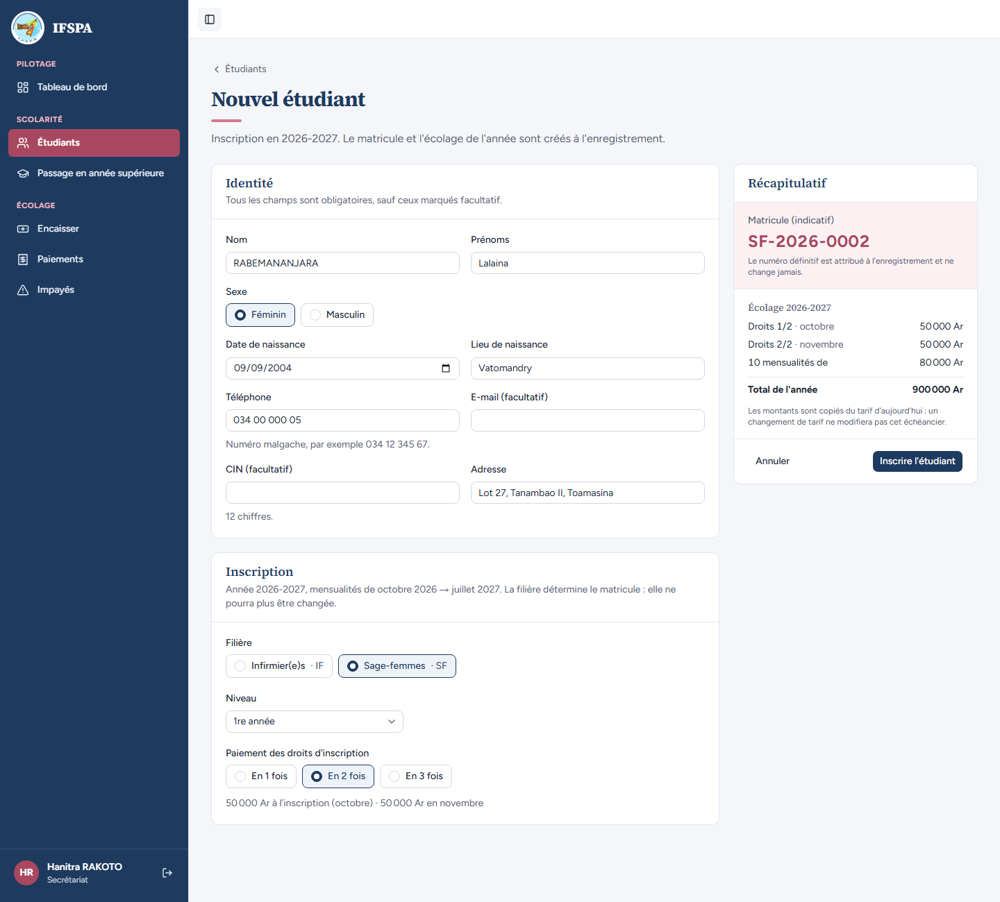
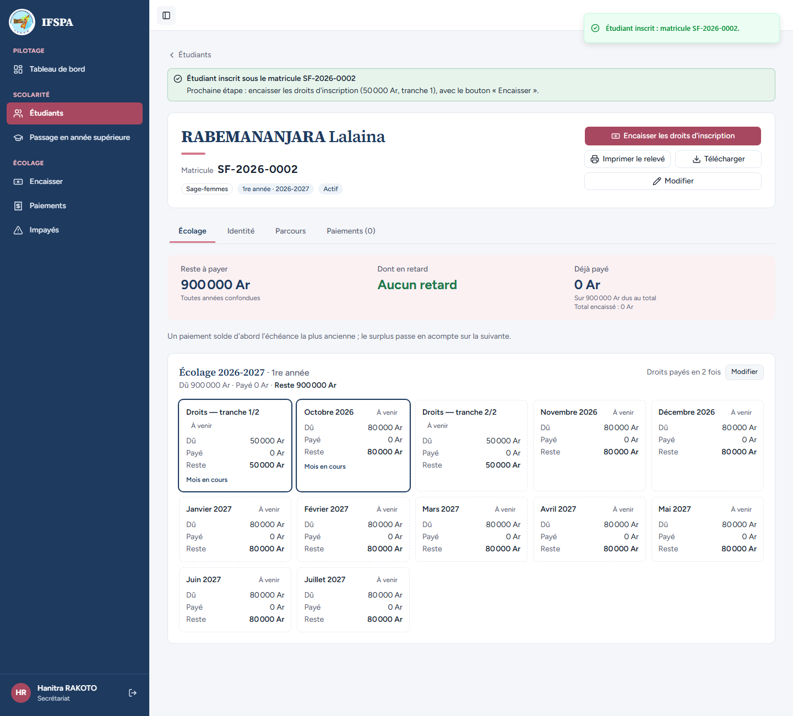

# UC04-03. Une étudiante paie ses droits d'inscription en deux fois

| | |
|---|---|
| Use case | UC04. Inscrire un nouvel étudiant |
| Règles couvertes | R-TRA (droits en 2 tranches : octobre, novembre), R-ECH, R-MAT (séquence Sage-femmes) |
| Rôle | Secrétariat, compte « Hanitra RAKOTO » |
| Durée estimée | 5 minutes |

## La situation

La mère de Lalaina RABEMANANJARA propose de payer les droits en deux fois : la moitié à l'inscription, la moitié en novembre. La secrétaire inscrit Lalaina en Sage-femmes avec « En 2 fois ».

## Avant de commencer

- Mêmes préparatifs que [UC04-01](UC04-01-trois-inscriptions.md) (base fraîche, sans la préparation 00). Avoir déroulé UC04-01 et UC04-02 : le matricule attendu est **SF-2026-0002** (après RAZAFINDRAKOTO Mialy SF-2026-0001).
- Compte secrétariat, identifiants `SEED_USER_*` de `.env`.

## Étapes

| # | Qui | Action | Résultat attendu | Capture | ✓ |
|---|---|---|---|---|---|
| 1 | Secrétariat | **Étudiants**, **Nouvel étudiant** : `RABEMANANJARA` Lalaina, Féminin, `09/09/2004`, `Vatomandry`, `034 00 000 05`, `Lot 27, Tanambao II, Toamasina`, **Sage-femmes · SF**, 1re année. Cliquer **En 2 fois**. | Sous les boutons : « 50 000 Ar à l'inscription (octobre) · 50 000 Ar en novembre ». Récapitulatif : matricule indicatif **SF-2026-0002** ; Droits 1/2 · octobre **50 000 Ar**, Droits 2/2 · novembre **50 000 Ar**, 10 mensualités de 80 000 Ar, Total de l'année 900 000 Ar. |  | |
| 2 | Secrétariat | Cliquer **Inscrire l'étudiant**. | Message « Étudiant inscrit : matricule SF-2026-0002. » Bandeau « Prochaine étape : encaisser les droits d'inscription (50 000 Ar, tranche 1) ». « Droits payés en 2 fois ». **12 cartes**, dans l'ordre : « Droits — tranche 1/2 » 50 000 Ar, Octobre 2026, « Droits — tranche 2/2 » 50 000 Ar, Novembre 2026, Décembre 2026 à Juillet 2027. Reste à payer 900 000 Ar. |  | |

## Ce que ce scénario ne couvre pas

- Le paiement des tranches au guichet : voir [UC06-04](../UC06-encaisser/UC06-04-droits-en-tranches.md).
- Le changement de découpage après l'inscription : voir [UC04-08](UC04-08-modifier-tranches.md).

## Dernière exécution par l'agent

- 17/10/2026 : ✅ 2 étapes sur 2. Voir [RAPPORT_2026-10-17_UC04](../../rapports/RAPPORT_2026-10-17_UC04.md).
- Parcours : [UC04-03-droits-en-2-fois.recette.ts](../../parcours/UC04-03-droits-en-2-fois.recette.ts).
