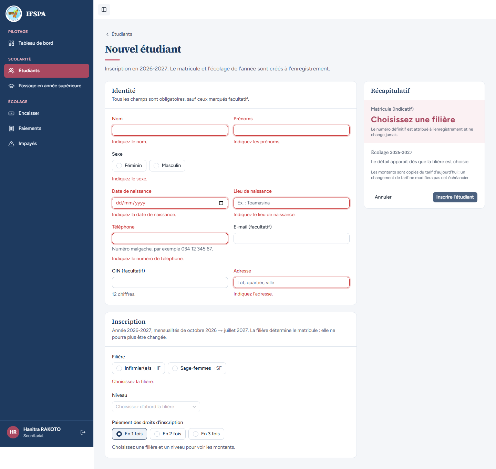
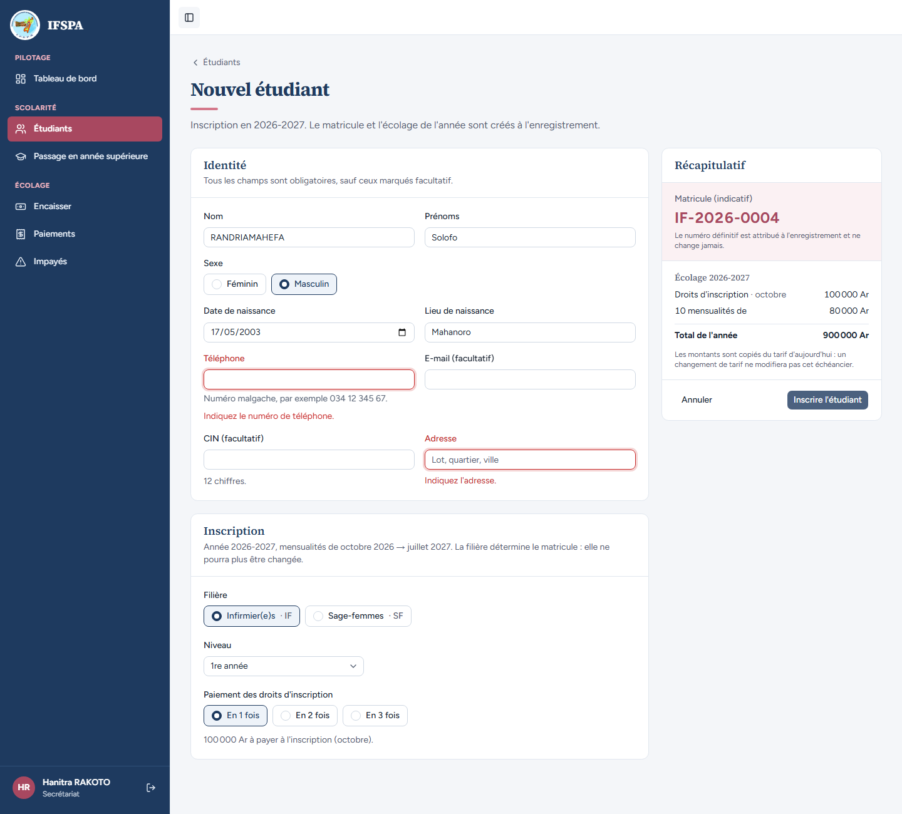
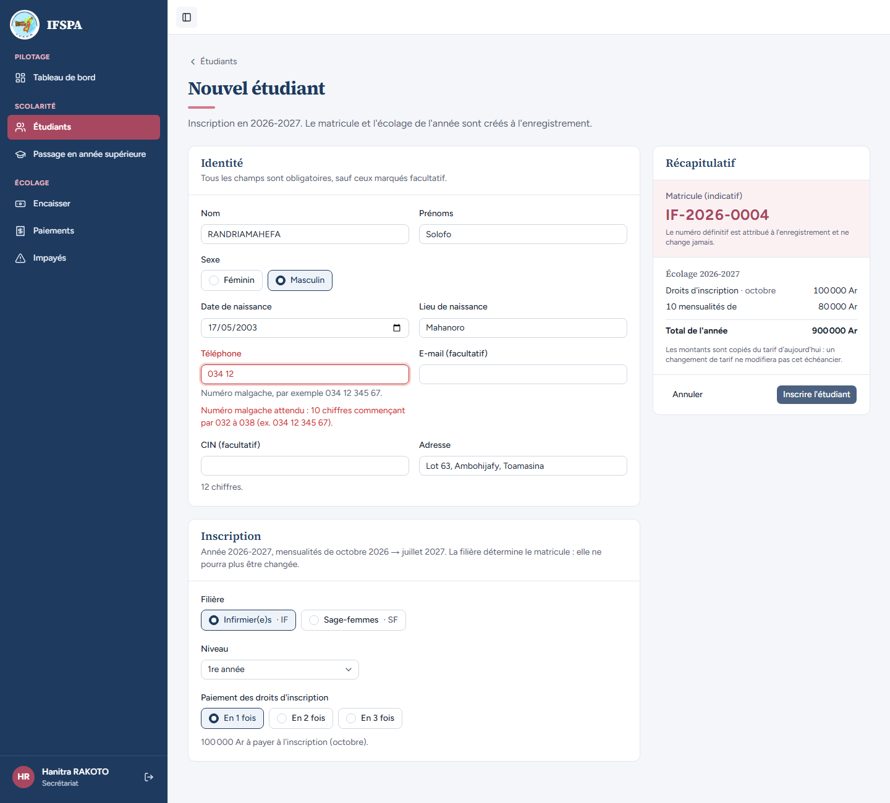
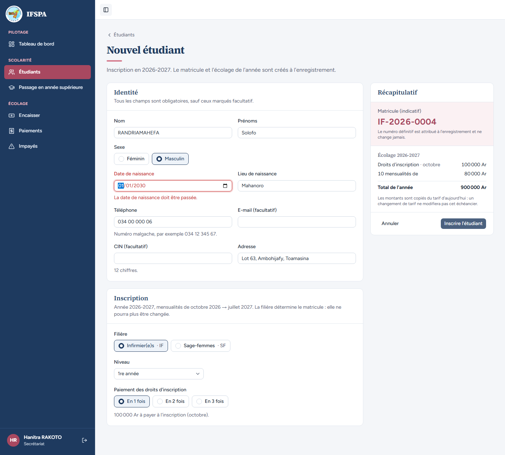
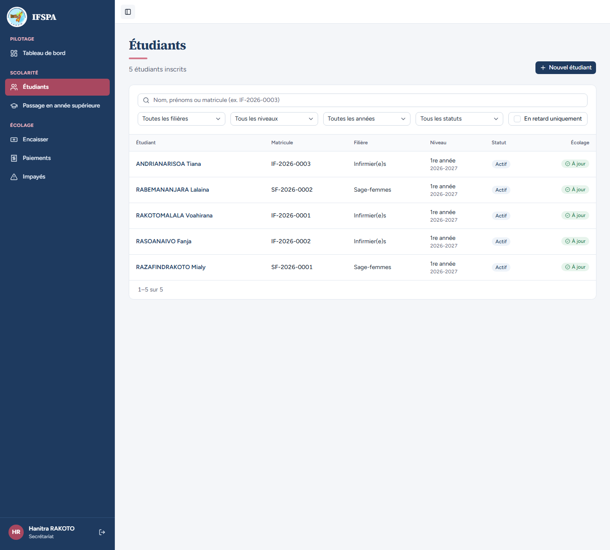

# UC04-04. Une fiche incomplète ou mal saisie n'est pas enregistrée

| | |
|---|---|
| Use case | UC04. Inscrire un nouvel étudiant |
| Règles couvertes | Champs exigés (décision provisoire n° 15 : téléphone et adresse exigés dans le formulaire), R-MAT (aucun matricule consommé par un refus) |
| Rôle | Secrétariat, compte « Hanitra RAKOTO » |
| Durée estimée | 8 minutes |

## La situation

La secrétaire va vite : elle valide un formulaire vide, puis oublie le téléphone et l'adresse de Solofo RANDRIAMAHEFA, tape un numéro incomplet, puis une date de naissance dans le futur. À chaque fois, l'écran dit précisément ce qui manque et n'enregistre rien.

## Avant de commencer

- Mêmes préparatifs que [UC04-01](UC04-01-trois-inscriptions.md) (base fraîche, sans la préparation 00). Avoir déroulé UC04-01 à UC04-03 : la liste compte **5 étudiants** et le prochain matricule Infirmier(e)s est IF-2026-0004.
- Compte secrétariat, identifiants `SEED_USER_*` de `.env`.

## Étapes

| # | Qui | Action | Résultat attendu | Capture | ✓ |
|---|---|---|---|---|---|
| 1 | Secrétariat | Ouvrir **Étudiants › Nouvel étudiant**, cliquer **Inscrire l'étudiant** sans rien saisir. | On reste sur « Nouvel étudiant ». Messages en rouge sous chaque champ exigé : « Indiquez le nom. », « Indiquez les prénoms. », « Indiquez le sexe. », « Indiquez la date de naissance. », « Indiquez le lieu de naissance. », « Indiquez le numéro de téléphone. », « Indiquez l'adresse. », « Choisissez la filière. » E-mail et CIN (« facultatif ») ne sont pas signalés. |  | |
| 2 | Secrétariat | Recharger le formulaire. Saisir `RANDRIAMAHEFA`, `Solofo`, Masculin, `17/05/2003`, `Mahanoro`, choisir **Infirmier(e)s · IF**. Laisser **Téléphone** et **Adresse** vides, cliquer **Inscrire l'étudiant**. | Seuls « Indiquez le numéro de téléphone. » et « Indiquez l'adresse. » apparaissent. Récapitulatif : matricule indicatif IF-2026-0004. On reste sur le formulaire. |  | |
| 3 | Secrétariat | Saisir `034 12` dans **Téléphone** et `Lot 63, Ambohijafy, Toamasina` dans **Adresse**, cliquer **Inscrire l'étudiant**. | Message « Numéro malgache attendu : 10 chiffres commençant par 032 à 038 (ex. 034 12 345 67). » sous le téléphone. |  | |
| 4 | Secrétariat | Saisir `034 00 000 06` dans **Téléphone**, puis `01/01/2030` dans **Date de naissance**, cliquer **Inscrire l'étudiant**. | Message « La date de naissance doit être passée. » sous la date. On reste sur le formulaire. |  | |
| 5 | Secrétariat | Menu **Étudiants**. | « 5 étudiants inscrits » : Solofo RANDRIAMAHEFA n'y est pas. Aucune fiche n'a été créée. |  | |

## Ce que ce scénario ne couvre pas

- Les refus serveur (saisie invalide, date future, sans session) ne se démontrent pas dans le navigateur, le formulaire les arrête avant : couvert par Vitest, `tests/integration/actions-etudiants.test.ts` (« saisie invalide ou date de naissance future : erreurs par champ, rien d'écrit », « sans session : redirigé vers la connexion, rien d'écrit »).
- Les champs facultatifs (CIN, e-mail) et leurs formats : non déroulés.
- Téléphone et adresse sont exigés par le formulaire mais facultatifs en base, pour l'import Excel (décision provisoire n° 15 de `STATUS.md`) : ce n'est pas une anomalie.

## Dernière exécution par l'agent

- 17/10/2026 : ✅ 5 étapes sur 5. Voir [RAPPORT_2026-10-17_UC04](../../rapports/RAPPORT_2026-10-17_UC04.md).
- Parcours : [UC04-04-champs-exiges.recette.ts](../../parcours/UC04-04-champs-exiges.recette.ts).
