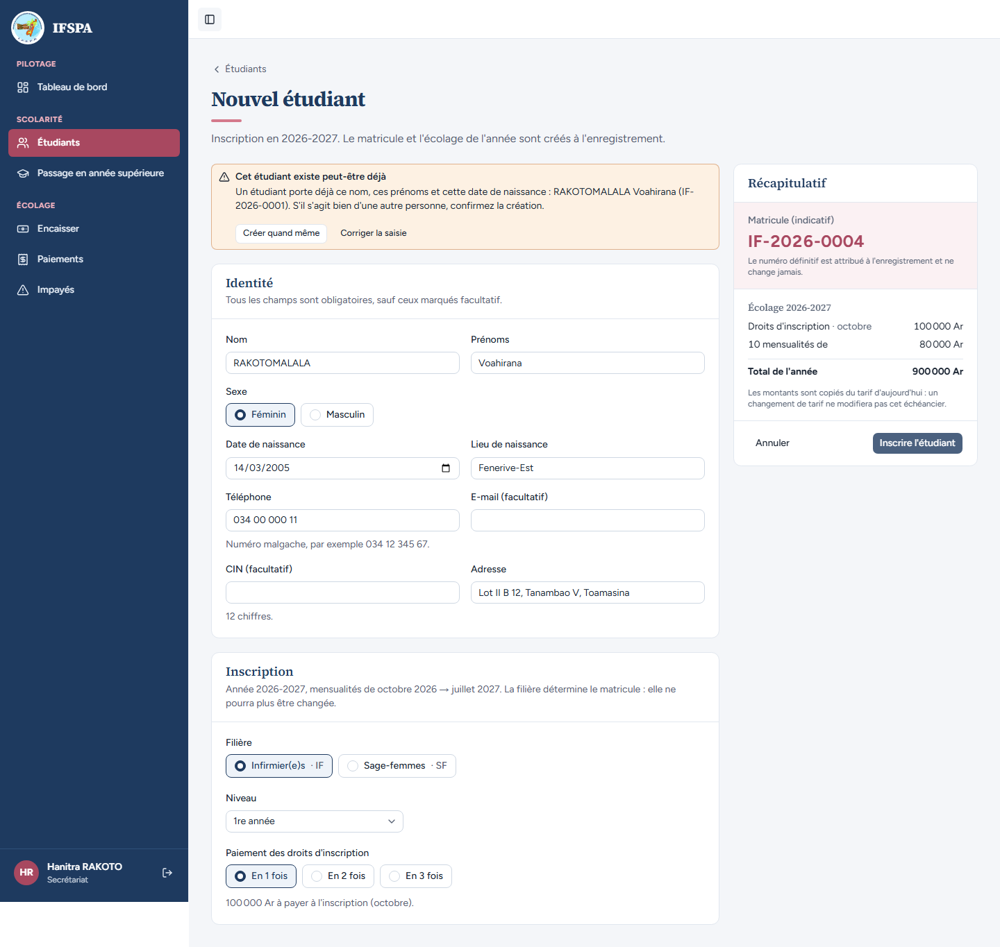
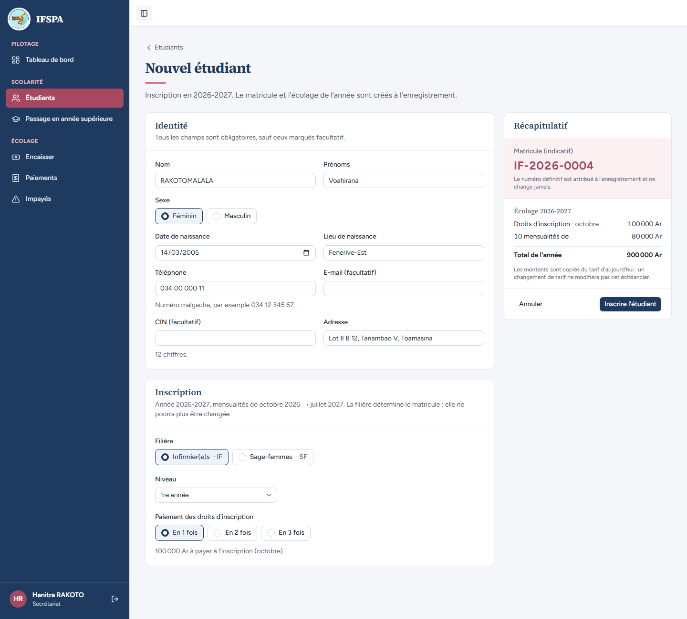
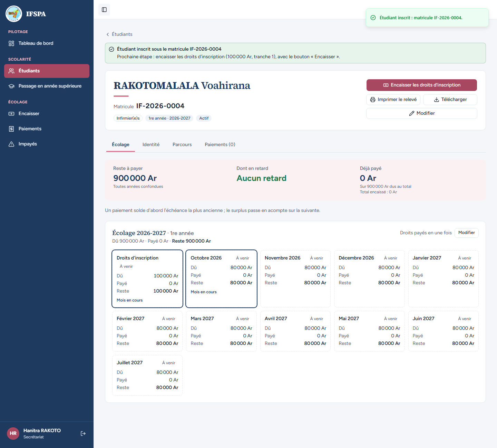
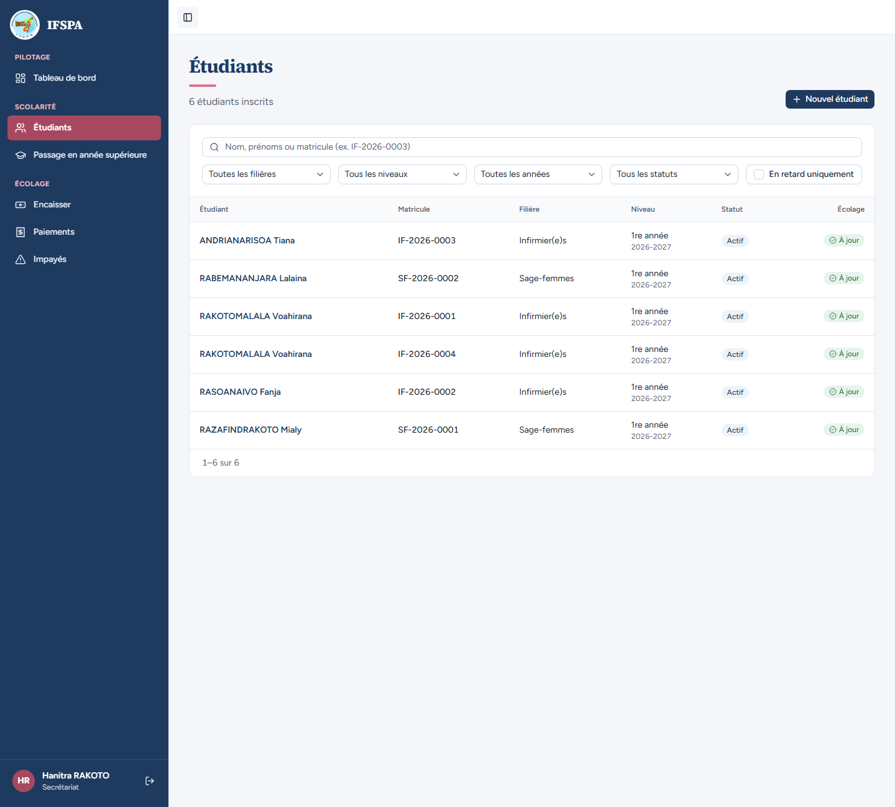

# UC04-05. Un homonyme déjà inscrit : avertissement, puis confirmation

| | |
|---|---|
| Use case | UC04. Inscrire un nouvel étudiant |
| Règles couvertes | Doublon (décision provisoire n° 18 : avertissement + confirmation explicite, pas de blocage), R-MAT (le matricule n'est consommé qu'à la création) |
| Rôle | Secrétariat, compte « Hanitra RAKOTO » |
| Durée estimée | 8 minutes |

## La situation

Une étudiante se présente à l'inscription sous le nom de Voahirana RAKOTOMALALA, née le 14/03/2005 : exactement l'identité d'une étudiante déjà inscrite (IF-2026-0001). L'institut préfère ne pas bloquer, car deux personnes peuvent porter le même nom, mais la secrétaire doit confirmer. L'écran la prévient et lui demande de décider.

## Avant de commencer

- Mêmes préparatifs que [UC04-01](UC04-01-trois-inscriptions.md) (base fraîche, sans la préparation 00). Avoir déroulé UC04-01 à UC04-04 : RAKOTOMALALA Voahirana (IF-2026-0001) existe, le prochain matricule Infirmier(e)s est **IF-2026-0004**.
- Compte secrétariat, identifiants `SEED_USER_*` de `.env`.

## Étapes

| # | Qui | Action | Résultat attendu | Capture | ✓ |
|---|---|---|---|---|---|
| 1 | Secrétariat | **Étudiants › Nouvel étudiant** : `RAKOTOMALALA` Voahirana, Féminin, `14/03/2005`, Lieu `Fenerive-Est`, Téléphone `034 00 000 11`, Adresse `Lot II B 12, Tanambao V, Toamasina`, **Infirmier(e)s · IF**. Cliquer **Inscrire l'étudiant**. | Un cadre orange apparaît en haut : titre « Cet étudiant existe peut-être déjà », texte « Un étudiant porte déjà ce nom, ces prénoms et cette date de naissance : RAKOTOMALALA Voahirana (IF-2026-0001). S'il s'agit bien d'une autre personne, confirmez la création. » Boutons « Créer quand même » et « Corriger la saisie ». On reste sur le formulaire ; rien n'est créé. |  | |
| 2 | Secrétariat | Cliquer **Corriger la saisie**. | Le cadre disparaît, la saisie est conservée (Nom RAKOTOMALALA, Prénoms Voahirana, 14/03/2005…). Matricule indicatif toujours **IF-2026-0004**. |  | |
| 3 | Secrétariat | Cliquer de nouveau **Inscrire l'étudiant** (le cadre revient), puis **Créer quand même**. | Message « Étudiant inscrit : matricule IF-2026-0004. » La fiche de RAKOTOMALALA Voahirana s'ouvre avec le matricule **IF-2026-0004** (et non 0001) : bandeau « Étudiant inscrit sous le matricule IF-2026-0004 ». |  | |
| 4 | Secrétariat | Menu **Étudiants**. | « 6 étudiants inscrits ». Deux lignes « RAKOTOMALALA Voahirana » : **IF-2026-0001** et **IF-2026-0004**. |  | |

## Ce que ce scénario ne couvre pas

- Le doublon ignore la casse et les accents, vaut d'une filière à l'autre, ne se déclenche pas pour un autre jour de naissance ou d'autres prénoms, et deux saisies simultanées de la même personne ne créent qu'une fiche : couvert par Vitest, `tests/integration/actions-etudiants.test.ts` (bloc « creerEtudiant : doublon »).
- Modifier la fiche d'un étudiant pour qu'elle devienne identique à une autre (pas de contrôle de doublon à la modification) : non déroulé.
- Le choix de ne pas bloquer est la décision provisoire n° 18 de `STATUS.md` : ce n'est pas une anomalie.

## Dernière exécution par l'agent

- 17/10/2026 : ✅ 4 étapes sur 4. Voir [RAPPORT_2026-10-17_UC04](../../rapports/RAPPORT_2026-10-17_UC04.md).
- Parcours : [UC04-05-doublon.recette.ts](../../parcours/UC04-05-doublon.recette.ts).
