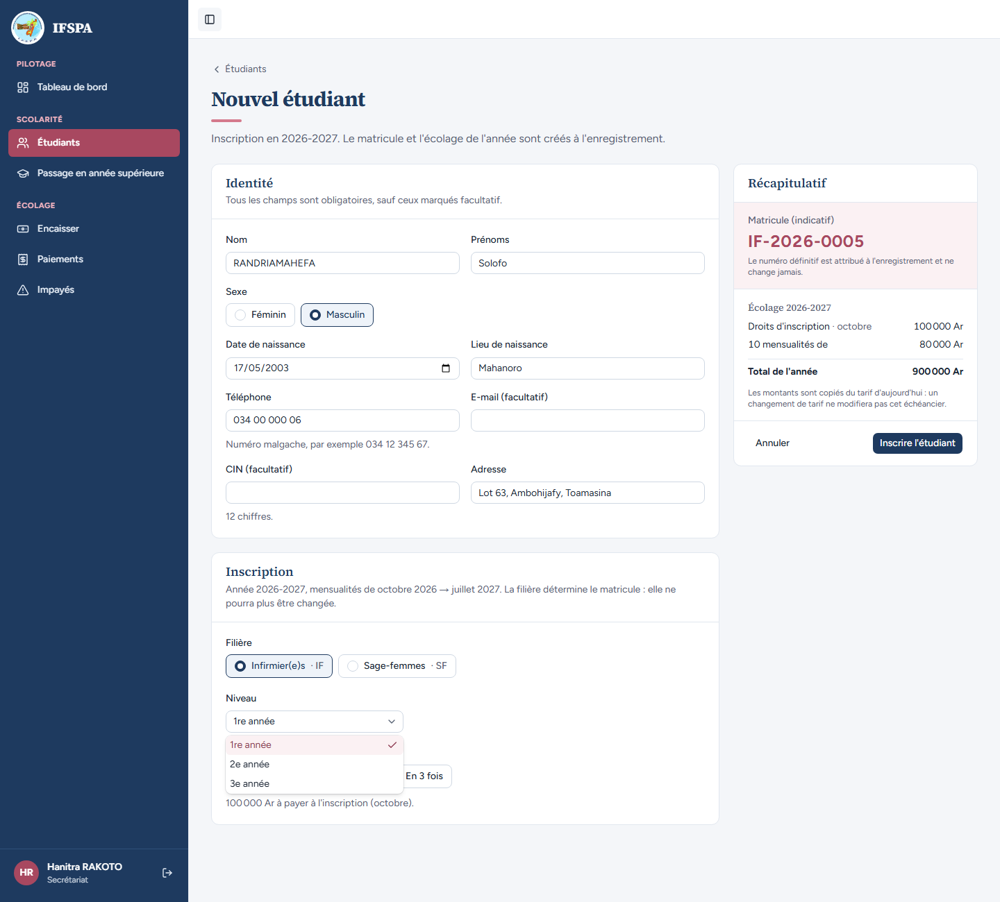
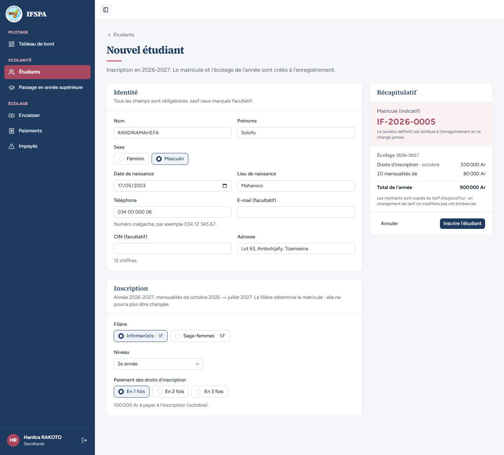
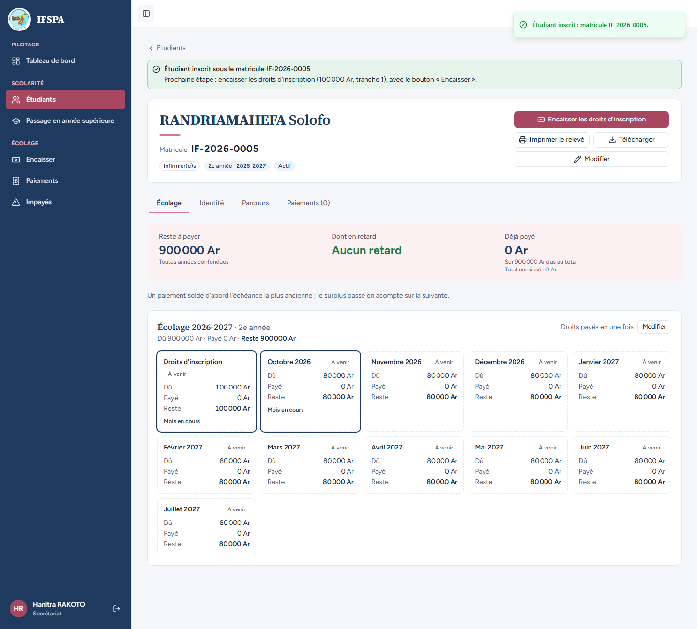
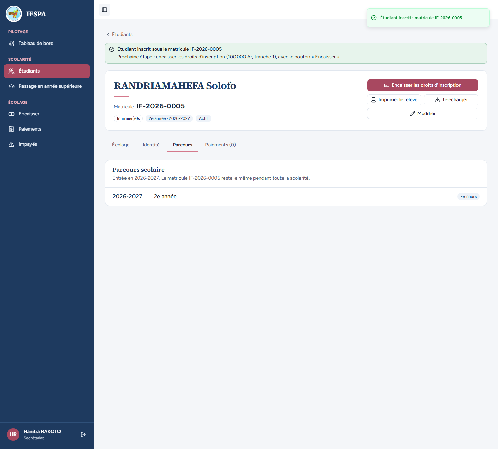
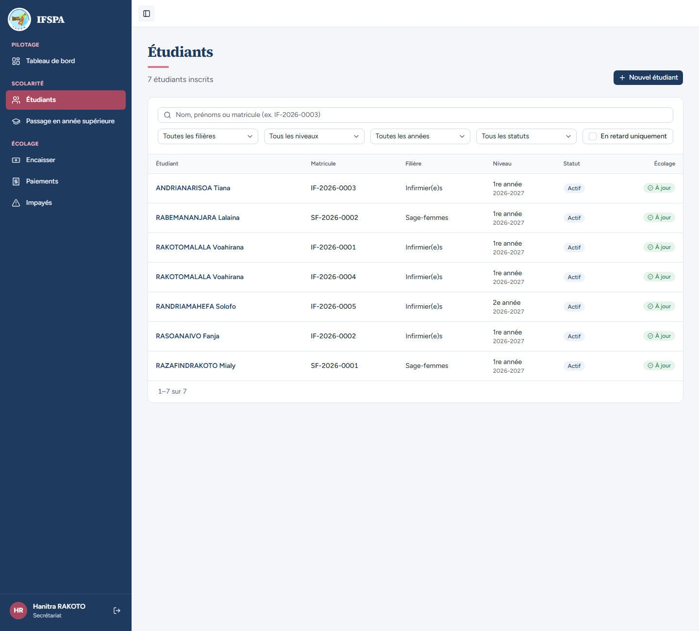

# UC04-06. Un étudiant s'inscrit directement en 2e année

| | |
|---|---|
| Use case | UC04. Inscrire un nouvel étudiant |
| Règles couvertes | Inscription directe en 2e année (décision provisoire n° 16), R-MAT (année d'entrée = année courante), R-ECH (tarif du niveau choisi), R-INS (année complète) |
| Rôle | Secrétariat, compte « Hanitra RAKOTO » |
| Durée estimée | 6 minutes |

## La situation

Solofo RANDRIAMAHEFA arrive d'un autre institut avec ses deux premières années validées : il entre à l'IFSPA directement en 2e année d'Infirmier(e)s. La secrétaire choisit le niveau « 2e année » ; l'inscription se fait quand même sur l'année scolaire courante, et son matricule porte l'année d'entrée 2026.

## Avant de commencer

- Mêmes préparatifs que [UC04-01](UC04-01-trois-inscriptions.md) (base fraîche, sans la préparation 00). Avoir déroulé UC04-01 à UC04-05 : le matricule attendu est **IF-2026-0005** (quatre étudiants IF existent déjà, dont l'homonyme de UC04-05).
- Compte secrétariat, identifiants `SEED_USER_*` de `.env`.

## Étapes

| # | Qui | Action | Résultat attendu | Capture | ✓ |
|---|---|---|---|---|---|
| 1 | Secrétariat | **Étudiants › Nouvel étudiant** : `RANDRIAMAHEFA` Solofo, Masculin, `17/05/2003`, `Mahanoro`, `034 00 000 06`, `Lot 63, Ambohijafy, Toamasina`. Choisir **Infirmier(e)s · IF**, puis ouvrir la liste **Niveau**. | Trois niveaux : « 1re année », « 2e année », « 3e année » (la durée de la filière est de 3 ans). |  | |
| 2 | Secrétariat | Choisir **2e année**. | Niveau « 2e année ». Récapitulatif : matricule indicatif **IF-2026-0005** ; Droits d'inscription · octobre 100 000 Ar, 10 mensualités de 80 000 Ar, Total de l'année **900 000 Ar** (tarif de la 2e année). |  | |
| 3 | Secrétariat | Cliquer **Inscrire l'étudiant**. | Message « Étudiant inscrit : matricule IF-2026-0005. » Fiche : pastilles « Infirmier(e)s », « **2e année · 2026-2027** », « Actif » ; « Écolage 2026-2027 · 2e année » ; **11 échéances** (droits, octobre 2026 à juillet 2027) ; reste à payer 900 000 Ar. |  | |
| 4 | Secrétariat | Onglet **Parcours**. | « Parcours scolaire », « Entrée en 2026-2027. Le matricule IF-2026-0005 reste le même pendant toute la scolarité. » Une seule ligne : « 2026-2027 », « 2e année », « En cours » (pas d'inscription en 1re année). |  | |
| 5 | Secrétariat | Menu **Étudiants**. | La ligne **IF-2026-0005** indique « 2e année » et « 2026-2027 ». |  | |

## Ce que ce scénario ne couvre pas

- L'entrée en 3e année : même mécanisme, non déroulée.
- Un niveau sans tarif (même filière, autre niveau) : voir [UC04-09](UC04-09-tarif-manquant.md).
- Le niveau au-delà de la durée de la filière et le niveau inconnu sont refusés par le serveur : couvert par Vitest, `tests/integration/actions-etudiants.test.ts` (« filière désactivée, inconnue ou niveau au-delà de la durée : refusé »).
- L'ouverture à tout niveau est la décision provisoire n° 16 de `STATUS.md` : ce n'est pas une anomalie.

## Dernière exécution par l'agent

- 17/10/2026 : ✅ 5 étapes sur 5. Voir [RAPPORT_2026-10-17_UC04](../../rapports/RAPPORT_2026-10-17_UC04.md).
- Parcours : [UC04-06-entree-en-2e-annee.recette.ts](../../parcours/UC04-06-entree-en-2e-annee.recette.ts).
