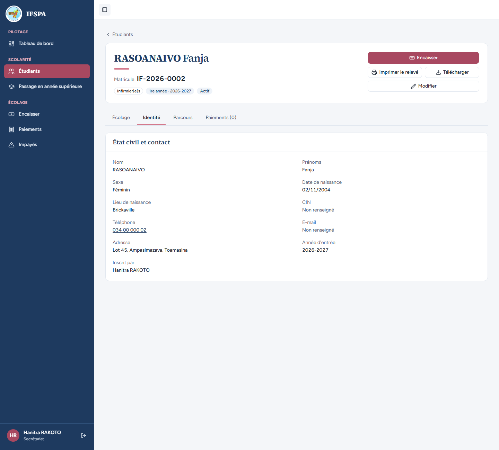
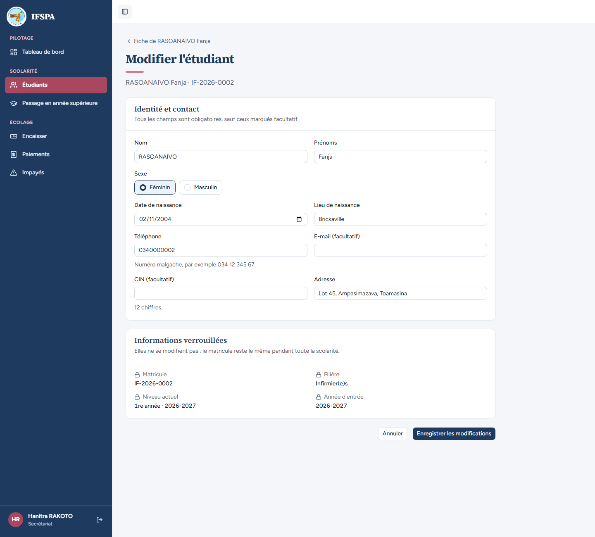
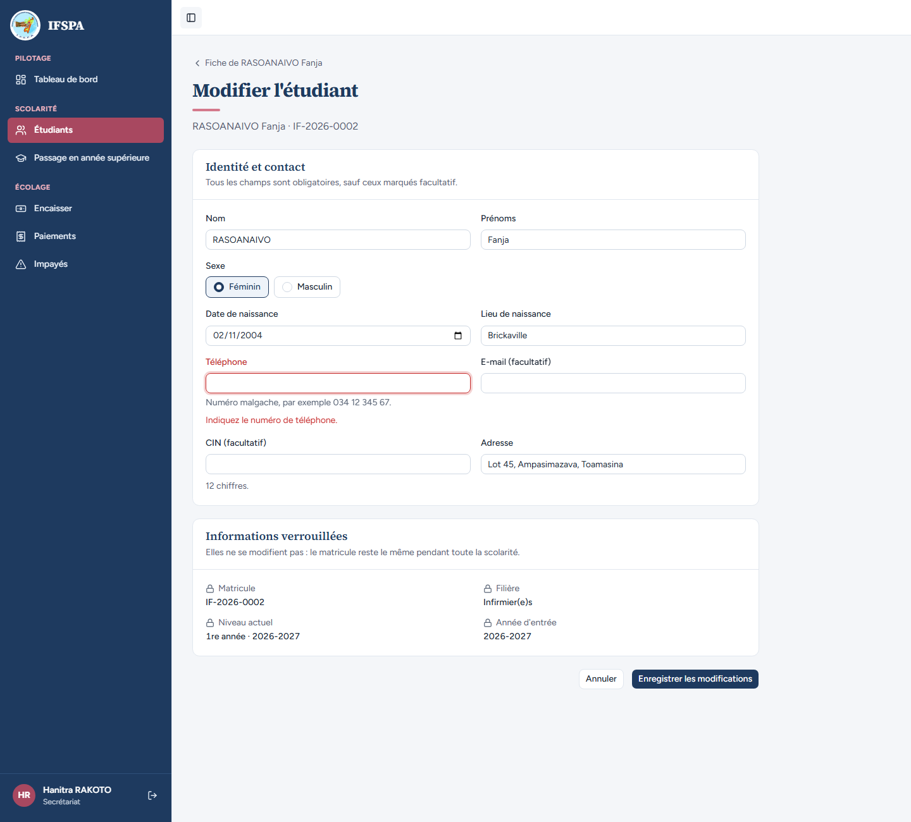
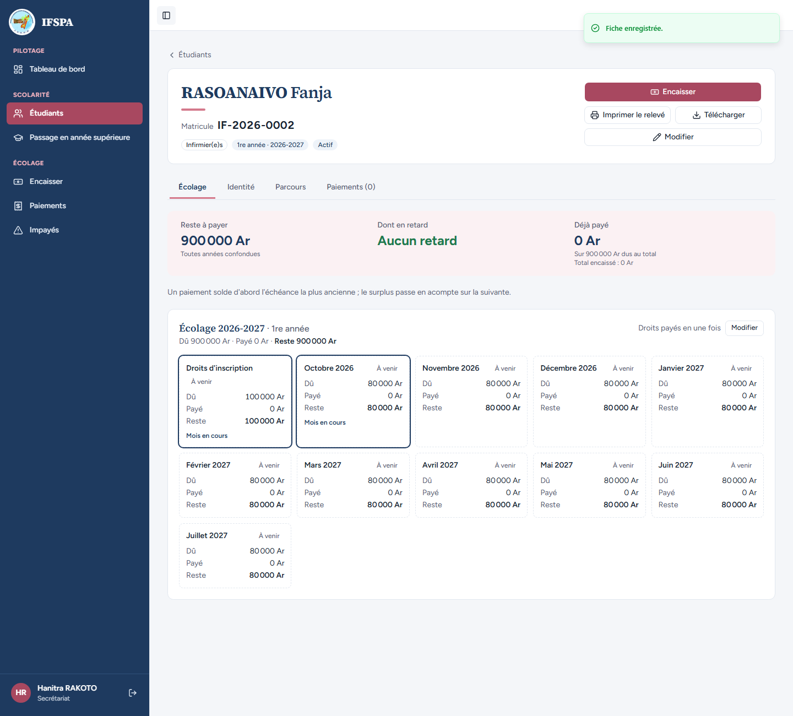
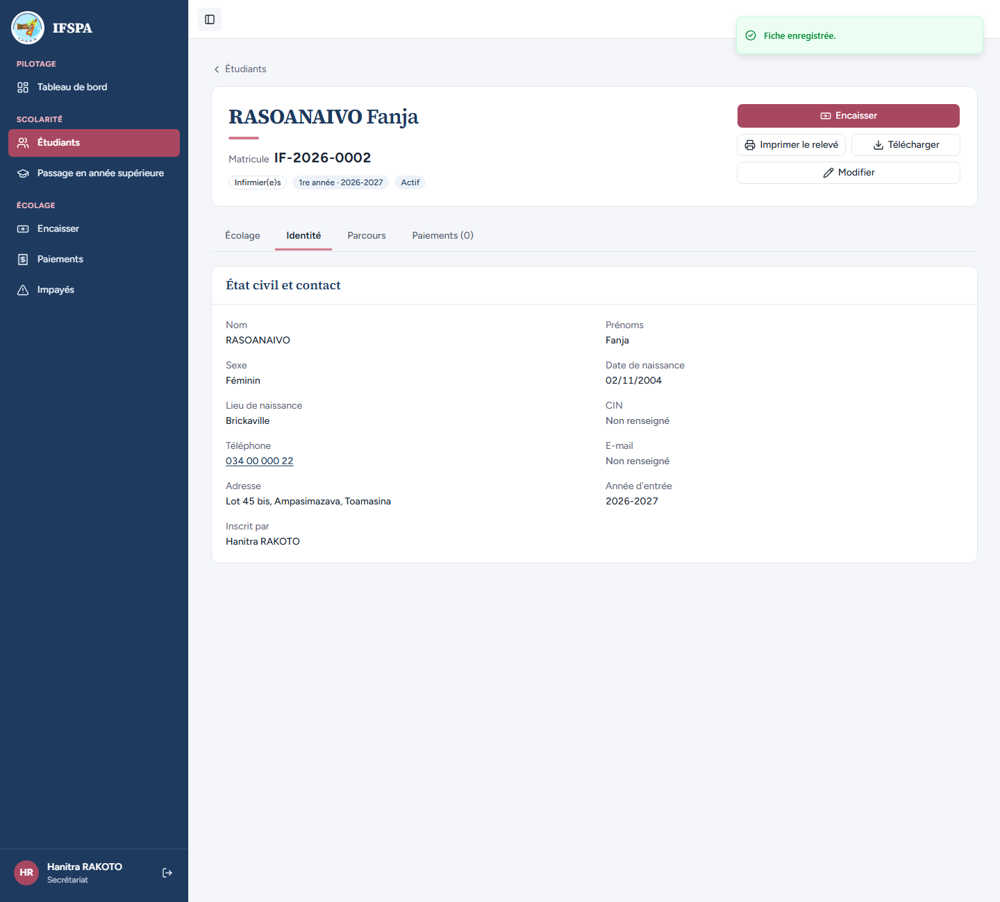

# UC04-07. Corriger le téléphone et l'adresse d'un étudiant, sans toucher au matricule

| | |
|---|---|
| Use case | UC04. Inscrire un nouvel étudiant (et UC05 pour la fiche) |
| Règles couvertes | R-MAT (le matricule ne change jamais), filière, niveau et matricule verrouillés après création (décision provisoire n° 17), champs exigés (décision n° 15) |
| Rôle | Secrétariat, compte « Hanitra RAKOTO » |
| Durée estimée | 8 minutes |

## La situation

Fanja RASOANAIVO a changé de numéro de téléphone et d'adresse (« Lot 45 bis »). La secrétaire corrige sa fiche. Elle peut changer l'identité et les coordonnées, mais pas le matricule, la filière, le niveau ni l'année d'entrée : l'écran les affiche verrouillés.

## Avant de commencer

- Mêmes préparatifs que [UC04-01](UC04-01-trois-inscriptions.md) (base fraîche, sans la préparation 00). Avoir déroulé UC04-01 : RASOANAIVO Fanja (**IF-2026-0002**) existe.
- Compte secrétariat, identifiants `SEED_USER_*` de `.env`.

## Étapes

| # | Qui | Action | Résultat attendu | Capture | ✓ |
|---|---|---|---|---|---|
| 1 | Secrétariat | Menu **Étudiants**, cliquer **RASOANAIVO Fanja**, onglet **Identité**. | Bloc « État civil et contact » : Nom RASOANAIVO, Prénoms Fanja, Sexe Féminin, Date de naissance 02/11/2004, Lieu de naissance Brickaville, CIN « Non renseigné », Téléphone **034 00 000 02**, E-mail « Non renseigné », Adresse « Lot 45, Ampasimazava, Toamasina », Année d'entrée 2026-2027, Inscrit par « Hanitra RAKOTO ». |  | |
| 2 | Secrétariat | Cliquer **Modifier** (en haut de la fiche). | Page « Modifier l'étudiant », sous-titre « RASOANAIVO Fanja · IF-2026-0002 ». Bloc « Identité et contact » prérempli. Bloc « Informations verrouillées » (« Elles ne se modifient pas : le matricule reste le même pendant toute la scolarité. ») : Matricule **IF-2026-0002**, Filière **Infirmier(e)s**, Niveau actuel **1re année · 2026-2027**, Année d'entrée **2026-2027**, chacun avec un cadenas et sans champ de saisie. Le champ Téléphone montre `0340000002` (voir « Ce que ce scénario ne couvre pas »). |  | |
| 3 | Secrétariat | Vider **Téléphone**, cliquer **Enregistrer les modifications**. | Message « Indiquez le numéro de téléphone. » sous le champ ; on reste sur « Modifier l'étudiant ». |  | |
| 4 | Secrétariat | Saisir `034 00 000 22` dans **Téléphone** et `Lot 45 bis, Ampasimazava, Toamasina` dans **Adresse**, cliquer **Enregistrer les modifications**. | Message « Fiche enregistrée. » Retour sur la fiche (onglet Écolage), reste à payer inchangé (900 000 Ar). |  | |
| 5 | Secrétariat | Onglet **Identité**. | Téléphone **034 00 000 22**, Adresse « Lot 45 bis, Ampasimazava, Toamasina ». Matricule **IF-2026-0002** inchangé dans l'en-tête de la fiche. |  | |

## Ce que ce scénario ne couvre pas

- Le changement du nom (la recherche est recalculée, le matricule reste le même) : couvert par Vitest, `tests/integration/actions-etudiants.test.ts` (bloc « modifierEtudiant » : « modifie l'identité sans toucher au matricule, à la filière ni à l'année d'entrée », « recalcule la recherche »). Refus serveur (date future, étudiant inconnu, sans session) : même fichier.
- Constat mineur : le champ Téléphone du formulaire de modification affiche `0340000002`, alors que la fiche et le formulaire d'inscription l'écrivent « 034 00 000 02 ». Voir le rapport.
- La suppression d'un étudiant saisi par erreur n'existe pas (décision provisoire n° 17 de `STATUS.md`) : ce n'est pas une anomalie.

## Dernière exécution par l'agent

- 17/10/2026 : ✅ 5 étapes sur 5. Voir [RAPPORT_2026-10-17_UC04](../../rapports/RAPPORT_2026-10-17_UC04.md).
- Parcours : [UC04-07-modifier-fiche.recette.ts](../../parcours/UC04-07-modifier-fiche.recette.ts).
