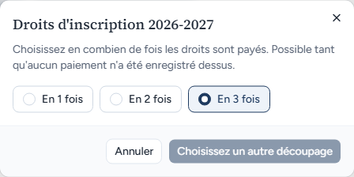
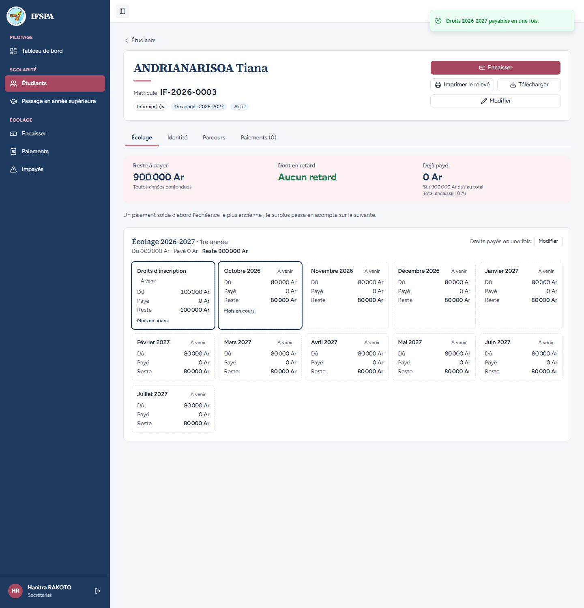
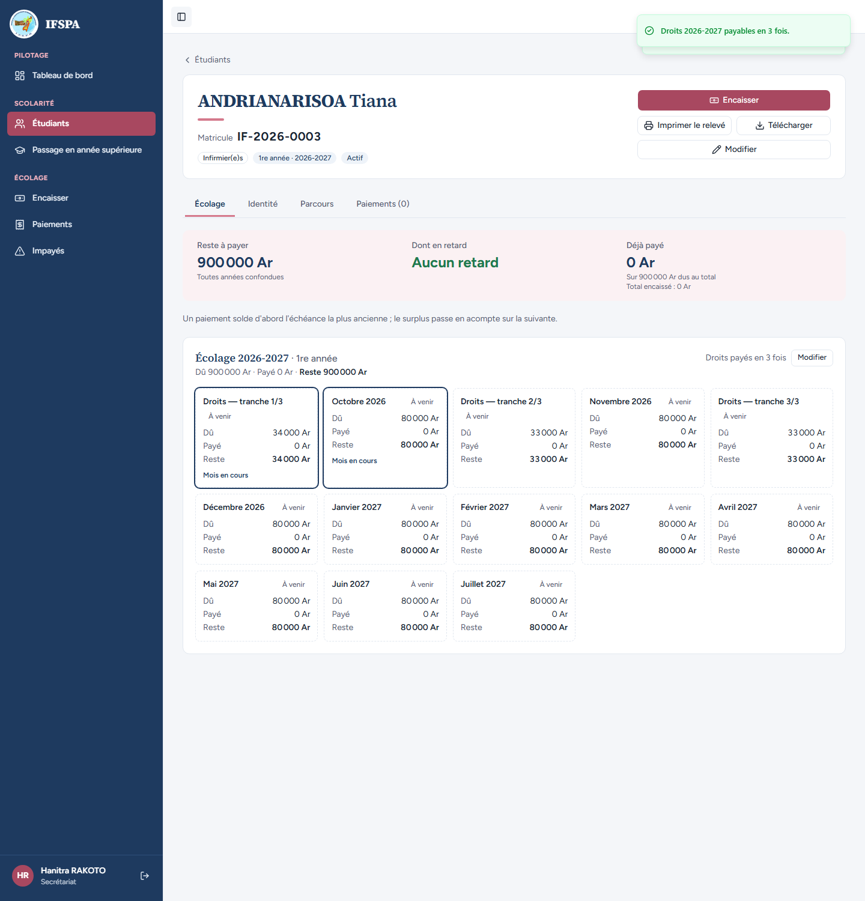
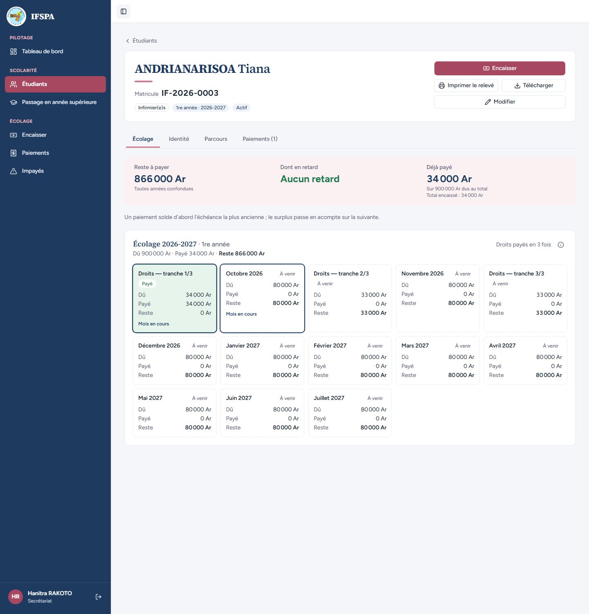
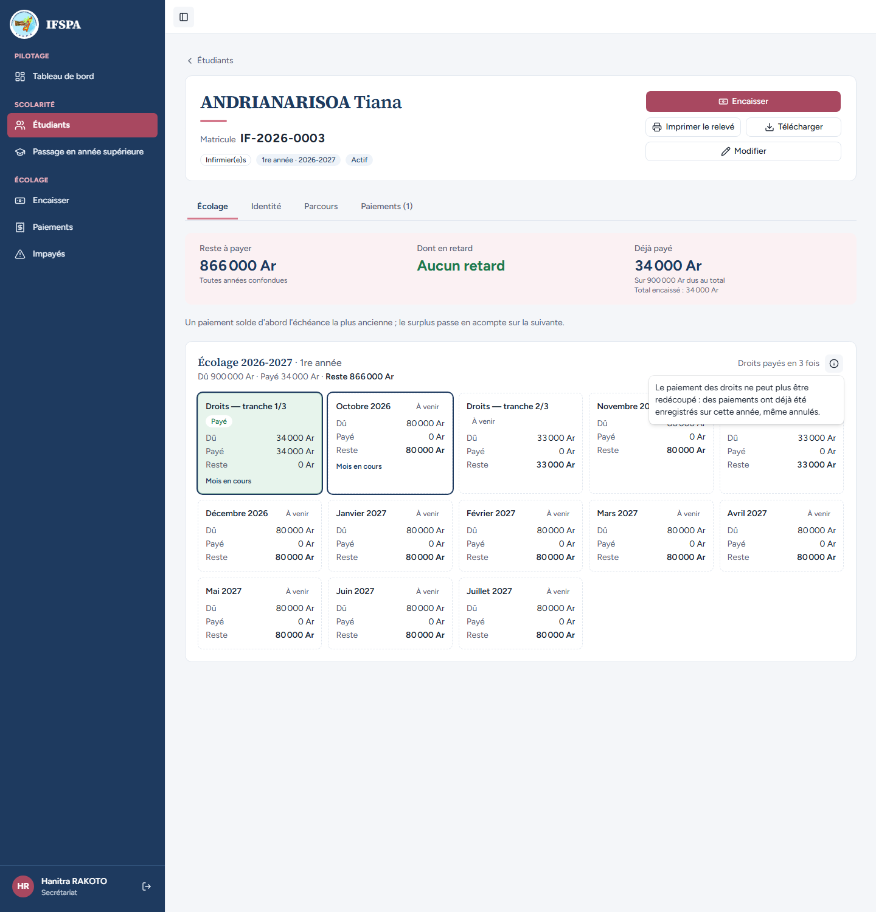

# UC04-08. Changer le découpage des droits tant que rien n'est payé

| | |
|---|---|
| Use case | UC04. Inscrire un nouvel étudiant (fiche : « Modifier » les droits) |
| Règles couvertes | R-TRA (droits en 1, 2 ou 3 tranches), R-ECH (le total dû ne change pas), R-REP (la tranche 1 se paie la première) |
| Rôle | Secrétariat, compte « Hanitra RAKOTO » |
| Durée estimée | 10 minutes |

## La situation

Le père de Tiana ANDRIANARISOA (droits en 3 fois) revient avant tout paiement : il préfère finalement tout payer d'un coup, puis se ravise et revient à trois fois. La secrétaire change le découpage depuis la fiche. Une fois la première tranche encaissée, le découpage ne peut plus bouger : l'écran n'offre plus le bouton et explique pourquoi.

## Avant de commencer

- Mêmes préparatifs que [UC04-01](UC04-01-trois-inscriptions.md) (base fraîche, sans la préparation 00). Avoir déroulé UC04-01 à UC04-07 : ANDRIANARISOA Tiana (**IF-2026-0003**, droits en 3 fois, rien payé) existe. **Ce cas encaisse 34 000 Ar** : pour le rejouer, repartir de `pnpm recette:base` et refaire UC04-01 à UC04-07.
- Compte secrétariat, identifiants `SEED_USER_*` de `.env`.

## Étapes

| # | Qui | Action | Résultat attendu | Capture | ✓ |
|---|---|---|---|---|---|
| 1 | Secrétariat | **Étudiants**, cliquer **ANDRIANARISOA Tiana**. Sur la ligne « Droits payés en 3 fois », cliquer **Modifier**. | La fiche montre 13 échéances. Fenêtre « Droits d'inscription 2026-2027 » : « Choisissez en combien de fois les droits sont payés. Possible tant qu'aucun paiement n'a été enregistré dessus. » Choix « En 1 fois », « En 2 fois », « En 3 fois » (coché). Le bouton grisé dit « Choisissez un autre découpage » : rien à valider tant que le choix est l'actuel. |  | |
| 2 | Secrétariat | Cliquer **En 1 fois**, puis **Payer les droits en 1 fois**. | Message « Droits 2026-2027 payables en une fois. » La fiche : « Droits payés en une fois », **11 cartes** (« Droits d'inscription » 100 000 Ar, Octobre 2026 à Juillet 2027). Reste à payer **900 000 Ar** (inchangé). |  | |
| 3 | Secrétariat | Cliquer **Modifier**, **En 3 fois**, **Payer les droits en 3 fois**. | Message « Droits 2026-2027 payables en 3 fois. » « Droits payés en 3 fois », **13 cartes** : « Droits — tranche 1/3 » **34 000 Ar**, Octobre 2026, « Droits — tranche 2/3 » 33 000 Ar, Novembre 2026, « Droits — tranche 3/3 » 33 000 Ar, Décembre 2026… Reste à payer 900 000 Ar. |  | |
| 4 | Secrétariat | Cliquer **Encaisser** (en haut de la fiche), cliquer la carte **Droits — tranche 1/3**, vérifier « Montant reçu » `34 000`, cliquer **Encaisser 34 000 Ar et imprimer le reçu**. | « Paiement enregistré : reçu R-2026-NNNNN. » (le numéro dépend des postes déjà ouverts : voir [UC06-01](../UC06-encaisser/UC06-01-deux-mois-especes.md)). | | |
| 5 | Secrétariat | Revenir sur la fiche (**Étudiants**, **ANDRIANARISOA Tiana**). | Onglet « Paiements (1) ». Reste à payer **866 000 Ar**, Déjà payé **34 000 Ar**. « Droits — tranche 1/3 » **Payé**. À droite de « Droits payés en 3 fois », plus de bouton « Modifier » : une icône d'information à la place. |  | |
| 6 | Secrétariat | Cliquer l'icône d'information (« Pourquoi certaines actions ne sont pas proposées »). | Bulle : « Le paiement des droits ne peut plus être redécoupé : des paiements ont déjà été enregistrés sur cette année, même annulés. » |  | |

## Ce que ce scénario ne couvre pas

- Le refus **côté serveur** d'un redécoupage après paiement (appel direct de l'action, sans passer par l'écran) ne se démontre pas dans le navigateur : couvert par Vitest, `tests/integration/actions-etudiants.test.ts` (« refusé après un paiement sur les droits, et rien n'est modifié », « refusé même quand le paiement sur les droits a été annulé », « refusé après un paiement annulé via les actions »).
- Le passage « En 2 fois » depuis la fiche, le redécoupage d'une année clôturée, la conservation des paiements déjà faits sur les mensualités : couverts par Vitest (même fichier, bloc « modifierTranchesDroits »).
- Le reçu et le ticket de l'étape 4 : voir [UC06-04](../UC06-encaisser/UC06-04-droits-en-tranches.md).

## Dernière exécution par l'agent

- 17/10/2026 : ✅ 6 étapes sur 6. Voir [RAPPORT_2026-10-17_UC04](../../rapports/RAPPORT_2026-10-17_UC04.md).
- Parcours : [UC04-08-modifier-tranches.recette.ts](../../parcours/UC04-08-modifier-tranches.recette.ts).
