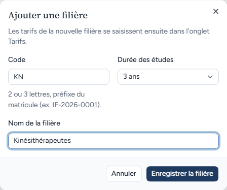
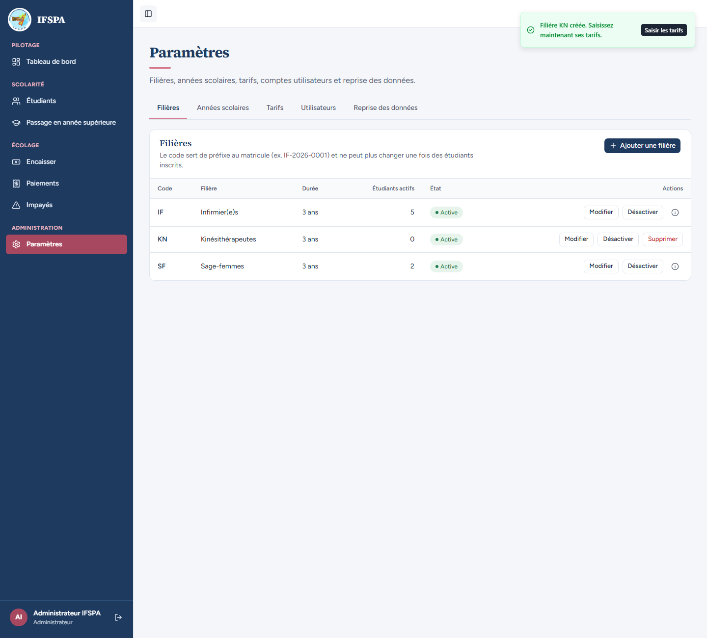
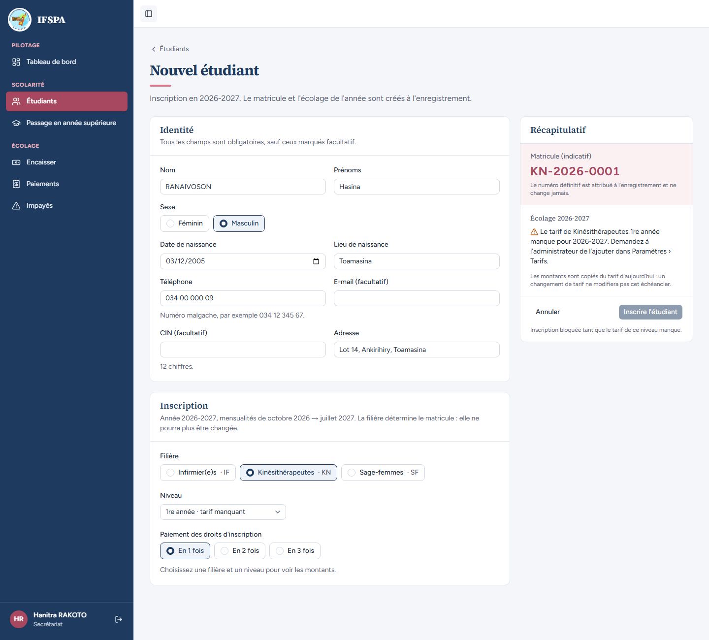
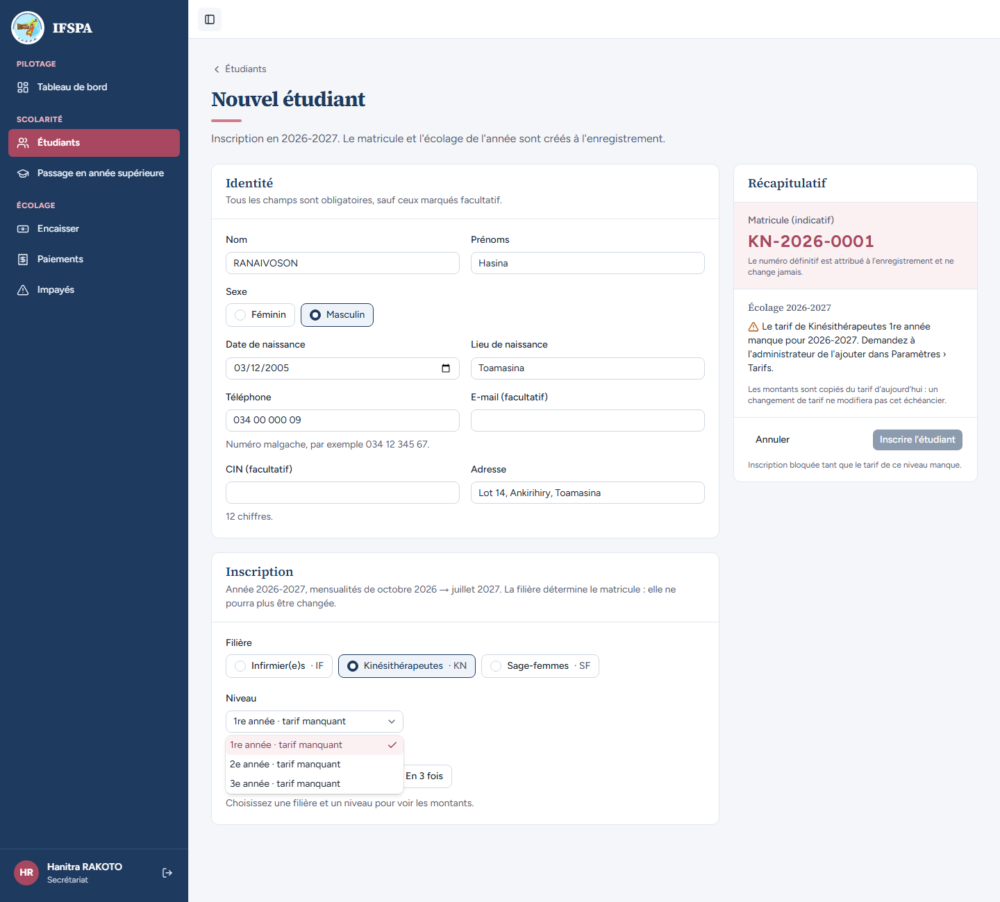
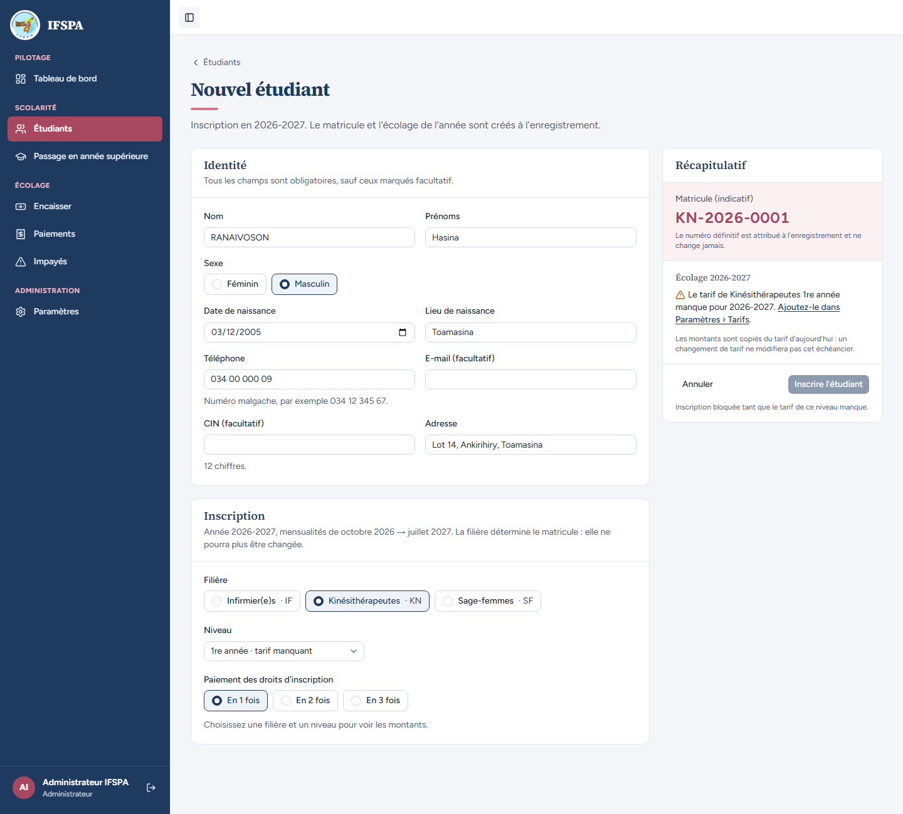
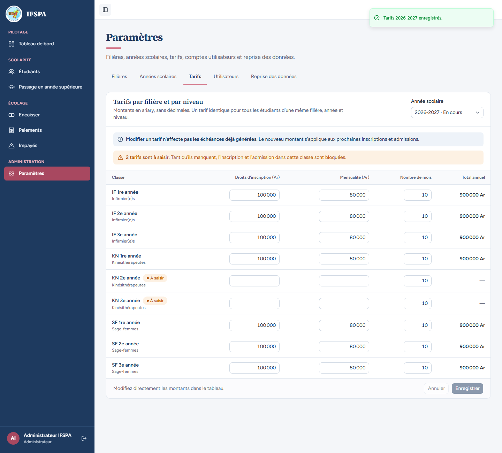
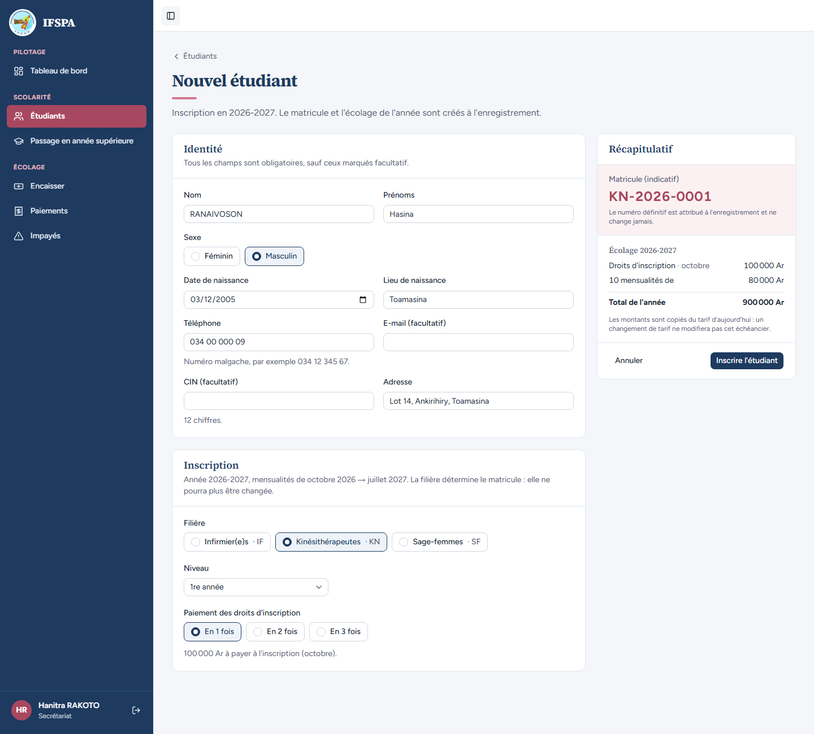
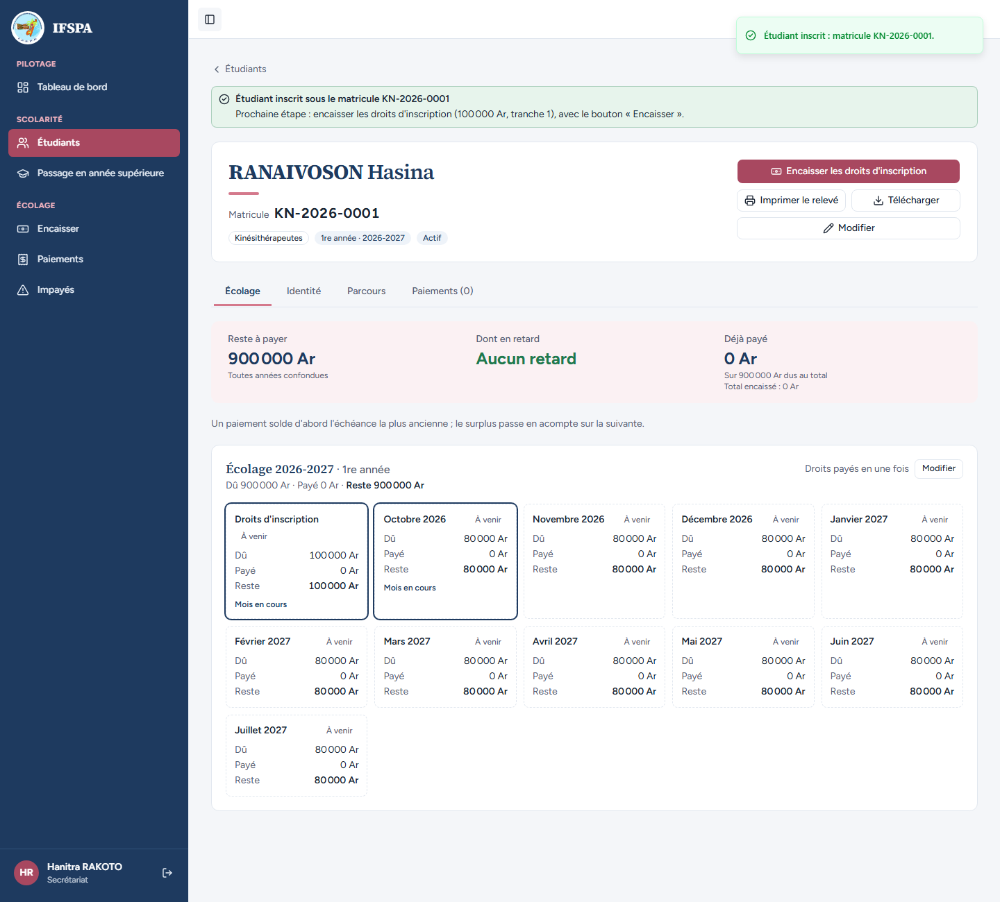

# UC04-09. Une filière sans tarif : l'inscription est bloquée, jusqu'à ce que l'administrateur le saisisse

| | |
|---|---|
| Use case | UC04. Inscrire un nouvel étudiant (et UC02 pour les tarifs) |
| Règles couvertes | R-INS (inscription bloquée avec un message clair si le tarif manque), R-ECH, R-MAT (séquence de la nouvelle filière), R-ROLE (le message renvoie à l'administrateur ; lui seul a le lien vers Paramètres › Tarifs) |
| Rôle | Administrateur (« Administrateur IFSPA ») pour la filière et le tarif ; secrétariat (« Hanitra RAKOTO ») pour l'inscription |
| Durée estimée | 12 minutes |

## La situation

L'institut ouvre une nouvelle filière, Kinésithérapeutes (code KN). L'administrateur la crée, mais n'a pas encore saisi ses tarifs. Un premier candidat, Hasina RANAIVOSON, se présente : la secrétaire ne peut pas l'inscrire et l'écran lui dit quoi faire. L'administrateur voit le même message avec un lien direct vers Paramètres › Tarifs, saisit le tarif de la 1re année, et la secrétaire peut alors inscrire Hasina (KN-2026-0001).

## Avant de commencer

- Mêmes préparatifs que [UC04-01](UC04-01-trois-inscriptions.md) (base fraîche, sans la préparation 00). Ce cas ne dépend d'aucun étudiant des précédents ; il suppose seulement les tarifs du seed (100 000 Ar de droits, 80 000 Ar × 10 mois). L'ordre conseillé reste UC04-01 à UC04-08.
- **Deux comptes**, dans deux fenêtres : l'administrateur (identifiants `SEED_ADMIN_*` de `.env`, « Administrateur IFSPA » en bas de la barre latérale) et le secrétariat (`SEED_USER_*`, « Hanitra RAKOTO »). Ce cas **ajoute la filière KN** : pour le rejouer, repartir de `pnpm recette:base`.

## Étapes

| # | Qui | Action | Résultat attendu | Capture | ✓ |
|---|---|---|---|---|---|
| 1 | Administrateur | Menu **Paramètres**, onglet **Filières**, cliquer **Ajouter une filière**. Saisir Code `KN`, Nom de la filière `Kinésithérapeutes`, Durée des études « 3 ans » (valeur par défaut). | Fenêtre « Ajouter une filière » : « Les tarifs de la nouvelle filière se saisissent ensuite dans l'onglet Tarifs. », aide du code « 2 ou 3 lettres, préfixe du matricule (ex. IF-2026-0001). » |  | |
| 2 | Administrateur | Cliquer **Enregistrer la filière**. | Message « Filière KN créée. Saisissez maintenant ses tarifs. » (bouton « Saisir les tarifs »). La liste montre IF, KN « Kinésithérapeutes · 3 ans · 0 étudiant actif · Active » (boutons Modifier, Désactiver, Supprimer), SF. |  | |
| 3 | Secrétariat | **Étudiants › Nouvel étudiant** : `RANAIVOSON` Hasina, Masculin, `03/12/2005`, `Toamasina`, `034 00 000 09`, `Lot 14, Ankirihiry, Toamasina`. Choisir la filière **Kinésithérapeutes · KN**. | Niveau « 1re année · tarif manquant ». Récapitulatif : matricule indicatif KN-2026-0001 ; sous « Écolage 2026-2027 », avertissement « Le tarif de Kinésithérapeutes 1re année manque pour 2026-2027. Demandez à l'administrateur de l'ajouter dans Paramètres › Tarifs. » (pas de total). Le bouton **Inscrire l'étudiant** est grisé, avec « Inscription bloquée tant que le tarif de ce niveau manque. » Aucun lien vers Paramètres (le secrétariat n'a pas cette rubrique). |  | |
| 4 | Secrétariat | Ouvrir la liste **Niveau**. | Trois lignes : « 1re année · tarif manquant », « 2e année · tarif manquant », « 3e année · tarif manquant ». |  | |
| 5 | Administrateur | Mêmes saisies dans **Étudiants › Nouvel étudiant**, filière **Kinésithérapeutes · KN**. | Même avertissement, mais la fin est un lien : « Le tarif de Kinésithérapeutes 1re année manque pour 2026-2027. **Ajoutez-le dans Paramètres › Tarifs**. » Bouton « Inscrire l'étudiant » grisé. |  | |
| 6 | Administrateur | Cliquer **Ajoutez-le dans Paramètres › Tarifs**. Dans la grille, ligne **KN 1re année** : « Droits d'inscription » `100 000`, « Mensualité » `80 000` (« Nombre de mois » `10`). Cliquer **Enregistrer**. | Avant la saisie, KN 1re année porte la pastille « À saisir ». Après l'enregistrement : message « Tarifs 2026-2027 enregistrés. », KN 1re année **900 000 Ar** ; KN 2e année et KN 3e année restent « À saisir » et le bandeau dit « 2 tarifs sont à saisir. Tant qu'ils manquent, l'inscription et l'admission dans cette classe sont bloquées. » |  | |
| 7 | Secrétariat | Rouvrir **Nouvel étudiant**, saisir Hasina RANAIVOSON et choisir **Kinésithérapeutes · KN**. | Niveau « 1re année » (plus de « tarif manquant »). Récapitulatif : matricule indicatif **KN-2026-0001** (la séquence de KN commence à 1), Droits d'inscription · octobre 100 000 Ar, 10 mensualités de 80 000 Ar, Total de l'année **900 000 Ar**. Bouton « Inscrire l'étudiant » actif. |  | |
| 8 | Secrétariat | Cliquer **Inscrire l'étudiant**. | Message « Étudiant inscrit : matricule KN-2026-0001. » Fiche de RANAIVOSON Hasina : pastille « Kinésithérapeutes », « 1re année · 2026-2027 », reste à payer 900 000 Ar, 11 échéances. |  | |

## Ce que ce scénario ne couvre pas

- Le refus **côté serveur** quand le tarif manque (le formulaire grisé arrête déjà l'envoi) : couvert par Vitest, `tests/integration/actions-etudiants.test.ts` (« tarif manquant : refusé, ni étudiant ni numéro pris, et le suivant reçoit 0001 »).
- Le blocage de l'admission en année supérieure faute de tarif : voir UC10 (non couvert).
- Le secrétariat n'accède pas à Paramètres (rubrique absente, accès refusé par le serveur) : voir [UC15-07](../UC15-reprise/UC15-07-secretariat-refuse.md) et la matrice (R-ROLE).
- Le tarif manquant d'une année passée ou d'une filière désactivée : non déroulé.

## Dernière exécution par l'agent

- 17/10/2026 : ✅ 8 étapes sur 8. Voir [RAPPORT_2026-10-17_UC04](../../rapports/RAPPORT_2026-10-17_UC04.md).
- Parcours : [UC04-09-tarif-manquant.recette.ts](../../parcours/UC04-09-tarif-manquant.recette.ts).
