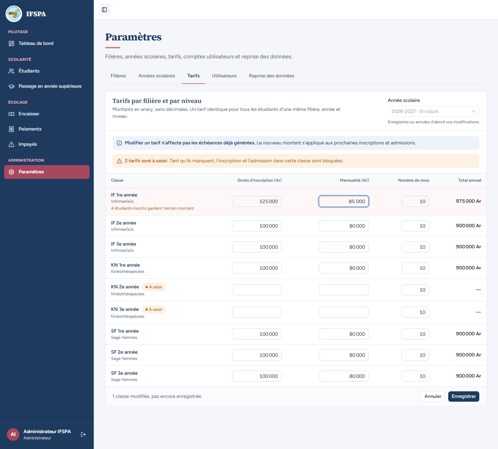
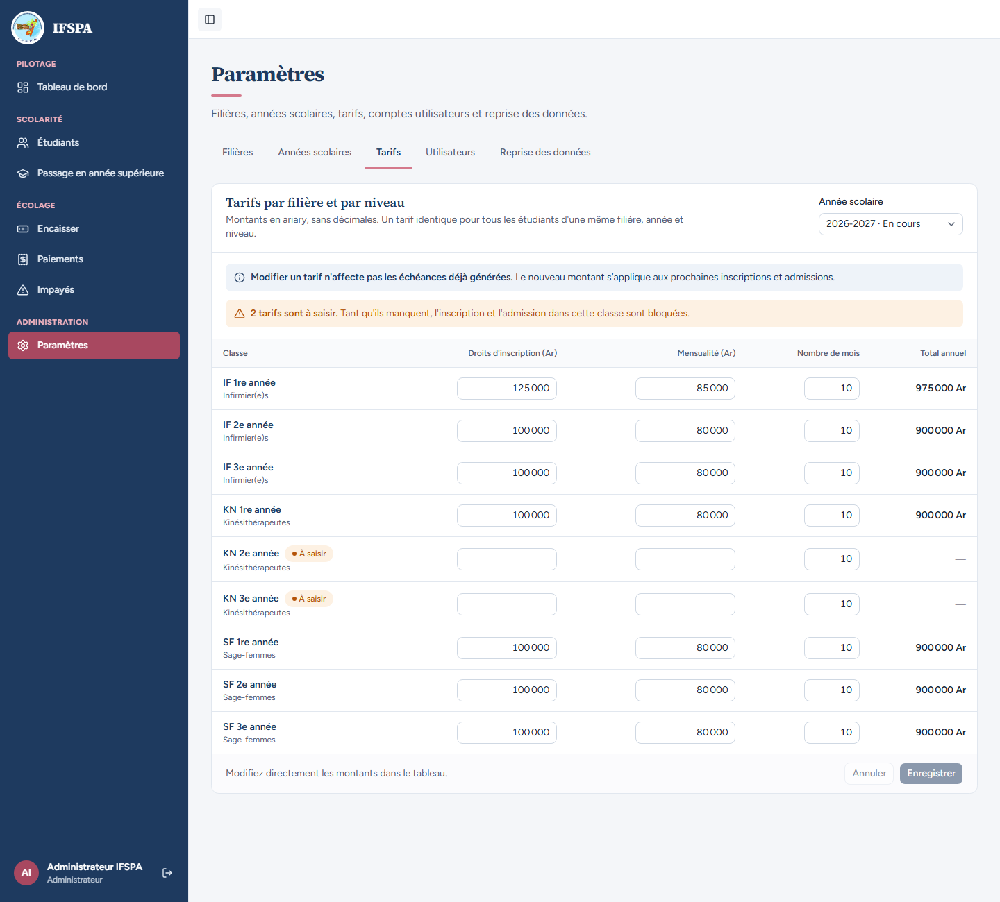
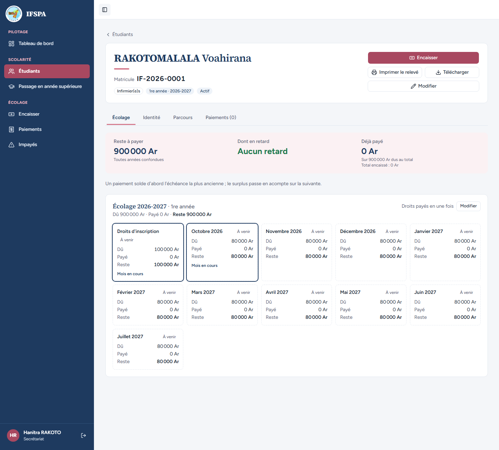
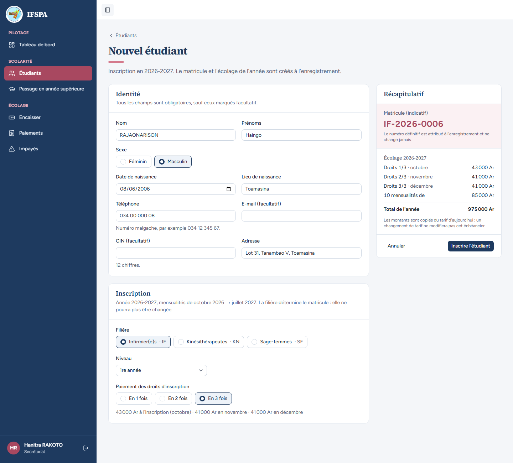
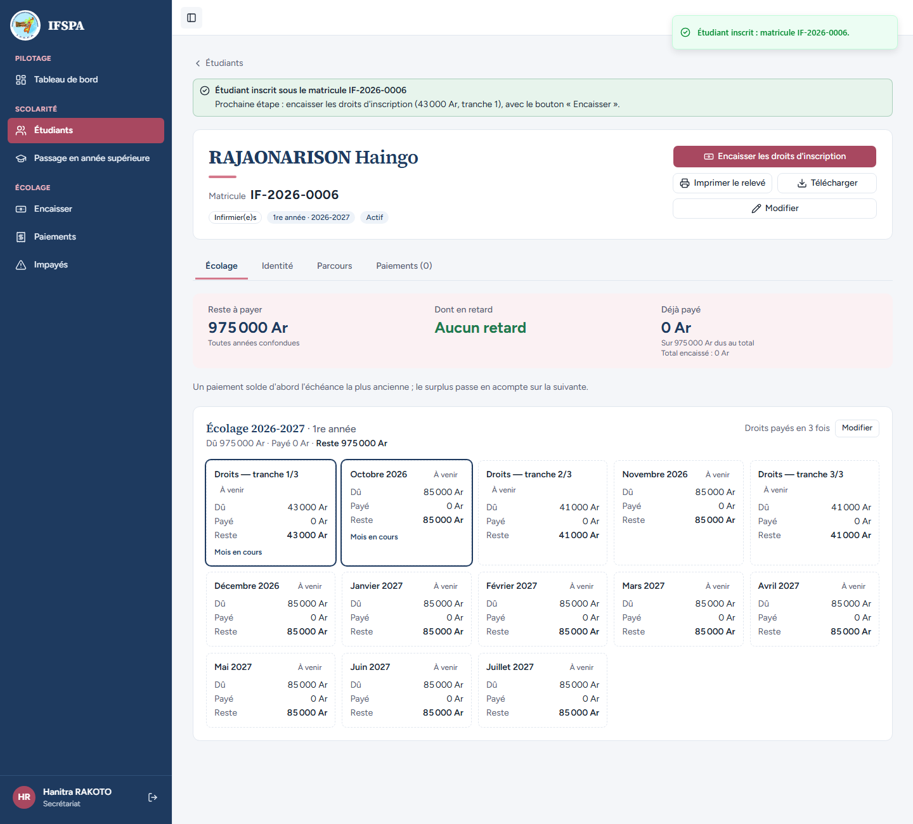
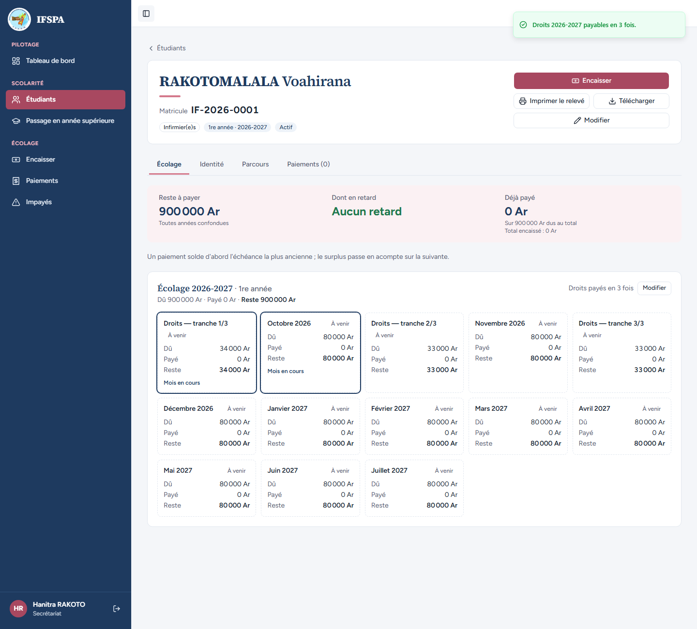

# UC04-10. Le tarif change : les inscrits gardent leur échéancier, le nouvel inscrit prend le nouveau

| | |
|---|---|
| Use case | UC04. Inscrire un nouvel étudiant (et UC02 pour les tarifs) |
| Règles couvertes | R-ECH (le montant est copié du tarif à l'inscription : un changement de tarif ne réécrit pas le passé), R-TRA (parts arrondies au millier, le reste sur la 1re tranche), R-MAT |
| Rôle | Administrateur (« Administrateur IFSPA ») pour le tarif ; secrétariat (« Hanitra RAKOTO ») pour les inscriptions |
| Durée estimée | 12 minutes |

## La situation

Le conseil de l'institut relève les tarifs d'Infirmier(e)s 1re année : 125 000 Ar de droits et 85 000 Ar par mois. L'administrateur modifie la grille. Les étudiants déjà inscrits (comme Voahirana RAKOTOMALALA) doivent continuer à payer 900 000 Ar ; le prochain inscrit, Haingo RAJAONARISON, paie 975 000 Ar, avec des droits en trois fois qui ne tombent pas juste : 43 000 + 41 000 + 41 000 Ar.

## Avant de commencer

- Mêmes préparatifs que [UC04-01](UC04-01-trois-inscriptions.md) (base fraîche, sans la préparation 00). Avoir déroulé UC04-01 à UC04-09 : quatre étudiants IF sont en 1re année (IF-2026-0001 à 0004), un en 2e année (IF-2026-0005) ; le matricule attendu pour le nouvel inscrit est **IF-2026-0006**. Ce cas **change le tarif IF 1re année** : pour le rejouer, repartir de `pnpm recette:base`.
- **Deux comptes**, dans deux fenêtres : l'administrateur (`SEED_ADMIN_*`) et le secrétariat (`SEED_USER_*`).

## Étapes

| # | Qui | Action | Résultat attendu | Capture | ✓ |
|---|---|---|---|---|---|
| 1 | Administrateur | Menu **Paramètres**, onglet **Tarifs** (année 2026-2027). Ligne **IF 1re année** : « Droits d'inscription » `125 000`, « Mensualité » `85 000`. | Bandeau « **Modifier un tarif n'affecte pas les échéances déjà générées.** Le nouveau montant s'applique aux prochaines inscriptions et admissions. » Sous la ligne : « 4 étudiants inscrits gardent l'ancien montant. » Total annuel de la ligne **975 000 Ar**. En bas : « 1 classe modifiée, pas encore enregistrée. » |  | |
| 2 | Administrateur | Cliquer **Enregistrer**, puis recharger la page. | Message « Tarifs 2026-2027 enregistrés. » Après rechargement : IF 1re année **125 000** / **85 000**, Total annuel **975 000 Ar** ; les autres classes restent à 900 000 Ar. |  | |
| 3 | Secrétariat | **Étudiants**, ouvrir **RAKOTOMALALA Voahirana** (IF-2026-0001). | **Rien n'a changé** : reste à payer **900 000 Ar** (« Sur 900 000 Ar dus au total »), « Droits d'inscription » 100 000 Ar, dix mensualités de 80 000 Ar (11 cartes). |  | |
| 4 | Secrétariat | **Nouvel étudiant** : `RAJAONARISON` Haingo, Masculin, `08/06/2006`, `Toamasina`, `034 00 000 08`, `Lot 31, Tanambao V, Toamasina`, **Infirmier(e)s · IF**, 1re année, **En 3 fois**. | Sous les boutons : « 43 000 Ar à l'inscription (octobre) · 41 000 Ar en novembre · 41 000 Ar en décembre ». Récapitulatif : matricule indicatif **IF-2026-0006** ; Droits 1/3 · octobre **43 000 Ar**, Droits 2/3 · novembre **41 000 Ar**, Droits 3/3 · décembre **41 000 Ar**, 10 mensualités de **85 000 Ar**, Total de l'année **975 000 Ar**. |  | |
| 5 | Secrétariat | Cliquer **Inscrire l'étudiant**. | Message « Étudiant inscrit : matricule IF-2026-0006. » Fiche : reste à payer **975 000 Ar** (« Sur 975 000 Ar dus au total »), 13 cartes : « Droits — tranche 1/3 » 43 000 Ar, « Droits — tranche 2/3 » 41 000 Ar, « Droits — tranche 3/3 » 41 000 Ar, dix mensualités de 85 000 Ar. |  | |
| 6 | Secrétariat | Rouvrir la fiche de **RAKOTOMALALA Voahirana**, cliquer **Modifier** (droits), **En 3 fois**, **Payer les droits en 3 fois**. | Message « Droits 2026-2027 payables en 3 fois. » Le découpage part de ses 100 000 Ar d'origine, pas du nouveau tarif : « Droits — tranche 1/3 » **34 000 Ar**, tranches 2/3 et 3/3 **33 000 Ar**. Reste à payer toujours 900 000 Ar. |  | |

## Ce que ce scénario ne couvre pas

- Le même constat par la base (échéances existantes inchangées, seules les suivantes copient le nouveau tarif) : couvert par Vitest, `tests/integration/actions-etudiants.test.ts` (« un changement de tarif ne réécrit pas les échéances existantes, seulement les suivantes », « 3 → 1 puis 1 → 2 : le total dû reste celui du tarif d'origine, même si le tarif a changé depuis »).
- Le passage en année supérieure après un changement de tarif (les échéances de l'année suivante prennent le tarif en vigueur) : voir UC10 (non couvert).
- Le tarif d'une année clôturée est en lecture seule : non déroulé ici (voir UC02).

## Dernière exécution par l'agent

- 17/10/2026 : ✅ 6 étapes sur 6. Voir [RAPPORT_2026-10-17_UC04](../../rapports/RAPPORT_2026-10-17_UC04.md).
- Parcours : [UC04-10-changement-de-tarif.recette.ts](../../parcours/UC04-10-changement-de-tarif.recette.ts).
