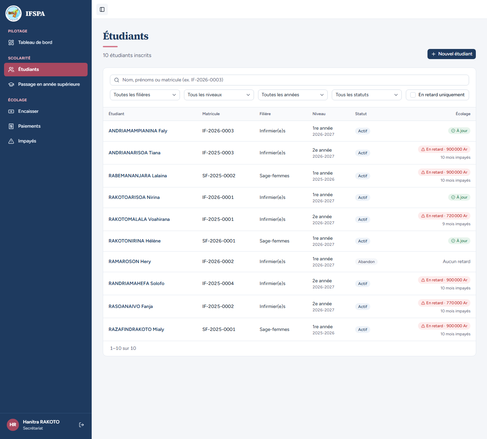
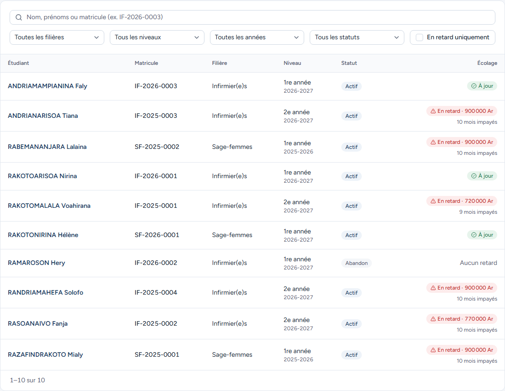
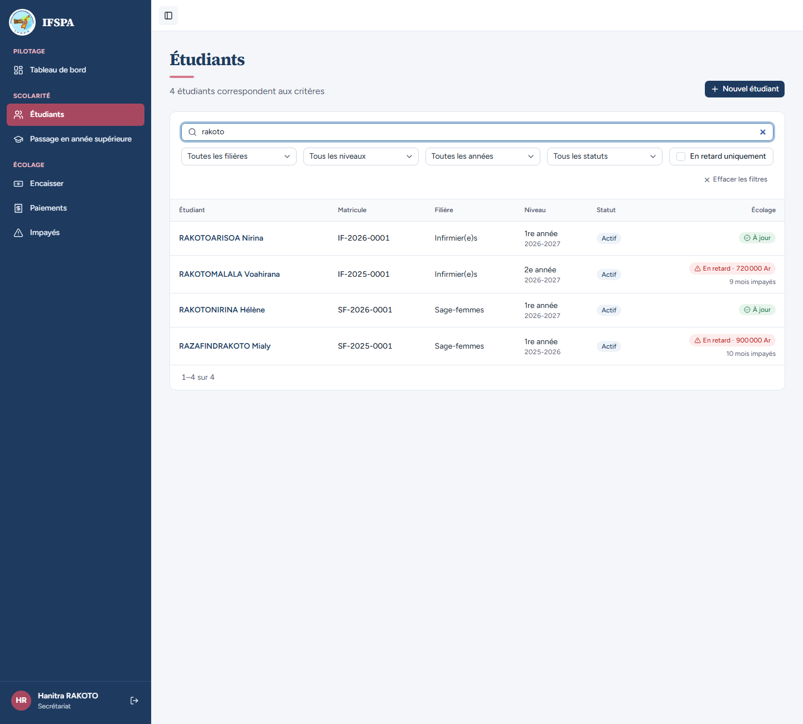
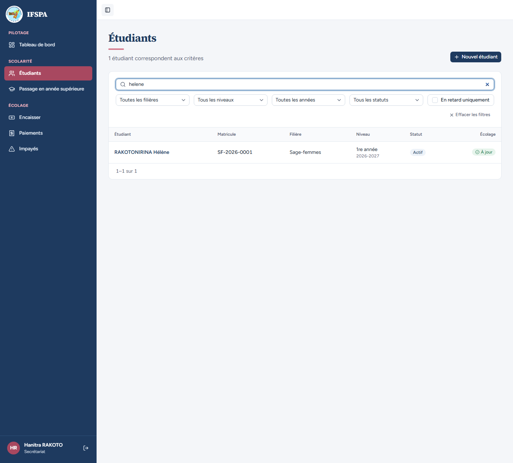
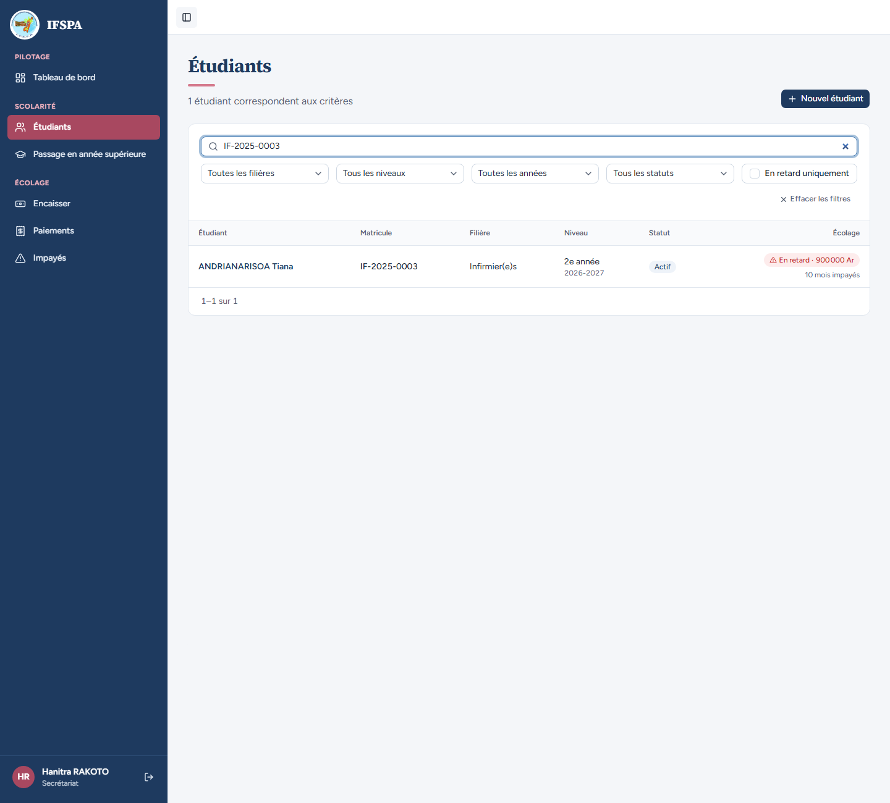
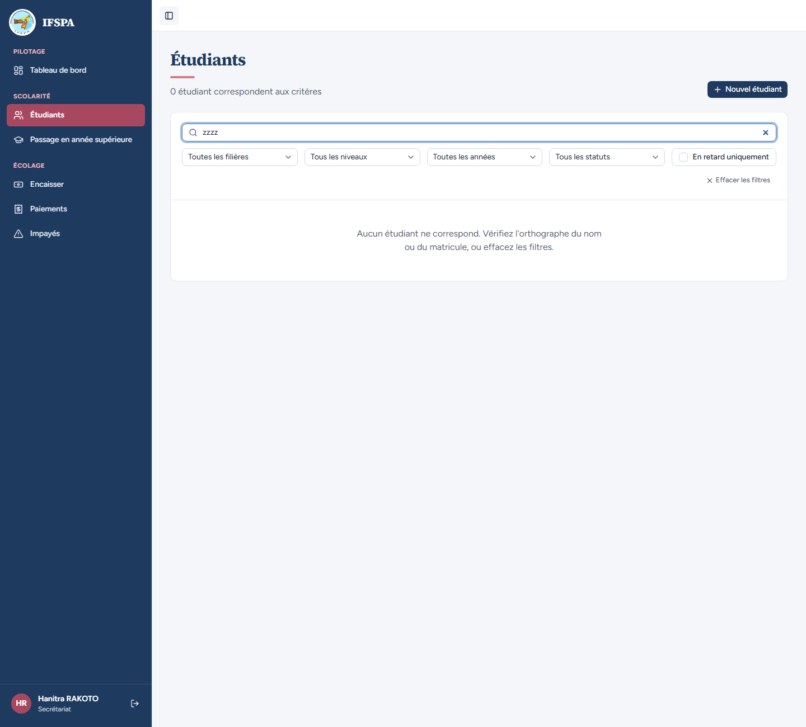

# UC05-01. Retrouver un étudiant par son nom, ses prénoms ou son matricule

| | |
|---|---|
| Use case | UC05. Retrouver un étudiant et lire sa situation |
| Règles couvertes | R-RET (la colonne « Écolage » : en retard, à jour), recherche sans accents, recherche reflétée dans l'adresse |
| Rôle | Secrétariat, compte « Hanitra RAKOTO » |
| Durée estimée | 8 minutes |

## La situation

Un parent se présente au secrétariat : « C'est pour Hélène, je ne me souviens plus de son nom de famille complet. » La secrétaire ouvre la liste des étudiants et tape ce qu'elle a : un prénom sans accent, un morceau de nom, ou le matricule lu sur un reçu. La liste se réduit, l'adresse de la page garde la recherche.

## Avant de commencer

1. `pnpm db:up`, `pnpm recette:base`, `pnpm build`, `pnpm recette:app`, puis ouvrir `http://localhost:3200`.
2. Avoir déroulé [00-PREPARATION.md](../00-PREPARATION.md), **sections A, B, C, G, H puis D**, puis [UC11-01](../UC11-sortie/UC11-01-abandon-nominal.md) (RAMAROSON Hery abandonne) : 10 étudiants.
3. Se connecter avec le compte **secrétariat** (identifiants `SEED_USER_*` de `.env`).

## Étapes

| # | Qui | Action | Résultat attendu | Capture | ✓ |
|---|---|---|---|---|---|
| 1 | Secrétariat | Menu **Étudiants**. | « **10 étudiants inscrits** », « 1–10 sur 10 ». Triés par nom : ANDRIAMAMPIANINA Faly, ANDRIANARISOA Tiana, RABEMANANJARA Lalaina, RAKOTOARISOA Nirina, RAKOTOMALALA Voahirana, RAKOTONIRINA Hélène, RAMAROSON Hery, RANDRIAMAHEFA Solofo, RASOANAIVO Fanja, RAZAFINDRAKOTO Mialy. Colonnes Étudiant, Matricule, Filière, Niveau, Statut, Écolage. |  | |
| 2 | Secrétariat | Lire les lignes. | RAKOTOMALALA Voahirana : IF-2025-0001, Infirmier(e)s, « 2e année » « 2026-2027 », « Actif », « En retard · 720 000 Ar », « 9 mois impayés ». RAKOTOARISOA Nirina : « À jour ». RAMAROSON Hery : « Abandon », « Aucun retard ». RAZAFINDRAKOTO Mialy : « 1re année » « 2025-2026 », « En retard · 900 000 Ar », « 10 mois impayés ». |  | |
| 3 | Secrétariat | Taper `rakoto` dans « Nom, prénoms ou matricule (ex. IF-2026-0003) ». | « **4 étudiants correspondent aux critères** » : RAKOTOARISOA Nirina, RAKOTOMALALA Voahirana, RAKOTONIRINA Hélène **et RAZAFINDRAKOTO Mialy** (la recherche porte sur un morceau du nom). L'adresse devient `/app/etudiants?q=rakoto`. |  | |
| 4 | Secrétariat | Remplacer par `helene` (sans accent), puis par `HÉLÈNE`. | Les deux fois, RAKOTONIRINA Hélène est la seule ligne (« 1 étudiant correspondent aux critères »). |  | |
| 5 | Secrétariat | Taper `voahirana`, puis `IF-2025-0003`, puis `SF-2026`. | `voahirana` : RAKOTOMALALA Voahirana. `IF-2025-0003` : ANDRIANARISOA Tiana. `SF-2026` (début de matricule) : RAKOTONIRINA Hélène. |  | |
| 6 | Secrétariat | Taper `rakoto voahirana`. | Un seul résultat : RAKOTOMALALA Voahirana (tous les mots doivent correspondre). | | |
| 7 | Secrétariat | Taper `zzzz`. | « **Aucun étudiant ne correspond. Vérifiez l'orthographe du nom ou du matricule, ou effacez les filtres.** » « 0 étudiant correspondent aux critères ». |  | |
| 8 | Secrétariat | Cliquer **Effacer les filtres**. | « 10 étudiants inscrits », champ vide, adresse `/app/etudiants` sans `?q=`. | | |
| 9 | Secrétariat | Ouvrir directement `http://localhost:3200/app/etudiants?q=rakoto`, cliquer RAKOTOMALALA Voahirana, puis revenir en arrière du navigateur. | À l'ouverture : champ rempli « rakoto », 4 résultats. Au retour : la même liste filtrée (champ « rakoto », 4 lignes). | | |

## Ce que ce scénario ne couvre pas

- **Pagination** (25 étudiants par page) : non démontrée à l'écran (10 étudiants seulement). Couverte par Vitest, `tests/integration/lectures-etudiants.test.ts` (« pagine par 25 : 26 étudiants donnent deux pages, une page trop haute est ramenée à la dernière »).
- La recherche sans accent et sans casse est aussi couverte par Vitest (même fichier, « recherche sans accent ni casse, par nom, prénoms ou matricule ; jokers LIKE traités littéralement »).
- Constat de l'agent (mineur) : le compteur dit « 1 étudiant **correspondent** aux critères » et « 0 étudiant correspondent » (verbe au pluriel avec un singulier).
- Ordinateur ici ; le téléphone est dans [UC05-07](UC05-07-telephone.md).

## Dernière exécution par l'agent

- 18/10/2026 : ✅ 9 étapes sur 9 (un constat mineur sur le libellé du compteur). Voir [RAPPORT_2026-10-18_UC05](../../rapports/RAPPORT_2026-10-18_UC05.md).
- Parcours : [UC05-01-liste-recherche.recette.ts](../../parcours/UC05-01-liste-recherche.recette.ts).
