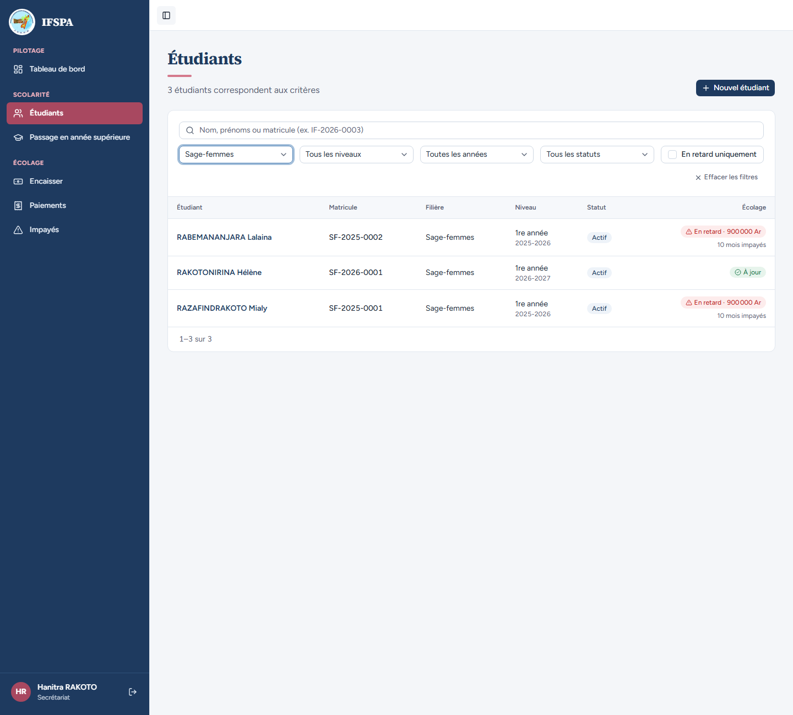
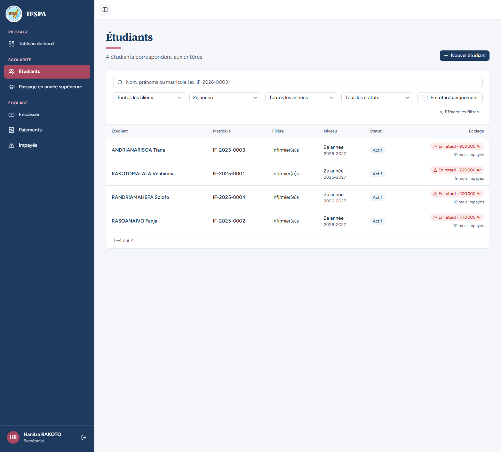
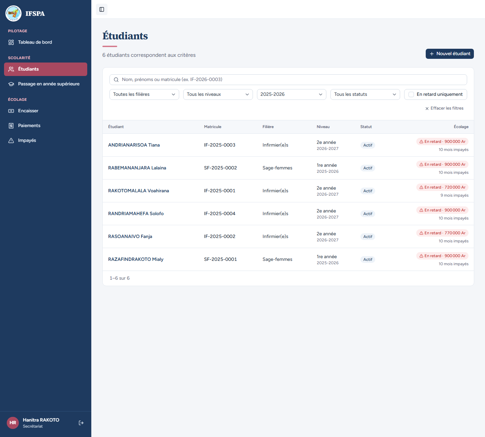
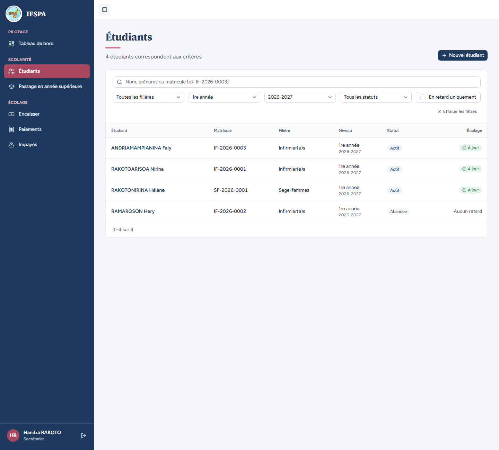
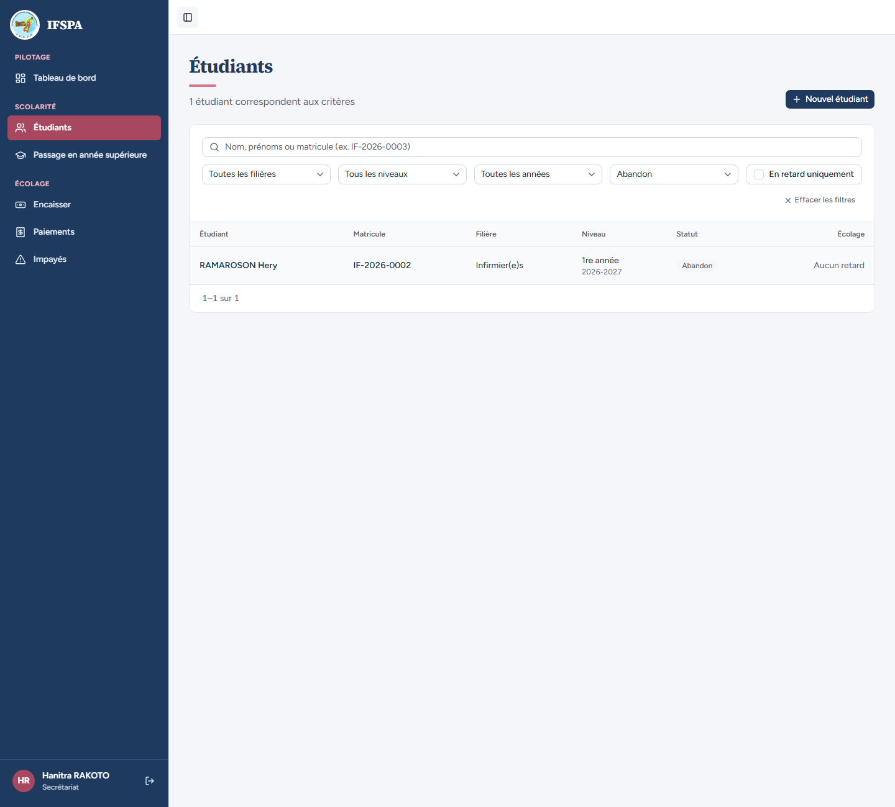
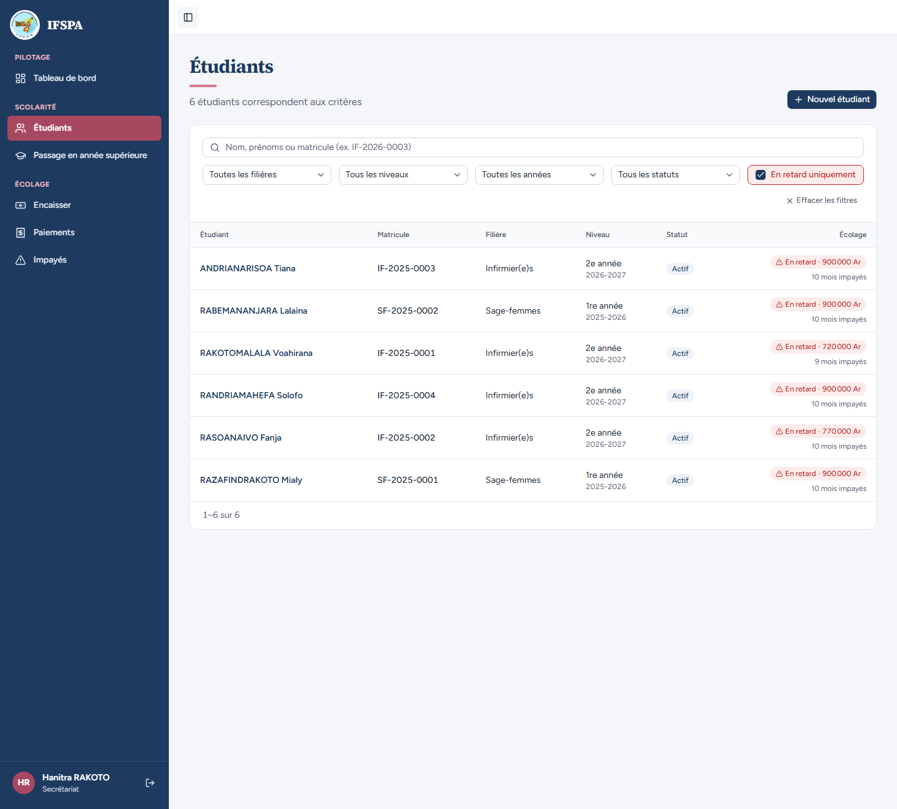
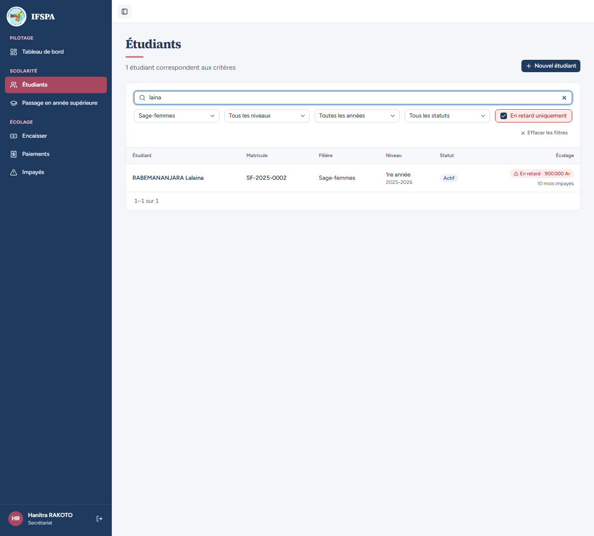

# UC05-02. Filtrer la liste par filière, niveau, année, statut et retard

| | |
|---|---|
| Use case | UC05. Retrouver un étudiant et lire sa situation |
| Règles couvertes | R-RET (filtre « En retard uniquement »), filtres reflétés dans l'adresse |
| Rôle | Secrétariat, compte « Hanitra RAKOTO » |
| Durée estimée | 8 minutes |

## La situation

La directrice demande à la secrétaire : « Combien de sages-femmes ? Qui est en 2e année ? Qui est en retard ? Qui a abandonné ? » La secrétaire répond avec les filtres de la liste, seuls ou combinés avec la recherche.

## Avant de commencer

1. `pnpm recette:base`, `pnpm build`, `pnpm recette:app`, puis ouvrir `http://localhost:3200`.
2. Mêmes données que [UC05-01](UC05-01-liste-recherche.md) : [00-PREPARATION.md](../00-PREPARATION.md) **sections A, B, C, G, H puis D**, puis [UC11-01](../UC11-sortie/UC11-01-abandon-nominal.md) (10 étudiants).
3. Se connecter avec le compte **secrétariat**.

## Étapes

| # | Qui | Action | Résultat attendu | Capture | ✓ |
|---|---|---|---|---|---|
| 1 | Secrétariat | Menu **Étudiants**, filtre **Filière** : « Sage-femmes ». | « 3 étudiants correspondent aux critères » : RABEMANANJARA Lalaina, RAKOTONIRINA Hélène, RAZAFINDRAKOTO Mialy. L'adresse contient `filiereId=`. |  | |
| 2 | Secrétariat | **Effacer les filtres**, filtre **Niveau** : « 2e année » (sans choisir d'année). | Les 4 étudiants passés en 2e année : ANDRIANARISOA Tiana, RAKOTOMALALA Voahirana, RANDRIAMAHEFA Solofo, RASOANAIVO Fanja (le niveau est celui de la dernière inscription). Adresse `niveau=2`. |  | |
| 3 | Secrétariat | **Effacer les filtres**, filtre **Année scolaire** : « 2025-2026 ». | 6 étudiants ont une inscription en 2025-2026 : ANDRIANARISOA Tiana, RABEMANANJARA Lalaina, RAKOTOMALALA Voahirana, RANDRIAMAHEFA Solofo, RASOANAIVO Fanja, RAZAFINDRAKOTO Mialy. Adresse `anneeId=`. |  | |
| 4 | Secrétariat | Choisir **Année scolaire** « 2026-2027 (courante) » : 8 étudiants. Ajouter **Niveau** « 2e année » : 4 étudiants (Tiana, Voahirana, Solofo, Fanja). Remplacer par « 1re année ». | Avec une année choisie, le niveau porte sur l'inscription de cette année-là. « 1re année » : ANDRIAMAMPIANINA Faly, RAKOTOARISOA Nirina, RAKOTONIRINA Hélène, RAMAROSON Hery (4 étudiants). |  | |
| 5 | Secrétariat | **Effacer les filtres**, filtre **Statut** : « Abandon ». Puis « Exclu ». Puis « Actif ». | « Abandon » : RAMAROSON Hery seul (adresse `statut=ABANDON`). « Exclu » : « Aucun étudiant ne correspond. Vérifiez l'orthographe du nom ou du matricule, ou effacez les filtres. » « Actif » : 9 étudiants. |  | |
| 6 | Secrétariat | **Effacer les filtres**, cocher **En retard uniquement**. | 6 étudiants : ANDRIANARISOA Tiana, RABEMANANJARA Lalaina, RAKOTOMALALA Voahirana, RANDRIAMAHEFA Solofo, RASOANAIVO Fanja, RAZAFINDRAKOTO Mialy. RAKOTOARISOA Nirina (à jour) n'y est pas. Adresse `enRetard=1`, la case est en rouge. |  | |
| 7 | Secrétariat | Ajouter la filière « Sage-femmes », puis taper `laina` dans la recherche. | Filière + retard : RABEMANANJARA Lalaina, RAZAFINDRAKOTO Mialy. Avec `laina` : RABEMANANJARA Lalaina seule. L'adresse porte `q=laina`, `enRetard=1` et `filiereId=`. |  | |
| 8 | Secrétariat | Recharger la page, puis **Effacer les filtres**. | Après rechargement : champ `laina`, case cochée, même ligne. Après « Effacer » : « 10 étudiants inscrits », case décochée. | | |

## Ce que ce scénario ne couvre pas

- Le passage au retard le 1er du mois M+1 pour le filtre « En retard » : couvert par Vitest, `tests/integration/lectures-etudiants.test.ts` (« la limite : octobre est « à venir » le 31/10 et « en retard » le 1er novembre »). Non démontré à l'écran (date du jour).
- Un étudiant sorti qui garde un retard dans le filtre « En retard » : couvert par Vitest, `tests/integration/actions-sorties.test.ts` (« liste des Étudiants : reste dû et retard sans les mois non dus, filtre « en retard » levé une fois l'échu payé »).
- Ordinateur seulement.

## Dernière exécution par l'agent

- 18/10/2026 : ✅ 8 étapes sur 8. Voir [RAPPORT_2026-10-18_UC05](../../rapports/RAPPORT_2026-10-18_UC05.md).
- Parcours : [UC05-02-filtres.recette.ts](../../parcours/UC05-02-filtres.recette.ts).
