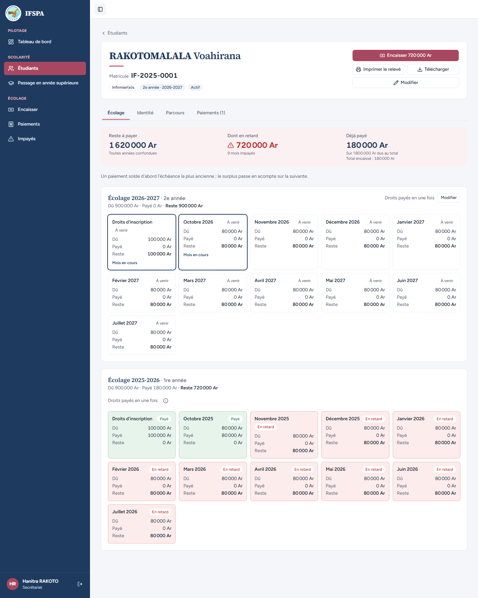
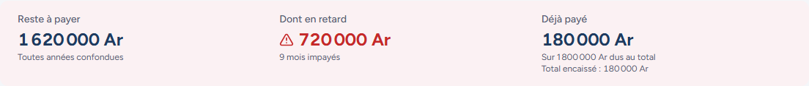
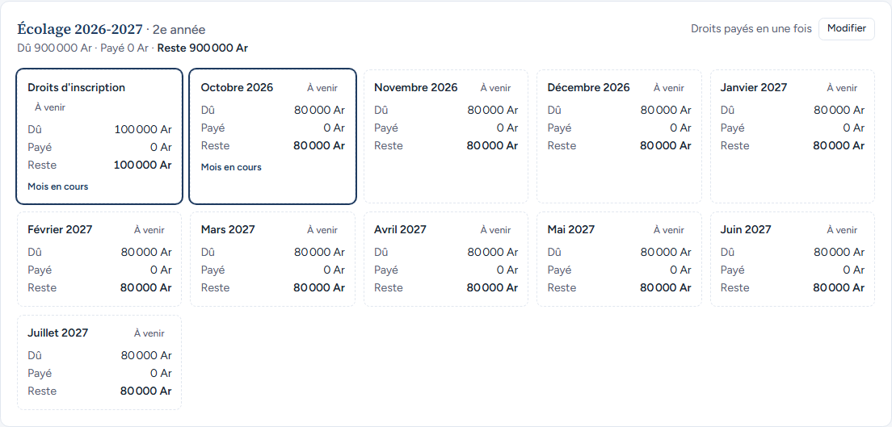
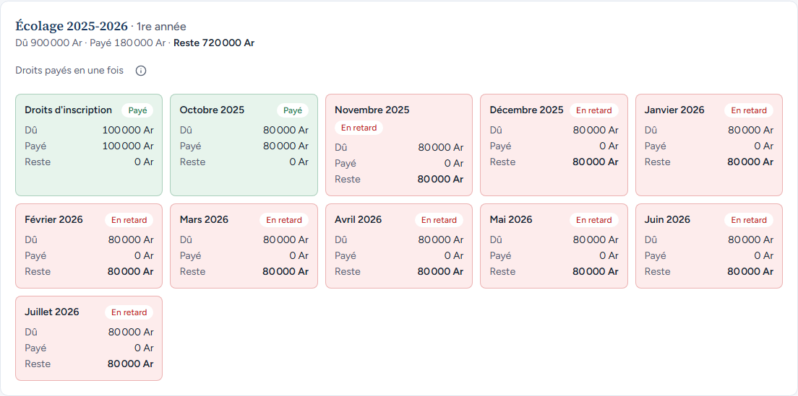
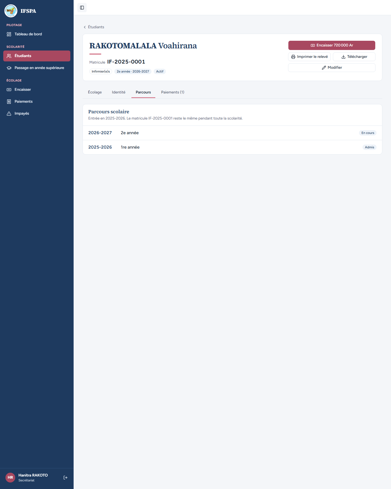
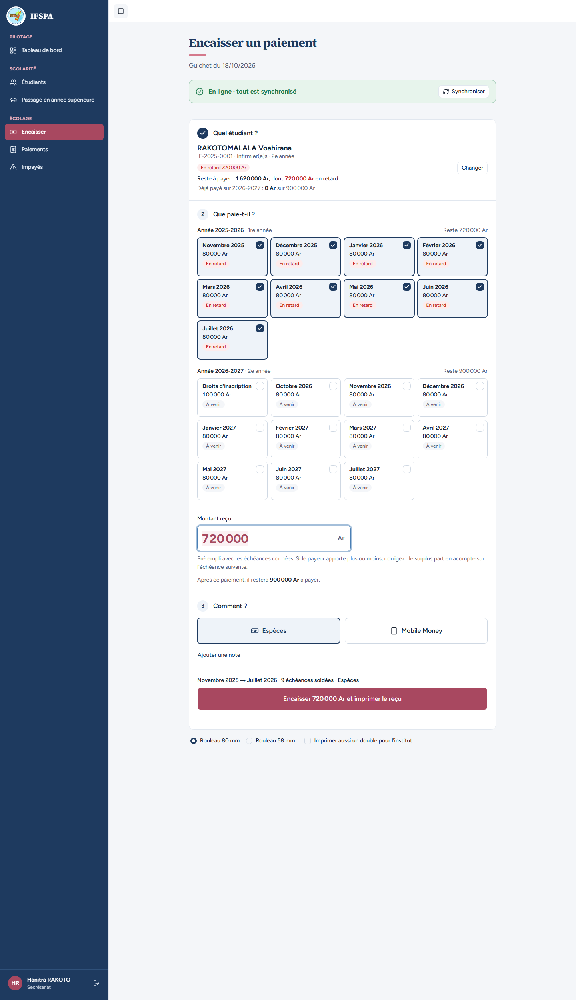

# UC05-03. Lire la situation d'un étudiant qui a deux années à suivre

| | |
|---|---|
| Use case | UC05. Retrouver un étudiant et lire sa situation |
| Règles couvertes | R-RET (payé, en retard, à venir, mois en cours), R-REP (« un paiement solde d'abord l'échéance la plus ancienne »), « chaque année est suivie pour elle-même » |
| Rôle | Secrétariat, compte « Hanitra RAKOTO » |
| Durée estimée | 8 minutes |

## La situation

La mère de RAKOTOMALALA Voahirana demande : « Combien reste-t-il à payer, et pour quels mois ? » La secrétaire ouvre la fiche : Voahirana a fini sa 1re année avec 720 000 Ar impayés, et commence sa 2e année. La fiche montre, année par année, ce qui est payé, en retard ou à venir, et le total des deux années.

## Avant de commencer

1. `pnpm recette:base`, `pnpm build`, `pnpm recette:app`, puis ouvrir `http://localhost:3200`.
2. Avoir déroulé [00-PREPARATION.md](../00-PREPARATION.md) **sections A, B, C, G, H puis D** (Voahirana a payé 180 000 Ar le reçu R-2026-00021, puis passe en 2e année), puis [UC11-01](../UC11-sortie/UC11-01-abandon-nominal.md).
3. Se connecter avec le compte **secrétariat**.

## Étapes

| # | Qui | Action | Résultat attendu | Capture | ✓ |
|---|---|---|---|---|---|
| 1 | Secrétariat | Menu **Étudiants**, cliquer RAKOTOMALALA Voahirana. | Fiche : « RAKOTOMALALA Voahirana », « Matricule IF-2025-0001 », badges « Infirmier(e)s », « 2e année · 2026-2027 », « Actif ». Boutons « **Encaisser 720 000 Ar** », « Imprimer le relevé », « Télécharger », « Modifier ». **Pas de « Enregistrer une sortie »** (réservé à l'administrateur). Quatre onglets : Écolage, Identité, Parcours, Paiements (1). |  | |
| 2 | Secrétariat | Onglet **Écolage** (ouvert par défaut) : lire le résumé. | « Reste à payer **1 620 000 Ar** » (« Toutes années confondues »), « Dont en retard **720 000 Ar** » (« 9 mois impayés »), « Déjà payé **180 000 Ar** » (« Sur 1 800 000 Ar dus au total », « Total encaissé : 180 000 Ar »). Phrase « Un paiement solde d'abord l'échéance la plus ancienne ; le surplus passe en acompte sur la suivante. » |  | |
| 3 | Secrétariat | Lire la première grille. | Deux grilles, la plus récente d'abord. « Écolage 2026-2027 · 2e année », « Dû 900 000 Ar · Payé 0 Ar · Reste 900 000 Ar » : les 11 échéances (droits et 10 mensualités) sont « À venir » ; « Octobre 2026 » porte « Mois en cours ». |  | |
| 4 | Secrétariat | Lire la seconde grille. | « Écolage 2025-2026 · 1re année », « Dû 900 000 Ar · Payé 180 000 Ar · Reste 720 000 Ar » : « Droits d'inscription » et « Octobre 2025 » « Payé » ; de « Novembre 2025 » à « Juillet 2026 », 9 cartes « En retard ». |  | |
| 5 | Secrétariat | Onglet **Parcours**. | « Entrée en 2025-2026. Le matricule IF-2025-0001 reste le même pendant toute la scolarité. » Une ligne par année : « 2026-2027 · 2e année · En cours », « 2025-2026 · 1re année · Admis ». |  | |
| 6 | Secrétariat | Cliquer **Télécharger**, puis **Imprimer le relevé**. | Téléchargement du fichier `releve-IF-2025-0001.pdf` ; « Imprimer le relevé » charge le PDF (la boîte d'impression réelle n'est pas observable). Contenu du relevé : [UC09](../UC09-releve/UC09-01-releve-fanja.md). | | |
| 7 | Secrétariat | Revenir à l'onglet Écolage, cliquer **Encaisser 720 000 Ar**. | L'écran Encaisser s'ouvre sur « RAKOTOMALALA Voahirana » : « Reste à payer : 1 620 000 Ar, dont 720 000 Ar en retard » ; les 9 mois en retard (novembre 2025 à juillet 2026) sont cochés d'office, 2026-2027 n'est pas coché ; montant prérempli 720 000 Ar. |  | |

## Ce que ce scénario ne couvre pas

- Le contenu du relevé PDF et sa boîte d'impression réelle : [UC09](../UC09-releve/UC09-01-releve-fanja.md) ; boîte d'impression : non démontré.
- Les lectures de la fiche (situation à la date du jour, deux années additionnées) sont aussi couvertes par Vitest, `tests/integration/lectures-etudiants.test.ts` (« deux années : chacune suivie pour elle-même, la situation générale les additionne »).
- Ordinateur ici ; le téléphone est dans [UC05-07](UC05-07-telephone.md).

## Dernière exécution par l'agent

- 18/10/2026 : ✅ 7 étapes sur 7. Voir [RAPPORT_2026-10-18_UC05](../../rapports/RAPPORT_2026-10-18_UC05.md).
- Parcours : [UC05-03-fiche-situation.recette.ts](../../parcours/UC05-03-fiche-situation.recette.ts).
