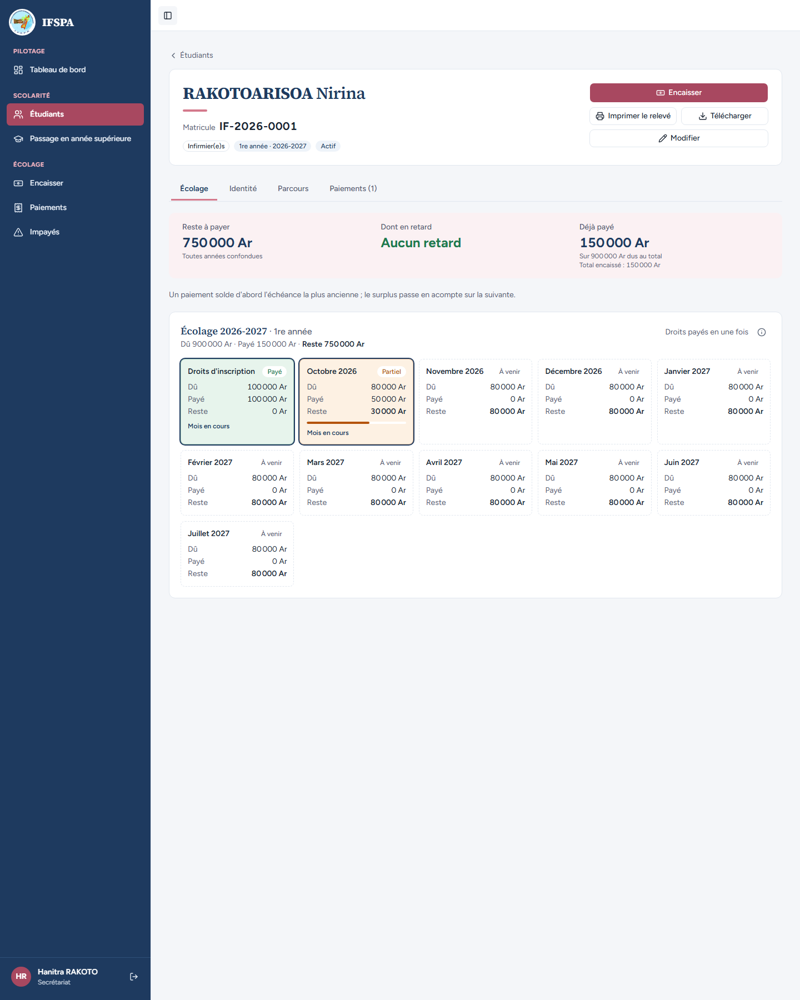
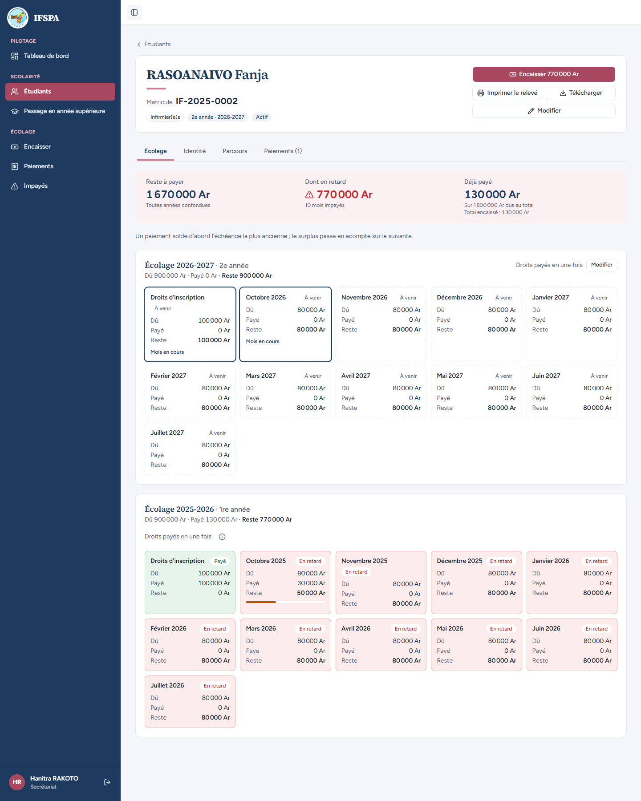

# UC05-04. Un acompte se lit sur la fiche : « Partiel » dans le mois en cours, « En retard » sur un mois échu

| | |
|---|---|
| Use case | UC05. Retrouver un étudiant et lire sa situation |
| Règles couvertes | R-RET (en retard à partir du 1er du mois M+1 : un mois échu avec acompte reste « En retard », un mois en cours avec acompte est « Partiel »), R-PAR |
| Rôle | Secrétariat, compte « Hanitra RAKOTO » |
| Durée estimée | 4 minutes |

## La situation

Deux familles ont versé un peu plus que les droits. La famille de RAKOTOARISOA Nirina (année en cours) a versé 150 000 Ar : octobre, le mois en cours, est partiellement payé. La famille de RASOANAIVO Fanja (année précédente) a versé 130 000 Ar : octobre 2025, déjà échu, a reçu 30 000 Ar mais reste en retard. La secrétaire lit les deux situations.

## Avant de commencer

1. `pnpm recette:base`, `pnpm build`, `pnpm recette:app`, puis ouvrir `http://localhost:3200`.
2. Avoir déroulé [00-PREPARATION.md](../00-PREPARATION.md) **sections A, B, C, G (reçus R-2026-00022 pour Fanja et R-2026-00023 pour Nirina), H puis D**.
3. Se connecter avec le compte **secrétariat**.

## Étapes

| # | Qui | Action | Résultat attendu | Capture | ✓ |
|---|---|---|---|---|---|
| 1 | Secrétariat | Menu **Étudiants**, chercher `IF-2026-0001`, ouvrir RAKOTOARISOA Nirina. | « Reste à payer **750 000 Ar** », « Aucun retard », « Déjà payé 150 000 Ar ». Grille « Écolage 2026-2027 · 1re année » : « Droits d'inscription » **Payé** ; « Octobre 2026 » **Partiel**, « Payé 50 000 Ar », « Reste 30 000 Ar », barre de progression et « Mois en cours » ; « Novembre 2026 » « À venir ». |  | |
| 2 | Secrétariat | Chercher `IF-2025-0002`, ouvrir RASOANAIVO Fanja. | « Reste à payer **1 670 000 Ar** » (770 000 Ar de 2025-2026 + 900 000 Ar de 2026-2027), « Dont en retard 770 000 Ar », « 10 mois impayés ». Grille « Écolage 2025-2026 · 1re année » : droits « Payé » ; « Octobre 2025 » **« En retard »** (et non « Partiel »), « Payé 30 000 Ar », « Reste 50 000 Ar ». |  | |

## Ce que ce scénario ne couvre pas

- Le passage de « Partiel » à « En retard » au 1er du mois suivant : couvert par Vitest, `tests/integration/lectures-etudiants.test.ts` (« un acompte sur un mois non échu ne met pas en retard ; échu et non soldé, si ») ; non démontré à l'écran (date du jour). La règle est aussi montrée sur le relevé : [UC09-02](../UC09-releve/UC09-02-releve-nirina.md).
- Ordinateur seulement.

## Dernière exécution par l'agent

- 18/10/2026 : ✅ 2 étapes sur 2. Voir [RAPPORT_2026-10-18_UC05](../../rapports/RAPPORT_2026-10-18_UC05.md).
- Parcours : [UC05-04-fiche-partiel.recette.ts](../../parcours/UC05-04-fiche-partiel.recette.ts).
