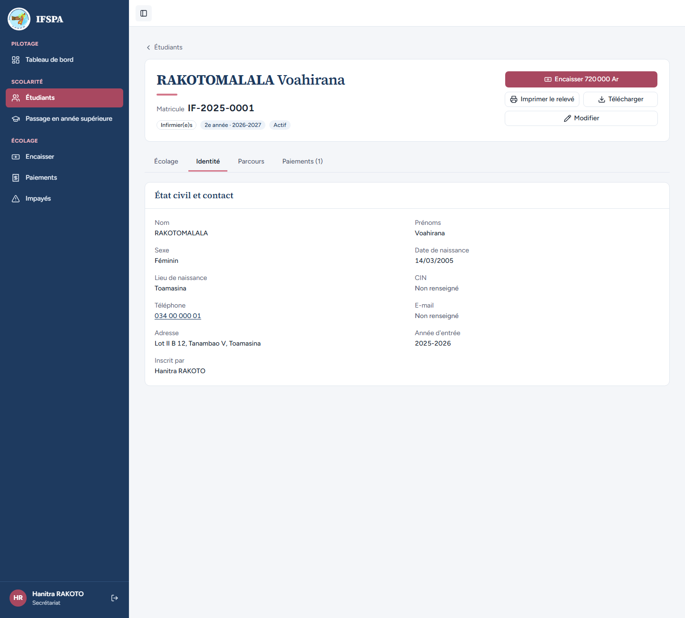
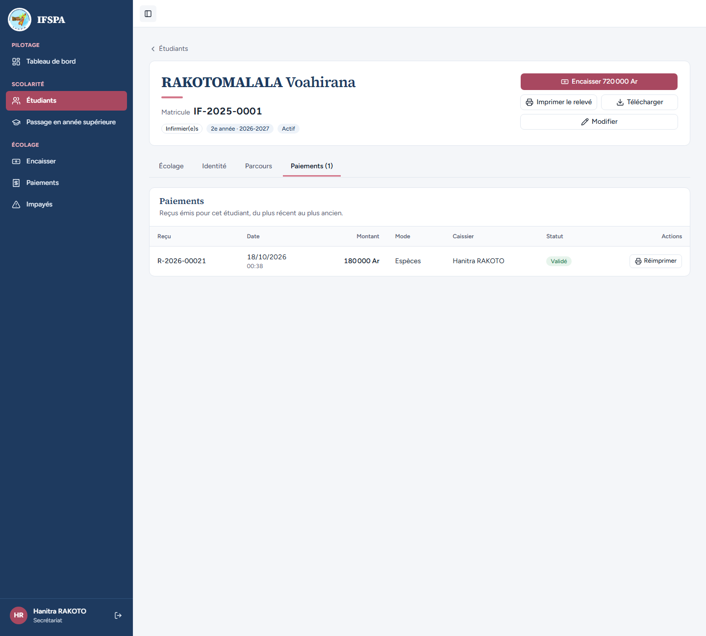
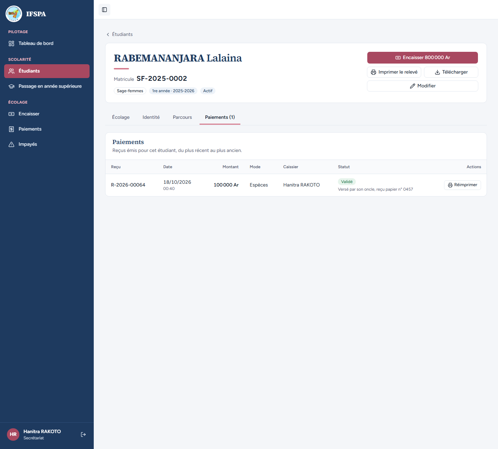
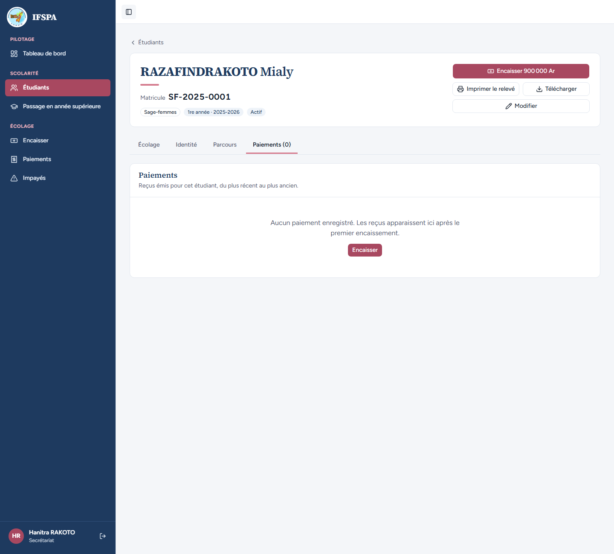

# UC05-05. Identité, contact et historique des paiements, avec la note du guichet

| | |
|---|---|
| Use case | UC05. Retrouver un étudiant et lire sa situation |
| Règles couvertes | Fiche (onglets Identité et Paiements), observation du paiement visible (décision provisoire n° 62), R-RECU (réimpression depuis la fiche) |
| Rôle | Secrétariat, compte « Hanitra RAKOTO » |
| Durée estimée | 7 minutes |

## La situation

La secrétaire doit rappeler la famille de Voahirana : elle lit son téléphone dans l'onglet Identité. Puis un oncle de RABEMANANJARA Lalaina verse 100 000 Ar de droits ; la secrétaire note « reçu papier n° 0457 » dans le champ note du guichet. Plus tard, la note se retrouve dans l'historique des paiements de la fiche.

## Avant de commencer

1. `pnpm recette:base`, `pnpm build`, `pnpm recette:app`, puis ouvrir `http://localhost:3200`.
2. Avoir déroulé [00-PREPARATION.md](../00-PREPARATION.md) **sections A, B, C, G, H puis D**, puis [UC05-01](UC05-01-liste-recherche.md) à [UC05-04](UC05-04-fiche-partiel.md) (ce cas ajoute un paiement à Lalaina : à dérouler après les cas qui montrent les montants de la liste).
3. Se connecter avec le compte **secrétariat**.

## Étapes

| # | Qui | Action | Résultat attendu | Capture | ✓ |
|---|---|---|---|---|---|
| 1 | Secrétariat | Menu **Étudiants**, ouvrir RAKOTOMALALA Voahirana (`IF-2025-0001`), onglet **Identité**. | Panneau « État civil et contact » : Nom « RAKOTOMALALA », Prénoms « Voahirana », Sexe « Féminin », Date de naissance « 14/03/2005 », Lieu de naissance « Toamasina », CIN et E-mail « Non renseigné », Téléphone « 034 00 000 01 » (lien d'appel `tel:0340000001`), Adresse « Lot II B 12, Tanambao V, Toamasina », Année d'entrée « 2025-2026 », Inscrit par « Hanitra RAKOTO ». |  | |
| 2 | Secrétariat | Onglet **Paiements (1)**. | « Reçus émis pour cet étudiant, du plus récent au plus ancien. » Une ligne : « R-2026-00021 », « 180 000 Ar », « Espèces », caissier « Hanitra RAKOTO », « Validé », bouton « Réimprimer ». |  | |
| 3 | Secrétariat | Menu **Encaisser**, chercher `RABEMANANJARA`, Entrée, saisir `100000` dans « Montant reçu », cliquer **Ajouter une note**, saisir `Versé par son oncle, reçu papier n° 0457` dans « Note (facultatif) », cliquer **Encaisser 100 000 Ar et imprimer le reçu**. | « Paiement enregistré : reçu R-2026-… » (**R-2026-00064** sur une base fraîche après les cas précédents ; lire le numéro à l'écran). | | |
| 4 | Secrétariat | Menu **Étudiants**, ouvrir RABEMANANJARA Lalaina (`SF-2025-0002`), onglet **Paiements (1)**. | La ligne du reçu : « 100 000 Ar », « Espèces », « Validé », et sous le statut, en petit, la note « **Versé par son oncle, reçu papier n° 0457** ». Bouton « Encaisser 800 000 Ar » en tête de fiche. |  | |
| 5 | Secrétariat | Ouvrir RAZAFINDRAKOTO Mialy (`SF-2025-0001`), onglet **Paiements (0)**. | « Aucun paiement enregistré. Les reçus apparaissent ici après le premier encaissement. » et un bouton « Encaisser ». |  | |

## Ce que ce scénario ne couvre pas

- Un reçu annulé, un reçu « à vérifier » dans l'historique de la fiche : [UC07](../UC07-paiements/UC07-02-annulation-motif.md) et [UC07-05](../UC07-paiements/UC07-05-a-verifier.md).
- Le ticket réimprimé : [UC06-08](../UC06-encaisser/UC06-08-ticket-80-58-double.md) et [UC07](../UC07-paiements/UC07-01-controle-journee.md).
- La note n'est pas imprimée sur le ticket (décision provisoire n° 62).
- Ordinateur ici ; le téléphone est dans [UC05-07](UC05-07-telephone.md).

## Dernière exécution par l'agent

- 18/10/2026 : ✅ 5 étapes sur 5. Voir [RAPPORT_2026-10-18_UC05](../../rapports/RAPPORT_2026-10-18_UC05.md).
- Parcours : [UC05-05-identite-paiements.recette.ts](../../parcours/UC05-05-identite-paiements.recette.ts).
