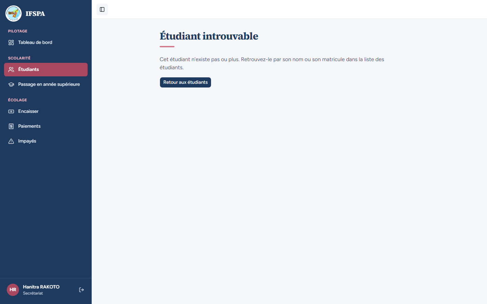

# UC05-06. Une adresse d'étudiant qui n'existe pas affiche la page « Étudiant introuvable »

| | |
|---|---|
| Use case | UC05. Retrouver un étudiant et lire sa situation |
| Règles couvertes | Page introuvable de l'espace Étudiants |
| Rôle | Secrétariat, compte « Hanitra RAKOTO » |
| Durée estimée | 2 minutes |

## La situation

Un lien envoyé par message, ou un favori, pointe vers une fiche qui n'existe plus ou dont l'adresse est mal recopiée. La secrétaire voit une page claire qui l'invite à retrouver l'étudiant dans la liste.

## Avant de commencer

1. `pnpm recette:base`, `pnpm build`, `pnpm recette:app`, puis ouvrir `http://localhost:3200`.
2. Aucune donnée particulière (utilisable dès la base fraîche, après connexion).
3. Se connecter avec le compte **secrétariat**.

## Étapes

| # | Qui | Action | Résultat attendu | Capture | ✓ |
|---|---|---|---|---|---|
| 1 | Secrétariat | Ouvrir `http://localhost:3200/app/etudiants/etudiant-qui-n-existe-pas`. | Titre « **Étudiant introuvable** », « Cet étudiant n'existe pas ou plus. Retrouvez-le par son nom ou son matricule dans la liste des étudiants. » et le bouton « Retour aux étudiants ». Le cadre de l'application est conservé (« Hanitra RAKOTO » en bas de la barre latérale). |  | |
| 2 | Secrétariat | Cliquer **Retour aux étudiants**. | La liste « Étudiants ». | | |
| 3 | Secrétariat | Ouvrir `http://localhost:3200/app/etudiants/etudiant-qui-n-existe-pas/modifier`. | Même page « Étudiant introuvable ». | | |

## Ce que ce scénario ne couvre pas

- Le code HTTP de la page : la réponse arrive en **200** (et non 404) parce que l'écran de chargement est envoyé avant la recherche de l'étudiant ; sans conséquence pour un espace connecté non indexé, noté dans le rapport.
- Une fiche d'un étudiant réel mais sans session : redirection vers la connexion (UC01, non recetté).
- Ordinateur seulement.

## Dernière exécution par l'agent

- 18/10/2026 : ✅ 3 étapes sur 3. Voir [RAPPORT_2026-10-18_UC05](../../rapports/RAPPORT_2026-10-18_UC05.md).
- Parcours : [UC05-06-introuvable.recette.ts](../../parcours/UC05-06-introuvable.recette.ts).
