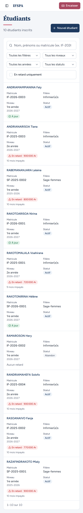
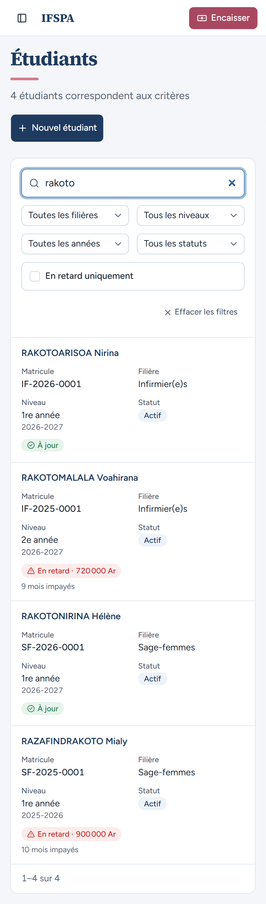
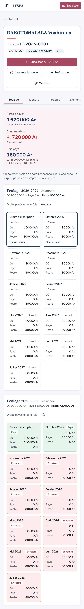
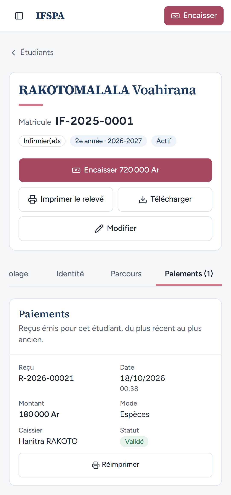

# UC05-07. La liste et la fiche d'un étudiant sur téléphone

| | |
|---|---|
| Use case | UC05. Retrouver un étudiant et lire sa situation |
| Règles couvertes | R-RET (lecture de la situation), écran adapté au téléphone (cibles tactiles de 44 px au moins) |
| Rôle | Secrétariat, compte « Hanitra RAKOTO » |
| Durée estimée | 5 minutes |

## La situation

La secrétaire, debout au guichet avec son téléphone, cherche un étudiant dont le parent est en face d'elle et lit sa situation sans ordinateur.

## Avant de commencer

1. `pnpm recette:base`, `pnpm build`, `pnpm recette:app`, puis ouvrir `http://localhost:3200` **sur un téléphone** (ou dans les outils du navigateur, mode téléphone, par exemple Pixel 7, 412 px de large).
2. Mêmes données que [UC05-01](UC05-01-liste-recherche.md) : [00-PREPARATION.md](../00-PREPARATION.md) **sections A, B, C, G, H puis D**, puis [UC11-01](../UC11-sortie/UC11-01-abandon-nominal.md).
3. Se connecter avec le compte **secrétariat**.

## Étapes

| # | Qui | Action | Résultat attendu | Capture | ✓ |
|---|---|---|---|---|---|
| 1 | Secrétariat | Menu (icône à gauche), **Étudiants**. | « 10 étudiants inscrits », une carte par étudiant (Matricule, Filière, Niveau, Statut, situation d'écolage). |  | |
| 2 | Secrétariat | Taper `rakoto` dans la recherche. | « 4 étudiants correspondent aux critères », 4 cartes ; le champ de recherche fait 44 px de haut au moins. |  | |
| 3 | Secrétariat | Toucher RAKOTOMALALA Voahirana. | Fiche : nom, « Matricule IF-2025-0001 », badges, boutons pleine largeur « Encaisser 720 000 Ar », « Imprimer le relevé », « Télécharger », « Modifier » (44 px de haut au moins). Résumé « Reste à payer 1 620 000 Ar », « Dont en retard 720 000 Ar », « Déjà payé 180 000 Ar », puis les deux grilles d'échéances en deux colonnes. Le bouton « Encaisser » est aussi dans la barre du haut. |  | |
| 4 | Secrétariat | Toucher les onglets **Identité**, **Parcours**, **Paiements (1)**. | Chaque onglet fait 44 px de haut au moins ; la page ne défile jamais horizontalement. Les onglets défilent horizontalement dans leur barre (l'onglet « Écolage » est partiellement masqué quand « Paiements » est ouvert). Paiements (1) : le reçu R-2026-00021, « 180 000 Ar », « Espèces », « Hanitra RAKOTO », « Validé », bouton « Réimprimer » pleine largeur. |  | |

## Ce que ce scénario ne couvre pas

- Le guichet sur téléphone est couvert par UC06 (écran Encaisser).
- Constat de l'agent (mineur) : à 412 px, la barre d'onglets est plus large que l'écran, le quatrième onglet est tronqué à l'ouverture de la fiche (« Paiement… ») ; il reste accessible en faisant défiler la barre.
- Appareil réel : non démontré (émulation Pixel 7).

## Dernière exécution par l'agent

- 18/10/2026 : ✅ 4 étapes sur 4 (projet `mobile`, captures suffixées `-mobile`). Voir [RAPPORT_2026-10-18_UC05](../../rapports/RAPPORT_2026-10-18_UC05.md).
- Parcours : [UC05-07-telephone.recette.ts](../../parcours/UC05-07-telephone.recette.ts) (à lancer avec `--project mobile`).
