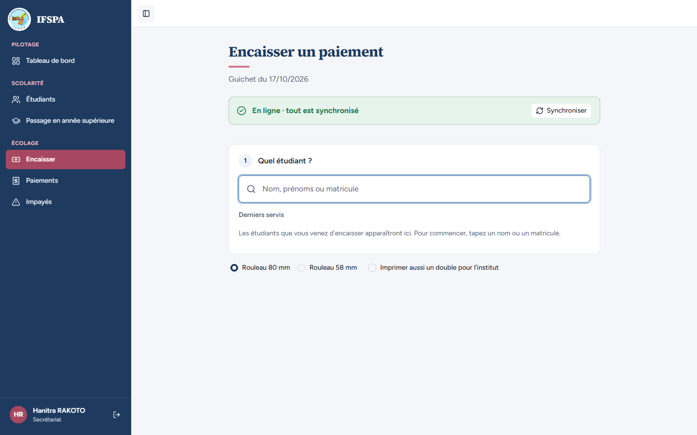
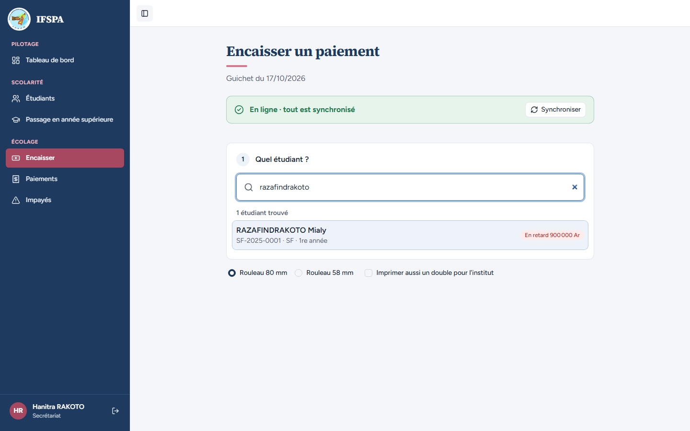
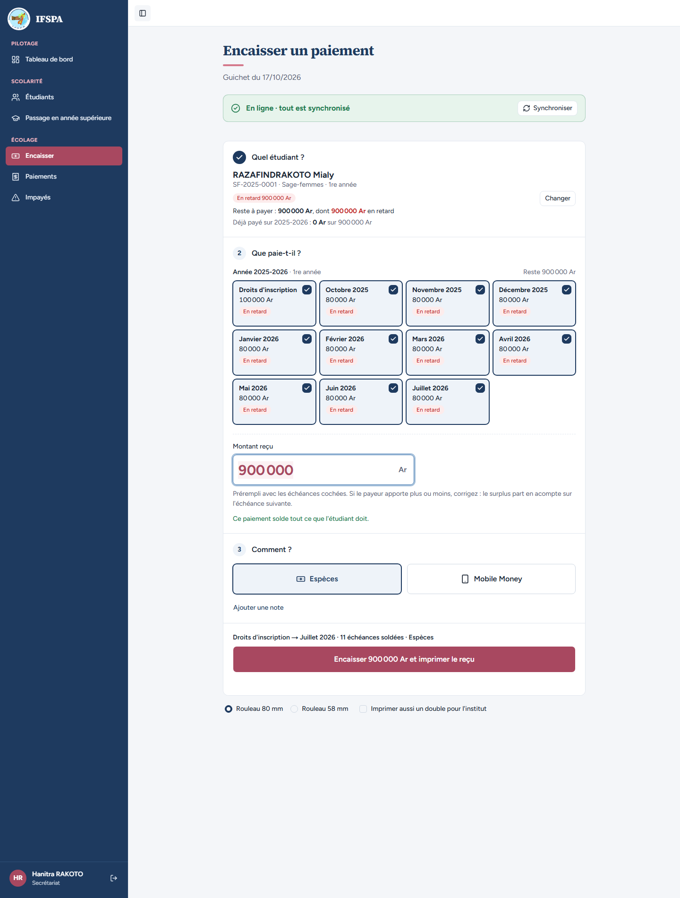
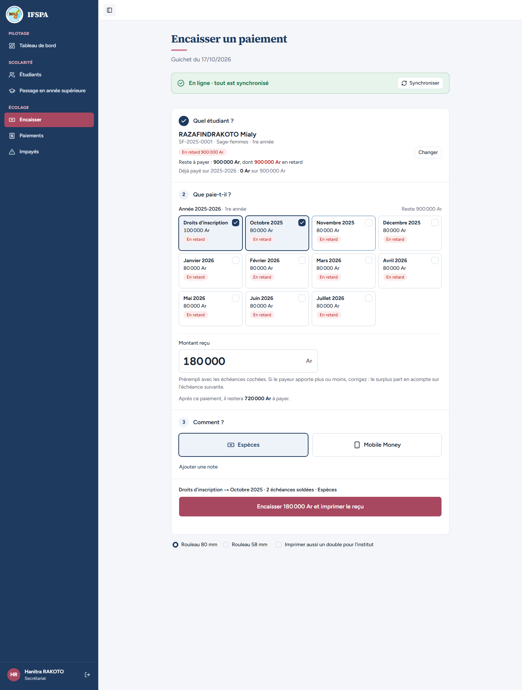
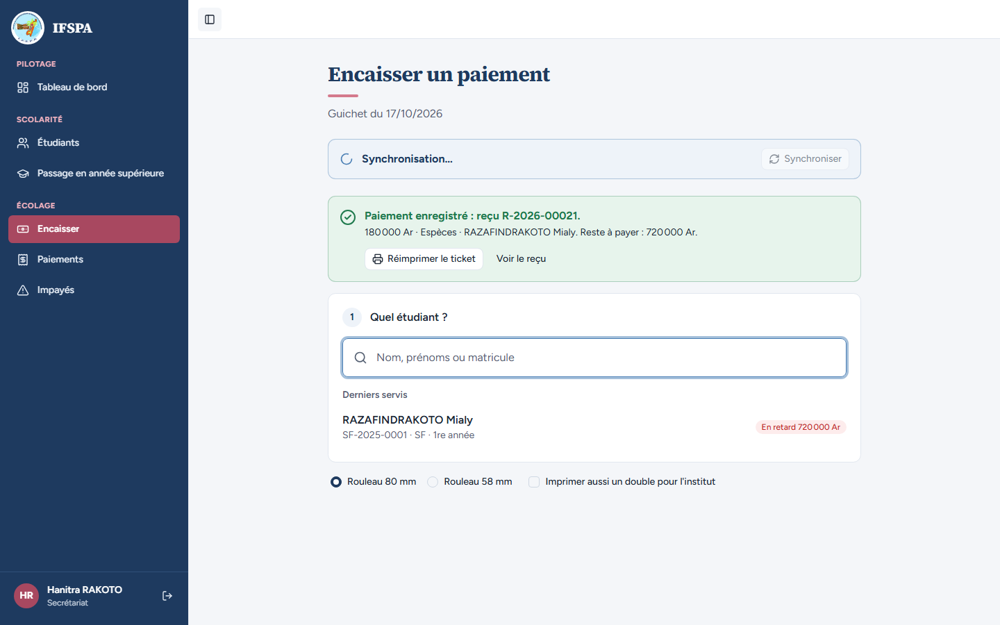
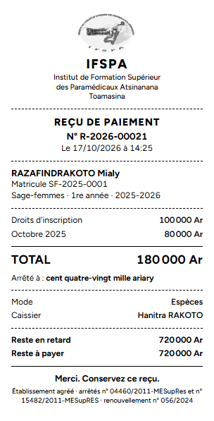
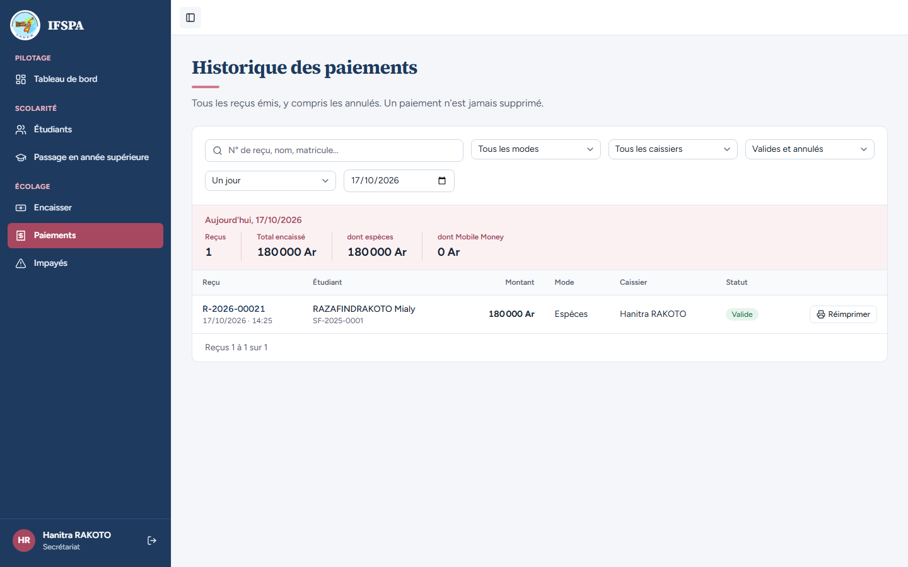
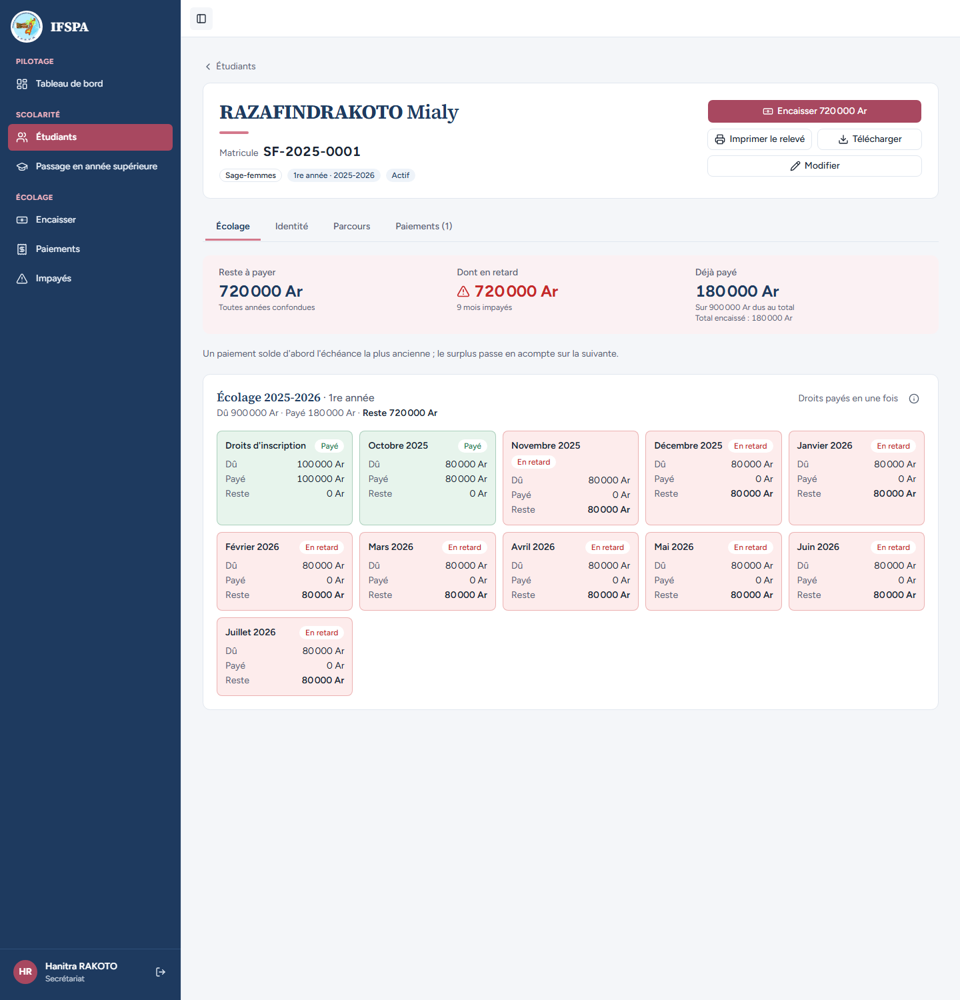

# UC06-01. La mère de Mialy RAZAFINDRAKOTO paie les droits et octobre en espèces

| | |
|---|---|
| Use case | UC06. Encaisser un parent au guichet |
| Règles couvertes | R-REP (de la plus ancienne à la plus récente), R-RET (retards cochés d'office), R-RECU (ticket 80 mm, n°, lettres, reste à payer), R-ROLE (le secrétariat encaisse) |
| Rôle | Secrétariat, compte « Hanitra RAKOTO » |
| Durée estimée | 8 minutes |

## La situation

Une mère se présente au guichet de l'institut avec des espèces pour sa fille Mialy, inscrite en Sage-femmes, 1re année. Elle veut payer les droits d'inscription et octobre. La secrétaire cherche l'étudiante, garde les deux premières échéances, encaisse, remet le ticket, et le reste dû de l'étudiante baisse d'autant.

## Avant de commencer

1. `pnpm recette:base`, `pnpm build`, `pnpm recette:app`, puis ouvrir `http://localhost:3200` dans Chrome ou Edge.
2. Avoir déroulé [00-PREPARATION.md](../00-PREPARATION.md), sections A, B, C **et D** (la section D sert aux cas 05 à 08 ; elle ne gêne pas ce cas).
3. Se connecter avec le compte **secrétariat** (identifiants `SEED_USER_*` de `.env`) ; « Hanitra RAKOTO » s'affiche en bas de la barre latérale.
4. Dérouler les cas UC06-01 à UC06-08 **dans l'ordre, dans le même navigateur** : les numéros de reçu en dépendent. Sur une base fraîche, le premier reçu en ligne est le **R-2026-00021** et non 00001 : l'écran Encaisser réserve 20 numéros pour le poste dès son ouverture (voir « Questions » du rapport).
5. Étudiante : RAZAFINDRAKOTO Mialy, **SF-2025-0001**, 900 000 Ar en retard (préparation, section B4).

## Étapes

| # | Qui | Action | Résultat attendu | Capture | ✓ |
|---|---|---|---|---|---|
| 1 | Secrétariat | Menu **Encaisser**. | Titre « Encaisser un paiement », « Guichet du JJ/MM/AAAA ». La recherche est prête à la saisie ; « Derniers servis » dit « Les étudiants que vous venez d'encaisser apparaîtront ici. Pour commencer, tapez un nom ou un matricule. » Bandeau vert « En ligne · tout est synchronisé ». |  | |
| 2 | Secrétariat | Taper `razafindrakoto` (minuscules). | « 1 étudiant trouvé » : **RAZAFINDRAKOTO Mialy**, SF-2025-0001 · SF · 1re année, badge « En retard 900 000 Ar ». |  | |
| 3 | Secrétariat | Appuyer sur Entrée. | « Reste à payer : **900 000 Ar**, dont 900 000 Ar en retard ». Les **11 échéances en retard sont cochées d'office** (Droits d'inscription, octobre 2025 à juillet 2026), « Montant reçu » **900 000**, « Ce paiement solde tout ce que l'étudiant doit. » |  | |
| 4 | Secrétariat | Cliquer la carte **Novembre 2025** pour ne garder que les deux premières. | « Montant reçu » **180 000** ; « Droits d'inscription → Octobre 2025 · 2 échéances soldées · Espèces » ; « Après ce paiement, il restera 720 000 Ar à payer. » ; bouton « Encaisser 180 000 Ar et imprimer le reçu ». |  | |
| 5 | Secrétariat | Cliquer **Encaisser 180 000 Ar et imprimer le reçu**. | Message vert « **Paiement enregistré : reçu R-2026-00021.** » avec « 180 000 Ar · Espèces · RAZAFINDRAKOTO Mialy. Reste à payer : 720 000 Ar. » et les boutons « Réimprimer le ticket » et « Voir le reçu ». Le navigateur lance l'impression. L'écran est remis à zéro : « Derniers servis » montre Mialy, « En retard 720 000 Ar ». |  | |
| 6 | Secrétariat | Regarder le ticket dans l'aperçu avant impression. | Ticket 80 mm, noir et blanc, sans QR code : logo, IFSPA, « REÇU DE PAIEMENT », **N° R-2026-00021**, Matricule SF-2025-0001, « Sage-femmes · 1re année · 2025-2026 », Droits d'inscription 100 000 Ar, Octobre 2025 80 000 Ar, **TOTAL 180 000 Ar**, « Arrêté à : cent quatre-vingt mille ariary », Mode Espèces, Caissier Hanitra RAKOTO, Reste en retard 720 000 Ar, Reste à payer 720 000 Ar. |  | |
| 7 | Secrétariat | Menu **Paiements**. | Aujourd'hui : Reçus 1, Total encaissé 180 000 Ar, dont espèces 180 000 Ar, dont Mobile Money 0 Ar. Ligne **R-2026-00021**, RAZAFINDRAKOTO Mialy, 180 000 Ar, Espèces, Hanitra RAKOTO, « Valide ». |  | |
| 8 | Secrétariat | Cliquer le nom de l'étudiante. | Fiche SF-2025-0001 : « Paiements (1) », Reste à payer 720 000 Ar, dont en retard 720 000 Ar (« 9 mois impayés »), déjà payé 180 000 Ar. « Droits d'inscription » et « Octobre 2025 » sont « Payé », les autres « En retard ». |  | |

## Ce que ce scénario ne couvre pas

- Refus serveur d'un montant invalide, session absente, idempotence (`idClient`) : couverts par Vitest, `tests/integration/actions-paiements.test.ts` (« deux mois d'un coup… », « refuse un montant nul… », « même idClient renvoyé deux fois… »).
- Impression sur l'imprimante thermique réelle : à faire par vous (voir le rapport).
- Téléphone au guichet : projet `mobile` non lancé.

## Dernière exécution par l'agent

- 17/10/2026 : ✅ 8 étapes sur 8. Voir [RAPPORT_2026-10-17_UC06](../../rapports/RAPPORT_2026-10-17_UC06.md).
- Parcours : [UC06-01-deux-mois-especes.recette.ts](../../parcours/UC06-01-deux-mois-especes.recette.ts).
