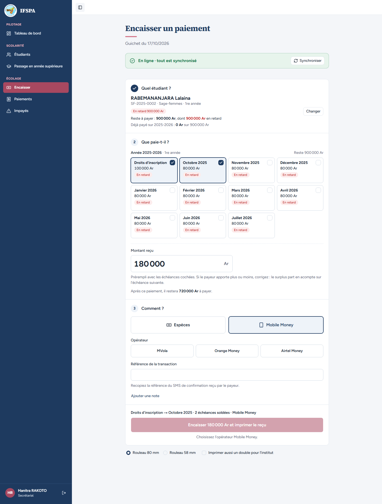
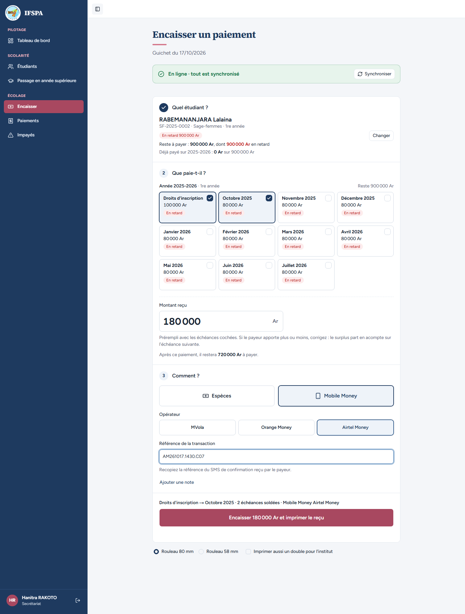
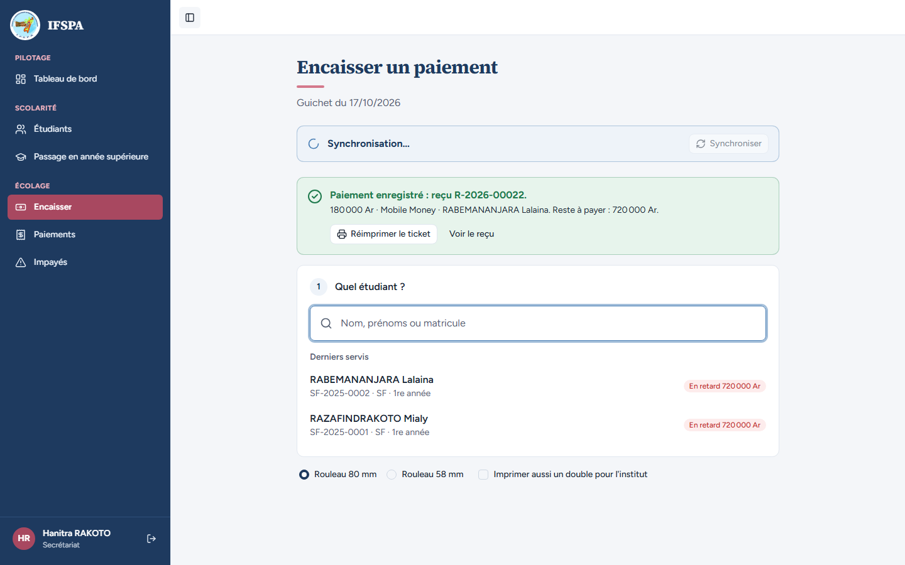
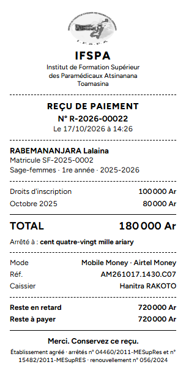
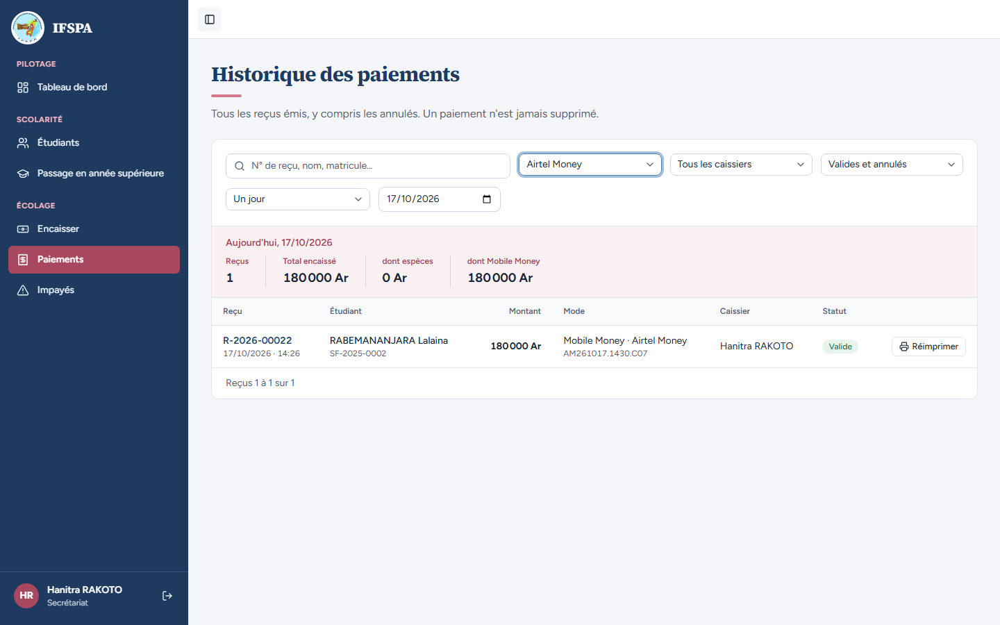

# UC06-02. Un parent paie les droits et octobre en Mobile Money (Airtel Money)

| | |
|---|---|
| Use case | UC06. Encaisser un parent au guichet |
| Règles couvertes | R-REP, R-RECU (mode, référence), refus de saisie Mobile Money incomplète |
| Rôle | Secrétariat, compte « Hanitra RAKOTO » |
| Durée estimée | 8 minutes |

## La situation

L'oncle de Lalaina RABEMANANJARA paie par Airtel Money et montre le SMS de confirmation. La secrétaire choisit Mobile Money : le bouton attend l'opérateur, puis la référence du SMS. Le ticket porte le mode et la référence, et la page Paiements permet de retrouver ce paiement par opérateur.

## Avant de commencer

- Mêmes préparatifs que [UC06-01](UC06-01-deux-mois-especes.md). Avoir déroulé UC06-01 : le reçu de ce cas est le **R-2026-00022**.
- Étudiante : RABEMANANJARA Lalaina, **SF-2025-0002**, 900 000 Ar en retard (préparation, section B5).

## Étapes

| # | Qui | Action | Résultat attendu | Capture | ✓ |
|---|---|---|---|---|---|
| 1 | Secrétariat | **Encaisser**, chercher `RABEMANANJARA`, Entrée, cliquer la carte **Novembre 2025**. | « Reste à payer : 900 000 Ar », « Montant reçu » **180 000**. | | |
| 2 | Secrétariat | Choisir **Mobile Money**. | Apparaissent les trois opérateurs MVola, Orange Money, Airtel Money et « Référence de la transaction ». Le bouton « Encaisser 180 000 Ar et imprimer le reçu » est grisé, avec « **Choisissez l'opérateur Mobile Money.** » dessous. |  | |
| 3 | Secrétariat | Choisir **Airtel Money**, puis saisir la référence `AM261017.1430.C07`. | Après l'opérateur : « Saisissez la référence de la transaction Mobile Money. », bouton toujours grisé. Après la référence : le bouton s'ouvre ; récapitulatif « Droits d'inscription → Octobre 2025 · 2 échéances soldées · Mobile Money Airtel Money ». |  | |
| 4 | Secrétariat | Cliquer **Encaisser 180 000 Ar et imprimer le reçu**. | « **Paiement enregistré : reçu R-2026-00022.** » avec « 180 000 Ar · Mobile Money · RABEMANANJARA Lalaina. Reste à payer : 720 000 Ar. » |  | |
| 5 | Secrétariat | Regarder le ticket dans l'aperçu avant impression. | N° R-2026-00022 ; Droits d'inscription 100 000 Ar, Octobre 2025 80 000 Ar ; TOTAL 180 000 Ar ; « Arrêté à : cent quatre-vingt mille ariary » ; **Mode « Mobile Money · Airtel Money »** ; **Réf. AM261017.1430.C07** ; Caissier Hanitra RAKOTO ; Reste à payer 720 000 Ar. |  | |
| 6 | Secrétariat | Menu **Paiements**, liste « Tous les modes », choisir **Airtel Money**. | Une seule ligne **R-2026-00022**, RABEMANANJARA Lalaina, 180 000 Ar, « Mobile Money · Airtel Money » avec la référence AM261017.1430.C07, « Valide ». Totaux : Reçus 1, dont espèces 0 Ar, dont Mobile Money 180 000 Ar. Le reçu R-2026-00021 d'espèces n'apparaît plus. |  | |

## Ce que ce scénario ne couvre pas

- MVola et Orange Money : même écran, non déroulés ici (MVola l'est dans UC13-02, hors ligne).
- Refus serveur d'un opérateur ou d'une référence manquants : couvert par Vitest, `tests/integration/actions-paiements.test.ts` (« étudiant inconnu… validations : opérateur et référence selon le mode », « Mobile Money : opérateur et référence enregistrés… »).

## Dernière exécution par l'agent

- 17/10/2026 : ✅ 6 étapes sur 6. Voir [RAPPORT_2026-10-17_UC06](../../rapports/RAPPORT_2026-10-17_UC06.md).
- Parcours : [UC06-02-mobile-money.recette.ts](../../parcours/UC06-02-mobile-money.recette.ts).
