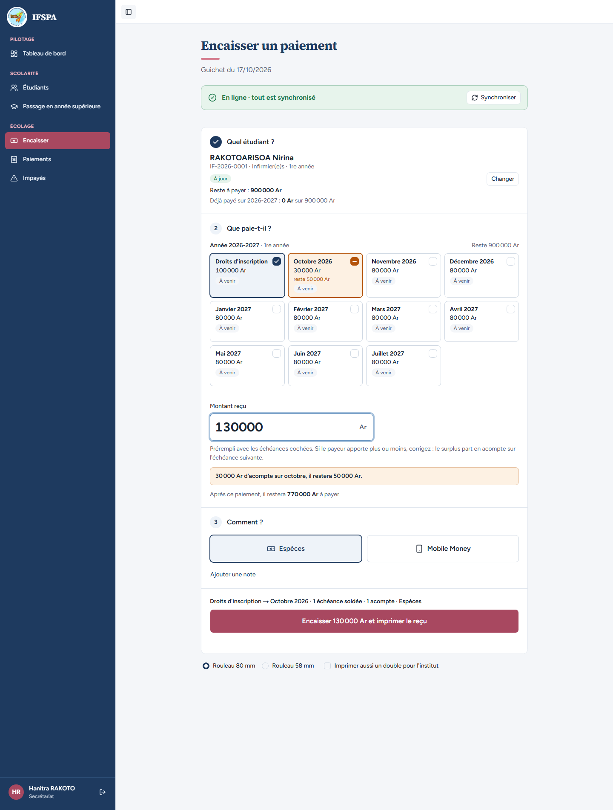
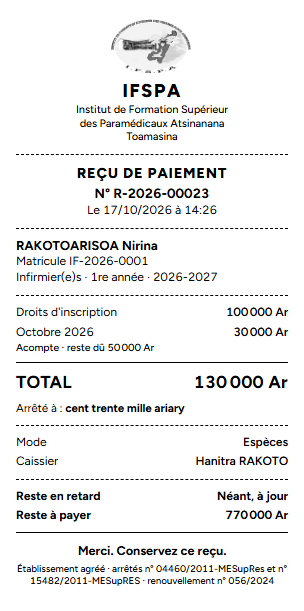
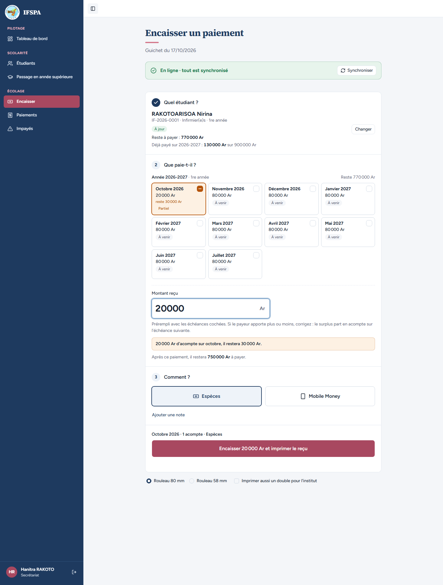
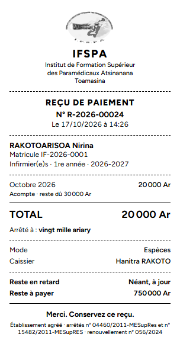
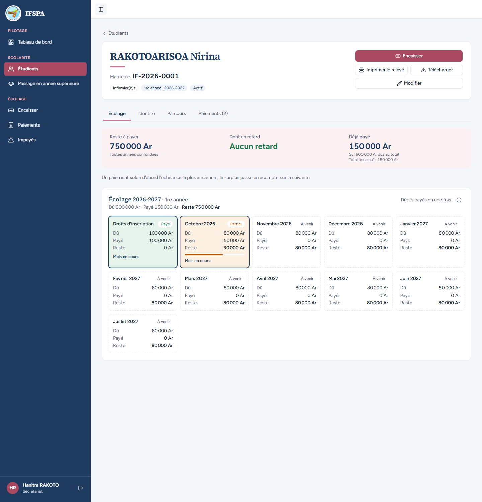

# UC06-03. Un parent apporte un montant libre : acompte sur le mois suivant, puis paiement en partie

| | |
|---|---|
| Use case | UC06. Encaisser un parent au guichet |
| Règles couvertes | R-PAR (surplus en acompte, montant inférieur paie en partie), R-RET (statut « Partiel », mois en cours non en retard), R-RECU (« Acompte · reste dû ») |
| Rôle | Secrétariat, compte « Hanitra RAKOTO » |
| Durée estimée | 10 minutes |

## La situation

Le père de Nirina RAKOTOARISOA, inscrit en 2026-2027 et à jour, apporte 130 000 Ar pour des droits de 100 000 Ar : « mettez le reste sur le mois suivant ». Plus tard, il revient avec seulement 20 000 Ar, moins que ce qui reste sur octobre. Dans les deux cas la secrétaire saisit le montant réel ; l'écran dit où il va et le ticket le précise.

## Avant de commencer

- Mêmes préparatifs que [UC06-01](UC06-01-deux-mois-especes.md). Avoir déroulé UC06-01 et 02 : les reçus de ce cas sont les **R-2026-00023** et **R-2026-00024**.
- Étudiant : RAKOTOARISOA Nirina, **IF-2026-0001**, rien en retard, 900 000 Ar à payer (préparation, section C2).

## Étapes

| # | Qui | Action | Résultat attendu | Capture | ✓ |
|---|---|---|---|---|---|
| 1 | Secrétariat | **Encaisser**, chercher `RAKOTOARISOA`, Entrée. | Badge « À jour », « Reste à payer : 900 000 Ar », « Déjà payé sur 2026-2027 : 0 Ar sur 900 000 Ar ». **Aucune échéance cochée**, « Montant reçu » vide, « Cochez une échéance ou saisissez le montant reçu. » | | |
| 2 | Secrétariat | Dans « Montant reçu », saisir `130000`. | « Droits d'inscription » coché ; **Octobre 2026** à moitié coché (carte orange, « 30 000 Ar », « reste 50 000 Ar »). Encadré orange « **30 000 Ar d'acompte sur octobre, il restera 50 000 Ar.** » ; « Après ce paiement, il restera 770 000 Ar à payer. » ; récapitulatif « Droits d'inscription → Octobre 2026 · 1 échéance soldée · 1 acompte · Espèces ». |  | |
| 3 | Secrétariat | Cliquer **Encaisser 130 000 Ar et imprimer le reçu**, regarder le ticket. | « Paiement enregistré : reçu **R-2026-00023**. » Ticket : Droits d'inscription 100 000 Ar ; Octobre 2026 30 000 Ar avec **« Acompte · reste dû 50 000 Ar »** ; TOTAL 130 000 Ar ; « Arrêté à : cent trente mille ariary » ; Reste en retard « Néant, à jour » ; Reste à payer 770 000 Ar. |  | |
| 4 | Secrétariat | Chercher de nouveau `RAKOTOARISOA`, Entrée, puis saisir `20000`. | « Reste à payer : 770 000 Ar », « Déjà payé sur 2026-2027 : 130 000 Ar ». La carte Octobre 2026 (« déjà 30 000 Ar » avant la saisie) passe à moitié cochée : « 20 000 Ar », « reste 30 000 Ar », « Partiel ». Encadré « 20 000 Ar d'acompte sur octobre, il restera 30 000 Ar. » ; « Après ce paiement, il restera 750 000 Ar à payer. » ; récapitulatif « Octobre 2026 · 1 acompte · Espèces ». |  | |
| 5 | Secrétariat | Cliquer **Encaisser 20 000 Ar et imprimer le reçu**, regarder le ticket. | « Paiement enregistré : reçu **R-2026-00024**. » Ticket : Octobre 2026 20 000 Ar avec « Acompte · reste dû 30 000 Ar » ; TOTAL 20 000 Ar ; « Arrêté à : vingt mille ariary » ; Reste à payer 750 000 Ar. |  | |
| 6 | Secrétariat | **Paiements**, cliquer le nom **RAKOTOARISOA Nirina**. | Fiche IF-2026-0001 : « Paiements (2) », Reste à payer 750 000 Ar, **Aucun retard**, déjà payé 150 000 Ar. « Droits d'inscription » **Payé** ; « Octobre 2026 » **Partiel** (payé 50 000 Ar, reste 30 000 Ar, barre de progression, « Mois en cours »). |  | |

## Ce que ce scénario ne couvre pas

- Passage de « Partiel » à « En retard » au 1er du mois suivant : dépend de la date du jour, couvert par Vitest, `tests/integration/actions-paiements.test.ts` (« une tranche de droits payée en partie : partielle avant le 1er novembre, en retard ensuite »).
- Répartition d'un surplus à cheval sur deux années : voir UC06-06 et Vitest (« couvre deux années… »).

## Dernière exécution par l'agent

- 17/10/2026 : ✅ 6 étapes sur 6. Voir [RAPPORT_2026-10-17_UC06](../../rapports/RAPPORT_2026-10-17_UC06.md).
- Parcours : [UC06-03-partiel-acompte.recette.ts](../../parcours/UC06-03-partiel-acompte.recette.ts).
