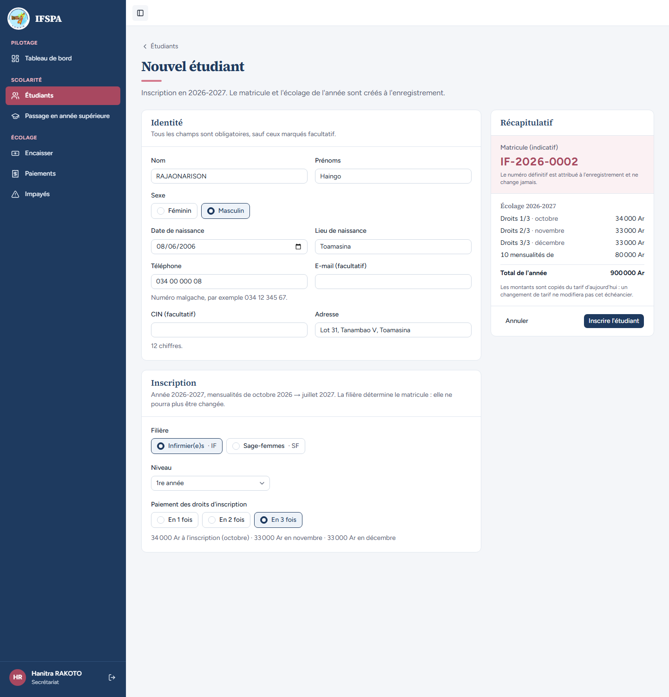
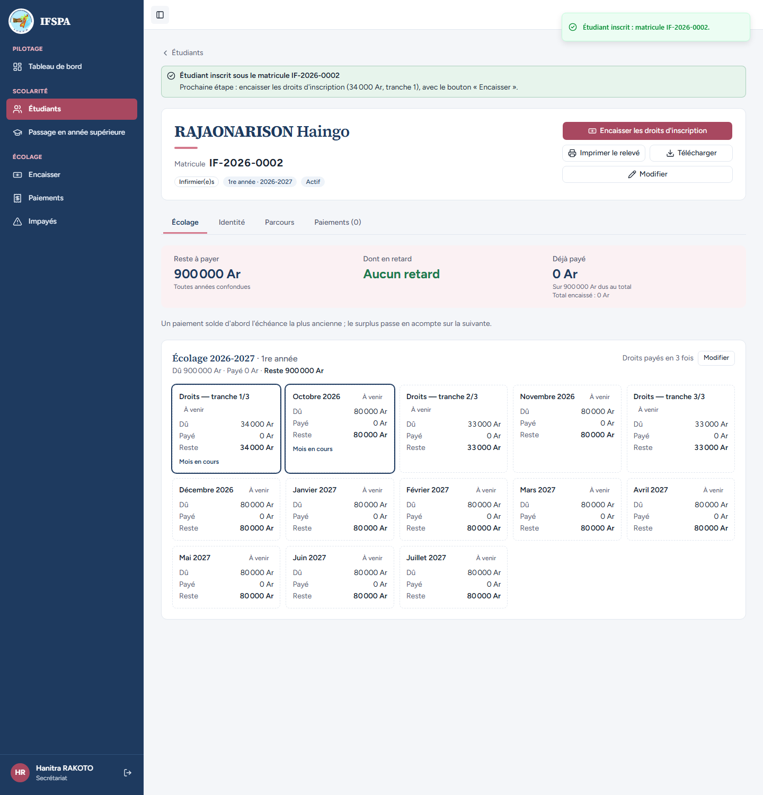
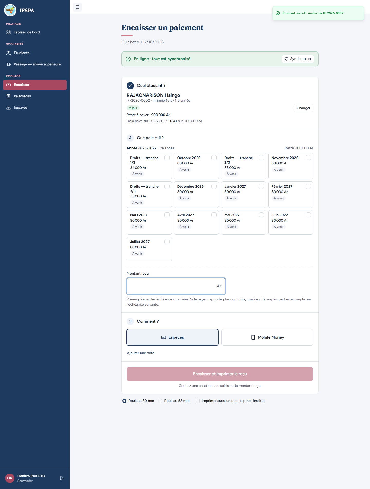
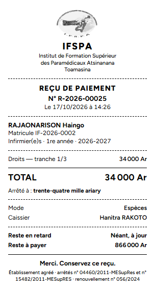
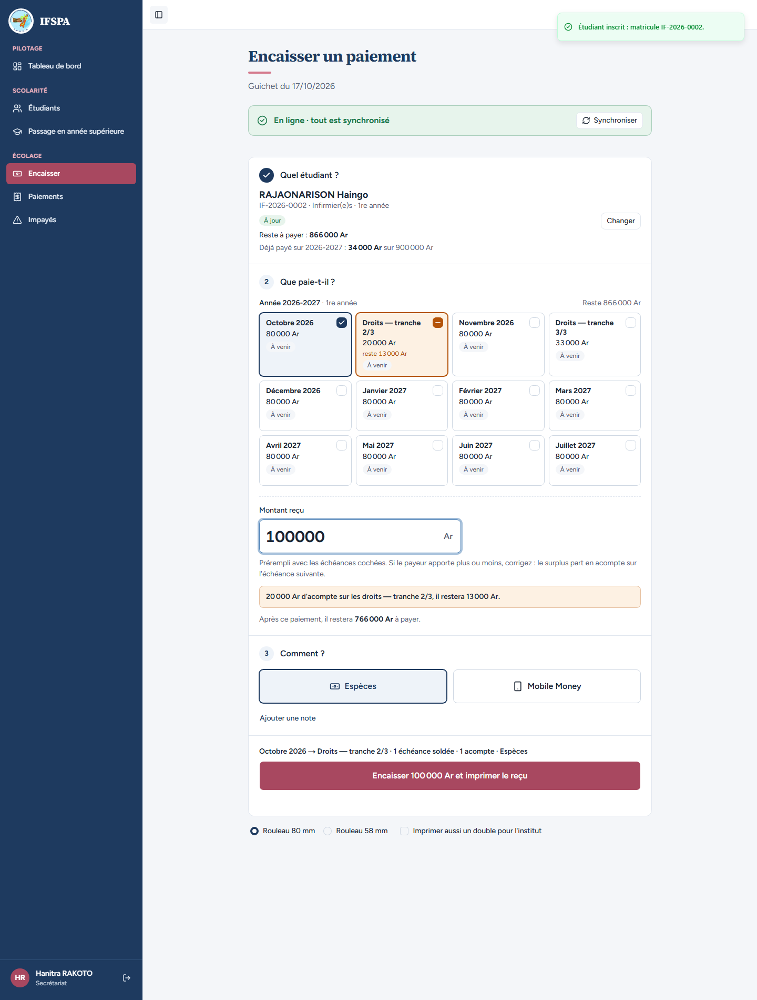
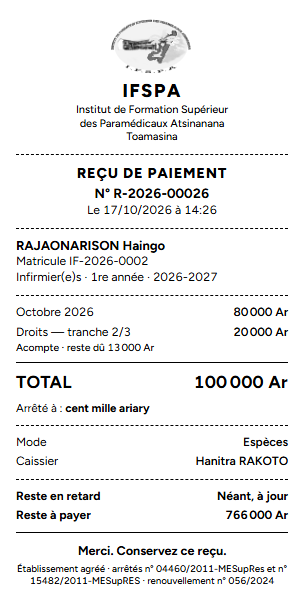
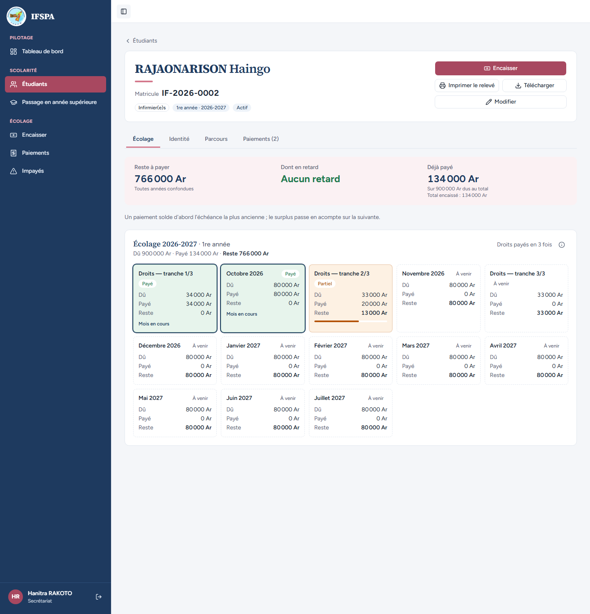

# UC06-04. Un nouvel étudiant paie ses droits d'inscription en trois tranches

| | |
|---|---|
| Use case | UC06. Encaisser un parent au guichet (et UC04 pour l'inscription) |
| Règles couvertes | R-TRA (droits en 3 tranches, parts arrondies au millier, le reste sur la 1re), R-MAT (matricule suivant), R-ECH, R-REP (la tranche 2 passe après octobre), R-PAR (tranche payée en partie) |
| Rôle | Secrétariat, compte « Hanitra RAKOTO » |
| Durée estimée | 12 minutes |

## La situation

Un nouveau père inscrit son fils Haingo RAJAONARISON en Infirmier(e)s, 1re année, et choisit de payer les droits en trois fois. La secrétaire l'inscrit (« En 3 fois »), puis encaisse depuis la fiche : d'abord la première tranche. Plus tard le père apporte 100 000 Ar : octobre est soldé, le surplus part en acompte sur la deuxième tranche.

## Avant de commencer

- Mêmes préparatifs que [UC06-01](UC06-01-deux-mois-especes.md). Avoir déroulé UC06-01 à 03 : les reçus de ce cas sont les **R-2026-00025** et **R-2026-00026**.
- Cet étudiant n'est pas dans la préparation : ce cas l'inscrit (matricule attendu **IF-2026-0002**, après RAKOTOARISOA Nirina IF-2026-0001).

## Étapes

| # | Qui | Action | Résultat attendu | Capture | ✓ |
|---|---|---|---|---|---|
| 1 | Secrétariat | Menu **Étudiants**, **Nouvel étudiant**. Nom `RAJAONARISON`, Prénoms `Haingo`, Masculin, naissance 08/06/2006, Toamasina, téléphone `034 00 000 08`, adresse `Lot 31, Tanambao V, Toamasina`, filière **Infirmier(e)s · IF**, 1re année, **En 3 fois**. | Matricule indicatif **IF-2026-0002**. Sous les boutons : « 34 000 Ar à l'inscription (octobre) · 33 000 Ar en novembre · 33 000 Ar en décembre. » Récapitulatif : Droits 1/3 · octobre 34 000 Ar, Droits 2/3 · novembre 33 000 Ar, Droits 3/3 · décembre 33 000 Ar, 10 mensualités de 80 000 Ar, Total de l'année 900 000 Ar. |  | |
| 2 | Secrétariat | Cliquer **Inscrire l'étudiant**. | La fiche s'ouvre : « Étudiant inscrit sous le matricule IF-2026-0002 », « Prochaine étape : encaisser les droits d'inscription (34 000 Ar, tranche 1) ». « Droits payés en 3 fois ». Échéances dans l'ordre : Droits — tranche 1/3 (34 000 Ar), Octobre 2026, Droits — tranche 2/3 (33 000 Ar), Novembre 2026, Droits — tranche 3/3 (33 000 Ar), Décembre 2026… |  | |
| 3 | Secrétariat | Cliquer **Encaisser les droits d'inscription**. | Le guichet s'ouvre sur l'étudiant, le champ « Montant reçu » a le focus. Cartes dans l'ordre : « Droits — tranche 1/3 », « Octobre 2026 », « Droits — tranche 2/3 », « Novembre 2026 », « Droits — tranche 3/3 », « Décembre 2026 »… ; rien n'est coché (tout est « À venir »). |  | |
| 4 | Secrétariat | Cliquer la carte **Droits — tranche 1/3**, puis **Encaisser 34 000 Ar et imprimer le reçu**. | « Montant reçu » **34 000**. « Paiement enregistré : reçu **R-2026-00025**. » Ticket : « Droits — tranche 1/3 » 34 000 Ar, TOTAL 34 000 Ar, « Arrêté à : trente-quatre mille ariary ». |  | |
| 5 | Secrétariat | Chercher `RAJAONARISON`, Entrée, saisir `100000`. | Encadré « **20 000 Ar d'acompte sur les droits — tranche 2/3, il restera 13 000 Ar.** » (octobre, plus ancien, est soldé d'abord : 80 000 Ar, puis 20 000 Ar sur la tranche 2/3). |  | |
| 6 | Secrétariat | Cliquer **Encaisser 100 000 Ar et imprimer le reçu**, regarder le ticket. | « Paiement enregistré : reçu **R-2026-00026**. » Ticket : Octobre 2026 80 000 Ar ; Droits — tranche 2/3 20 000 Ar avec « Acompte · reste dû 13 000 Ar » ; TOTAL 100 000 Ar ; « Arrêté à : cent mille ariary » ; Reste en retard « Néant, à jour » ; Reste à payer 766 000 Ar. |  | |
| 7 | Secrétariat | **Paiements**, cliquer le nom **RAJAONARISON Haingo**. | Fiche IF-2026-0002 : « Droits payés en 3 fois », « Paiements (2) », Reste à payer 766 000 Ar, Aucun retard, déjà payé 134 000 Ar. Tranche 1/3 **Payé**, Octobre 2026 **Payé**, tranche 2/3 **Partiel** (payé 20 000 Ar, reste 13 000 Ar), tranche 3/3 « À venir ». |  | |

## Ce que ce scénario ne couvre pas

- Le découpage « En 2 fois » et le changement de découpage depuis la fiche (« Modifier », possible tant que rien n'est payé) : non déroulés.
- Refus d'un découpage impossible, tarif manquant, doublon : relèvent du scénario UC04 (à écrire).
- Une tranche ne se paie jamais avant un mois plus ancien non soldé : c'est la règle de répartition (R-REP), vue à l'étape 5.

## Dernière exécution par l'agent

- 17/10/2026 : ✅ 7 étapes sur 7. Voir [RAPPORT_2026-10-17_UC06](../../rapports/RAPPORT_2026-10-17_UC06.md).
- Parcours : [UC06-04-droits-en-tranches.recette.ts](../../parcours/UC06-04-droits-en-tranches.recette.ts).
