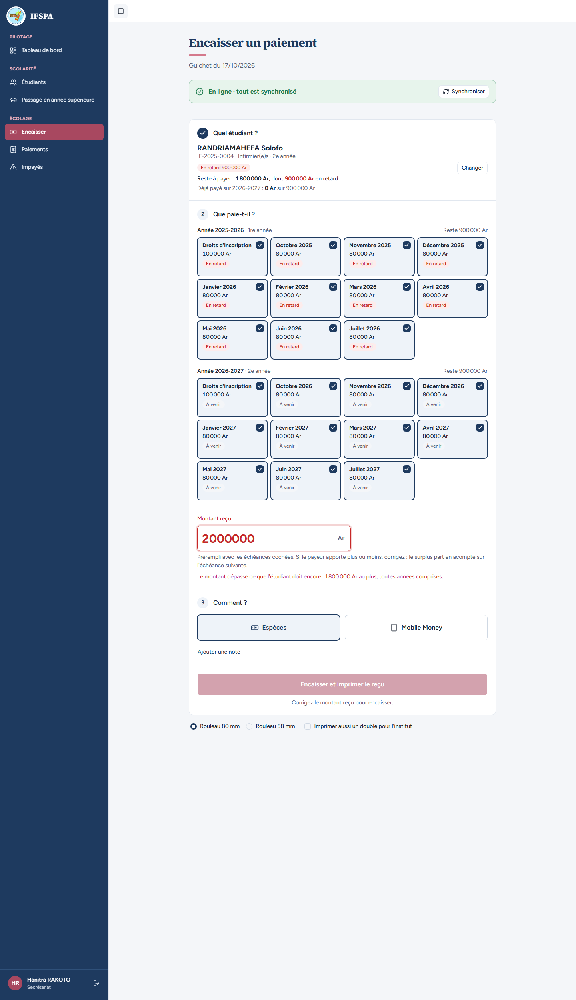
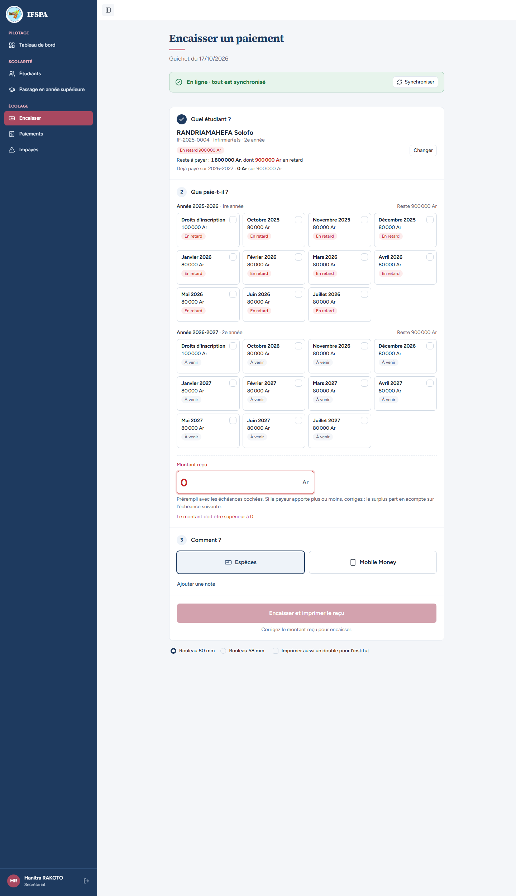
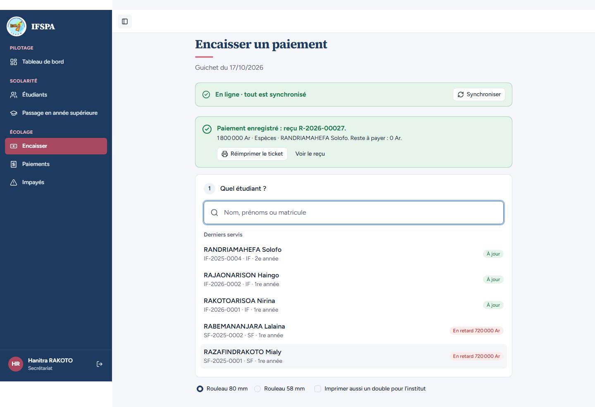

# UC06-05. Un montant au-delà de ce que l'étudiant doit, ou nul, est refusé au guichet

| | |
|---|---|
| Use case | UC06. Encaisser un parent au guichet |
| Règles couvertes | R-TROP (refus au-delà du reste dû total, toutes années ; montant nul refusé ; reste dû exact accepté) |
| Rôle | Secrétariat, compte « Hanitra RAKOTO » |
| Durée estimée | 6 minutes |

## La situation

Un étudiant de 2e année doit encore 1 800 000 Ar sur deux années. Son oncle compte ses billets et la secrétaire tape 2 000 000 Ar : l'écran refuse et dit combien l'étudiant doit au plus. Un zéro saisi par erreur est refusé aussi. Rien n'est enregistré ni imprimé. Quand elle tape le montant exact, 1 800 000 Ar, le paiement passe et solde tout.

## Avant de commencer

- Mêmes préparatifs que [UC06-01](UC06-01-deux-mois-especes.md). Avoir déroulé UC06-01 à 04 : le reçu de ce cas est le **R-2026-00027**.
- Étudiant : RANDRIAMAHEFA Solofo, **IF-2025-0004**, 1 800 000 Ar dus sur 2025-2026 et 2026-2027 (préparation, sections B6 et D).

## Étapes

| # | Qui | Action | Résultat attendu | Capture | ✓ |
|---|---|---|---|---|---|
| 1 | Secrétariat | **Encaisser**, chercher `RANDRIAMAHEFA`, Entrée. | « IF-2025-0004 · Infirmier(e)s · 2e année », badge « En retard 900 000 Ar », « Reste à payer : **1 800 000 Ar**, dont 900 000 Ar en retard ». | | |
| 2 | Secrétariat | Dans « Montant reçu », saisir `2000000`. | Champ en rouge ; message « **Le montant dépasse ce que l'étudiant doit encore : 1 800 000 Ar au plus, toutes années comprises.** » ; le bouton « Encaisser et imprimer le reçu » est grisé, avec « Corrigez le montant reçu pour encaisser. » dessous. |  | |
| 3 | Secrétariat | Remplacer par `0`. | Champ en rouge ; message « **Le montant doit être supérieur à 0.** » ; bouton grisé. |  | |
| 4 | Secrétariat | Regarder l'écran et l'imprimante. | Aucun message « Paiement enregistré », aucune impression lancée. | | |
| 5 | Secrétariat | Saisir `1800000` (le reste dû exact), cliquer **Encaisser 1 800 000 Ar et imprimer le reçu**. | Avant le clic : « Ce paiement solde tout ce que l'étudiant doit. » Puis « Paiement enregistré : reçu **R-2026-00027**. » avec « 1 800 000 Ar · Espèces · RANDRIAMAHEFA Solofo. Reste à payer : 0 Ar. » ; dans « Derniers servis », Solofo est « À jour ». |  | |

## Ce que ce scénario ne couvre pas

- Le refus **côté serveur** (appel direct à l'action avec un montant trop grand, nul, décimal) : couvert par Vitest, `tests/integration/actions-paiements.test.ts` (« refuse un trop-perçu au-delà du reste dû total, et le paiement exact du reste est accepté », « refuse un montant nul, négatif, décimal ou illisible »). Non démontrable dans le navigateur.
- Un montant avec décimales ou du texte : non déroulé à l'écran.

## Dernière exécution par l'agent

- 17/10/2026 : ✅ 5 étapes sur 5. Voir [RAPPORT_2026-10-17_UC06](../../rapports/RAPPORT_2026-10-17_UC06.md).
- Parcours : [UC06-05-refus-trop-percu.recette.ts](../../parcours/UC06-05-refus-trop-percu.recette.ts).
